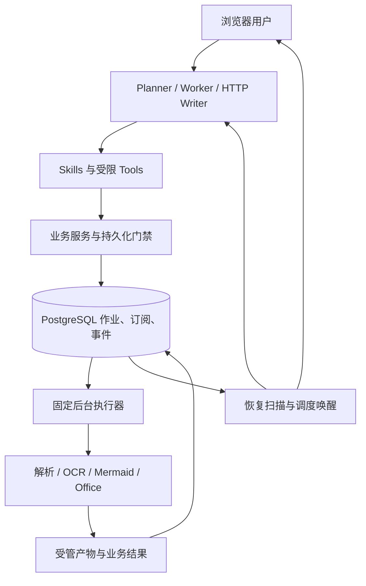

# Agent 工具 Skills 与开源运行组件实施计划

编制日期：2026-11-02；三轮核对：2026-11-03

状态：六轮修订版（2026-11-03）。用户确认的决策如下，依据见 12.5 的本机对比验证：

- **不做目标部署**：运行、开发、测试与验收都以本机为准（Windows 11 Pro、本机 WPS 12.1 与 Word 2021），不准备 Windows Server 目标机，也不打安装包。
- 导出只兼容 WPS 与 Word，WPS 优先。
- 原导出引擎已从代码、配置、文档与本地文件中彻底移除。

实施进度：

- **S1 已 E 收口（2026-11-03，本机验证，见第 9 节与 12.5）**：
  - 文档引擎替换，见 6.1。
  - Mermaid-CLI 11.17.0 按固定版本清单安装在 `tools/mermaid-cli`，使用本机 Chrome。
  - 运行能力：`toolhealth` 注册表、`GET /api/runtime/tools`，以及常驻只读工具 `tool_runtime_status`（Planner `ExtraTools` 与 Worker 均装配）。
  - 文档引擎、mmdc、OCR、embedding、reranker 启动时用固定样本实际自检。
  - 前端：项目顶栏的运行能力入口，以及上传与导出入口的能力提示。
  - 本机依赖登记见 [`docs/LOCAL_RUNTIME.md`](docs/LOCAL_RUNTIME.md)。
- **S2 已 E 收口（2026-11-03，本机验证，见第 9 节与 12.6）**：
  - 持久化订阅与终态事件：`agent_job_subscriptions` / `agent_job_events`，作业终态由 `fixed_file_jobs`、`export_jobs` 上的触发器在作业自身事务内发布。
  - 回合状态机：`db/agent_jobs.go` 的 `SubscribeAgentJob`（同事务校验宿主 Intent 活租约）、`TakeAgentJobEvent`、`FinalizeIntentTurn`（原子收尾 open / blocked+waiting_job / done / blocked）、`WakeWaitingIntents`（唤醒协调）、`SettleWaitingIntents`。
  - 引擎接线：`runIntent` 投递事件并只确认已保存进 transcript 的事件；Watchdog Stop 与 RequireWriteback 的“持久化订阅释放本轮槽位”分支；等待态不通知 Planner 已结束。
  - 公共只读工具 `agent_job_status`（Planner `ExtraTools` 与 Worker 均装配）、`GET /api/tasks/{id}/agent-jobs`，执行页“等待后台处理”与后台作业卡片。
  - S2 只交付框架，没有注册任何提交类工具；测试作业直接写固定解析 / 导出队列表来驱动框架。
- **S3 已 E 收口（2026-11-04，本机验证，见第 9 节与 12.7）**：
  - 持久化图表渲染作业 `chart_render_jobs`（复合外键 → `proposal_charts`，请求幂等、执行版本与期限首次提交固定、终态不可改写），`chart_render` 加入订阅类型，新增 `superseded` 终态。
  - 存储与执行：`db/chart_jobs.go`（提交 / 领取 / 心跳 / 写回 / 取消，暂停退回 queued 并推进令牌）、`export/chart_jobs.go`（服务层校验与规范化请求哈希、`ChartRunner` 事务外渲染并按作业 + 令牌隔离产物）。
  - 两条写作路径：Worker 经新技能 `diagram-generation`（`chart_render_submit` / `chart_render_status` / `chart_render_cancel`）提交并订阅；HTTP 章节 Writer 草稿的 `charts` 计划与修订在同一事务登记。
  - HTTP `/api/tasks/{id}/chart-jobs*`；前端章节图表卡片改为异步生成、取消、重试与旧修订分组。
- **S4 已 E 收口（2026-11-04，本机验证，见第 9 节与 12.8）**：
  - 导出请求组 `export_requests`（请求键全生命周期幂等、`snapshot_hash` 首次冻结、请求组与全部格式作业 / 订阅同事务创建）；`export_jobs` 增加请求组外键、`strict_runtime`、执行版本、首次提交固定的截止时间、错误码、实际文档引擎与 `cancelled` 终态。
  - 显式版本化导出策略：最终稿 `export-final/v1`（文档引擎真实刷新目录、图表须已渲染、产物回读目录 / 图片 / 表格，引擎不可用拒绝而不降级），预览稿 `export-preview/v1` 保持旧行为且只能是 `preview_only`。
  - 取消、暂停、截止与尝试预算围栏：`db/export_requests.go`、`db/exports.go`、`export/export_jobs.go`、`export/exec.go`、`export/runner.go`。
  - 新技能 `proposal-export`（`proposal_export_check` / `submit` / `status` / `cancel`），`proposal_export_check` 同时装配给 Planner；Agent 提交须服务器授予任务导出能力（`AUTOBID_AGENT_EXPORT_ENABLED`，默认关闭，R2 可信身份完成前保持关闭）。
  - HTTP `request_key` / `mode` / `expected_outline_version`、`/exports/{jobID}/cancel` 与 `/export-requests*`；导出页按请求组展示最终稿 / 预览稿、逐格式状态、取消与下载。
- **S5a 已 E 收口（2026-11-04，本机验证，见第 9 节与 12.9）**：
  - 解析候选模式：`file_processing_records` 增加 `candidate_only`、`parser_profile`、`parser_version` 与 `rejected` 状态（拒绝人 / 原因 / 时间），候选输入与 payload 不可改写；`fixed_file_jobs` 增加首次提交固定的 `executor`、`error_code`、`retry_after`，终态不可改写。
  - 解析路由与执行版本锁定（`filework/route.go`）：auto / native / ocr_only，enhanced_pdf 未交付；OCR 版本变化以 `RUNTIME_UNAVAILABLE` 失败，OCR 暂时不可达在原期限与尝试预算内重试。
  - 人工采用 import 候选（同事务 `PersistTender`）、拒绝候选、导入候选不推进 `source_epoch` 而采用后推进；结构化缺口与逐行 OCR 原件定位。
  - 新技能 `document-processing`（`document_parse_submit` / `status` / `result` / `cancel`），只开放 `source_kind=tender_file`，强制候选模式并同事务订阅当前意图；宿主范围新增 `allowed_file_ids`。
  - 本机 PaddleOCR 3.7.0 服务（`tools/paddleocr`），HTTP 协议增加请求 ID、内容哈希与执行版本；`/file-processing-records/{id}/reject` 与材料处理页的候选核对、采用、拒绝和作业控制。
- **尚未实施**：S5b、S5c、S6、S7。没有 `deploy/` 目录。本文依赖的 R1 代码（`section_write_jobs`、`intent_inputs/outputs/completion`、`execution_scope`）已随提交 `b22a30c` 入库，但 R1/R2 尚未 E 收口（见[可靠性计划](docs/RELIABILITY_PLAN.md)）。S0 文档核对已完成，可启动首版工程实现。分域候选扩展、并发与业务效果的不确定项见第 12 节。

适用项目：AutoBid Engine。本文中的 Skill 指项目提供给 Agent 的业务技能（`bidtools.Skills()`），不是 Codex 桌面插件。

## 1. 实施目标与范围

将文档处理、知识检索、图表生成、标书合稿封装为 Agent 可按需调用的 Skills 与 Tools，并将所需开源程序、运行时、模型和字体纳入本机运行环境。

用户侧目标：企业业务人员使用浏览器即可上传资料、查看处理结果、编辑章节和下载标书，无需逐项安装 Python、OCR、Mermaid-CLI 或办公软件。

运行环境就是本机：WPS（优先）或 Word，以及本计划用到的运行组件（mmdc、OCR 等）都装在本机，由本机上的服务调用。“免安装”指通过浏览器使用的业务人员无需另装软件，不代表运行依赖消失。

本计划交付：

1. 四类技能的使用规则、工具契约、宿主授权及真实执行入口。
2. 开源运行组件与 WPS/Word 文档引擎在本机的安装、版本登记与功能自检。
3. 耗时作业提交、查询、取消、幂等恢复及 Agent 后续处理机制。
4. 与既有解析采用、证据核验、章节修订、审批和导出快照的连接。
5. 工程回归、故障演练、部署验收和业务评测记录。

本计划不重建 Planner/Worker 框架，不引入 LangChain/Dify、独立向量数据库或通用脚本执行器，不开放 Agent 安装软件、执行任意 Shell、选择任意服务地址或访问宿主路径。原有 F2 脚本 Runner 仍受自身启动关口约束。

**运行与验收环境以本机为准**（2026-11-03 用户确认），不做目标部署：

- 运行组件是本机进程或仅监听本机的 HTTP 服务，不依赖 Docker/WSL2，不打安装包。
- 导出只使用 WPS / Word 文档引擎，不使用其他转换器。

与既有计划的关系：

- [ROADMAP.md](ROADMAP.md)：继续采用 E（工程实现）、V（外部验证）、P（生产启用）分级。
- [CLAUDE.md](CLAUDE.md)：遵守数据域、迁移、审批、检索与验证约束。
- [可靠性计划](docs/RELIABILITY_PLAN.md)：复用 R1 作业机制；R2 可信身份和显式质量策略是开放高影响工具的前置条件。本文不是对 R2/R3/R4 的完成声明。
- [文件处理计划](docs/file-processing/PLAN.md)：复用 F1/F3a/F3a+ 固定文件处理，固定 OCR/解析服务不等同于开放 F2。
- [检索工程边界](eval/retrieval/README.md)：索引版本、证据核验与模型评测要求保持有效。
- ROADMAP 原先延后的 mmdc 适配，在本计划 S3 中列为拟实施项；通过验收后再同步其状态。

## 2. 当前代码基线与实施落点

以下以本次工作区代码为准，不把接口存在等同于真实依赖已验证。

| 能力 | 已有实现 | 实施差集 |
| --- | --- | --- |
| Skills / Tools | `bidtools/skills.go` 有 **6** 个 Skill；`agent/worker.go` 经 `Skill` 解锁、`SearchExtraTools` 获取 Schema；`server/task_llm.go:LLMService.Resolve` 装配 Worker；Planner 尚未挂载业务工具 | 新增 3 个 Skill，复用 knowledge-reuse；Planner 只读注入、宿主授权 |
| 文档 | `filework.Processor.process` 首次导入直接 PersistTender；reparse 将完整 PreparedTender 存入 FileProcessingRecord.Payload，Preview 仅为差异摘要；Adopt 目前只支持 reparse；固定队列已有幂等/租约/取消 | Agent 首次导入候选模式、人工采用 import 分支、解析后端与结果分页（**S5a 已实现**：`filework/route.go`、`agent.go`、`candidate.go`、`bidtools/document_jobs.go`，见 12.9） |
| 检索 | `retrieval/providers.go`、版本化索引、核验与 knowledge-reuse 已有 | 健康探测、版本回显与可选模型部署，不重写协议 |
| 图表 | `export.BuildChartSource` 支持 architecture/gantt/org/equipment_table；`export.Renderer.RenderPNG` 与 `export.MMDC`；proposal_charts 已有 source_hash、pending、修订绑定、产物路径/哈希 | 期望修订围栏、持久化渲染作业、幂等取消、结构化图表计划（**S3 已实现**：`db/chart_jobs.go`、`export/chart_jobs.go`，见 12.7） |
| 导出 | `db.CreateExportJobs` 冻结快照；**CompleteExportJob、FailExportJob、Heartbeat 已检查 lease_token + running**；export/runner.go 异步执行 | 全生命周期请求幂等、cancelled、严格最终稿策略与完成通知；复用已有围栏，没有 FinishExportJob 这个待修补接口（**S4 已实现**：`db/export_requests.go`、`export/export_jobs.go`，见 12.8） |
| 导出引擎 | **2026-11-03 已实现**：`export.Service.Office` 是文档引擎接口（`export/office.go`，含按 `AUTOBID_OFFICE_ENGINE` 探测与启动自检），实现为 WPS/Word COM 自动化（`office_windows.go` + `office_com.ps1`）；`Execute` 在引擎为 nil 时 PDF 永久失败，DOCX 只写 updateFields 占位；`/api/export/status` 返回 `office_engine` / `office_version` | 作业结果记录引擎名与版本（**S4 已实现**：`export_jobs.office_engine` / `office_version`）；多作业排队已在 S1 验证（引擎固定串行） |
| HTTP 章节 Writer | `server/proposal.go:llmSectionWriter.WriteSection` 已调用 harness.Run（最多 6 轮工具调用，再解析 JSON）；SectionWriterTools 包含证据绑定，非纯只读；`server/section_jobs.go:executeSectionJob` 调 FinishSectionWriteJob 原子保存修订/结果 | 增加图表计划，并在修订提交事务内登记渲染作业；不改回单次 LLM 调用 |
| Intent | intent_completion.go 校验产物；intent_inputs.go 持久化 Hint；runIntent 正常回合校验后 ACK；终态触发器和函数尾部均退回 Hint | 持久化作业事件、原子回合收尾与等待恢复、Hint 等待态兼容（**S2 已实现**：`db/agent_jobs.go`，见 12.6） |

真实边界：

- 未直接内置 MinerU/PaddleOCR 或指定 BGE 模型；没有截图中四个同名工具包。模板上传继续接受 .docx。
- 导出已改为 WPS/Word 文档引擎（12.5）；原导出引擎在本机的历史故障随其移除不再追查，真实导出回归以新引擎为准。
- mmdc 真实渲染仍未验收。
- 用户暂无企业历史投标、得分、证明材料原件和评审人员，V/P 继续待验证。

## 3. 目标架构与执行接线



Skill 描述步骤，Tool 调应用内业务服务，不经 HTTP 回环重复实现逻辑。

- 运行组件在 Windows 上以本地进程或仅监听本机的 HTTP 服务承载。
- WPS/Word 由受控子进程经 COM 自动化调用（见 6.1）。
- Go 单体与 PostgreSQL 不变。

### 3.1 Worker 与 Planner

- 在 LLMService.Resolve 注入工具，沿用 Skill → SearchExtraTools → 执行。提交业务作业与订阅须同事务。
- 现有 `db.WithIntentExecution/WithExecutionScope` 注入执行身份和范围。原稿所称 IntentExecutionFromContext/ExecutionScopeFromContext **目前不存在**。S2 在 db 内新增校验/提交方法，使用现有私有 Context 值并在事务内校验活租约；不必向模型开放身份读取接口。（S2 已实现：`LockSubmittingIntent`、`SubscribeAgentJob`、`CheckJobKindScope`。）
- Planner 新增可选 `ExtraTools []tool.CoreTool`，仅装配 tool_runtime_status、proposal_export_check、agent_job_status。解析/图表/导出由 add_intent 派发 Worker，人工采用不派发为 Agent 操作。（三者均已装配：tool_runtime_status、agent_job_status 随 S1/S2，proposal_export_check 随 S4。）
- `agent.WorkerWritebackTools` 是收尾白名单；`server/watchdog.go:isWatchdogWritebackTool` 是另一套写回识别。修改前者不会自动改变后者。**submit 不是交付物**：S2 为 Watchdog Stop 和 runIntent 增加“持久化订阅允许释放本轮槽位”分支，done 仍校验真实结果。不得添加工具名称后就绕过完成门禁。

### 3.2 HTTP Writer 与图表原子登记

保留现有有界工具循环/JSON，不引入 Intent 挂起协议。新增 `SectionDraft.Charts []ChartPlanDraft`（code/title/chart_type/spec），同一修订 code 唯一、首版最多 20 项，复用 BuildChartSource 规格。

服务层先校验全部计划并生成确定性源码，再将纯数据传入扩展的 FinishSectionWriteJob；db 不反向导入 export。**同一事务**保留现有租约/大纲/修订门禁，SaveApplied 时保存修订并创建 proposal_charts 与 chart_render_jobs，键由章节作业 ID、修订 ID、code 确定性生成。冲突候选不创建正式图表作业，计划可随候选留存。无效规格在提交修订前报错。

提交后只发唤醒提示，Runner 从库领取。禁止“先提交修订、再循环 Submit”产生崩溃漏图窗口，也禁止在数据库事务内渲染或发网络请求。

## 4. 工具契约与业务规则

新增名称均为**拟实现接口**。tenant_id/task_id/actor/intent_id/lease_epoch 由宿主注入。请求只接收受管 ID 与枚举，HTTP 与 Tool 共用业务状态机。

### 4.1 首版工具清单

| Skill | 工具 | 输入与输出契约 |
| --- | --- | --- |
| 新增 document-processing | document_parse_submit | S5a 仅 source_kind=tender_file；file_id、operation=import/reparse、document_id、expected_parse_revision、parser_profile、request_key。import 的目标文档/修订为空；reparse 两者必填，revision 是目标 **parse_revision 整数**，不是文档 ID/source_epoch。返回 job_ref、状态、解析配置、截止时间；记录生成后才有 record_ref |
| 同上 | document_parse_status/result/cancel | status/cancel 接收 job_ref；result 接收 record_ref={kind:tender_parse_record,id}，支持 cursor、limit_sections(1..20)、max_chars(500..8000)；返回定位、原件哈希、缺口、next_cursor。取消未终态作业不等于拒绝候选 |
| 已有 knowledge-reuse | kb_search_*、kb_read_chunk/evidence、kb_verify_evidence、kb_research | 保持现有权限、证据状态、索引版本与预算契约 |
| 新增 diagram-generation（proposal-writing 引用） | chart_render_submit | section_id/section_code 二选一，expected_rev_no>0 必填，title/chart_type/spec/request_key；类型沿用 architecture/gantt/org/equipment_table，spec 为对应 JSON。返回 chart_id、修订、source_hash、job_ref、状态 |
| 同上 | chart_render_status/cancel | job_ref；返回图表状态、作业状态、尺寸、是否对当前修订过期与失败原因 |
| 新增 proposal-export | proposal_export_check | formats 为非空去重 docx/pdf 子集，可选 template_id；返回 ready、批准大纲版本、blockers、warnings、依赖健康/检查时间。预检不承诺提交成功 |
| 同上 | proposal_export_submit | formats/template_id/bidder_name（映射现有 Bidder）/expected_outline_version/request_key；项目名读取任务。返回请求组、各格式 job_ref、快照指纹和状态。最终稿强制 strict_runtime=true，模型无权关闭 |
| 同上 | proposal_export_status/cancel | job_ref 或导出请求组；组取消逐项返回取消/已终态结果。返回快照状态、toc_refreshed、sha256、受鉴权下载路由 |
| 公共只读 | tool_runtime_status | capability 可选 all/ocr/enhanced_pdf/mermaid/office/embedding/reranker；返回 unconfigured/starting/healthy/degraded/self_test_failed、版本、自检时间、脱敏原因；office 另返回当前引擎 wps/word |
| 公共只读 | agent_job_status | job_ref 或当前宿主绑定 Intent 下分页列表；返回目标版本、状态、失败及下一步动作，不能借类型/ID 越权 |

`job_ref={kind,id}` 首版 kind 为 **tender_parse/chart_render/proposal_export**，分别映射 fixed_file_jobs/chart_render_jobs/export_jobs；未来知识/证据解析使用不同 kind，不以裸数字 ID 混查。Tool 提交强制订阅当前 Intent，不开放模型 subscribe=false；HTTP 用户提交可无 Intent 订阅。

parser_profile 限 auto/native/ocr_only/enhanced_pdf，并按实际部署能力启用；auto 的解析路由与执行版本在首次提交时固定，重试不随配置变化。未交付的增强后端返回 FEATURE_DISABLED/RUNTIME_UNAVAILABLE。

import 还需现有 ProcessInput 的 TenderNo/LotNo/Title/DocRole/PublishedAt 元数据：优先读取受管材料/任务配置，缺失则返回具体缺项供补充，不臆造 tender_no；允许用户补充的字段沿用现有导入校验并计入指纹。

**首版不注册 document_parse_adopt。** 人工通过采用接口操作；解析完成事件只表示“候选就绪”。正式入库后的下游工作继续受人工采用及 source_epoch 门禁控制，不把一个终态事件复用为后续审批事件。

### 4.2 返回、状态与错误

```json
{
  "accepted": true,
  "job_ref": {"kind": "tender_parse", "id": 123},
  "status": "queued",
  "business_state": "pending",
  "deadline_at": "2026-11-02T12:30:00Z",
  "next_action": "wait_for_job_event"
}
```

对外状态 queued/running/succeeded/failed/cancelled/superseded 由底层映射；只有记录 ready 才返回 candidate_pending_review，adopted/rejected 与处理作业状态分开。提交门禁失败返回 accepted=false/error_code/retryable/blockers，不插入伪成功作业。

错误码：INVALID_ARGUMENT（Schema 错误）、FEATURE_DISABLED、RUNTIME_UNAVAILABLE、SCOPE_VIOLATION、PRECONDITION_FAILED、CONFLICT_STALE_REVISION、IDEMPOTENCY_KEY_CONFLICT、HUMAN_ACTION_REQUIRED。上述条件未纠正不自动盲重试。截止/总尝试耗尽为 BUDGET_EXHAUSTED；临时容量不足应排队或 CAPACITY_BUSY（retryable=true），不能当永久预算耗尽。运行期瞬断可在原期限/尝试预算内重试。

### 4.3 执行规则

**文档**：ProcessInput 和固定作业不可变 input 增加 candidate_only/parser_profile。Agent 强制 candidate_only=true，旧固定导入默认 false。保存现有 Payload 中完整 PreparedTender，Preview 仅摘要/差异；保留页码、表格定位、OCRLine.BBox、source_hash、解析器版本和缺口。import 人工采用在同事务调用 PersistTender + CompleteFileProcessing，检查原件哈希/候选状态/任务门禁并幂等；reparse 保留 ExpectedRevision 和失效链。source_epoch 为任务级来源门禁，不能替代文档 parse_revision。

招标原件/正文属于招标来源域，file_processing_records/fixed_file_jobs 是过程记录，不是企业事实。知识库和企业证明材料保持各自存储与核验，S5a 以外来源先拒绝，S5b/c 单独设计后开放。

**图表**：ChartInput/ChartRequest 增加 ExpectedRevNo，Tool 强制提供，旧接口可兼容缺省。事务内校验正式修订并绑定 section_rev_id+rev_no；复用 BuildChartSource 的 SourceHash，另用 request_hash 比较完整请求，不重复新增 spec_hash。Renderer.RenderPNG 产物经 export.Store 保存路径/哈希/尺寸，不增设不存在的 svg_bytes/png_bytes。equipment_table 保持原生 Word 表格，不依赖 mmdc。

完成回调检查活租约、期限、未取消、source_hash 与修订；章节已前进则 superseded，不挂新修订。已完成历史作业仍 succeeded，查询另标 stale。兼容 chart_generate/render/rebind/delete 必须检查活跃异步作业，拒绝并发改写或先明确取消，不能绕过新围栏。

**导出**：CreateExportJobs 快照事务比较实际批准大纲版本（现有 ExportPreflight 的版本在 Readiness 内，不存在 pref.OutlineVersion），重验正文、材料和图表门禁。最终稿必须由 WPS/Word 引擎真实刷新目录，作业结果记录引擎名与版本；所需 Mermaid 图有可读且哈希正确的 PNG，equipment_table 按 native 处理。已有合格 PNG 时不因 mmdc 临时离线拒绝导出。

严格策略写入不可变快照，执行时重验；服务在预检后故障不能静默生成未刷新最终稿。旧 HTTP 兼容产物明确 preview_only，不能凭 succeeded 声称最终交付。外部探测不在数据库长事务内执行。

**检索**：沿用 retrieval 协议、版本化索引、预算和证据状态。配置语义模型后不静默用 HashEmbedder 冒充；模型切换先重建再激活，质量按业务评测另行验证。

## 5. 持久化、事务与恢复契约

### 5.1 数据模型实施清单

以下为字段与约束规范，**不是已执行的迁移脚本**。实施时写入 db/schema.sql 幂等 DDL，由 db.Migrate 执行。所有新表含 tenant_id、created_by/updated_by/approved_by、created_at/updated_at；旧行采用兼容默认或可空外键，不强造历史请求键。

| 表 / 落点 | 字段与必须成立的约束 |
| --- | --- |
| fixed_file_jobs / file_processing_records | input 增加 candidate_only/parser_profile/执行版本，纳入输入不可变校验与指纹；记录增加 parser_profile/parser_version，完整候选复用 payload。既有 request_key/fingerprint/租约/期限继续使用 |
| 新增 chart_render_jobs | id、tenant_id/task_id、chart_id、request_key/request_hash、source_hash/执行版本、status 六态、attempts/max_attempts（默认 3）、首次提交固定 deadline_at（初始默认 10 分钟，可配置）、lease_token/lease_until、error_code/error。全生命周期 UNIQUE(tenant_id,task_id,request_key)，活跃 UNIQUE(tenant_id,chart_id)。**FK(tenant_id,task_id,chart_id) → proposal_charts(tenant_id,task_id,id)** 才匹配现有唯一键；修订从绑定图表读取，不复制未经约束的 section/revision |
| proposal_charts | 可增加 HTTP 图表计划 plan_code；计划请求键使用服务端保留命名空间。复用 source_hash/artifact_path/artifact_hash。活动作业期间禁止改输入，所有修改入口遵守同一版本与锁规则 |
| 新增 export_requests | id、tenant_id/task_id、request_key、request_hash（规范化客户端输入）、snapshot_hash（首次冻结输入）、formats、strict_runtime、执行版本。UNIQUE(tenant_id,task_id,request_key)，另建 UNIQUE(tenant_id,task_id,id) 供复合 FK；输入不可变 |
| export_jobs | 新增可空 export_request_id、strict_runtime、首次提交固定 deadline_at（旧作业兼容可空、新入口必填）；复合 FK 关联 export_requests；UNIQUE(tenant_id,task_id,export_request_id,format)。status CHECK 增 cancelled，不可变触发器覆盖新输入。保留 lease_token 围栏，补取消/到期/任务生命周期检查与事件发布；不能只建活跃 fingerprint 索引 |
| 新增 agent_job_subscriptions | id、tenant_id/task_id/exploration_id/intent_id、created_intent_epoch（审计）、job_kind/job_id、target_ref/expected_version、required=true、state=waiting/notified/acknowledged/cancelled。UNIQUE(tenant_id,intent_id,job_kind,job_id)；索引覆盖租户+作业+等待态、Intent+state |
| 新增 agent_job_events | id、subscription_id 外键、terminal_status/business_state/payload、state=pending/delivered/acknowledged/expired、delivery_epoch、delivered_at/acknowledged_at。UNIQUE(subscription_id)；归属通过 subscription 读取，避免冗余 task/intent 漂移；终态 payload 不可改写 |

多态 job 引用不能用普通 FK 验证：同事务检查作业租户/任务、目标权限、tasks.exploration_id = intent.exploration_id 以及当前活租约。禁止按模型自报 ID 插入订阅。未来新增 kind 必须先实现对应验证。

S2 落地说明（2026-11-03）：

- `agent_job_subscriptions.job_kind` 的 CHECK（`ck_agent_job_subscriptions_kind`）在 S2 只含已实现校验的 `tender_parse`、`proposal_export`；S3 已先实现 `chart_render_jobs` 的同事务校验，再按 5.1 的 DROP/ADD 写法扩展为含 `chart_render`。
- `expected_version` 为可空 BIGINT（解析为目标 parse_revision，图表为 rev_no，导出为大纲版本）。
- `agent_job_events` 另带 `tenant_id`，并以复合 FK `(tenant_id, subscription_id)` 关联订阅，归属仍只经订阅读取。
- 终态发布用触发器 `agent_job_terminal` 挂在作业表 `AFTER UPDATE OF status` 上，与终态写入同一事务；终态内容由 SQL 函数 `agent_job_outcome` 统一给出，“先完成后订阅”的路径复用同一函数。
- 触发器 `return_terminal_intent_inputs` 已改为监听 `state, blocked_reason` 并豁免 blocked+waiting_job。

S3 落地说明（2026-11-04）：

- `chart_render_jobs` 按上表建立：`UNIQUE(tenant_id,task_id,request_key)`、活跃部分唯一索引 `(tenant_id,chart_id)`、复合 FK `(tenant_id,task_id,chart_id)` → `proposal_charts` `ON DELETE CASCADE`；另有 `executor`（首次提交固定的执行版本，如 `mmdc 11.17.0`、`native`）、`lease_owner`、`started_at/finished_at`。
- 触发器 `chart_render_jobs_immutable` 拒绝改写冻结输入（请求键 / 哈希 / 源码哈希 / 执行版本 / 期限 / 尝试预算 / 创建人）以及终态之后的状态变化；`agent_job_terminal('chart_render')` 挂在 `AFTER UPDATE OF status` 上，终态集合加入 `superseded`。
- `agent_job_outcome('chart_render')` 的业务状态：成功且图表仍与作业源码一致、绑定章节当前修订并已渲染为 `chart_ready`，否则 `chart_stale`；载荷含图表、修订、尺寸、产物哈希与错误码。
- `proposal_charts.plan_code`（每修订部分唯一）与 `section_write_jobs.chart_plans` 为 `ADD COLUMN IF NOT EXISTS`；HTTP Writer 计划的请求键为服务端保留前缀 `sys:section-job:<作业>:rev:<修订>:chart:<编号>`，客户端请求键不得以 `sys:` 开头。

S4 落地说明（2026-11-04）：

- `export_requests` 按上表建立：`UNIQUE(tenant_id,task_id,request_key)`、`UNIQUE(tenant_id,task_id,id)`；另有 `template_key/template_hash/bidder/outline_id/outline_version`、`policy_version`（`export-final/v1` / `export-preview/v1`）、`executor`（严格最终稿必填，`ck_export_requests_strict`）与首次提交固定的 `deadline_at`；复合 FK 关联批准大纲（级联）与上传模板（RESTRICT，被请求引用的模板不能删）；触发器 `export_requests_immutable` 冻结全部输入。
- `export_jobs` 以 `ADD COLUMN IF NOT EXISTS` 增加 `export_request_id`（旧行为空）、`strict_runtime`、`deadline_at`、`executor`、`error_code`、`office_engine`、`office_version`；复合 FK `(tenant_id,task_id,export_request_id)` 级联；部分唯一索引 `(tenant_id,task_id,export_request_id,format)`。
- 旧库内联 CHECK 按 5.1 的写法替换：先 `DROP CONSTRAINT IF EXISTS export_jobs_status_check`，再加 `ck_export_jobs_status`（含 `cancelled`）；`ck_export_jobs_strict` 要求严格作业有执行版本、请求组与截止时间，`ck_export_jobs_final` 要求严格作业只有目录已刷新并记录引擎时才能成功。
- `export_jobs_immutable` 扩展冻结列（请求组、严格策略、执行版本、截止时间、尝试预算），并拒绝终态之后的任何状态变化。
- `agent_job_outcome('proposal_export')`：成功且严格、目录已刷新、记录了引擎为 `final_ready`，其余成功为 `preview_only`；载荷增加请求组、策略、引擎与错误码。
- 不带请求键的旧 HTTP 调用（`CreateExportJobs`）以保留前缀 `sys:legacy:` 生成一次性请求键，按预览稿策略登记请求组。

S5a 落地说明（2026-11-04）：

- `file_processing_records` 以 `ADD COLUMN IF NOT EXISTS` 增加 `candidate_only`、`parser_profile`（`''`/auto/native/ocr_only，`ck_file_processing_records_profile`）、`parser_version`、`rejected_by` / `reject_reason` / `rejected_at`；旧库内联状态 CHECK 按 5.1 的写法替换：先 `DROP CONSTRAINT IF EXISTS file_processing_records_status_check`，再加含 `rejected` 的 `ck_file_processing_records_status`；`ck_file_processing_records_rejected` 要求拒绝记录有拒绝人、原因与时间。
- 触发器 `file_processing_records_guard` 冻结候选输入（文件、操作、请求键与指纹、原件哈希、目标文档与修订、payload、preview、候选模式、解析配置与版本、创建人），只允许 ready → adopted / rejected，其余终态不可再变。
- `fixed_file_jobs` 以 `ADD COLUMN IF NOT EXISTS` 增加 `executor`、`error_code`、`retry_after`；`fixed_file_job_audit` 把 `executor` 并入输入不可变校验，并拒绝终态之后的状态变化。`candidate_only` / `parser_profile` 写在不可变的 `input` 中并计入请求指纹（`omitempty`，旧请求的指纹不变）。
- `agent_job_outcome('tender_parse')`：记录被拒绝时业务状态为 `rejected`；载荷增加操作、候选模式、解析配置与版本、执行版本、原件与哈希、目标文档 / 修订、缺口数与错误码。`agentJobResultValid('tender_parse')` 另要求待采用候选的原件仍可用且哈希不变；被拒绝的候选不算交付。

迁移验证覆盖新库、旧库升级、再次执行、旧 CHECK 替换及历史查询；原稿错误 FK 与不完整索引已改为上述约束，不把未运行的 DDL 当验收。

DDL 落地补充（三轮核对）：

- **外键删除行为**：
  - 现状：`export_jobs`、`fixed_file_jobs`、`proposal_charts` 对 `tasks` 都是 `ON DELETE CASCADE`，`proposal_charts` 还随章节修订级联删除。
  - 新表对 `tasks` 及父对象一律用 `ON DELETE CASCADE`，涉及 `chart_render_jobs` → `proposal_charts`、`export_jobs` → `export_requests`、`agent_job_events` → `agent_job_subscriptions`。若改用 RESTRICT，删除任务或修订会被阻断。
  - 删除图表的接口先按 4.3 拒绝活跃作业，已终态的作业随图表级联删除。
- **旧库 CHECK 替换**：
  - `export_jobs.status` 的 CHECK 是列内联约束，`CREATE TABLE IF NOT EXISTS` 不会更新旧库。
  - 按 PostgreSQL 命名规则，约束名应为 `export_jobs_status_check`；实施时先用 `\d export_jobs` 确认。
  - 写法参照 `schema.sql` 中的 `requirement_items_category_check`：先 `ALTER TABLE … DROP CONSTRAINT IF EXISTS`，再 `ADD CONSTRAINT`。其他需要扩展 CHECK 的旧表同样处理。

### 5.2 幂等、围栏与锁序

**请求幂等**：范围为 (tenant_id,task_id,job_kind,request_key)，各作业表天然隔离 kind。先校验权限，再查原请求并比较规范化客户端 request_hash；相同返回原作业，涵盖成功/失败/取消终态，不同则冲突。只有新键才解析当前版本、冻结快照并检查新提交门禁。不能用变化后的当前修订重算旧请求指纹，导致原请求无法重放。主动重试使用新键；自动重试沿用原作业/期限/总预算。

图表指纹覆盖章节、expected_rev_no、类型、标题与规范化 spec；导出请求指纹覆盖 formats/template_id/bidder/期望大纲版本及服务端策略，snapshot_hash 另覆盖实际模板哈希、章节修订、图表和材料门禁。一个导出请求组与全部格式作业/订阅原子创建，禁止半组入队。

**取消/暂停**：取消事务写终态并撤销租约/推进令牌，发布事件；旧成功、失败与心跳均不能改写。暂停停止领取且撤销在途写回资格，恢复不延长原期限/预算；终止不再派发。固定解析复用原机制，图表/导出补同等检查。产物按作业+尝试隔离写受管目录，数据库拒绝后清理孤立文件，不覆盖已成功文件。

**锁序按操作规定**：

- Agent 提交：需要任务锁时先任务行，再 Intent 活租约；图表随后大纲 → 章节 → 图表 → 作业 → 订阅/事件。固定解析/导出保留业务锁序，新增 Intent 锁须在业务锁前。多个同类对象按 ID 排序。
- 图表完成：任务 → 大纲 → 章节 → 图表 → 作业 → 订阅/事件；仅领取作业的短事务不继续申请大纲/章节锁。
- HTTP Writer：保留任务 → section_write_jobs → 大纲 → 章节；同事务只插入本次新图表/作业，不反向锁其他 Intent。
- **终态发布仅写业务结果、订阅、事件，不锁 exploration_nodes**。原稿作业 → 订阅 → Intent 与提交 Intent → 作业存在反序，禁止沿用。
- 回合收尾/唤醒先锁 Intent；最终正文校验按大纲 → 章节，再订阅/事件，不反向锁业务作业。订阅/事件变更后不得回头申请 Intent 锁；新写回仍走业务门禁。

### 5.3 等待、事件确认与交付

下述方法名为拟新增；真实接线点是 runIntent、intent_completion.go、intent_inputs.go、exploration.go 和各队列终态方法。

1. **提交/订阅**：同事务锁作业行并读状态，非终态建立 waiting，已终态建立 notified + pending event。终态更新也锁同一作业行，避免先完成后订阅丢通知。拒绝结束/越界 Intent 的订阅。
2. **持久化完成**：Runner 的终态事务更新订阅并插入唯一事件，覆盖成功、不可重试失败、取消、到期、重试耗尽回收等全部终态路径；回 queued 不发终态。Task.Notify 只是加速信号。
3. **原子收尾**：Worker 正常完成且 session.Resume 保存 transcript 成功后，ACK 本轮确已送达的事件，再调用拟新增 FinalizeIntentTurn。该方法锁 Intent/活租约统一决策：有未消费事件或 Hint → open；仅剩 waiting 订阅 → blocked+waiting_job；都无则校验真实产物后 done。不得先 HasWaiting 再单独 UPDATE。租约丢失、取消、错误、超时维持原分支优先级。
4. **唤醒协调**：独立短事务锁 Intent 再检查订阅/事件，仅重开 blocked_reason=waiting_job 且有未消费事件的节点，允许部分作业完成先处理。与第 3 步串行化：事件先到则收尾可见，收尾先到则协调器可见等待态。不复活 done/stopped/手动暂停/其他阻断。启动与周期扫描数据库，暂停不派发、恢复重扫；允许后台扫描，不要求模型持续轮询。
5. **消费与 ACK**：TakeAgentJobEvent 按 Intent/当前 epoch 领取；旧 epoch delivered 可重放，同 epoch 不重复注入。created_intent_epoch 仅审计，不能屏蔽接管后的订阅。事件 ID 写入结构化消息，调用或 transcript 保存失败不 ACK；只 ACK 本轮已送达且保存的消息。不得让 CheckIntentDeliverables 先以未 ACK 为由拒绝，再把 ACK 放到其后。
6. **Hint 兼容**：触发器 return_terminal_intent_inputs 和 runIntent 尾部 ReturnIntentInputs 都豁免 blocked+waiting_job。触发器监听 state **及 blocked_reason**，等待态转普通 blocked 即使 state 未变也退回。已处理并保存的 Hint 按协议确认，未处理保留可重放；不能全量误消费。检查 Frontier/Claim/ResumePaused/通用 set_state/Reopen 入口，不能绕过等待门禁。等待期间新 Hint 要么持久化投递并唤醒，要么交回 Planner，不能无人消费。
7. **完成判据**：宿主 Mandate 扩展必需作业引用/输出类型，只有必需作业成功且结果版本有效才满足；ACK 失败事件不代表工作成功。解析候选就绪、正确修订真实图表、严格导出快照分别校验；人工审批另行处理。RequireWriteback 对异步工作读取订阅关联产物，不能要求唤醒回合重复写工具，也不能凭 submit 结束。失败交由 Planner 重规划，不无限重试。
8. **Planner 可见性**：
   - 现状：
     - `runIntent` 的失败、预算耗尽和默认完成分支都调用 `NotifyDone`，Planner 输入渲染为“意图 #N 已结束（state）”。
     - 概览只携带 state/blocked_reason，Planner 提示词没有“等待”语义。
     - `HasActiveIntent` 只统计 open/running。
   - 要求：
     - Intent 进入 blocked+waiting_job 时不发 `TriggerIntentDone`；如需提示，改发独立的等待触发。
     - 概览与 Planner 提示词把这类 Intent 标为“等待后台作业，勿重复派发或 reopen”。
     - 作业事件唤醒后完成真实收尾，才按原路径调用 `NotifyDone`。

## 6. 开源组件与本机运行环境

| 组件 | 首版决策 | 验收重点 |
| --- | --- | --- |
| WPS / Word 文档引擎 | **唯一导出引擎（2026-11-03 已实现）**：经 COM 自动化刷新目录、另存 DOCX、导出 PDF；WPS（`KWPS.Application`）优先，Word（`Word.Application`）备选，一套实现按 ProgID 切换，详见 6.1 | 真实刷新目录并生成 DOCX/PDF；交付 DOCX 换到另一软件中打开时目录页码零误差；进程可回收；仅检测到已注册不算通过 |
| Mermaid-CLI | Windows 本地安装固定版本的 Node.js + `@mermaid-js/mermaid-cli`，使用指定的 Chrome/Chromium 可执行文件（puppeteer 配置），附带中文字体 | 实际 PNG、中文标签、甘特图、超时与子进程清理 |
| PaddleOCR | Windows 本机 Python 服务，经仅监听本机的 HTTP 适配器实现 `ingest.OCRProvider`，转换为 `ingest.OCRPage`/`OCRLine.BBox`；CPU 基础配置与 GPU 可选配置分开 | 中文扫描件、坐标和页码、数字/表格识别、错误与缺口保留；Windows 安装与性能实测 |
| MinerU | 作为复杂 PDF 增强后端按需启用；Windows 可行性、版本与资源要求在 S5 确认 | 多栏、跨页表格、阅读顺序、原文定位；与现有解析器对比 |
| embedding/reranker | 延续已有 `retrieval/providers.go` 协议；可选本地模型部署包 | 索引一致性、故障降级、成本和业务检索评测 |
| python-docx/Pandoc | 首版不为更换工具名重写现有编译器 | 仅在明确模板能力缺口且回归收益成立时引入 |

不打安装包。本机运行依赖登记在 [`docs/LOCAL_RUNTIME.md`](docs/LOCAL_RUNTIME.md)（程序、版本、安装位置、用途、相关环境变量与自检方法，2026-11-03 建立），功能自检通过健康 Tool/API 提供。

S1 接线注意：

- **复用已有接口**：Renderer 已是接口，复用 RenderPNG；OCR 复用 OCRProvider。
- **导出引擎**：已按 6.1 实现；mmdc、健康 Tool/API、本机运行依赖登记与本机验收已于 2026-11-03 完成。
- **本机服务协议**：至少固定请求 ID、执行版本、输入内容/哈希、受限选项、超时、产物类型/哈希及结构化错误。
- **限额**：文件大小、页数、像素和并发限额由部署配置与服务端共同强制执行。

### 6.1 WPS / Word 文档引擎（2026-11-03 已实现）

以下规格已落地到代码，开发机（Windows 11 + 本机 WPS / Word）验证结果见 12.5。

- **接口**（`export/office.go`）：
  - 文档引擎接口为 `Office`：`Name()`、`Version()`、`Refresh(ctx, inDocx, outDocx, outPDF) (*RefreshResult, error)`。
  - `Service.Office` 即该接口；`Execute` 在引擎为 nil 时：PDF 永久失败，DOCX 只写“打开时更新域”占位（preview_only 语义）。
  - API 回退路径 `export.NewService` 不探测任何外部程序，避免测试与未配置场景启动 WPS/Word。
- **实现方式**（`export/office_windows.go` + `export/office_com.ps1`）：
  - Go 用 `go:embed` 内嵌一个 Windows PowerShell 5.1 脚本，在 STA 子进程中通过 COM 执行，结果以 UTF-8 JSON 文件返回。
  - 不引入 go-ole 等新依赖；COM 类是否注册经 `syscall` 读取注册表判断。
  - 非 Windows 平台没有可用引擎（`office_other.go`）。
- **调用步骤（已验证 WPS 与 Word 均支持）**：
  1. `Documents.Open(path, false, false, false)`，同时设置 `Visible=false`、`DisplayAlerts=0`、`AutomationSecurity=3`（禁用宏）。
  2. 循环执行 `TablesOfContents.Item(k).Update()` 与 `Repaginate()`，直到目录文字稳定（最多 5 轮，样本 2 轮稳定）。
  3. `SaveAs2(path, 16)` 另存 DOCX。
  4. `ExportAsFixedFormat(path, 17, …, CreateBookmarks=1)` 导出带标题书签的 PDF。
  5. 依次执行 `Close(0)`、`Quit()`。
- **注意 `Quit` 的写法**：PowerShell 调用 `Quit(0)` 会因参数需按引用传递而失败，进程随之残留。必须调用无参的 `Quit()`。
- **引擎选择**：
  - `AUTOBID_OFFICE_ENGINE=auto|wps|word`，默认 auto，依次尝试 WPS、Word。
  - 启动时用内置两章小样本实际跑一遍“刷新目录 + DOCX + PDF + 回读自检”，通过才启用；自检单次上限至少 2 分钟，不受很短的作业超时影响（故障演练可把作业超时设为 1 秒）。
  - 运行中引擎失败不自动换成另一个引擎来生成最终稿。
  - 版本标签由引擎名加程序 Build 组成（如 `WPS 12.1.0.29161`）。WPS 的 `Application.Name` 会报成 “Microsoft Word”，不能直接用。
  - **已补（S4）**：作业结果记录实际引擎与版本（`export_jobs.office_engine` / `office_version`）；严格最终稿另在首次提交时固定执行版本 `executor`，执行时不符即失败。
- **配置项**：
  - `AUTOBID_OFFICE_TIMEOUT_SECONDS` 单次超时，默认 180，导出 Runner 租约随之为“超时 + 60 秒”。
  - 同一引擎同一时间只处理一个文档（固定并发 1），提高并发须先完成多作业验证。
- **进程管理**：
  - WINWORD/wps 由 COM 启动，父进程是系统的 DCOM 服务而不是脚本，现有 `killTree` 管不到。
  - 识别规则：COM 启动的进程命令行带 `/Automation -Embedding`，WPS 还会派生一个同样带 `/Automation` 的子进程。用户打开的文档与 WPS 常驻插件宿主进程不带这些参数。
  - 脚本结束前，回收本次新增的自动化进程（最多等 15 秒，超时结束）。
  - 脚本超时或异常退出时，Go 侧再结束本次开始后创建的自动化进程。
  - 已有的用户或后台进程在验证中均未受影响。
- **运行会话**：
  - COM 自动化需要已加载用户配置的交互会话：服务在本机已登录的用户会话中运行（沿用 `start.bat`），不作为 Windows 服务（Session 0）运行。
- **随引擎一起修正（已完成）**：
  - **自检误报**：
    - Word 在恰好排满的行尾留一个越过右边距的空格字形；`ingest.ReadPDFLayout` 的行右缘改为止于最后一个可见字形（只影响导出自检用的版面读取，招标解析的列段边界不变）。
    - `verify.go` 对以全角收尾标点结尾的行，右侧多容许半个字宽（行末标点压缩）。
  - **★ 字体**：`docx.go` 对 ★☆▲△■□●○◆◇※ 所在的 run 写 `w:hint="eastAsia"`，Word/WPS 改用中文字体，不再回退到 Segoe UI Symbol / MS PGothic。
- **已移除**：原导出引擎的代码、内嵌脚本、环境变量、测试依赖、界面文案、文档与本地诊断文件。`/api/export/status` 返回 `office_engine` 与 `office_version`，保留 `office` 布尔字段兼容。

本机运行规则：

- 在 `docs/LOCAL_RUNTIME.md` 登记已验证的程序、WPS/Word、模型与字体版本；本机组件升级后重跑功能自检，不使用浮动 `latest`。
- 默认不启动所有重模型；增强解析/本地检索模型通过明确的配置开关启用。不能未经测量承诺单张 GPU 可同时承载所有服务。
- 模型文件与字体提供预下载/离线导入流程，记录授权与第三方 notices；业务请求中不临时执行 pip/npm 安装或首次联网下载。
- 内部服务不直接暴露给浏览器。主应用发送受管文件内容和受限参数，不把宿主路径或任意用户 URL 传给执行器。
- 运行组件使用独立运行目录与仅本机监听端口，只获得所需暂存目录；程序调用有超时、并发上限与失败清理。
- 新增解析/渲染配置时保留旧本机配置兼容；凭据由服务器管理，不写进 Skill、模型上下文或诊断响应。
- 功能自检使用小型固定样本实际完成 OCR、PNG 和 DOCX/PDF 转换。配置存在但功能失败时，UI 与 Agent 都应看到不可用原因。

S1 在本机验收：本机 WPS（及可选的 Word）与本机运行组件实际完成功能自检。只写出代码，或只检测到程序已安装，不算通过。

## 7. 身份、权限与人工操作

| 主体 | 能力 | 强制限制 |
| --- | --- | --- |
| Planner | 健康/预检/范围内作业查询；派发 Intent | 无直接提交/业务审批工具 |
| Worker | 经宿主授权的解析、图表、导出与原有知识工具 | 宿主身份、活租约、目标范围检查，无人工采用/批准工具 |
| HTTP Writer | 原有有界检索/证据绑定及图表计划 | 仅当前章节与要求；修订和图表入队原子提交 |
| 人类角色 | 采用候选、批准大纲/故事板/章节、确认承诺/交付 | 按各自状态机校验；粉队/红队保留作者与评审人分离，不对所有操作套用同一种批准字段语义 |

现有 CheckSectionScope/CheckRequirementScope 不覆盖文件、模板或全项目导出。S2/S4/S5a 扩展**宿主授予**的对象/动作能力：allowed_file_ids、allowed_template_ids、允许作业类型、can_export_task；受限空集合表示无权限。Planner/模型给出的 Mandate 只能收窄宿主能力，不能自授全任务导出。查询、取消、分页及下载均复验权限，不能只保护提交。

X-Autobid-User 当前只是审计声明。R2 未完成时只在隔离开发环境验证受限工具；开放高影响自动化入口前完成相关可信身份/策略，跨企业生产仍要求 Phase 7 RBAC。Skill 解锁不是授权。

## 8. HTTP 与前端衔接

路由由 server/http.go 和各 register*Routes 注册；下列新增项不能冒称已有。

| 能力 | 现有与新增路由 |
| --- | --- |
| 健康 | 新增 GET /api/runtime/tools，与 Tool 同源 |
| 固定解析 | 已有 POST/GET /api/tasks/{id}/file-jobs、GET /api/tasks/{id}/file-jobs/{jobID}、POST /api/tasks/{id}/file-jobs/{jobID}/cancel；扩展 parser_profile/candidate_only |
| 候选 | 现有路径为 /api/tasks/{id}/file-processing-records，含列表、GET /{recordID} 与 POST /{recordID}/adopt；**没有现成 reject 路由**。S5a 若提供拒绝按钮，新增同前缀 POST /{recordID}/reject，持久化拒绝人/原因/时间，已采用不得再拒绝（**S5a 已实现**；详情另按 `cursor` 分页返回候选段落与原件定位，adopt 支持 import 候选 `expected_revision=0`） |
| 图表 | 已有 GET/POST /api/tasks/{id}/charts（section_id 过滤/提交）、GET /charts/{chartID} 和 /image，以及 render/rebind/delete；不是 sections/{id}/charts。新增 POST/GET /api/tasks/{id}/chart-jobs、GET /api/tasks/{id}/chart-jobs/{jobID}、POST /api/tasks/{id}/chart-jobs/{jobID}/cancel |
| 导出 | 保留 /api/tasks/{id}/exports/preflight、POST/GET exports、GET /{jobID} 与 /{jobID}/download；新增取消、request_key、expected_outline_version、服务器授权的最终稿/预览策略；旧兼容结果不默认为最终稿 |
| 通知 | 复用任务 SSE 更新视图；刷新/重连读取持久化列表恢复，不用 SSE 代替数据库完成状态 |

页面展示状态、输入版本、尝试/期限、失败、产物与下一步；候选可对照原件人工采用，旧修订图表明确标记，导出区分 preview_only/严格最终稿。业务用户无需安装运行依赖或读取宿主日志。

### 8.1 前端随功能阶段同步交付

前端是本计划的交付范围。每个涉及用户操作或可见状态的阶段，应同步完成 API 类型、调用封装、页面状态、操作反馈与浏览器验收；S7 负责全链路联调和交付，不集中补做前面阶段的页面。后台接口完成但对应页面未接通时，只能记录为后端子任务完成，不能勾选整个阶段 E。

下表路径相对于 `web/src/`，均以现有页面为落点；新增共享组件在实施时按复用需要拆分，不要求另建独立“插件管理平台”。

| 同步阶段 | 前端工作与现有落点 | 页面验收 |
| --- | --- | --- |
| S1 运行能力 | `features/task-workspace/TaskHeader.tsx` 及解析/导出入口展示相关能力状态，必要时复用能力提示组件；导出页 `features/proposal/export/ExportParts.tsx` 已显示文档引擎（WPS/Word）版本（2026-11-03） | 依赖未配置、自检失败、检查中分别可见；显示影响和下一步，不泄漏宿主路径/密钥；已有有效图表时不因渲染器离线误禁导出 |
| S2 作业等待 | `features/execution/ExecutionPage.tsx`、`features/task-workspace/TaskWorkspaceProvider.tsx`、`resources.ts` 接入等待原因与作业事件；按当前用户权限读取业务作业 | “等待后台处理”与执行失败分开；刷新/断线重连恢复状态；Agent 提交的作业同样可见，不只显示页面提交的作业 |
| S3 图表（2026-11-04 已交付，见 12.7） | `features/proposal/export/ExportParts.tsx` 的 ChartsCard 与 `features/proposal/writing/SectionWorkspace.tsx` 接入异步生成、取消、失败重试和修订标记 | 两条写作路径产图自动刷新；旧修订图不显示为当前图；取消后迟到响应不恢复成功；重试按新请求语义提交 |
| S4 导出（2026-11-04 已交付，见 12.8） | `features/proposal/export/ExportPage.tsx`、`ExportParts.tsx` 接入预检阻断、请求组、各格式状态、取消与下载 | 明确区分预览/最终稿；多格式部分失败逐项展示；提交响应丢失后同键重发不重复生成；权限不足/版本冲突有明确提示 |
| S5a 解析（2026-11-04 已交付，见 12.9） | `features/proposal/documents/FixedWorkflow.tsx` 接入解析能力、候选模式、分页对照、人工采用及作业控制 | 区分处理中、候选待确认、已采用、失败/取消；不将 OCR 完成标成证据已核验；采用后刷新文档、要求、大纲及导出门禁 |
| S5b/S5c 条件扩展 | `pages/KnowledgePage.tsx` 及企业证据对应页面随分域协议一起设计，页面落点在该阶段确认 | 知识候选、索引生效与企业证据核验分开；未实现来源类型不出现在可提交选项中 |
| S6 检索 | `pages/KnowledgePage.tsx`、`pages/task/ResearchTab.tsx` 显示当前索引/模型状态、检索降级原因与证据状态 | 模型故障不冒充正常语义检索，模型切换不混用索引；技术信息只在诊断详情中展示 |
| S7 整体验收 | 连通上述页面，验证权限、关闭能力、刷新恢复、升级后的历史记录 | 业务用户只用浏览器完成所声明范围的全流程，无需安装依赖 |

### 8.2 前后端契约与状态更新规则

- 同步维护 `api/client.ts`、`api/types.ts`、`api/processing-types.ts`；请求和响应字段对齐真实注册路由，区分作业状态与业务状态。未实现的接口不得以假成功或固定演示数据接入正式页面。
- 扩展 `features/task-workspace/resources.ts` 的失效映射：图表完成刷新图表/导出预检，导出事件刷新作业/下载状态，解析采用刷新来源及受影响门禁。采用后的后端失效规则不由前端重新推断。
- SSE 用于触发重读，列表/详情 API 是恢复依据；S2 同步定义用户可见事件字段与可查询的作业引用，不能只把 Agent 内部事件存进数据库。事件不足以定位对象时做有界资源重读；断线、页面切换与迟到响应不得覆盖新任务或新修订状态。
- 同一次提交的重复点击/网络重试复用 request_key；用户更改输入或明确重新执行才使用新键。按钮禁用只改善体验，权限、幂等与版本门禁仍由服务器执行。
- 每个改动阶段执行前端 build、相关状态/资源映射单测与核心浏览器用例；浏览器验收覆盖真实 API 的成功、阻断、失败、刷新恢复。替身可测试 UI 分支，但不能替代真实 OCR、Mermaid、Office 的阶段验收。

## 9. 分阶段实施与退出标准

S0 是本次文档核对完成项，不标记为工程 E。下列工程阶段除已勾选的 S1、S2、S3、S4、S5a 外均未验收。

各阶段的工作与退出标准同时包含第 8.1 节对应的前端交付及第 8.2 节联调要求，按“后端服务 → API/类型 → 页面接入 → 联调验收”闭环推进。

| 阶段 | 工作与落点 | 退出标准 |
| --- | --- | --- |
| S0 文档核对（已完成） | 校正接口、契约、事务与不确定项 | 第 2~5、12 节作为编码输入，不代替迁移实测 |
| [x] E S1 运行包、文档引擎与自检（2026-11-03） | WPS/Word 文档引擎、自检校准与 ★ 字体（6.1）；本机运行依赖登记（`docs/LOCAL_RUNTIME.md`）；mmdc（`tools/mermaid-cli`）；健康 Tool/API（`toolhealth`、`GET /api/runtime/tools`、`tool_runtime_status`）及前端能力提示 | 本机上，WPS（及配置时的 Word）真实刷新目录，DOCX/PDF 回读通过，交付 DOCX 换软件打开目录页码零误差；mmdc 真实 PNG；超时后无残留进程且不误杀用户进程；本机依赖版本已登记。**结果**见 12.5 末尾“S1 收口复验” |
| [x] E S2 订阅与回合状态机（2026-11-03） | schema、db/agent_jobs.go、engine/watchdog/intent_completion/intent_inputs；`agent_job_status`、`GET /api/tasks/{id}/agent-jobs` 与执行页等待状态 | 原子提交/等待、恢复扫描、ACK、Hint 保留、范围授权；故障注入无丢唤醒/重复应用；测试作业可验证框架，不代表真实工具交付。**结果**见 12.6 |
| [x] E S3 图表 Skill（2026-11-04） | chart_render_jobs、服务/Tool/HTTP、SectionDraft.Charts 与章节事务 | 两条写作路径生成真实图；修订+图表入队崩溃恢复；取消/旧修订/兼容入口不覆盖新图。**结果**见 12.7 |
| [x] E S4 合稿 Skill（2026-11-04） | export_requests、组幂等、严格策略、取消/暂停与完成事件 | 终态重发复用，同键异参拒绝，真实目录/图片/表格回读，无迟到发布；高影响入口符合 R2。**结果**见 12.8（Agent 导出入口默认关闭，R2 完成前不开放） |
| [x] E S5a 招标解析 Skill（2026-11-04） | tender_file、candidate_only、人工 import 采用、原生解析/PaddleOCR | 真实 OCR、完整候选、原件定位、幂等采用、source_epoch 失效通过；不开放知识/企业来源。**结果**见 12.9 |
| [ ] E S5b 知识库增强解析（条件阶段） | 先设计知识原件/候选/采用/索引失效，再实现；MinerU 按评测决定 | 分域表/API 设计与实现验收，不能借用招标表或改写已激活索引 |
| [ ] E S5c 企业证据 OCR（条件阶段） | 先设计原件版本/页级候选/采用/可采性失效，再实现 | OCR 仅产待核验结果，原件变化传播失效，不声称业务可采性已通过 |
| [ ] E S6 检索部署 | providers/健康回显/可选本地模型 | 真实接口、索引重建回滚与降级；无稳定收益保持既有模型和单 Agent |
| [ ] E S7 一体交付 | 前端、端到端、升级恢复、离线/运维 | 浏览器完成声明范围，本机全量验证通过；S5b/c 未完成时明确首版只含招标解析 |
| [ ] V 外部验证 | 真实材料、保留集、专家 | 按 D0~D5/检索协议验收，目前缺材料 |
| [ ] P 试点 | 受控真实企业/项目 | ROADMAP 发布门槛，不由 E 自动升级 |

默认顺序：S1 → S2 → S3 → S4 → S5a → S6 → S7（S1~S5a 已 E 收口）。S5b/c 是单独设计与验收的扩展，不以尚未冻结的分域 Schema 阻塞首版，未完成不声称三域全覆盖。S1 的编码与验收都在本机完成；mmdc 需先在本机安装。R2 与基础工程衔接，未完成不开放高影响入口。每阶段退出后重估工作量，不承诺固定周期或未经测量的 GPU 容量。

## 10. 验证矩阵与测量口径

| 场景 | 必须验证的结果 |
| --- | --- |
| 按需调用 | Agent 能发现已授权技能；错误技能/参数会得到可操作错误，不触发任意程序执行 |
| 对象越界 | 修改 ID、章节编号、作业类型、结果引用均不能读取或操作其他授权范围对象 |
| 重复与并发 | 相同请求重复提交不产生重复业务产物；同键不同输入拒绝；多实例不超出已配置并发预算 |
| 恢复 | 在领取、执行、文件生成、事务提交、事件消费等节点终止进程，重启后不丢结果、不延长原期限、不接受旧租约写回 |
| 取消与暂停 | 暂停/取消立即建立数据库围栏；进程清理、续跑/新请求语义与 UI 一致 |
| 通知竞态 | 先完成后订阅、重复通知、保存会话前崩溃和旧 Intent 已终止均有确定结果 |
| 收尾竞态 | 用事务屏障分别复现完成先于挂起、挂起先于完成；提交与终态并发无锁反序；全部错误/耗尽回收路径均产生终态事件 |
| 确认与 Hint | ACK 前后崩溃可恢复；旧 epoch 可重放；waiting_job 转普通 blocked（state 不变）正确退回 Hint；暂停恢复不误派发 |
| Planner 可见性 | 等待中的 Intent 不被当作已结束或失败；Planner 不为它重复派发或 reopen，作业完成并唤醒后才汇报结果 |
| 图表原子性 | 在修订与图表登记之间故障注入，两者一起回滚或提交；无规格、多个规格、冲突候选、原生设备表及旧接口并发分别验证 |
| 幂等与最终稿 | 成功/失败/取消后同键重发及快照已变化时重发仍返回原请求；同键异参冲突；预检后 Office 故障不能降级成最终稿成功 |
| 解析 | 文本 PDF、扫描 PDF、复杂表格、图片、DOCX/XLSX/ZIP 等按实际支持范围处理；缺页/缺坐标显式记录，不伪造 |
| 资料域 | 招标来源不能被当企业证明材料；知识库引用不得跳过证据核验；原件改变触发相应失效 |
| 图表 | 真实 Mermaid-CLI 绘制中文架构图/甘特图；检验 PNG、尺寸和修订绑定，不使用替身图片作为运行验收 |
| 导出 | 真实 WPS（及配置时的 Word）执行目录更新、另存 DOCX/PDF；交付 DOCX 在另一软件中不更新域直接打开，目录页码零误差；检查页码、图表、横向表格、中文字体嵌入、快照一致性；引擎不可用时最终稿被拒绝而非降级 |
| 文档引擎进程 | 超时、崩溃、强制取消后不残留 WINWORD/wps 进程；同机已有的用户或后台 WPS/Word 进程不受影响；并发数超过配置值时排队 |
| 检索 | 与既有服务结果/预算规则一致；模型变更后的新旧索引隔离、重建、回滚和降级均有记录 |
| 本机运行与迁移 | 业务用户只用浏览器；本机组件缺失或自检失败时，界面与 Agent 都能看到原因；旧库升级、历史作业查询、备份恢复、旧版本回退不破坏已留存产物 |

工程命令：`go vet ./...`；设置真实 `AUTOBID_TEST_DATABASE_URL` 后执行 `go test -race -count=1 ./...`；前端改动执行 `npm --prefix web run build` 和 `npm --prefix web run test:unit`，并对新增核心流程做浏览器验收。只修改本计划文档不触发上述工程通过声明。

建议收集的测量项：解析每页耗时、表格/数字还原与来源定位正确率；图表成功率和排队时间；导出成功率、页码/版式问题；检索完整证据召回与每个正确任务成本；作业恢复时长、重复应用次数、P95、CPU/内存/显存峰值。质量门槛在看保留集结果之前冻结；这些是待测项目，不是本项目已有成绩。

每份报告标明代码版本、本机 WPS 或 Word/运行组件/模型/字体版本、配置、样本规模、测试环境、通过/失败/跳过原因，以及 E/V/P 等级。原始日志留在 Git 忽略的数据目录，仓库保存不含凭据和企业敏感原文的验收摘要。

## 11. 启用、回滚与验收清单

新增能力默认通过配置显式启用；缺失运行服务时不向 Agent 宣称可用。技能可见性不能代替执行时检查，关闭能力后应拒绝新提交，并按既定策略处理在途作业。

导出引擎只有 WPS 与 Word 两个，两者都不可用时：

- PDF 与严格最终稿提交返回 RUNTIME_UNAVAILABLE；
- DOCX 只能以 preview_only 输出（写入“打开时更新域”）；
- 不得回退到任何其他转换器。

升级先部署版本化运行服务并做功能探测，再开放新提交。作业固定执行版本；回滚不篡改旧作业输入、已批准修订、证据来源或导出快照。禁用新解析器可继续使用原解析器处理其支持范围，不能把不支持的扫描件静默当空白文档成功导入。回退应用版本前须确认数据库兼容性，必要时停止新提交并完成/取消在途作业。

交付验收：

- [ ] 四类技能有实际执行工具、Schema、角色配置及失败示例。
- [ ] 新增耗时解析、渲染与合稿工具具备持久化作业，Agent 不依靠持续对话或内存通知等待结果。
- [ ] 通用 Worker 与 HTTP 章节 Writer 的能力范围分别经过测试。
- [ ] 第 8.1 节各已交付阶段的页面、API 类型、SSE/资源刷新与操作反馈同步完成，并通过相应前端检查和浏览器验收。
- [ ] 原件、解析候选、知识证据、章节正文和导出产物保持各自数据域及审批边界。
- [ ] 图表与导出使用真实程序验证，未渲染/未刷新结果不会冒充最终交付。
- [ ] 本机完成依赖自检、升级恢复与浏览器全流程验收。
- [ ] 所有工程失败和可选跳过可查，ROADMAP 只在对应验收通过后更新。
- [ ] 真实业务效果与生产启用继续按 V/P 单独验收。

## 12. 审查结论与不确定项

### 12.1 已修正的实质问题

| 审查项 | 原稿问题 / 代码依据 | 修订结论 |
| --- | --- | --- |
| 真实接线 | Writer 已有工具循环、CompleteExportJob 已围栏；含不存在的函数/类型/路由 | 按代码改正，新增接口明确标拟实现，避免重复建设 |
| 图表提交 | 修订提交后 Submit 有崩溃丢单；示例 FK 不匹配父表唯一键 | 同事务登记图表作业，复合 FK 对齐，复用 source_hash 与文件产物 |
| 等待恢复 | 先查后挂起会漏唤醒；作业与 Intent 锁反序；先检查未 ACK 再 ACK 无法消费 | 原子收尾、终态与节点唤醒分事务、持久化扫描、ACK/完成判据分离 |
| 幂等 | 活跃 fingerprint 索引不能保证终态重放或拒绝同键异参 | 持久化导出请求组，原请求哈希与冻结快照分离，多格式原子提交 |
| 人工边界 | 人工采用要求与 Worker adopt 冲突；模型可关闭 strict_runtime | 首版不注册 adopt，最终稿策略服务器强制，预览另标 |
| 资料范围 | document ID/parse_revision/source_epoch 混用；仅存 Preview；章节授权不足以覆盖文件/导出 | 字段拆清、完整 Payload、宿主能力扩展；S5b/c 显式待分域设计 |

### 12.2 已选定的首版设计

采用 Planner 只读/派单、Agent 首次导入候选先行并人工采用、最终稿严格运行策略、Intent 使用 blocked+waiting_job 四项设计。作为实施默认，不再要求用户重复确认常规技术决策；触发器/Watchdog/HTTP 兼容与身份要求已写入正文。

### 12.3 仍须实测或补充的信息

| 不确定项 | 可确认范围 | 何时解决 / 未通过处理 |
| --- | --- | --- |
| 运行与验收环境 | 已确定（2026-11-03）：以本机为准，即 Windows 11 Pro、本机 WPS 12.1、Word 2021，不做目标部署 | 不再是不确定项 |
| WPS/Word 授权用途 | 本机 WPS 为个人版，Word 为家庭和学生版 | 授权用途由用户自行确认，不作为工程验收条件 |
| 文档引擎并发与稳定性 | S1 已验证（2026-11-03）：两个导出执行者争用 6 个真实作业时引擎串行排队、全部首次成功；140 页文档与连续多次刷新无变慢、无残留进程（数字见 12.5 末尾）。引擎内并发仍固定为 1；数小时级运行与生产负载未验证 | 并发保持 1；需要提高时先做多文档同时刷新的专项验证 |
| OCR/复杂 PDF/模型效果与容量 | 有适配接口和候选后端，没有本项目质量/资源结论 | S5a/增强解析试验/S6 用代表样本实测、固定版本；无收益不启用可选后端 |
| 知识/证据候选域 | 既有知识与原件表不等于已有统一候选协议 | S5b/c 先提交表/API/采用/失效设计并核对；首版拒绝这些 source_kind，不先占字段宣称冻结 |
| 业务质量与生产权限 | 外部材料/评审暂无；审计头非可信身份，Phase 7 未完成 | R2/Phase 7 按范围验收，V/P 待真实材料；与工程进度分开 |

结论：**首版可以开始工程实现；整套方案仍需分阶段实测，不能宣称全部能力可生产使用。** 本轮仅修订计划，未修改业务代码、安装组件、执行迁移或重跑工程测试；未把未知项写成已证实故障。

### 12.4 三轮核对（2026-11-03）

**已核对一致的现状描述**：对照提交 `b22a30c` 的代码复核第 2~5、8 节，以下各项与代码一致：

- 6 个 Skill，以及 `Skill` → `SearchExtraTools` 的解锁链。
- `PlannerConfig` 没有挂载业务工具。
- HTTP Writer 设 `MaxTurns: 6`，工具集包含 `requirement_bind_evidence`。
- `FinishSectionWriteJob` 在同一事务内保存修订。
- `Complete/Fail/HeartbeatExportJob` 都校验 `lease_token` + running。
- `ExportPreflight` 的大纲版本位于 `Readiness` 内。
- `proposal_charts` 已有 `UNIQUE(tenant_id,task_id,id)`。
- 触发器 `return_terminal_intent_inputs` 只监听 `state`。
- 图表、导出、候选路由与文中描述一致，候选路由确实没有 reject。
- 第 8.1 节列出的前端落点文件都存在。

**本轮补充**：本轮只补了两处实施缺口，其余设计未改：

- 5.3 新增第 8 条“Planner 可见性”，第 10 节对应增加一行验证。
- 5.1 补充外键删除行为与旧库 CHECK 替换的写法。

**仍需外部输入**：以下几项需要用户或环境提供，写代码替代不了：

- **S1 运行验收**：（已完成，2026-11-03）以本机为准，mmdc 已在本机安装；真实企业模板仍需用户提供。
- **S4 最终稿提交**：属于高影响入口，依赖 R2 的显式质量策略与可信身份，这两项都尚未实施。S4 可以先编码，但开放前须完成 R2。（2026-11-04 S4 已编码收口：导出策略已显式版本化；可信身份仍未实施，Agent 导出入口由 `AUTOBID_AGENT_EXPORT_ENABLED` 控制且默认关闭，见 12.8。）
- **真实导出回归**：（已由 12.5 更新）真实导出用例已改为依赖 WPS/Word 引擎，R1 的 E 收口以新引擎的全量回归为准。

### 12.5 导出引擎对比验证与决策（2026-11-03）

**验证方法**：

- **环境**：开发机 Windows 11，Word 2021（16.0.20527）、WPS 12.1.0.29161。
- **样本**：用项目 `export.Build` 与默认模板生成一份虚构标书：三级标题 18 个，长中文段落含各种全角标点与中英混排，13 列横向宽表 2 页，3 张图，60 行偏离表，共 37 页。
- **测法**：各引擎刷新目录并导出 DOCX/PDF，用项目 `CheckPDF`/`CheckDOCX` 打分，并做字形坐标检查与截图目视。再把每份交付 DOCX 不更新域，直接放到另一软件中打开导出，核对目录页码。
- **脚本与产物**：均在会话临时目录，未进入仓库。

**对比验证（一次性脚本）**：

| 指标 | WPS | Word |
|---|---|---|
| 刷新目录 + DOCX + PDF | 成功，4.3 s（PDF 1.4 s） | 成功，10.7 s（PDF 6.5 s） |
| 页数 / 版式 | 37 页，与 Word 逐行一致 | 37 页 |
| 自身 PDF 目录页码 | 18/18 正确 | 18/18 正确 |
| 交付 DOCX 在另一软件中打开 | Word 中 18/18 正确 | WPS 中 18/18 正确 |
| 字体嵌入 | 全部嵌入 | 全部嵌入 |

同一样本下，原导出引擎刷新的 DOCX 在 Word、WPS 中打开时，18 条目录页码各错 15 条；原引擎排版也比 WPS/Word 多 4 页（41 页）。这是移除它的直接原因。

**落地实现复验（项目代码 `export.DetectOffice` + `Refresh` + 校准后的自检）**：

- `auto` 选中 WPS：启动自检 3.2 s，刷新 4.3 s。
- 强制 Word：启动自检 5.1 s，刷新 11.8 s。
- 两份 PDF 的项目自检问题数均为 **0**（校准前 WPS 87 条、Word 156 条误报），18 条目录全部正确。
- ★ 不再回退字体。
- 结束后无自动化进程残留，已有的 WPS 常驻进程未受影响。

**决策（用户确认）**：

1. 彻底移除原导出引擎（代码、配置、文档与本地文件）。
2. 文档引擎只兼容 WPS 与 Word，WPS 优先。
3. 不做目标部署：运行、开发、测试与验收都以本机为准（Windows 11，本机 WPS / Word）。

**未验证**（截至本节对比时）：

- 真实企业模板与更大文档；
- 多作业并发；
- 长时间稳定性；
- mmdc 真实图表插入后的版式。

这些均在 S1 验收，结果见下。

**S1 收口复验（2026-11-03，E 级，本机）**：

- **全量回归**：`go vet ./...` 与真实 PostgreSQL 下的 `go test -race -count=1 ./...` 全部通过；mmdc 与 WPS 可用，真实组件用例均实际执行，未跳过。前端 `npm run build` 与 `test:unit` 20/20 通过。
- **mmdc 真实图表插入成稿**：真实渲染的中文架构图、甘特图、组织图插入成稿，经 WPS 刷新后共 17 页、3 张图，版式自检 0 问题，目录页码一致。
  - 甘特图源码固定 `todayMarker off`，否则渲染结果会带上渲染当天的红线。
- **更大文档**：140 页、61 条目录的文档，WPS 刷新 7.8 秒、Word 刷新 30.1 秒，两者都排成 140 页。PDF 版式问题为 0，DOCX 目录页码与 PDF 一致。
- **多作业排队**：两个导出执行者争用 6 个真实作业，WPS 与 Word 下都全部首次成功，引擎同一时间只处理一个文档。两种引擎导出的 PDF 均为 22 页。
- **连续运行**：WPS 连续刷新 30 次、Word 连续刷新 15 次，没有变慢，也没有残留进程。
- **取消与超时清理**：mmdc、WPS、Word 中途取消后，本次启动的进程全部结束，调用前已存在的用户进程不受影响。
- **浏览器验收**（本机服务 + 开发库）：
  - 顶栏的运行能力入口：显示正常、未配置、自检失败三种状态，以及影响和下一步。
  - 导入对话框：显示 OCR 未配置的提示。
  - 导出门禁：mmdc 自检失败时显示失败原因；导出按钮仍只受导出门禁控制。
  - “检查中”状态由前端单测与接口测试覆盖；本机启动时文档引擎与 mmdc 的自检在服务开始监听前完成，页面上看不到这一状态。
- **仍未验证**：
  - 真实企业投标模板，需要用户提供；
  - 引擎内同时处理多个文档（并发保持 1）；
  - 数小时级运行与生产负载；
  - OCR（S5a）。

逐项记录见 [`docs/LOCAL_RUNTIME.md`](docs/LOCAL_RUNTIME.md) 第 4 节。

### 12.6 S2 收口记录（2026-11-03，E 级，本机）

**交付内容**（对应 3.1、5.1~5.3、7、8.1 S2 行）：

| 落点 | 实现 |
| --- | --- |
| schema | `agent_job_subscriptions`、`agent_job_events`、`agent_job_outcome()`、作业表终态触发器 `agent_job_terminal`、事件载荷不可改触发器；`return_terminal_intent_inputs` 豁免等待态并监听 `blocked_reason`；冷节点条件排除等待态 |
| db | `db/agent_jobs.go`：`LockSubmittingIntent`、`SubscribeAgentJob`、`ListAgentJobs`、`GetAgentJobSnapshot`、`TakeAgentJobEvent`、`FinalizeIntentTurn`、`WakeWaitingIntents`、`SettleWaitingIntents`；`CompleteIntentOrContinue` 改为委托 `FinalizeIntentTurn`；`HasActiveIntent` 计入等待态；`ReopenIntent` / 配额批量重开拒绝 waiting_job；Overview 新增 `waiting_intents` 并从最近结束中剔除 |
| 宿主范围 | `IntentMandate.allowed_job_kinds`（提交、列表、单作业查询同样校验）、`required_job_kinds`；Worker 只能读当前意图的订阅，`restrict_objects` 时单作业查询只能读本意图已订阅的作业 |
| 引擎 | `runIntent` 在唤醒回合把已到达事件作为本回合输入，其余经 `steerHooks` 送达；只确认确已保存进 transcript 的事件（按事件标记核对），未保存的退回 pending 重放；Watchdog Stop 与 RequireWriteback 的持久化订阅分支；等待态不调用 `NotifyDone`；`jobWakeLoop` 启动即扫并周期扫描，Runner 终态后加速；任务终态时等待中的 Intent 转 stopped（目标达成）/ exhausted（超时） |
| Planner | `ExtraTools` 装配 `agent_job_status`；提示词说明 waiting_intents 勿重复派发或 reopen；结束事件附 blocked_reason |
| 工具 / HTTP | `agent_job_status`（Planner 与 Worker 常驻只读）；`GET /api/tasks/{id}/agent-jobs?intent_id=&kind=&job_id=&before=&limit=` |
| 前端 | `api/types.ts` / `client.ts` 的 `AgentJob` 与 `agentJobs`；`resources.ts` 新增 `agentJobs` 资源，`agent-jobs` / `file-processing` / `export` 活动触发重读；`TaskWorkspaceProvider` 重连与聚焦重读包含作业；执行页“等待后台处理”分组、与失败分开的说明、后台作业卡片（作业状态与业务状态分开，预览稿不显示为最终成功） |

**验证结果**：

- `go vet ./...` 通过；真实 PostgreSQL 下 `go test -race -count=1 ./...`：350 条测试/子测试通过，26 个包通过，0 失败，0 竞态报告。7 项可选跳过：真实模型、两个浏览器用例、两项 mmdc 与一项文档引擎长稳用例（需显式环境变量开启；S2 未改动导出与渲染，导出端到端用例在 WPS 下实际执行并通过，作业表新触发器随之执行）。
- 新增 S2 用例（`db/agent_jobs_test.go`、`server/agent_jobs_test.go`）覆盖：
  - 先订阅后终态、先终态后订阅、重复订阅幂等、回到 queued 不发布、终态载荷不可改；
  - 订阅事务与终态事务两种先后顺序（事务屏障）都恰好一个事件；
  - 收尾与终态发布并发：收尾等待终态事务提交后看到事件而继续，不误入等待态；
  - 等待 → 暂停不派发 → 恢复重扫唤醒 → 同 epoch 不重复注入 → 未保存投递退回重放 → 旧 epoch 收尾被拒 → 确认后 done；
  - 租约接管后重放已投递未确认事件；必需作业失败 → blocked(required_job_failed)，Hint 交回 Planner、失败事件已确认；
  - 等待态保留 Hint、只改 blocked_reason 离开等待也交回；任务终态结束等待态、迟到终态不复活；
  - 截止耗尽（`ClaimFixedFileJob`）、任务暂停取消、导出租约重试回队列不发布、导出成功为 preview_only；
  - 宿主身份缺失 / 旧 epoch / 他任务作业 / 类型混用 / 未支持类型 / 作业类型越权均拒绝；
  - 引擎端到端：测试作业提交后意图进入等待并释放槽位、任务不被判完成、Planner 未收到“已结束”，作业成功后唤醒、送达并 done，transcript 含事件标记；
  - `agent_job_status` 与 `/agent-jobs` 的意图绑定、越界返回 SCOPE_VIOLATION、类型校验；Watchdog 持久化订阅不督促写回。
- 前端 `npm --prefix web run build` 通过（保留既有 bundle 大于 500 kB 提示）；`test:unit` 23/23 通过（新增 3 条：等待与失败分开、作业/业务状态分开、活动到作业重读）。
- 浏览器验收（本机服务 + 隔离库，真实 API；种子数据只写作业与订阅表来驱动框架）：
  - 执行页显示“等待后台处理”分组、蓝色状态与“无需操作”说明、只读引导框，以及该工作的作业卡片（排队中、尝试次数、截止时间）；
  - 必需作业失败的工作显示为红色失败说明与作业失败原因，和等待态分开；
  - 作业在库内置为成功后，唤醒协调器重开该工作，SSE 活动触发页面重读：工作移至“待执行”，作业显示“已成功 · 已采用”；
  - 整页刷新后状态由接口恢复；控制台无错误。
- 原始日志在 Git 忽略的 `data/s2-checks/`（`vet.log`、`race.jsonl`、`race.exit`、`web-build.log`、`web-tests.log`、`server.log`）。

**边界（未包含在 S2）**：

- 没有注册任何提交类工具（document_parse_submit / chart_render_submit / proposal_export_submit 分别在 S5a / S3 / S4）；测试作业只验证框架，不代表真实工具交付。
- `chart_render` 类型、`superseded` 终态与 `export_jobs` 的 cancelled 状态分别随 S3、S4 落地；导出结果在严格最终稿策略（S4）前一律为 preview_only。
- 等待中的单个意图暂不支持从页面取消；SSE 断线重连依赖既有 `invalidate(ALL)`（已包含作业资源），未单独做断网演练。
- 身份仍为宿主注入的执行身份，不是 R2 可信用户身份；开放高影响提交入口前仍须完成 R2。

### 12.7 S3 收口记录（2026-11-04，E 级，本机）

**交付内容**（对应 3.2、4.1~4.3、5.1~5.2、8、8.1 S3 行）：

| 落点 | 实现 |
| --- | --- |
| schema | `chart_render_jobs`（六态、请求键全生命周期唯一、每图表至多一个活跃作业、复合 FK 级联）与不可改触发器；`agent_job_outcome` / `agent_job_terminal` 加入 `chart_render` 与 `superseded`；订阅类型 CHECK 以 DROP/ADD 扩展；`proposal_charts.plan_code`、`section_write_jobs.chart_plans` |
| db | `db/chart_jobs.go`：`SubmitChartRender`（新图表或重试已有图表；先查原请求比哈希，新键才检查暂停 / 容量 / 修订 / 批准大纲；宿主绑定 Intent 时同事务订阅）、`ClaimChartRenderJob`（领取时以 `BUDGET_EXHAUSTED` 结束耗尽作业、以 superseded 结束已过期图表）、`HeartbeatChartRenderJob`、`FinishChartRenderJob`（可重试失败回 queued，失败不覆盖已有有效渲染）、`CancelChartRenderJob`、`ListChartRenderJobs`；`FinishSectionWriteJob(..., *ChartPlanBatch)`；`agentJobResultValid('chart_render')`；兼容入口 `SetChartRender` / `RebindChart` / `DeleteChart` 先锁图表再检查活跃作业；`SetTaskPaused` 撤销在途渲染写回资格 |
| export | `export/chart_jobs.go`：`Service.SubmitChartRender`、`BuildChartPlans`、`ChartRunner`（心跳续租，租约丢失即取消渲染；产物按作业 + 令牌目录写入，写回被拒时删除，成功后清理其他尝试）；`ChartRequest.ExpectedRevNo`（同步兼容入口可缺省）；`MMDCTimeout()`；`Service.ChartWake` 加速领取 |
| Tool / Skill | 新技能 `diagram-generation`（`chart_render_submit` / `chart_render_status` / `chart_render_cancel`），拒绝时返回 `accepted=false` + `error_code` + `retryable`；`proposal-writing` 第 8 步改为引用它；`agent_job_status` 支持 `chart_render`；`add_intent` 的 mandate Schema 补出 `allowed_job_kinds` / `required_job_kinds`（S2 已支持解析但未在 Schema 中声明），Planner 提示词说明图表方向可要求 `chart_render` |
| HTTP | `POST/GET /api/tasks/{id}/chart-jobs`、`GET /chart-jobs/{jobID}`、`POST /chart-jobs/{jobID}/cancel`（400 / 404 / 409 `idempotency_conflict`·`stale_revision`·`chart_job_active` / 422 / 429 / 503 `runtime_unavailable`）；`/charts/{id}/render|rebind` 与删除在作业活跃时 409；HTTP Writer 草稿 `charts` 计划在保存修订前全部校验（无效则整份草稿不保存、作业以原因阻塞）；`chart-render` 活动 |
| 运行 | `cmd/server` 启动 `ChartRunner`（`AUTOBID_CHART_WORKERS`，租约 = mmdc 超时 + 60 秒，终态后 `WakeAgentJobs`）；`AUTOBID_CHART_JOB_DEADLINE_SECONDS`（默认 600）登记在 `docs/LOCAL_RUNTIME.md` |
| 前端 | `api/types.ts` / `client.ts` 的图表作业类型与调用；`features/proposal/export/chartJobs.ts` 展示与请求键规则（单测）；章节图表卡片改为提交渲染作业、显示排队 / 渲染中 / 失败 / 已取消、取消与重试、写作计划标记、旧修订图表折叠分组且不进入导出说明；活跃作业时 2 秒轮询，`chart-render` 活动重读图表、导出门禁与作业列表；执行页作业卡片显示图表渲染与 `chart_ready` / `chart_stale` |

**实施时选定的细节**：

- **执行版本**：新请求固定当时的渲染器标签（`mmdc 11.17.0`，设备选型表为 `native`）；执行时渲染器标签不同则以 `RUNTIME_UNAVAILABLE` 失败并标记未渲染，按新请求重试，不随配置漂移。
- **渲染器不可用**：Tool / 页面提交 Mermaid 图表返回 `RUNTIME_UNAVAILABLE`（不插入作业）；设备选型表照常受理。HTTP Writer 的计划随修订登记，执行时以 `RUNTIME_UNAVAILABLE` 结束并标记未渲染，导出插入源码占位框。
- **取消与失败不覆盖有效图**：取消不改写图表；重新渲染失败、耗尽或取消时保留图表已有的有效渲染结果。
- **superseded 的判定**：有活跃作业时禁止重新绑定、章节修订号只增不减，图表过期是单调的，因此领取时可不加章节锁直接结束为 superseded；写回时在章节锁下再判一次。
- **`chart_generate`**：保留为同步兼容工具（仍由 `proposal-writing` 解锁，以便旧会话重放），说明中写明不登记后台作业、不满足 `required_job_kinds=chart_render`，新图表走 `diagram-generation`。
- **测试夹具**：`dbtest.ReadyTask` 在已有（旧写作门禁）任务内构造可导出标书；引擎测试环境增加 `legacyWriting` 与 `beforeRun`。

**验证结果**：

- `go vet ./...` 通过；真实 PostgreSQL 下 `go test -race -count=1 ./...`：366 条测试/子测试通过，26 个包通过，0 失败，0 竞态报告；4 项可选跳过（真实模型契约、两个浏览器用例、文档引擎长稳用例，需显式环境变量开启）。首轮全量运行发现 1 条 S2 用例仍把 chart_render 断言为未支持类型（S3 起应为类型混用 → SCOPE_VIOLATION），修正断言后重跑全量通过。配置了本机 mmdc（`AUTOBID_MMDC_PATH` / `AUTOBID_MMDC_BROWSER`）与 WPS，真实组件用例实际执行。
- 新增 S3 用例：
  - `db/chart_jobs_test.go`：未修订 / 期望修订不符 / 保留键 / 章节越界拒绝；6 路并发同键只建一个作业；同键重放与同键异参；活跃作业时重试与三个兼容入口拒绝；暂停拒绝新请求但重放原作业；订阅与重放复用订阅；限定对象时不能读取 / 取消他人作业；领取、错令牌心跳、写回、重复写回拒绝；终态事件 `chart_ready` 与载荷；终态状态与冻结期限不可改写；新修订后结果失效；写回时 / 领取时 superseded 且不改图；取消后心跳与迟到成功被拒；重试同一图表 → 暂停撤销写回 → 恢复后尝试次数与原期限不变；可重试失败回 queued；尝试耗尽与截止耗尽；图表计划编号重复拒绝；**故障注入**（第二个作业插入失败）时修订与第一张图表一起回滚、章节作业仍可重试；正常写回同事务登记两张图表与作业（保留前缀请求键）；冲突候选不登记正式图表、计划随作业留存。
  - `export/chart_jobs_test.go`：规范化后同一请求重放、异参冲突；首次失败后重试成功、产物按作业 + 令牌隔离且哈希可回读；渲染器不可用时同键重放仍返回原作业、Mermaid 新请求拒绝、设备表原生生成；执行版本不一致失败后按新请求重试；兼容同步渲染在作业终态后可用；渲染完成到写回之间被取消时迟到结果被拒、本次产物删除；图表计划校验；**真实 mmdc**：中文架构图 848×596、甘特图 3168×392 经作业渲染并绑定章节当前修订。
  - `bidtools/chart_jobs_integration_test.go`：`FEATURE_DISABLED`、无宿主意图与章节 / 作业类型越界 `SCOPE_VIOLATION`、`INVALID_ARGUMENT`（缺参、规格错误、job_ref 类型错误）、`CONFLICT_STALE_REVISION`、`IDEMPOTENCY_KEY_CONFLICT`、`RUNTIME_UNAVAILABLE`；受理后订阅当前意图、重放；状态与取消的意图范围。
  - `server/chart_jobs_test.go`（真实 mmdc）：`/chart-jobs` 提交 202、重放、409 两类冲突、保留键 400、兼容入口 409、列表 / 详情、渲染后 PNG 下载、取消后执行者不恢复成功、按新键重试同一图表、渲染器不可用 503 而设备表 202；**HTTP Writer 路径**：草稿附甘特图 + 设备表计划 → 修订与两张图表同事务登记 → 执行器渲染（甘特图 3168×296 PNG、设备表原生）；无效计划时修订不保存、作业阻塞；**Worker 路径**：经 `chart_render_submit` 提交并订阅 → 意图 `blocked + waiting_job` → `ChartRunner` 真实渲染后唤醒 → 校验 `required_job_kinds=chart_render`（图表绑定当前修订且已渲染）后 done，Planner 未收到“已结束”。
- 前端 `npm --prefix web run build` 通过（保留既有 bundle 大于 500 kB 提示）；`test:unit` 28/28 通过（新增 5 条：活跃作业可取消不可并发重试、旧修订图过期分组、取消 / 失败后可重试且保留原图、请求键复用与换新、`chart-render` 活动与 Agent 图表作业状态）。
- 浏览器验收（本机服务二进制 + 隔离库 `autobid_s3check` + 真实 mmdc 与 WPS；种子数据经 db 公开 API 构造可导出标书）：
  - 章节图表卡片“生成图表”提交技术架构图 → 卡片显示“渲染中 · 渲染作业 #1 · 第 1/3 次”与“取消渲染” → 无需刷新自动变为“已渲染”，图片为 mmdc 真实 PNG（896×904）；
  - 暂停任务后为已渲染图表登记一个排队作业 → 卡片显示“排队渲染” → 页面取消 → 图表保留原渲染、提示“最近一次重新渲染已取消” → 恢复任务后“重新渲染”以新请求键 `ui-retry-2-after-3` 提交并渲染成功；
  - 页面保持打开时，另一进程经 `FinishSectionWriteJob` 写回 rev 2（附组织架构图与设备选型表计划），并经 `chart_render_submit` 同等路径以意图身份提交甘特图：卡片自动刷新出“写作计划 C1 / C2”与 Agent 图表（均为 rev 2、已渲染），rev 1 的两张图收入“旧修订图表 2 张（不进入导出）”折叠组；
  - 执行页“后台作业”显示“图表渲染 #7 · 工作 #2 · 已成功 · 图表已绑定当前修订”，等待中的工作被唤醒回到“待执行”；控制台无错误，服务日志无 WARN/ERROR。
- 原始日志在 Git 忽略的 `data/s3-checks/`（`vet.log`、`race.jsonl`、`race.exit`、`web-build.log`、`web-tests.log`、`browser-server.log`）。

**边界（未包含在 S3）**：

- 浏览器验收中的写作路径由测试进程直接调用存储层写回（本机没有可用于演示的生成模型配置）；两条写作路径的真实执行（HTTP 章节 Writer 与 Worker 工具调用）由 `server/chart_jobs_test.go` 的替身模型用例覆盖。图表内容是否正确、是否符合评审要求未经外部评审（V/P 待验证）。
- 引擎内 mmdc 并发仍由 `AUTOBID_MMDC_CONCURRENCY` 限制；未做数小时级运行与大批量图表的排队测量。
- 页面上的作业列表只在章节图表卡片与执行页呈现，没有单独的任务级图表作业页；Planner 仍不能直接提交图表（经 `add_intent` 派发 Worker）。
- 身份仍为宿主注入的执行身份与 `X-Autobid-User` 审计声明，不是 R2 可信身份；导出（S4）、解析（S5a）的提交类工具尚未实施，导出结果仍为 preview_only。

### 12.8 S4 收口记录（2026-11-04，E 级，本机）

**交付内容**（对应 3.1、4.1~4.3、5.1~5.3、7、8、8.1 S4 行、11）：

| 落点 | 实现 |
| --- | --- |
| schema | `export_requests`（请求键全生命周期唯一、输入不可改）；`export_jobs` 新列与 `cancelled`，旧库 CHECK 以 DROP/ADD 替换，`ck_export_jobs_strict` / `ck_export_jobs_final`；`export_jobs_immutable` 冻结新输入并拒绝终态后的状态变化；`agent_job_outcome` 区分 `final_ready` / `preview_only`（细节见 5.1 S4 落地说明） |
| db | `db/export_requests.go`：`SubmitExport`（REPEATABLE READ 事务；先查原请求比哈希，相同则重放原请求组含终态，新键才检查暂停 / 容量 / 期望大纲版本 / 门禁并冻结快照；同键并发撞唯一键后重试一次即重放；宿主绑定 Intent 须宿主授予任务导出能力并同事务订阅全部作业）、`GetExportRequest` / `ListExportRequests` / `GetExportJobScoped` / `CancelExportJob` / `CancelExportRequest`（任务行共享锁 → 作业按 ID 升序）；`db/exports.go`：`ExportPreflightPolicy(strict)`（`chart_not_final`）、领取跳过暂停任务并以 `BUDGET_EXHAUSTED` 结束耗尽 / 过期作业、租约不超过截止时间、心跳与写回在任务共享锁下校验令牌 / 未暂停 / 未过期、`FailExportJobCode`；`CreateExportJobs` 改为预览稿兼容入口；`SetTaskPaused` 撤销在途导出；`agentJobResultValid('proposal_export')` 只认严格最终稿；`CheckTemplateScope` / `WithTaskExportGrant` |
| export | `export/export_jobs.go`：`Service.SubmitExport`（规范化后求请求哈希，策略版本计入；只有新的最终稿请求检查文档引擎并固定 `executor`）；`export/exec.go`：严格作业要求引擎可用且与 `executor` 一致（`RUNTIME_UNAVAILABLE`），快照 PNG 可读且哈希一致，生成时不得有图表降级，回读目录结构问题为零、图片与表格不少于快照（`READBACK_FAILED`），结果记录实际引擎与版本；`export/verify.go`：`DOCXBodyImages`；`export/runner.go`：以首次提交的截止时间为执行期限，心跳默认 `min(租约/3, 5s)`，写回被拒时清理本次产物 |
| Tool / Skill | 新技能 `proposal-export`（`bidtools/export_jobs.go`）：`proposal_export_check`（只读，Planner `ExtraTools` 同时装配）、`proposal_export_submit`（强制 `mode=final`，模型不能选预览稿；未授予时 `FEATURE_DISABLED`）、`proposal_export_status`、`proposal_export_cancel`；错误码 `INVALID_ARGUMENT` / `PRECONDITION_FAILED`（附 blockers）/ `RUNTIME_UNAVAILABLE` / `IDEMPOTENCY_KEY_CONFLICT` / `CONFLICT_STALE_REVISION` / `CAPACITY_BUSY` / `SCOPE_VIOLATION`；`agent_job_status` 识别 `final_ready`；`add_intent` mandate 增加 `allowed_template_ids`；Planner / Worker 提示词说明导出方向与 `required_job_kinds=proposal_export` |
| HTTP | `POST /exports`：带 `request_key`（或 `Idempotency-Key` 头）时登记请求组 202（重放 `replayed=true`），`mode=final|preview` 缺省预览稿，最终稿必须带键；不带键的旧调用 201 预览稿；`GET /exports/preflight?mode=final`（另把文档引擎不可用列为阻断）；`POST /exports/{jobID}/cancel`；`GET /export-requests[/{id}]`、`POST /export-requests/{id}/cancel`；下载头 `X-Export-Business-State`；状态码 400 / 404 / 409（`idempotency_conflict`、`stale_revision`）/ 422（`export_blocked`、`precondition_failed`）/ 429 / 503（`runtime_unavailable`） |
| 运行 | `AUTOBID_EXPORT_JOB_DEADLINE_SECONDS`（默认 1800）、`AUTOBID_AGENT_EXPORT_ENABLED`（默认关闭），登记在 `docs/LOCAL_RUNTIME.md` 3.1；`cmd/server` 把导出执行者的 `Wake` 接到 `Service.ExportWake` |
| 前端 | `api/types.ts` / `client.ts` 的请求组、取消与 `mode` 预检；`features/proposal/export/exportJobs.ts`（作业 / 请求组展示、请求键规则，单测）；导出页增加最终稿 / 预览稿模式、按请求组逐格式展示（最终稿 / 仅预览稿 / 排队 / 执行中 / 失败原因 / 已取消 / 部分完成）、单项与整组取消、活跃时 2 秒轮询、`export` 活动重读门禁与作业；`chart_not_final` / `office_unavailable` 阻断的跳转与文案；执行页作业卡片显示“严格最终稿已生成” |

**实施时选定的细节**：

- **最终稿与预览稿**：HTTP 由用户在页面选择，缺省预览稿（旧兼容结果不默认为最终稿）；Agent 工具只能提交最终稿。预览稿在引擎可用时同样刷新目录，但业务状态仍是 `preview_only`。
- **重放不受运行能力影响**：同键同参的重放直接返回原请求组，不检查当前文档引擎；只有新请求检查并固定执行版本。
- **图表**：严格策略只认已登记哈希的 PNG 或原生设备选型表；已有合格 PNG 时即使重新渲染作业仍在进行或 mmdc 临时离线也不阻断。
- **暂停**：暂停拒绝新的导出请求，已提交的作业可以查看与取消；暂停撤销在途执行（令牌推进、文档引擎进程随 Context 结束），恢复后不延长原截止时间，被撤销的那次执行计入尝试次数。
- **作业错误信息**：严格最终稿的 PNG 问题只写原因分类（文件缺失 / 内容哈希与登记不符），不把受管目录或宿主路径写进作业错误（浏览器验收中发现后修正，见下）。
- **高影响入口与 R2**：导出策略已显式版本化（`export-final/v1` / `export-preview/v1`），但 R2 的可信身份尚未实施，因此 Agent 提交由服务器配置授予且默认关闭；Planner mandate 只能收窄（`allowed_job_kinds`、`allowed_template_ids`），不能自授。页面导出仍以 `X-Autobid-User` 作审计声明。

**验证结果**：

- `go vet ./...` 通过；真实 PostgreSQL 下 `go test -race -count=1 ./...`：377 条测试/子测试通过，26 个包通过，0 失败，0 竞态报告；4 项可选跳过（真实模型契约、两个浏览器用例、文档引擎长稳用例，需显式环境变量开启）。配置了本机 WPS 与 mmdc，真实组件用例实际执行。
- 新增 S4 用例：
  - `db/export_requests_test.go`：同键同参重放（含终态后）、同键异参冲突、快照变化后重放仍返回原请求组、保留前缀拒绝、6 路并发同键只建一组；严格策略下未渲染图表阻断、`ck_export_jobs_final` 拒绝未刷新目录的严格成功；取消写终态并推进令牌，迟到的成功 / 失败 / 心跳被拒；暂停撤销在途写回、恢复后截止时间与尝试次数不变；截止时间耗尽以 `BUDGET_EXHAUSTED` 结束；未授予任务导出能力、模板越界、作业类型越界拒绝，授予后同事务订阅、重放复用订阅、终态事件 `final_ready`；第二个格式作业插入失败时整组回滚。
  - `export/export_jobs_test.go`：**真实 WPS + mmdc 严格最终稿端到端**（DOCX / PDF 目录已刷新、记录 `WPS 12.1.0.29161`、回读目录 / 图片 / 表格，终态后重放不重新生成、同键异参冲突）；替身引擎下提交时无引擎拒绝、重放不受运行能力影响、执行时引擎缺失 / 版本不符、目录未刷新的回读失败、PNG 哈希不符与文件缺失均失败且不留产物、作业错误不含路径，预览稿保持 `preview_only`。
  - `export/export_cancel_windows_test.go`：真实 WPS 刷新进行中取消；无论心跳先失去租约而中止刷新，还是刷新先完成而写回被拒，作业都保持已取消、不登记产物、不留本次尝试的文件，调用前已存在的进程不受影响。
  - `bidtools/export_jobs_integration_test.go`：`FEATURE_DISABLED`、无宿主意图 / 模板越界 `SCOPE_VIOLATION`、参数错误、`CONFLICT_STALE_REVISION`、`IDEMPOTENCY_KEY_CONFLICT`、`RUNTIME_UNAVAILABLE`、门禁未过 `PRECONDITION_FAILED` 附 blockers；受理后订阅当前意图、重放、状态与取消的意图范围。
  - `server/export_requests_test.go`：HTTP 请求组 202 / 重放 / 409 两类冲突 / 503 / 旧调用 201 预览稿 / 列表与取消 / 下载业务状态头；**Worker 路径**：经 `proposal_export_submit` 提交并订阅 → 意图 `blocked + waiting_job` → 真实 WPS 执行后唤醒 → 校验 `required_job_kinds=proposal_export`（严格最终稿）后 done，Planner 未收到“已结束”。
- 前端 `npm --prefix web run build` 通过（保留既有 bundle 大于 500 kB 提示）；`test:unit` 33/33 通过（S4 新增 5 条：最终稿与预览稿分开、活跃可取消与失败原因、部分完成与旧作业分组、请求键复用与换新、导出活动重读与阻断跳转；暂停说明不显示为“上次失败”）。
- 浏览器验收（本机服务二进制 + 隔离库 `autobid_s4check` + 真实 WPS 与 mmdc；种子数据经 `db/dbtest` 公开 API 构造两份可导出标书，临时种子代码已删除）：
  - 图表渲染中途暂停项目，图表仍待渲染：最终稿模式门禁显示“图表未渲染（最终稿）· 渲染作业 #2 仍在进行”并提供“去渲染章节图表”跳转，预览稿模式只显示提示、可以导出；暂停时提交导出提示“项目已暂停：恢复项目后才能提交新的导出”。
  - 恢复后图表渲染完成，最终稿模式可导出；模拟首次提交响应丢失（请求已到服务器、页面收到网络错误）后再次点击，两次使用同一请求键，服务器只登记一个请求组，DOCX / PDF 均为“最终稿 · 目录已由 WPS 12.1.0.29161 刷新，产物已回读核对”。
  - 提交后立即暂停，在途作业退回排队（页面显示截止时间与暂停说明），页面取消 PDF 后恢复：DOCX 成为最终稿，请求组显示“部分完成”，PDF 显示“已取消”；整组取消（确认框）后恢复项目，作业保持已取消，无迟到执行。
  - 磁盘上的图表 PNG 被改动后提交最终稿：两种格式都失败并逐项显示原因，产物不登记；预览稿请求显示“仅预览稿”，下载头 `X-Export-Business-State` 分别为 `preview_only` / `final_ready`。
  - 另一份标书打开导出页后，由另一进程批准新大纲版本：点击导出返回 409 `stale_revision`，提示“批准大纲版本已变化：已刷新导出门禁”，门禁自动刷新为 v2 与新阻断项，未登记请求组。
  - 以 `AUTOBID_OFFICE_ENGINE=none` 重启服务：最终稿模式门禁显示“文档引擎不可用（最终稿）”、按钮禁用，新的最终稿请求 503 `runtime_unavailable`；已有请求键的重放仍返回原请求组 #1；预览稿受理并标为“目录页码未刷新，不作为最终交付”。
  - 整页刷新后 7 个请求组及其状态由接口恢复；验收结束后没有残留的 WPS / Word 自动化进程；控制台只有刻意触发的 4xx / 503 与重启期间的连接错误，服务日志的 WARN 均对应上述刻意场景。
  - **验收中发现并修正**：严格最终稿遇到不可读 PNG 时，作业错误带出了受管目录的相对路径（文件缺失时会是宿主绝对路径）。已改为只写原因分类，并在 `TestStrictExportRefusesDegradedRuntime` 中断言不含路径；暂停退回排队的说明原先显示为“上次失败”，已改为只有带错误码的失败才这样显示。
- 原始日志与截图在 Git 忽略的 `data/s4-checks/`（`vet.log`、`race.jsonl`、`race.exit`、`web-build.log`、`web-tests.log`、`browser-server.log`、`export-requests.jpg`）。

**边界（未包含在 S4）**：

- R2 可信身份未实施：Agent 导出入口默认关闭，开放前须完成 R2；页面导出的操作人仍是 `X-Autobid-User` 审计声明。浏览器验收未开启 Agent 导出，Worker 路径由 `server/export_requests_test.go` 的替身模型用例覆盖。
- 真实企业投标模板、交易平台投标文件制作工具的导入、签章与评分索引表（页码定位得分点）未验证；导出成功只表示产物已生成并通过本机回读，不代表外部评审通过（V/P 待验证）。
- 引擎内并发仍为 1，未做数小时级运行与大批量导出排队测量；部分失败的浏览器演示用的是取消（一个格式成功、一个取消）和 PNG 改动（两个格式都失败），没有构造“同一请求组内一个格式成功、另一个格式真实执行失败”的样本。
- 页面上请求组列表最多读取最近 30 组；更早的请求组需要分页读取，页面尚未提供翻页。

### 12.9 S5a 收口记录（2026-11-04，E 级，本机）

**交付内容**（对应 4.1~4.3、5.1~5.3、6、7、8、8.1 S5a 行）：

| 落点 | 实现 |
| --- | --- |
| schema | 见 5.1 S5a 落地说明：候选模式 / 解析配置 / 解析版本 / 拒绝字段与 `rejected` 状态、候选不可改触发器；`fixed_file_jobs.executor` / `error_code` / `retry_after` 与终态不可改；`agent_job_outcome('tender_parse')` 的 `rejected` 与扩展载荷 |
| db | `db/fixed_jobs.go`：`enqueueFixedFileJobTx`（任务行 / 文件处理锁 → Intent 活租约 → 作业；同键同参重放任意状态，同键异参 `ErrIdempotencyKeyConflict`，暂停 `ErrJobPrecondition`，容量 `ErrJobCapacity`）、`SubmitTenderParse`（同事务订阅当前意图）、`GetTenderParseJob`（作业类型 / 原件范围 / 限定对象时只读本意图作业）、`FinishFixedFileJobCode`、`ReleaseFixedFileJob`，领取尊重 `retry_after` 并以 `BUDGET_EXHAUSTED` 结束耗尽作业（保留最近一次原因）；`db/file_processing.go`：`RejectFileProcessingRecord`、`GetTenderParseRecord`；`db/materials.go`：导入候选待采用时材料为 `review`；`db/execution_scope.go`：`CheckFileScope`（`IntentMandate.allowed_file_ids`） |
| ingest | `ParseOptions.Profile`（auto / native / ocr_only）；`ParseMeta.Gaps` 七类结构化缺口写进候选摘要；OCR 框 `coord=ocr_px` + 图像尺寸，段落另存逐行 `ocr_lines`；`HTTPOCR` 协议（请求 ID、内容 SHA-256、回报 engine / version / input_sha256，GET 返回执行版本，连接失败与 502/503/504 为 `ErrOCRTransient`）；`TesseractOCR.Version`；`OCRVersion` |
| filework | `route.go`：`NormalizeProfile`、`ResolveRoute`（事务外固定 executor）、`pinnedOCR`（版本变化 `ErrRuntimeChanged`、暂时不可达 `ErrRuntimeTransient`，均丢弃本次候选）；`processing.go`：候选模式导入不写正式文档，`Adopt` 支持 import 候选（重读原件哈希、同事务 `PersistTender` + `CompleteFileProcessing`、幂等），`Reject`；`agent.go`：`SubmitAgentParse`（来源类型、参数组合、元数据只取本任务已有招标编号、`MetadataRequiredError`）；`candidate.go`：`Candidate` 分页与原件定位；`jobs.go`：暂时故障回队列（`RetryDelay`，OCR 能力降为 degraded，成功后恢复），其余失败带错误码终止 |
| Tool / Skill | 新技能 `document-processing`（`bidtools/document_jobs.go`）：`document_parse_submit` / `status` / `result` / `cancel`，错误码 `INVALID_ARGUMENT` / `FEATURE_DISABLED` / `RUNTIME_UNAVAILABLE` / `HUMAN_ACTION_REQUIRED`（附 `missing_fields`）/ `SCOPE_VIOLATION` / `PRECONDITION_FAILED` / `CONFLICT_STALE_REVISION` / `IDEMPOTENCY_KEY_CONFLICT` / `CAPACITY_BUSY`；`agent_job_status` 识别 `rejected`；`add_intent` mandate 增加 `allowed_file_ids`；Planner 提示词说明解析方向与 `required_job_kinds=tender_parse`，候选采用前不是正式文档 |
| HTTP | `/file-jobs` 接受 `parser_profile` / `candidate_only`（503 `runtime_unavailable`、422 `feature_disabled`、409 `idempotency_conflict` / `precondition_failed`、429 `capacity_busy`）；`POST /file-processing-records/{id}/reject`；详情按 `cursor` 分页返回 `candidate` 与 `gaps`，导入候选在原件变化时标 `stale`；`/adopt` 支持导入候选 |
| 运行 | `tools/paddleocr`（`service.py`、`fetch_models.py`、`requirements.txt` / `requirements.lock.txt`），`start.bat` 自动启动并设置 `AUTOBID_OCR_URL`；`cmd/server` 先于 LLM 服务创建文件处理器与执行器，Worker 工具装配 `document-processing`；启动 OCR 自检在服务加载模型期间重试并记录执行版本；登记见 `docs/LOCAL_RUNTIME.md` 3.3 / 4.1 |
| 前端 | `api/processing-types.ts` / `client.ts` 的候选、拒绝、解析配置与作业字段；`features/proposal/documents/parseJobs.ts`（状态、执行版本、原件定位、缺口文字、请求键规则，单测）；`FixedWorkflow.tsx` 作业行显示解析配置、执行版本、Agent 提交与候选状态，可取消、重试、核对候选；`ProcessingPanel.tsx` 提交时选择解析配置与候选模式，候选核对弹窗给出元数据、执行版本、OCR 未核验提示、缺口、逐段原件定位与分页，可采用或写原因拒绝；执行页把被拒绝的候选与成功分开 |

**实施时选定的细节**：

- **解析路由与执行版本**：auto 的 PDF 在 OCR 不可用时仍可提交，路由固定为不含 OCR，扫描页记为 `ocr_unavailable` 缺口，不当空白页。ocr_only 与图片必须有 OCR，否则提交即 `RUNTIME_UNAVAILABLE`、不插入作业。native 图片与 ocr_only 的 DOCX / 表格为参数错误。
- **版本只在实际用到 OCR 时核对**：锁定 OCR 的作业遇到全文本层 PDF 时不调用 OCR，记录的解析版本只写固定解析器。
- **暂时故障与确定性失败分开**：OCR 服务暂时不可达时，本次解析结果整体丢弃（不保存带假缺口的候选），作业回到队列，计入尝试、截止时间不变，按 `retry_after` 退避。版本变化、哈希不符等确定性失败直接终止并带错误码。
- **导入元数据**：Agent 只能选用本任务已有正式招标文档中的招标编号 / 标段。本任务还没有正式文档、有多个编号未指定或给出未知编号时，返回 `HUMAN_ACTION_REQUIRED`，首份文件由人在页面导入。`doc_role` 与 `published_at` 可由 Agent 填写；它们计入请求指纹，并在候选核对时展示给人复核。
- **请求指纹**：Agent 请求的指纹只按规范化的客户端输入计算，不含服务端推导的招标编号。同键重放先于运行能力与元数据检查，之后文档或 OCR 状态变化都不影响重放。
- **页面默认**：页面导入默认勾选候选模式（可取消，取消后保持 F3a+ 的直接导入）。增强解析后端未交付，不出现在选项中；OCR 不可用时禁用“全部 OCR”。
- **默认 OCR 模型**：默认用 mobile 识别模型（实测见 `docs/LOCAL_RUNTIME.md` 3.3）：同一合成扫描页 mobile 4.9 秒、漏 5 个字，server 17.4 秒、逐字正确。固定解析作业默认截止 15 分钟，server 模型只适合约 50 页以内的扫描件，作为可选配置。

**验证结果**：

- `go vet ./...` 通过；真实 PostgreSQL 下 `go test -race -count=1 ./...`：387 条测试/子测试通过，26 个包通过，0 失败，0 竞态报告；4 项可选跳过（真实模型契约、两个浏览器用例、文档引擎长稳用例，需显式环境变量开启）。配置了本机 WPS、mmdc 与 PaddleOCR（`AUTOBID_OCR_URL`），真实组件用例实际执行。
- 新增 S5a 用例：
  - `ingest/s5a_profile_test.go`：auto / native / ocr_only 路由与七类缺口、OCR 像素坐标与图像尺寸、低置信度与空识别、native 图片拒绝、候选摘要带缺口；HTTP OCR 协议（请求头哈希与请求 ID、回报哈希不符拒绝、GET 版本、503 与连接拒绝为暂时故障、415 为确定性失败、服务不报版本不能锁定）；**真实 PaddleOCR**：自检样本，以及两页 PDF（文本层 + 合成扫描页）只对扫描页 OCR，识别关键条款与表格文字，18 条逐行识别框都在图像范围内。
  - `filework/s5a_integration_test.go`：候选导入不写正式文档、不推进来源 epoch，必需材料为“待采用”并阻断导出；采用（`expected_revision` 须为 0）后正式入库、来源 epoch 推进、导出门禁出现 `requirements_source_changed`、材料完成，重复采用幂等，已采用不能拒绝；拒绝须写原因、持久化拒绝人与时间、重复拒绝幂等、拒绝后不能采用、候选 payload 与状态不可改写、终态作业不可改状态、`agent_job_outcome` 为 `rejected`；路由表（8 种格式 / 配置组合）；执行版本锁定后 OCR 换版本以 `RUNTIME_UNAVAILABLE` 失败且不留候选；同键重放与同键异参；OCR 暂时不可达回队列（计入尝试、截止时间不变、`retry_after` 生效）、恢复后成功；一直不可达 3 次后 `BUDGET_EXHAUSTED` 并保留最近一次原因；Agent 提交的门禁（无宿主意图、未开放来源、未交付配置、参数组合、保留键、首份文档缺失 / 未知编号 `MetadataRequiredError`、`allowed_file_ids` 越界），受理后强制候选、固定执行版本、同事务订阅、重放复用订阅、同键异参冲突，终态事件 `candidate_pending_review` 与载荷，限定对象时他意图不可读记录与作业，事件投递确认后 `required_job_kinds=tender_parse` 收尾 done；Agent 重新解析（陈旧修订号拒绝、带元数据拒绝），候选被人工拒绝后另一意图的必需作业因结果失效而 blocked；**真实 PaddleOCR 端到端**：扫描件按 auto 路由生成候选，执行版本锁定 PaddleOCR 与模型摘要，候选逐段给出第 2 页、OCR 行数（≥15）、最低置信度与原件哈希，人工采用后正式入库为 2 页文档并推进来源 epoch。
  - `bidtools/document_jobs_integration_test.go`：`FEATURE_DISABLED`（未配置、知识 / 企业证据来源、enhanced_pdf）、无宿主意图与 `allowed_file_ids` 越界 `SCOPE_VIOLATION`、`INVALID_ARGUMENT`、`HUMAN_ACTION_REQUIRED`（首份文档与未知编号）、无 OCR 的图片 `RUNTIME_UNAVAILABLE`、`CONFLICT_STALE_REVISION`、`IDEMPOTENCY_KEY_CONFLICT`；受理后强制候选、加速唤醒、订阅当前意图；状态给出候选记录引用；结果分页（`limit_sections` / `max_chars` / `next_cursor`、原件哈希）；他意图（限定对象）不能查询、读取或取消；取消排队作业与已终态原样返回；结果工具说明 OCR 未经核验。
  - `server/document_jobs_test.go`：HTTP 503 / 422 / 409 错误码，候选详情分页与原件定位，拒绝 400 / 200、已拒绝不能采用、导入候选按 0 采用、已采用不能拒绝；**Worker 路径**：经 `document_parse_submit` 提交并订阅 → 意图 `blocked + waiting_job` → 固定执行器生成候选后唤醒 → `required_job_kinds=tender_parse` 校验通过后 done，候选未写入正式文档，Planner 未收到“已结束”。
  - 既有用例的对应调整：技能数 9、新写入工具的只读断言、`TestProbeRuntime` 的替身 OCR 服务改为回报执行版本（S5a 协议要求，自检同时记录版本）。
- 前端 `npm --prefix web run build` 通过（保留既有 bundle 大于 500 kB 提示）；`test:unit` 39/39 通过（S5a 新增 6 条：处理中 / 候选待核对 / 已采用 / 已拒绝 / 失败与取消分开、OCR 未核验与拒绝人原因、解析配置选项、执行版本 / 原件定位 / 缺口文字、请求键复用与换新、解析事件重读与被拒候选不显示为成功）。
- 浏览器验收（本机服务二进制 + 隔离库 `autobid_s5acheck` + 真实 PaddleOCR；`AUTOBID_OFFICE_ENGINE=none`；种子经 db / filework 公开 API 构造，临时种子代码已删除）：
  - 文档页“材料处理”：Agent 提交的答疑纪要候选显示“候选待核对 · Agent 提交”和执行版本 `fixed-parser-v1（不使用 OCR）`。解析配置只有三项，增强解析不出现；OCR 健康时“全部 OCR”可选；候选模式默认勾选。
  - 选中两页扫描附件（第 2 页为合成扫描页），按 auto 提交为候选：
    - 作业显示执行版本 `fixed-parser-v1 + paddleocr 3.7.0（PP-OCRv5_mobile_det / PP-OCRv5_mobile_rec）`，候选由真实 PaddleOCR 生成；
    - 核对弹窗提示“第 2 页为 OCR 机器识别文字，未经人工核验”，逐段给出“第 2 页 · OCR n 行 · 最低置信度 0.97 / 1.00”；
    - 正文中能看到 mobile 模型的真实漏字（“3.2★项目期90历天”）。
  - 写入复核说明后采用：招标包文件由 1 份变为 2 份（扫描附件 2 页 6 段），作业与记录显示“已采用”，页面提示来源已变化、须重新提取要求。
  - Agent 候选：不填原因直接点“拒绝此候选”，提示“请填写拒绝原因”；填写原因后拒绝成功。记录显示“已拒绝 · 拒绝人 operator · 原因：…”，作业显示“候选已拒绝”，正式文档未变。
  - `GET /api/runtime/tools` 中 OCR 为 healthy，版本即锁定的 PaddleOCR 与模型摘要。
  - 执行页的后台作业卡片显示“招标解析 #1 · 已成功 · 候选待人工采用”。作业事件在作业终态时冻结，之后的人工拒绝以材料处理页为准。
  - 服务日志只有两条 WARN，对应刻意关闭的文档引擎与 mmdc。
  - **验收中发现并修正**（S5a 之前就有的问题）：
    - 招标包文件页的文件树与材料处理是兄弟组件，原先分别用文档 ID 和任务 ID 作 React key。两者相等时（隔离库中都为 1），每次刷新都会多渲染几份文件树，刷新 3 次后同一文档出现 14 份。
    - 已改为带前缀的 key；复测刷新 4 次后仍只有 1 份。
- 原始日志在 Git 忽略的 `data/s5a-checks/`（`vet.log`、`race.jsonl`、`race.exit`、`web-build.log`、`web-tests.log`、`browser-server.log`）。

**边界（未包含在 S5a）**：

- OCR 质量只有 1 页合成扫描样本，没有真实扫描招标件与人工标注；mobile 模型在样本上漏字但置信度仍高，因此候选必须人工对照原件采用，采用后也不等于证据已核验（V/P 待验证）。
- 只配置了 CPU，没有安装 GPU 版 PaddlePaddle。MinerU 增强解析（enhanced_pdf）、知识库来源（S5b）与企业证明材料来源（S5c）均未实施，提交时返回 FEATURE_DISABLED。
- 执行页后台作业卡片显示的是作业终态时冻结的事件（如“候选待人工采用”）；之后的人工采用 / 拒绝以材料处理页与 `document_parse_status` 为准。
- PDF 扫描页只识别页面中面积最大的一张图像；不渲染整页矢量内容，CCITT / JBIG2 等编码的扫描图仍记为缺口。
- 人工采用 / 拒绝仍以 `X-Autobid-User` 作审计声明，不是 R2 可信身份；Agent 不能采用候选（首版不注册采用工具）。
- 单页 OCR 有 2 分钟超时，固定解析作业默认截止 15 分钟；大批量扫描件的排队与资源占用未测量。

## 13. 上游参考与版本核对入口

以下用于实施时核对安装方式、接口和版本；不把上游宣传指标当成本项目结果。最终版本在本机安装与真实依赖验收时登记；链接仅作为后续核对入口，本轮未重新核对上游版本。

- [MinerU 官方仓库](https://github.com/opendatalab/MinerU)：增强文档解析及部署资料。
- [PaddleOCR 官方仓库](https://github.com/PaddlePaddle/PaddleOCR)：OCR/文档处理及部署资料。
- [Mermaid-CLI 官方说明](https://github.com/mermaid-js/mermaid-cli/blob/master/README.md)：CLI 安装与 puppeteer（指定 Chrome 可执行文件）配置。
- WPS 二次开发（COM / JS API）文档：实施时向金山办公官方渠道核对，本轮未核对链接。
- [python-docx 官方文档](https://python-docx.readthedocs.io/en/latest/)：仅作为未来生成库比较入口，首版继续使用现有编译器。

本文交付的是实施计划。创建文档不会安装组件、改变现有开关、采用任何解析候选或启用自动导出。
