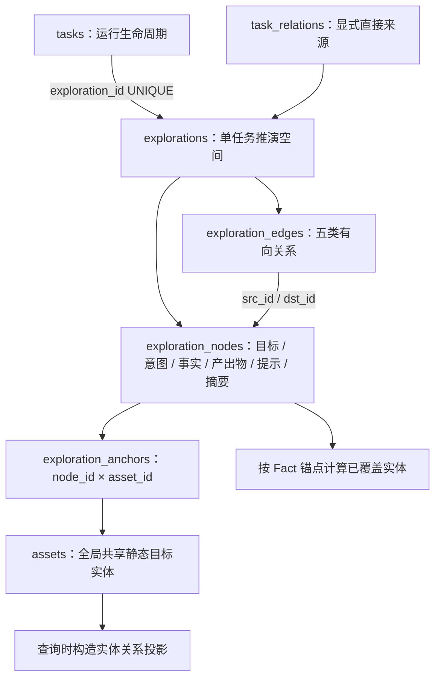
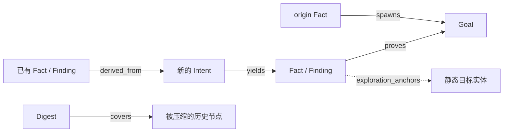
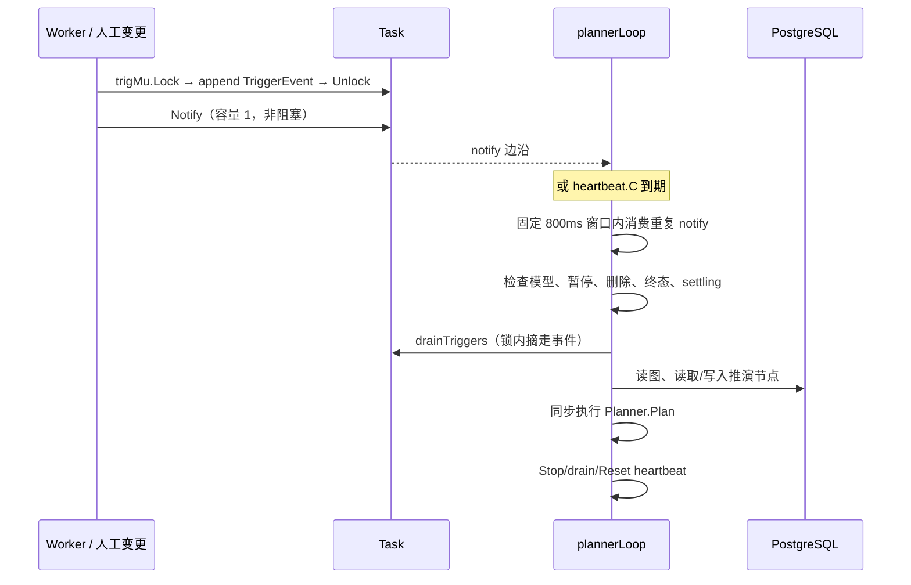
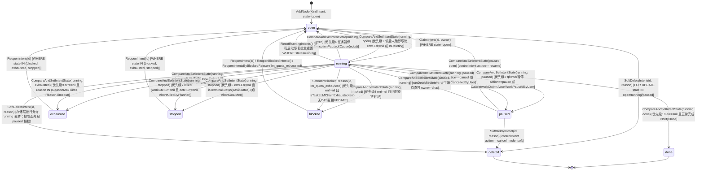
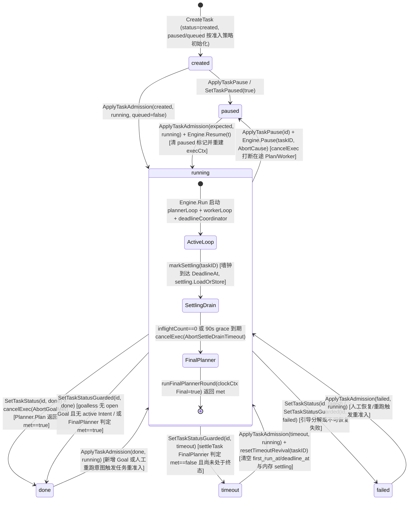
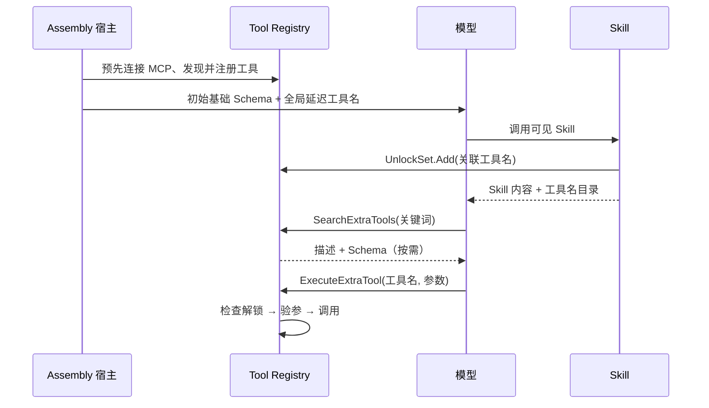
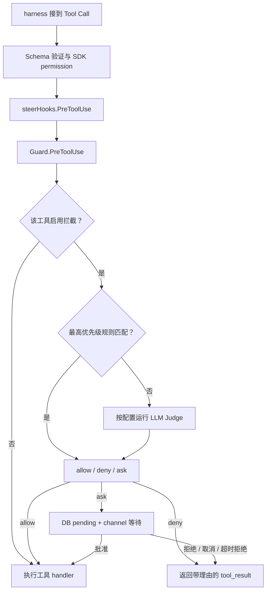

# ARTEX 底层编排架构逆向蓝图（草案）

> 阅读基线：`reference-baseline`（所有源码声明与控制流骨架已内联于本文，严禁跨工作区读取外部目录），Git commit `5c0dbd4bec940f3c0faf20705a56d879b57d3dfe`。本文只讨论编排、状态、存储、上下文、容错和控制面。物理标识符保留源码拼写：`asset` 表示“静态目标实体”，`fact` 表示“过程事实”，`finding` 表示“经确认的推演产出物”。业务判定方法不在本文范围内。
>
> 证据规则：本地引用均使用该快照的真实行号；依赖行为另标为 `norma@v0.4.3`，不冒充本仓库实现。依赖版本由 `go.mod:L1-L7` 锁定。下文的“保证”“约定”“缺口”分别指数据库/代码强制行为、模型提示约定、当前实现未强制的条件。附录摘录完整声明，不用省略号隐藏字段、方法或 CHECK 分支。

阅读导航：[数据模型](#data-model) · [调度契约](#scheduler) · [超时结算](#settlement) · [上下文组装](#assembly) · [LLM 容错](#llm) · [审批控制](#intercept) · [并发清单](#concurrency) · [完整声明](#declarations)。

## 0. 先校正五个容易影响架构复用的前提

1. **本版本没有 `asset_edges` 表，也没有该名称的 Go/SQL 实现。** 对整个参考目录检索该标识符无命中。持久化底层是全局实体表 `assets`；可视化的实体关系由查询结果及实体属性在内存中组装。上层才有真正持久化的 `exploration_nodes / exploration_edges`。因此“双图”准确说是“共享实体关系投影 + 任务推演图”，不是两个对称的邻接表图数据库。证据：`db/schema.sql:L40-L113`、`db/schema.sql:L153-L281`、`db/task_scope.go:L423-L583`。
2. **状态枚举不是完整的状态迁移约束。** `ck_node_state` 验证 `kind/state` 组合，却不检查 `OLD.state → NEW.state`。抢占和部分终态迁移由条件 UPDATE 实现；普通 `SetNodeState` 可直接覆盖合法状态。证据：`db/schema.sql:L183-L194`、`db/exploration.go:L268-L271`、`db/exploration.go:L363-L373`、`db/exploration.go:L1173-L1181`。
3. **结算不是“卸载全部外部工具，只留图写入”。** Worker 只传 `DisabledTools: ["Bash"]`；依赖实现过滤提供给模型的 Schema，并未删除注册表项。其他工具仍可能保留，写回主要依靠收尾提示，代码不校验必须产生 Fact/实体/产出物。证据：`agent/worker.go:L423-L470`、`norma@v0.4.3/harness/query.go:L594-L612`、`norma@v0.4.3/harness/tools.go:L28-L98`、`server/engine.go:L1131-L1157`。
4. **Lazy Disclosure 延后的是模型可见信息和执行解锁，不是 MCP 建连及 tools/list。** 连接和工具发现已经在每次组装时进行；Skill 调用解锁工具名，模型再通过搜索工具获取 Schema。搜索端本身不检查 UnlockSet，因此不能把 Schema 隐藏理解为访问控制。证据：`server/assembly.go:L65-L139`、`norma@v0.4.3/tool/deferred.go:L102-L215`、`norma@v0.4.3/tool/deferred.go:L221-L272`。
5. **自动配额 Failover 不调用 `invalidateTaskAgents`。** 稳定的任务 Agent 持有动态 Provider 路由器，每次调用重选当前 Profile；缓存失效发生在配置/绑定变更路径。这个区别决定 Planner 内存待办是否保留。证据：`server/task_llm.go:L50-L54`、`server/task_llm.go:L110-L147`、`server/task_llm.go:L546-L616`、`server/task_llm.go:L618-L642`、`server/server.go:L630-L642`。

<a id="data-model"></a>

## 1. 双图的数据模型、血缘和覆盖率

### 1.1 持久化结构与隔离边界



| 对象 | 强制约束与真实用途 |
|---|---|
| `assets` | 全局 `id`；没有 `exploration_id`。按不同实体类别建立部分唯一索引，实现规范化身份去重；`task_ids BIGINT[]` 是任务来源集合，不是每个元素都有外键约束的隔离键。`db/schema.sql:L40-L94` |
| `explorations` | 独立空间 ID、描述、目标、状态、轮次。`tasks.exploration_id` 唯一且外键 `ON DELETE RESTRICT`，一个任务对应一个推演空间。`db/schema.sql:L153-L168`、`db/schema.sql:L505-L535` |
| `exploration_nodes` | 每行属于一个空间，节点删除随空间级联；`payload JSONB` 保存类型相关内容，`priority` 用于调度，`owner` 是工作槽标识，不是租约。`db/schema.sql:L170-L202` |
| `exploration_edges` | `(exploration_id, src_id, rel, dst_id)` 主键去重；节点端点分别有外键；禁止自环，限制关系字符串。`db/schema.sql:L248-L257` |
| `exploration_anchors` | `(node_id, asset_id)` 复合主键，多对多、重复插入幂等；两个外键均级联删除。没有复制实体，也没有单独保存 task_id。`db/schema.sql:L276-L281` |
| `task_asset_links` | 任务与实体的来源记录，另有 `source_node_id`；与锚点不同，前者说明任务发现/引入来源，后者说明哪个推演节点涉及哪个实体。`db/schema.sql:L648-L683` |
| `task_relations` | 显式直接来源任务；查询可读当前任务与直接来源任务，不递归遍历来源链。`db/exploration_sources.go:L20-L41`、`db/task_assets_context.go:L12-L53` |

隔离主要由 `ExplorationStore{db, expID}` 的 SQL 过滤落实，而非 PostgreSQL 行级安全策略。当前表 DDL 没有为边建立“端点与边必须属于同一个 exploration”的复合外键，也没有 DAG、端点 kind 矩阵或唯一父节点约束。`Link` 直接写入空间 ID 与端点 ID；部分工具允许直接来源任务的 Fact/Finding 成为上游证据，因此这种跨空间端点有实际使用场景，不能简单认作所有跨空间边都是错误。证据：`db/exploration.go:L172-L175`、`db/exploration.go:L259-L264`、`db/exploration_sources.go:L161-L183`、`agent/tools.go:L1032-L1089`。

全局实体表也不等于所有 Agent 都能任意读取所有实体：当前 `list_assets` 走当前任务及直接来源任务的声明范围查询。旧注释中的“全局可见”不能替代实际调用链。证据：`agent/tools_insert.go:L530-L584`、`db/task_assets_context.go:L64-L89`。

### 1.2 枚举、CHECK 与状态迁移责任

`db/constants.go` 的 `Kind*`、`Rel*` 是普通字符串常量，不是覆盖所有状态的 Go 类型枚举。它还包含 `StateOrigin`、`StateIntentDeleted` 和 Digest 状态；完整合法组合以 SQL 为准。证据：`db/constants.go:L4-L40`。

以下为核心推演节点 CHECK 的完整原文，包含已弃用但仍兼容的 `begin`：

```sql
CONSTRAINT ck_node_kind CHECK (kind IN ('begin','goal','intent','fact','finding','hint','digest')),
CONSTRAINT ck_node_state CHECK (
    (kind='begin'   AND state IN ('open')) OR
    (kind='intent'  AND state IN ('open','running','paused','done','blocked','exhausted','stopped','deleted')) OR
    (kind='goal'    AND state IN ('open','met','abandoned')) OR
    (kind='fact'    AND state IN ('confirmed','dismissed','origin')) OR
    (kind='finding' AND state IN ('confirmed','dismissed')) OR
    (kind='hint'    AND state IN ('active','consumed')) OR
    (kind='digest'  AND state IN ('active','superseded'))
)
```

来源：`db/schema.sql:L183-L194`；兼容旧库时又完整重建该约束：`db/schema.sql:L203-L240`。

| 表/字段 | 合法值或完整 CHECK 表达式 | 迁移与含义 |
|---|---|---|
| `explorations.status` | `CHECK (status IN ('open','achieved','failed'))` | 空间状态与 `tasks.status` 是不同字段，不能混用。`db/schema.sql:L153-L159` |
| `tasks.status` | `CHECK (status IN ('created','running','paused','done','failed','timeout'))` | 调度与终止主要检查任务生命周期；另有 `paused / queued` 标记。`db/schema.sql:L513-L518` |
| `intent` | `open / running / paused / done / blocked / exhausted / stopped / deleted` | `open → running` 原子抢占；终态分流见第 2 节。`db/exploration.go:L1173-L1181` |
| `goal` | `open / met / abandoned` | `prove_goal` 写 proves 边再置 met；“无 open goal”与“全部 met”不是同一个谓词。`agent/tools.go:L1157-L1203`、`server/engine.go:L845-L857` |
| `fact` | `confirmed / dismissed / origin` | origin 是任务根事实；事实状态不会自动限制覆盖率统计。`db/exploration.go:L236-L243`、`db/task_assets_context.go:L12-L53` |
| `finding` | `confirmed / dismissed` | 产出物节点另外关联独立产出物记录。`db/finding_traffic.go:L342-L388` |
| `hint` | `active / consumed` | 人工补充上下文。`agent/tools.go:L1408-L1439` |
| `digest` | `active / superseded` | 历史摘要替换，成员通过 covers 边指向。`db/digest.go:L122-L147`、`db/digest.go:L201-L221` |
| `task_llm_profiles.status / position` | `CHECK (status IN ('ready','quota_exhausted'))`；`CHECK (position >= 0)` | 顺序配置链状态，`UNIQUE(task_id, position)`。`db/schema.sql:L696-L708` |

实体表保留原始物理枚举，迁移到通用任务系统时可替换类别体系，但不能误报为不存在的通用枚举：

- `CHECK (type IN ('root_domain','ip','subdomain','app','service','endpoint'))`。
- `CHECK (company_source IN ('explicit','scope'))`。
- `CHECK (port BETWEEN 1 AND 65535)`。
- `CHECK (service_type IN ('http','other'))`。

来源：`db/schema.sql:L40-L82`；旧库补约束：`db/schema.sql:L104-L113`。这些表达式约束类型、归属来源和字段取值，不定义推演状态。

约束强度必须分层理解：

- `payload` 只要求合法 JSONB，不保证 `summary`、`evidence`、`confidence` 的语义或必填字段；Intent priority 也没有 0–10 的 SQL CHECK。相关校验和默认值由工具完成。`db/schema.sql:L170-L194`、`agent/tools.go:L1032-L1089`、`agent/tools.go:L1317-L1351`。
- `SetNodeState` 没有旧状态条件，也不设置 `completed_at`；`SetIntentState` 和 `CompareAndSetIntentState` 对 done/blocked/exhausted/stopped 设置完成时间，其他状态清空时间；后者才要求期望旧状态。`db/exploration.go:L268-L271`、`db/exploration.go:L351-L373`。
- `ReopenIntent` 只允许 blocked/exhausted/stopped 回到 open，保留节点 ID、图关系和会话；启动恢复另将 running 批量归回 open。`db/exploration.go:L312-L336`、`server/server.go:L264-L279`。
- 软删除先锁节点行，允许 running/paused/open 转 deleted，保留血缘并记录原因；不是物理删除图。`db/exploration.go:L389-L425`。

### 1.3 五类有向边：方向比名称更重要



| rel | 当前写入方向 | 血缘语义与实现 |
|---|---|---|
| `spawns` | 根 origin Fact → Goal | 建立目标的起源。历史兼容 begin 并不代表当前创建必须有 begin。`agent/tools.go:L1449-L1469` |
| `derived_from` | 已有 Fact/Finding → 新 Intent | “这个意图基于哪个已有证据而提出”。方向是证据到意图，不能按英文表面理解为反向。无显式父证据时回落 origin Fact；无根时可能没有父边。`agent/tools.go:L1032-L1089` |
| `yields` | Intent → Fact/Finding | “这个执行单元产出了什么”。Fact 可缺少 Intent 而成为无 yields 入边的节点；产出物事务可以绑定合法 Intent。`agent/tools.go:L1317-L1351`、`db/finding_traffic.go:L355-L379` |
| `proves` | Fact/Finding → Goal | 证据支持目标达成，随后置 Goal=met。当前只验证证据 kind，不强制证据 state=confirmed。`agent/tools.go:L1157-L1203` |
| `covers` | Digest → 被概括的成员节点 | 上下文压缩关系，**不是实体覆盖率关系**。`db/digest.go:L122-L175` |

边表核心约束完整如下，来源 `db/schema.sql:L248-L257`：

```sql
PRIMARY KEY (exploration_id, src_id, rel, dst_id),
CONSTRAINT ck_edge_noself CHECK (src_id <> dst_id),
CONSTRAINT ck_edge_rel CHECK (rel IN ('spawns','derived_from','yields','proves','covers'))
```

这三个约束不能阻止环、错误 kind 的连接或多重推理父节点。`ON CONFLICT DO NOTHING` 仅令同一条边重复写入幂等，不做语义去重。`db/exploration.go:L259-L264`。

### 1.4 跨图锚定与真实覆盖率口径

锚点的完整 DDL 很小，足以体现跨图连接，不需要额外关系类型：

```sql
CREATE TABLE IF NOT EXISTS exploration_anchors (
    node_id  BIGINT NOT NULL REFERENCES exploration_nodes(id) ON DELETE CASCADE,
    asset_id BIGINT NOT NULL REFERENCES assets(id)            ON DELETE CASCADE,
    PRIMARY KEY (node_id, asset_id)
);
CREATE INDEX IF NOT EXISTS idx_anchor_asset ON exploration_anchors(asset_id);
```

来源：`db/schema.sql:L276-L281`。

`AddNode` 在一个事务里插入节点及初始锚点，任一外键失败可回滚；`Anchor` 是独立补锚，跳过非正 ID，重复锚点忽略。`asset_id` 始终指向同一全局实体，不在任务里复制。实体删除会级联删除锚点；节点删除不会删除实体。证据：`db/exploration.go:L197-L217`、`db/exploration.go:L250-L256`。

当前 Agent 总览实际调用的是 `TaskCoverageWithSources`，不是只考虑本任务的旧函数。它使用当前任务和**直接来源任务**构造两个集合：

```text
context_tasks = 当前任务 ∪ 直接关联来源任务
target_assets = context_tasks 声明范围匹配实体
                ∪ context_tasks 推演节点锚定实体
tested_assets = context_tasks 中 kind='fact' 的节点所锚定实体
denominator = COUNT(DISTINCT target_assets)
tested = COUNT(DISTINCT target_assets ∩ tested_assets)
pct = tested / denominator；denominator=0 时为 NULL
```

证据：`agent/tools.go:L528-L532`、`db/task_assets_context.go:L12-L53`、`db/task_assets_context.go:L123-L180`。

三个容易被概念误导的细节：

1. numerator 的条件是 `kind='fact'`，没有 `state='confirmed'`、confidence、终态 Intent 或证据质量过滤；origin/dismissed Fact 只要有锚点也可能贡献覆盖。
2. Intent/Finding 的锚点能扩充分母，但单独不能增加“已测”分子。锚定代表相关性；是否计入覆盖由查询口径决定。
3. `covers` 不参与上述计算。实体关系图是 `BuildCoverageGraph` 以查询结果和父子属性组装的内存边，不是缺失的 `asset_edges` 表。证据：`db/task_assets_context.go:L12-L53`、`db/task_scope.go:L423-L583`。

### 1.5 图写入工具的事务边界与回调

| 工具/入口 | 数据操作 | 原子性、归属与通知 |
|---|---|---|
| `add_intent` / `addOneIntent` | 验 summary、父 Fact/Finding、实体范围；写 intent/open、priority、锚点；再写 derived_from | 节点+锚点在 `AddNode` 事务内；父边另写且忽略 Link 错误。priority=0 会变默认 5；父节点可来自直接来源任务。批处理逐项执行，允许部分成功。`agent/tools.go:L1021-L1146` |
| `record_fact` / `recordOneFact` | 写 fact/confirmed、payload、锚点，再可选写 intent→yields→fact | Intent 取条目字段或顶层默认，不自动回落 `ToolSet.ownerNode`；未给 Intent 允许孤立事实。节点+锚点原子，yields 不在同一事务。`agent/tools.go:L1306-L1406` |
| `report_finding` | 通过 FindingRecorder 或 Store 写 finding 节点、锚点、yields、独立产出物记录及证据关联 | 核心写入在同一事务；校验任务与 exploration 归属，并校验指定 Intent；成功后 NotifyFinding。通知的 ownerNode 回落不能误当成写入归属回落。`agent/tools.go:L1219-L1298`、`db/finding_traffic.go:L328-L415` |
| `insert_assets` | 类型化规范化 UPSERT 全局实体；维护任务来源；给 owner Intent 补锚；记录 source_node；添加自动范围 | 逐条写，非整批事务；补锚等后续错误未全部上抛。当前成功分支调用 AddAutoScope，并非全由 coverageEnabled 控制。`agent/tools_insert.go:L203-L365` |
| `prove_goal` | 验本地 Goal 及可读 Fact/Finding；写 proves；置 met；检查所有 Goal 是否 met | 边与状态分开调用且忽略相应写入错误，不是“证据边+达标状态”事务。最多读取 1000 个目标作全 met 检查。`agent/tools.go:L1157-L1203` |
| `add_goal / add_hint` | 新 Goal=open 与根 spawns；Hint=active 与锚点 | 通知唤醒 Planner 是另一步，非数据库事务 outbox。`agent/tools.go:L1408-L1469`、`server/manager.go:L1786-L1809` |
| Digest 存储入口 | 新 Digest=active 与 covers 成员，替代旧摘要时删除旧 covers 并置 superseded | 各自使用事务；成员可能被多个摘要覆盖，查询选择较小 Digest ID，不存在单摘要唯一覆盖约束。`db/digest.go:L122-L175`、`db/digest.go:L201-L221` |

`assets` 的去重是类型自然键的数据库唯一索引 + UPSERT，而不是“让模型不要重复”。一个具体 UPSERT 会合并 `task_ids` 并刷新最近出现时间。证据：`db/schema.sql:L83-L94`、`db/assets.go:L255-L301`。

工具的 `ReadOnly / Concurrent` 标记也是调度契约：`readTool` 明确可并发；`writeTool` 没有设置 Concurrent，依赖 SDK 默认 false，于单会话中避免与其他工具并行。它**不**给不同 Worker 加全局写锁；跨 Worker 竞争仍由 PostgreSQL 条件 UPDATE/唯一约束/事务解决。`ToolSet.writes` 是本轮计数，不是互斥锁、去重账本或必须写回的验证器。证据：`agent/tools.go:L143-L147`、`agent/tools.go:L280-L300`、`norma@v0.4.3/tool/tool.go:L147-L152`、`norma@v0.4.3/harness/streaming.go:L76-L94`。

### 1.6 双图如何变成有限的模型上下文

`graphOverview` 是有界态势快照，不是完整图导出：读取目标/提示、有限边集、open frontier、running 与最近终态、有限事实/产出物，以及摘要和冷节点索引；大量细节留给 `node_detail` 等查询。典型界限包括 edges=5000、open=30、Intent 列表=300、recentDone 截取=12、Fact/Finding 查询各=1000、最近 Fact=20、最近 Finding=10、冷摘要=15。超大图下不能把展示数量当无界全量统计。证据：`agent/tools.go:L354-L552`。

Planner 每轮触发图压缩器；轮次、内容版本及热度决定节点是否可冷却，Digest 用 covers 保持摘要到原节点的追溯。写入状态会增加 content_version，避免被修改过的节点长期隐藏在旧摘要下。具体轮次/戳/版本入口：`agent/planner.go:L355-L360`、`db/digest.go:L17-L117`、`db/exploration.go:L268-L271`。Worker 的总览额外移除覆盖率块，减少无关态势。`agent/tools.go:L325-L337`。

<a id="scheduler"></a>

## 2. Planner–Worker 调度契约与状态连续性

### 2.1 三层状态各司其职

| 层 | 存放位置 | 生命周期 |
|---|---|---|
| 可执行工作与结果 | PostgreSQL Intent/Fact/Finding/Goal、边、锚点 | 可恢复、可审计；数据库状态是领取资格与结果归属的依据 |
| Planner 的后续计划 | `Planner.todos map[int64]*actool.TodoStore`，键为 exploration ID | 跨同一 Planner 实例的规划轮次保留；进程重启/Agent 重建不保留 |
| 单 Intent 的对话 | Transcript + `exp<explorationID>-worker-i<intentID>` | Worker 重领、暂停恢复和整轮重试可恢复；不绑定工作槽编号 |

证据：`agent/planner.go:L23-L53`、`agent/planner.go:L108-L143`、`agent/worker.go:L94-L96`、`agent/worker.go:L474-L533`。

“Bounded Intent”并不是一个带 budget 字段的独立 Go 类型：它是 `db.Node(kind=intent)` 加摘要、锚点、父事实、单次 Worker 预算与角色工具集构成的执行契约。默认 Worker 工具不含 `add_intent`，Planner 负责投放方向；DB 工具绑定仍可改变可用工具集合，不能视为不可绕过的角色权限。证据：`db/exploration.go:L67-L84`、`agent/tools.go:L1021-L1089`、`agent/tools.go:L2033-L2054`、`agent/tools_insert.go:L644-L661`、`server/assembly.go:L239-L324`。

### 2.2 边沿唤醒：Channel 只表示“有变化”，事件保存在另一个容器

`Task.notify` 是容量 **1** 的 `chan struct{}`。`Notify` 使用非阻塞 send + default：重复信号合并，不排队多个空信号。具体变化由 `Task.trigMu sync.Mutex` 保护的 `pendingTriggers []agent.TriggerEvent` 保留；NotifyDone/NotifyFinding/目标和提示变更先 append，再 Notify。`drainTriggers` 在锁内整体取出 slice 并置 nil。证据：`server/manager.go:L29-L74`、`server/manager.go:L831-L850`、`server/manager.go:L1751-L1778`、`server/manager.go:L1786-L1860`。

注意类型实际定义于 `agent/planner.go`，Manager 只是生产事件。完整声明：

```go
type TriggerEvent struct {
    Kind     string
    IntentID int64
    Detail   string
    Summary  string
    Goals    []string
    OldGoal  string
    NewGoal  string
    Hints    []string
}
```

来源：`agent/planner.go:L158-L167`。

这形成“合并唤醒 + 保留原因”的两通道契约：通知本身不承载事实，Planner 唤醒后重新读 DB，并把触发细节写入本轮输入。NotifyDone 还让 Planner 查看该 Intent 的 yields 事实及最近 Worker 总结。事件 slice 是内存数据，不是持久队列；没有与图写入绑定的 outbox。Heartbeat 可弥补遗漏唤醒，但不能恢复已经丢失的精确事件序列。证据：`agent/planner.go:L173-L274`、`server/engine.go:L875-L880`、`server/engine.go:L901-L912`。

### 2.3 plannerLoop：固定合并窗口 + 完成后重臂 Heartbeat

`Engine.Run` 对 taskID 使用 `started.LoadOrStore` 去重，创建一个 Planner goroutine 和 N 个 Worker goroutine；仅在没有 open/running Intent 时立即 Notify 首轮。带种子工作时 Worker 先跑，Planner 等完成事件或心跳。证据：`server/engine.go:L748-L777`。



精确时序如下：

1. `e.debounce` 默认 800ms。`runRound` 新建一次 Timer，持续消费 notify，**每次收到事件不会 Reset Timer**；这是固定长度的合并窗口，不是“最后一次变化后再安静 800ms”的尾沿防抖。窗口内没有 `ctx.Done()` 分支，取消最多要先等这段窗口。`server/engine.go:L389-L394`、`server/engine.go:L808-L819`。
2. 规划前检查 Agent 是否可用、任务是否 paused/deleting/terminal/settling。没有 open Goal 时不调用模型；清掉触发列表，且没有 open/running Intent 才 guarded 地转 done。`HasActiveIntent` 不算 paused Intent。`server/engine.go:L820-L862`、`db/exploration.go:L1155-L1170`。
3. `beginTaskOperation` 登记 inflight，取得任务可取消执行 Context，注入 TaskClock，发 round 事件，再 drainTriggers 并同步 Plan。普通 plannerLoop 内不并发执行两个 Plan。`server/engine.go:L859-L880`、`server/engine_timeout.go:L42-L62`。
4. Plan 返回全部目标达成时写 Task=done，并 `cancelExec(..., AbortGoalMet)` 取消在途 Worker。`server/engine.go:L882-L894`。
5. Heartbeat 在 loop 启动时即计时；运行期下限/默认 600 秒。每次 runRound **返回以后**，Stop→非阻塞 drain→Reset。因此后续间隔实际从本次处理完成重新计算，而不是固定频率 ticker。DDL 的历史默认值 300 不等于执行层生效值 600。`db/schema.sql:L525-L525`、`server/engine.go:L779-L805`、`server/engine.go:L901-L914`。

Plan 正在运行时到来的事件会保留在 pendingTriggers 中，notify 最多保留一个边沿，供下一轮处理。模型未配置、暂停等 guard 返回前通常还未 drainTriggers，事件可继续积累；这也说明 slice 并没有通用长度上限。依据：`server/manager.go:L1762-L1778`、`server/manager.go:L1854-L1860`、`server/engine.go:L820-L877`。

#### 【核心控制流代码骨架 1-A】`plannerLoop` 固定窗口合并与 Heartbeat 重臂循环（去业务化）

对照 `server/engine.go:L789-L914` 与 `server/manager.go:L1751-L1860`，以下骨架完整保留边沿唤醒合并、触发器排空锁、6 重前置准入守卫、无目标收敛以及 `Stop -> drain -> Reset` 心跳重臂时序：

```go
// Notify 与 drainTriggers：容量 1 边沿信号 + 互斥锁保护的原因切片
func (t *Task) appendTrigger(ev agent.TriggerEvent) {
	t.trigMu.Lock()
	t.pendingTriggers = append(t.pendingTriggers, ev)
	t.trigMu.Unlock()
	t.Notify()
}

func (t *Task) Notify() {
	select {
	case t.notify <- struct{}{}:
	default: // 已有未消费边沿信号，非阻塞合并
	}
}

func (t *Task) drainTriggers() []agent.TriggerEvent {
	t.trigMu.Lock()
	defer t.trigMu.Unlock()
	out := t.pendingTriggers
	t.pendingTriggers = nil
	return out
}

// resetPlannerTimer：标准 Stop -> 非阻塞 drain -> Reset 模式，防止残留触发信号导致假唤醒
func resetPlannerTimer(timer *time.Timer, d time.Duration) {
	if !timer.Stop() {
		select {
		case <-timer.C:
		default:
		}
	}
	timer.Reset(d)
}

func (e *Engine) plannerLoop(ctx context.Context, t *Task) {
	interval := plannerHeartbeatInterval(t) // 下限/默认 600s (db.MinPlanHeartbeatSeconds)
	heartbeat := time.NewTimer(interval)
	defer heartbeat.Stop()

	runRound := func(src string) {
		// 1. 固定长度合并窗口（默认 800ms）：持续吸收突发 notify，不重置 timer
		timer := time.NewTimer(e.debounce)
	drain:
		for {
			select {
			case <-t.notify:
			case <-timer.C:
				break drain
			}
		}

		// 2. 六重前置守卫：LLM 就绪 -> 暂停 -> 删除屏障 -> 任务终态 -> 超时收尾中 -> 无开放目标
		planner, _ := e.snapshotFor(t)
		if planner == nil || e.IsPaused(t.ID) || e.IsDeleting(t.ID) {
			return
		}
		if isTerminalStatus(t.lifecycleSnapshot().Status) || e.isSettling(t.ID) {
			return
		}
		if open, err := t.Store.HasOpenGoal(); err == nil && !open {
			t.drainTriggers() // 清空积压事件，防止 goalless 模式下无界增长
			if active, err := t.Store.HasActiveIntent(); err == nil && !active {
				if won, err := e.m.SetTaskStatusGuarded(t.ID, "done"); err == nil && won {
					e.emitActivity(t, db.Activity{Worker: "system", Kind: "text", Summary: "目标全部达成且无在途意图，任务完成"})
				}
			}
			return
		}

		// 3. 登记 inflight（受 deleteMu.RLock 保护，与删除屏障互斥）并派生带时钟的任务执行 Context
		if !e.beginTaskOperation(t.ID) {
			return
		}
		defer e.decInflight(t.ID)

		e.stampFirstRun(t)
		e.touch(t.ID)
		ectx := e.clockCtx(e.execContextFor(ctx, t.ID), t, false)
		if ectx.Err() != nil || e.IsDeleting(t.ID) {
			return
		}

		// 4. 摘取本窗口合并的全部触发事件，同步执行单轮规划
		e.emitActivity(t, db.Activity{
			Worker:  "planner",
			Kind:    "round",
			Summary: fmt.Sprintf("第 %d 轮规划", e.nextPlannerRound(t.ID)),
		})
		triggers := t.drainTriggers()
		taskIDInt, _ := strconv.ParseInt(t.ID, 10, 64)

		e.BeginLLMCall(t.ID)
		met, _, err := planner.Plan(ectx, taskIDInt, e.m.assets, t.Store, t.Goal, triggers, func(r db.Activity) {
			e.emitActivity(t, r)
		})
		e.EndLLMCall(t.ID)

		// 5. 规划结果分流：若全部目标达成则落库 done 并以 AbortGoalMet 取消所有在途 Worker
		switch {
		case err != nil && ectx.Err() == nil:
			// 规划期非取消错误记录日志，等待下一边沿或 Heartbeat 兜底
		case met:
			_ = e.m.SetTaskStatus(t.ID, "done")
			e.cancelExec(t.ID, agent.AbortGoalMet)
		}
		e.touch(t.ID)
	}

	for {
		select {
		case <-ctx.Done():
			return
		case <-t.notify:
			runRound("edge")
		case <-heartbeat.C:
			runRound("heartbeat")
		}
		// 每次唤醒处理完毕后重新起算静置窗口，而非固定频率 Ticker
		resetPlannerTimer(heartbeat, interval)
	}
}
```

### 2.4 todoFor：跨轮次保留“还没形成可执行 Intent 的链条”

`todoFor(expID)` 在 `Planner.todoMu` 锁内查表，没有则创建 `actool.NewTodoStore()`。每次 Plan 将同一个指针传入 `Options.Todos`，并把 `Todos.List()` 渲染到新一轮 user 输入。SDK 的 TodoWrite 每次**替换完整列表**，TodoStore 自己还有 `mu sync.Mutex`，List 返回拷贝。证据：`agent/planner.go:L108-L143`、`agent/planner.go:L429-L462`、`norma@v0.4.3/tool/todo.go:L23-L53`。

它支持这样的连续性：未来步骤留在 pending；当前可证实前提对应步骤进入 in_progress；Worker 写回 Fact 后，下一轮 Planner 从触发事件和图中确认前提，再投放下一 Intent 并更新 todo。**Todo 只是模型工作计划，不是执行队列、DAG 依赖解析器或数据库锁。** “前置事实存在才投放”的方向约束来自提示和 add_intent 的父节点校验，不是 TodoStatus 自动驱动调度。`agent/planner.go:L129-L143`、`agent/tools.go:L1032-L1089`。

Planner 使用固定 `exp%d-planner` 记录 transcript，但每轮走新 session 的 `captureRun`，没有 Worker 那样的 Resume。长期连续性依赖“图 + 事件 + 共享 TodoStore”，不能把累积日志当成完整对话自动恢复。自动 Profile 切换保留 Planner 实例；显式缓存失效重新 NewPlanner 会丢失内存 todo。证据：`agent/planner.go:L441-L471`、`server/task_llm.go:L546-L604`。

### 2.5 领取：先读候选，再用 PostgreSQL 条件 UPDATE 争抢

完整路径：

```text
Engine.Run
  → workerLoop
    → beginTaskOperation
      → runWorkerStep
        → claimNext
          → ExplorationStore.Frontier(20)
          → 对候选逐个 ClaimIntent(id, workName)
        → runIntent
          → Worker.Execute
            → Worker.execute
              → NewSession → Resume → captureRunSession
          → 根据取消原因 / TerminalReason / error 做终态分流
          → NotifyDone
```

证据：`server/engine.go:L916-L972`、`server/engine.go:L982-L1157`、`server/engine.go:L1237-L1245`、`agent/worker.go:L349-L361`、`agent/worker.go:L497-L535`。

`Frontier` 按 priority DESC、id ASC 取 open Intent；数据库有相应部分索引。多个 Worker 可以读到同一候选列表，但只有第一个条件更新成功的 Worker 才领取成功。这里没有 `SELECT FOR UPDATE SKIP LOCKED`，也没有先锁整张 frontier。完整实现：

```go
func (s *ExplorationStore) ClaimIntent(id int64, owner string) (bool, error) {
	res, err := s.db.Exec(`UPDATE exploration_nodes SET state='running', owner=$1
WHERE id=$2 AND exploration_id=$3 AND kind='intent' AND state='open'`, owner, id, s.expID)
	if err != nil {
		return false, err
	}
	n, _ := res.RowsAffected()
	return n == 1, nil
}
```

来源：`db/exploration.go:L1173-L1181`。PostgreSQL 行级 UPDATE 竞争确保只有一人看到 RowsAffected=1；这里的原子性是数据库提供的，不是 Go Mutex。ClaimIntent 返回 `(bool, error)`；`claimNext` 忽略 error，只检查 bool。`claimNext` 最多尝试当前 20 个候选，未抢到则返回无工作；Worker 约 800ms 后再轮询。没有 owner 租约、定期续租或多进程崩溃回收协议。重启恢复由 server 主动 running→open。证据：`db/exploration.go:L1136-L1148`、`db/schema.sql:L241-L246`、`server/engine.go:L916-L960`、`server/engine.go:L1237-L1245`、`server/server.go:L264-L279`。

### 2.6 确定性 Session ID 与执行上下文

Session ID 的完整函数：

```go
func WorkerSessionID(explorationID, intentID int64) string {
	return fmt.Sprintf("exp%d-worker-i%d", explorationID, intentID)
}
```

来源：`agent/worker.go:L94-L96`。它使用 exploration ID，而不是 Task ID；工作槽 `work#1`、`work#2` 换手不改变会话身份。

Worker 每次构造当前工具集与 System Prompt，创建 session 后调用 Resume；读到旧消息时恢复 Skill 解锁集合，并使用继续执行输入。读取失败没有在这里作为致命错误上抛，因此“稳定命名”不等于“任何存储故障都能无损恢复”。当前 Intent 放在 system 中，图态势放在 user 中，以降低压缩时丢失执行边界的风险。证据：`agent/worker.go:L396-L420`、`agent/worker.go:L474-L533`、`agent/deferred.go:L34-L51`。

`runIntent` 的取消层级是：

```text
服务器/运行时 parent context
  └─ taskRuntime.ctx（删除/停机可以取消整个任务循环）
      └─ Engine.execCtx[taskID]，WithCancelCause
          └─ workCtx，WithCancelCause（单 work 控制）
              ├─ intercept.WithTask / WithAgent / run 信息（Context value）
              └─ TaskClock（Context value，非 WithDeadline）
                  └─ SDK toolCtx = WithDeadline(workCtx, 本次 MaxDuration)
```

图表示职责关系；具体 value 注入先后见 `server/engine.go:L982-L1025`。`execContextFor` 缓存同一任务的执行 Context；Pause 取消它，Resume 让后续调用重新建立；单 Worker Kill 使用独立 cancel cause，不取消其他 Worker。`TaskClock` 只传 deadline 数值，不直接取消父 Context。证据：`server/engine.go:L178-L181`、`server/engine.go:L296-L340`、`server/engine.go:L397-L422`、`server/engine.go:L624-L633`、`agent/taskclock.go:L12-L22`。

### 2.7 runIntent 的终态分流：按代码优先级，不只看 error

`runIntent` 在 Execute 返回后**先读取** `context.Cause(workCtx)`，再 detach。detach 自己会用 `AbortWorkFinished` 取消 Context；若倒序读取，真正取消原因会被清理行为污染。工作完成通知函数在最终状态写入后由 defer 执行。证据：`server/engine.go:L1050-L1067`、`server/engine.go:L406-L422`。

| 顺序 | 条件 | Intent 状态/后续 |
|---|---|---|
| 领取后执行前已取消或正在删除 | 尚未正式开始 | running→open |
| 单 work pause | 控制面 pause action | running→paused，允许后续人工续跑 |
| 单 work cancel | 控制面 cancel action | 先 running→paused 建立停止屏障，后续 API 清理/软删除 |
| 整个任务暂停/相应取消原因 | task pause | running→open，供任务恢复时重领 |
| 任务执行 Context 取消且 settling | 超时 drain 强制打断 | running→exhausted |
| 任务执行 Context 取消且 Task 已终态 | 目标完成或其他任务终止 | running→stopped |
| 当前 work 被 Planner kill，任务仍活着 | 单 work 停止 | running→stopped，Notify 唤醒重规划 |
| 普通返回 err != nil | 执行失败 | blocked；配额耗尽另记录 blocked_reason |
| err=nil 且 reason=MaxTurns / Timeout | 已走预算终止/收尾 | exhausted |
| 其他正常返回 | 即使 Writes.Total()==0 | done，之后 NotifyDone |

证据：`server/engine.go:L988-L993`、`server/engine.go:L1068-L1157`。

通常使用 `CompareAndSetIntentState(id, "running", to)`，防止后台完成回调覆盖人工已修改的状态。配额错误的 `SetIntentBlockedReason` 是另一个直接 UPDATE 入口，没有相同的 running CAS 条件，不能笼统声称所有终态写入都做了 CAS。证据：`server/engine.go:L479-L488`、`server/engine.go:L1144-L1151`、`db/task_context.go:L562-L566`。

`workExecution.done` 为容量 1 的 `chan error`。`ControlWork` 先在 `workMu` 下预占 action，再 cancel，最长等 30 秒、请求 ctx 或 done；完成方发送一个结果，**没有 close(done)**，即使结构体注释写了“closed”。等待超时会释放 action 预占，但已经发送的取消不会撤回。`steerBox` 则在 `steerMu` 下排队，由工具前置 Hook FIFO 取出。证据：`server/engine.go:L397-L477`、`server/engine.go:L493-L524`。

#### 【Intent 与 Task 全生命周期 Mermaid 状态机图（`stateDiagram-v2`）】

以下两张 `stateDiagram-v2` 分别刻画 `intent`（8 种数据库合法状态：`open / running / paused / done / blocked / exhausted / stopped / deleted`）与 `task`（6 种数据库合法状态：`created / running / paused / done / failed / timeout` 及内存 `settling` 阶段）的全部合法转移边、触发函数与 `context.Cause` 判定条件。

##### （1）Intent 8 态全生命周期状态机



> **状态迁移补充边界说明**：
> - 除上述带条件谓词的受控迁移外，底层 `SetIntentState(id, state)` 与 `SetNodeState(id, state)` 无 `OLD.state` 校验，可在回滚或管理路径直接覆盖状态；`CancelIntent(id)`（`mode == "hard"`）则在 `running` 先经 `ControlWork("cancel")` 落 `paused` 栅栏后，物理 `DELETE` 意图节点及其独占子孙。
> - `taskExecutionPaused(context.Cause(ectx))` 识别的 `AbortCause.Code` 集合为：`"paused_by_user"`、`"paused_by_orchestrator"`、`"paused_on_reload"`、`"paused_race_guard"`、`"queued_for_admission"`、`"llm_unavailable_queued"`、`"task_deleted"`（见 `server/engine.go:L1214-L1226`）。

##### （2）Task 全生命周期与超时结算状态机



#### 【核心控制流代码骨架 1-B】`runIntent` 10 级优先级终态分流与单 Work 协同控制（去业务化）

对照 `server/engine.go:L397-L488` 与 `server/engine.go:L982-L1157`，以下骨架完整展示单意图执行句柄注册、`ControlWork` 预占与 30s 等待、`model_error` 会话级退避续跑、**先提取 `context.Cause(workCtx)` 后 `detachWork`** 的防污染时序，以及严格按 10 级优先级落库终态并回调 `completeWork` 的完整实现：

```go
func (e *Engine) registerWork(intentID int64, cancel context.CancelCauseFunc) {
	e.workMu.Lock()
	e.work[intentID] = &workExecution{cancel: cancel, done: make(chan error, 1)}
	e.workMu.Unlock()
}

func (e *Engine) detachWork(intentID int64) (action string, complete func(error)) {
	e.workMu.Lock()
	run := e.work[intentID]
	if run != nil {
		delete(e.work, intentID)
		action = run.action
		// 释放子 Context 资源；若在读取 Cause 之前调用，会把未取消的 workCtx 原因染成 AbortWorkFinished
		run.cancel(agent.AbortWorkFinished)
	}
	e.workMu.Unlock()

	e.steerMu.Lock()
	delete(e.steerBox, intentID)
	e.steerMu.Unlock()

	if run == nil {
		return action, func(error) {}
	}
	// 注意：向容量 1 的 done 发送结果而不 close(done)
	return action, func(err error) { run.done <- err }
}

func (e *Engine) ControlWork(ctx context.Context, intentID int64, action string) error {
	if action != "pause" && action != "cancel" {
		return fmt.Errorf("unsupported work action %q", action)
	}
	e.workMu.Lock()
	run := e.work[intentID]
	if run == nil || run.action != "" {
		e.workMu.Unlock()
		return errWorkControlConflict
	}
	run.action = action
	done := run.done
	cause := error(agent.AbortWorkPausedByUser)
	if action == "cancel" {
		cause = agent.AbortWorkCancelledByUser
	}
	run.cancel(cause)
	e.workMu.Unlock()

	timer := time.NewTimer(workControlWaitTimeout) // 30s
	defer timer.Stop()
	select {
	case err := <-done:
		return err
	case <-ctx.Done():
		e.releaseWorkControl(intentID, run, action)
		return ctx.Err()
	case <-timer.C:
		e.releaseWorkControl(intentID, run, action)
		return context.DeadlineExceeded
	}
}

func (e *Engine) runIntent(ctx context.Context, t *Task, name string, worker *agent.Worker, intent *db.Node, requestID, message string) bool {
	e.stampFirstRun(t)
	e.touch(t.ID)
	ectx := e.clockCtx(e.execContextFor(ctx, t.ID), t, false)

	// [优先级 1] 领取后、正式执行前发现任务已取消或正在删除 -> running 回退 open
	if ectx.Err() != nil || e.IsDeleting(t.ID) {
		_ = transitionIntentState(t.Store, intent.ID, "running", "open")
		return true
	}

	// 派生单 work 独立可取消 Context，供 Planner kill_work 或用户 pause/cancel 精确制导
	workCtx, workCancel := context.WithCancelCause(ectx)
	e.registerWork(intent.ID, workCancel)

	iid := intent.ID
	label := fmt.Sprintf("%s · #%d", name, iid)
	workCtx = intercept.WithTaskContext(workCtx, t.ID, label, func(a db.Activity) {
		nid := iid
		a.NodeID, a.Worker = &nid, name
		e.emitActivity(t, a)
	})

	// 空转续跑计数器建在 model_error 重试循环外，跨重试共享同一意图配额
	hooks := steerHooks{
		inner:  t.Guard.Hooks(),
		drain:  func() (string, bool) { return e.drainSteer(iid) },
		nudges: &atomic.Int64{},
		limit:  e.emptyTurnNudgeLimit(),
		label:  label,
	}

	wTaskID, _ := strconv.ParseInt(t.ID, 10, 64)
	runOnce := func() (harness.TerminalReason, agent.WriteCounts, error) {
		e.BeginLLMCall(t.ID)
		defer e.EndLLMCall(t.ID)
		if message != "" {
			return worker.ExecuteWithMessage(workCtx, name, wTaskID, e.m.assets, t.Store, intent, hooks, func(r db.Activity) { e.emitActivity(t, r) }, e.m.enrich, t.NotifyFinding, requestID, message)
		}
		return worker.Execute(workCtx, name, wTaskID, e.m.assets, t.Store, intent, hooks, func(r db.Activity) { e.emitActivity(t, r) }, e.m.enrich, t.NotifyFinding)
	}

	reason, wrote, err := runOnce()

	// 会话级 model_error 重试：排除已被 taskLLMRuntime 处理过的配额错误（!isTaskLLMRuntimeError(err)）
	maxRetries, retryBackoff := e.modelErrorRetryPolicy()
	for attempt := 1; attempt <= maxRetries &&
		retryableWorkerModelError(reason, err) &&
		workCtx.Err() == nil && ectx.Err() == nil && !e.IsPaused(t.ID) && !e.isSettling(t.ID); attempt++ {
		if sleepCtx(workCtx, retryBackoff) {
			break
		}
		reason, wrote, err = runOnce()
	}

	// 关键时序：必须在 detachWork 取消 workCtx 之前读取 workCause 与 killed 判定！
	workCause := context.Cause(workCtx)
	killed := workCtx.Err() != nil && ectx.Err() == nil
	action, completeWork := e.detachWork(intent.ID)

	// 若 ControlWork 调用方因 30s 超时或断连释放了内存 action 预占，仍以 Context 命名原因兜底
	if action == "" {
		switch {
		case errors.Is(workCause, agent.AbortWorkPausedByUser):
			action = "pause"
		case errors.Is(workCause, agent.AbortWorkCancelledByUser):
			action = "cancel"
		}
	}

	var controlErr error
	defer func() { completeWork(controlErr) }()

	// [优先级 2] 单 work 暂停 -> running CAS 转 paused
	if action == "pause" {
		controlErr = transitionIntentState(t.Store, intent.ID, "running", "paused")
		e.touch(t.ID)
		return true
	}
	// [优先级 3] 单 work 取消 -> 先 running CAS 转 paused 建立停止屏障，交由上层 API 软删除或物理清理
	if action == "cancel" {
		controlErr = transitionIntentState(t.Store, intent.ID, "running", "paused")
		e.touch(t.ID)
		return true
	}
	// [优先级 4] 任务级暂停打断 -> running CAS 回退 open，恢复时沿用确定性 SessionID 续跑
	if ectx.Err() != nil && taskExecutionPaused(context.Cause(ectx)) {
		_ = transitionIntentState(t.Store, intent.ID, "running", "open")
		return true
	}
	// [优先级 5] 任务级超时收尾 drain 强行打断 -> running CAS 转 exhausted
	if ectx.Err() != nil && e.isSettling(t.ID) {
		_ = transitionIntentState(t.Store, intent.ID, "running", "exhausted")
		e.touch(t.ID)
		return true
	}
	// [优先级 6] 任务已入终态（如全部目标达成触发 AbortGoalMet）-> running CAS 转 stopped
	if ectx.Err() != nil && isTerminalStatus(e.m.TaskStatus(t.ID)) {
		_ = transitionIntentState(t.Store, intent.ID, "running", "stopped")
		e.touch(t.ID)
		return true
	}
	// [优先级 7] 被 Planner 调用 kill_work 单点终止（任务自身仍存活）-> running CAS 转 stopped 并唤醒重规划
	if killed {
		_ = transitionIntentState(t.Store, intent.ID, "running", "stopped")
		e.touch(t.ID)
		t.Notify()
		return true
	}

	// [优先级 8 / 9 / 10] 执行返回后的终态判定：エラー -> blocked；MaxTurns/Timeout -> exhausted；其余 -> done
	_ = wrote
	state := "done"
	switch {
	case err != nil: // [优先级 8]
		state = "blocked"
	case reason == harness.ReasonMaxTurns || reason == harness.ReasonTimeout: // [优先级 9]
		state = "exhausted"
	default: // [优先级 10]
		state = "done"
	}

	if state == "blocked" && isTaskLLMChainExhausted(err) {
		_ = t.Store.SetIntentBlockedReason(intent.ID, db.IntentBlockedLLMQuota)
	} else {
		_ = transitionIntentState(t.Store, intent.ID, "running", state)
	}
	e.touch(t.ID)
	t.NotifyDone(intent.ID)
	return true
}
```

<a id="settlement"></a>

## 3. Timeout Settlement：预算结束后的有限写回窗口

### 3.1 Worker 如何配置结算

Worker 本轮运行预算分为 `w.maxTurns` 与 `w.runTimeout`；0 表示该项本身不限，任务 deadline 仍可夹逼时长。`clampMaxDuration` 把本轮时长夹到任务 deadline 剩余时间：已有本轮限制则取较小值，无本轮限制则使用剩余时间，过期时最少给 1 秒；TaskClock 本身不强制中止执行。证据：`agent/worker.go:L423-L458`、`agent/taskclock.go:L38-L54`。

传入 SDK 的结算参数来自：

- 无任务 deadline：`wrapupSettlement("worker", []string{"Bash"})`。
- 有任务 deadline：`wrapupSettlementForTask("worker", []string{"Bash"}, clamped)`。
- 收尾提示和轮数可以由 `WrapupOverride`、`WrapupMaxTurnsOverride` 覆盖；各角色内置收尾轮数默认 10，正数 DB 覆盖生效。任务超时还有独立提示/轮数覆盖，未设置则回落 per-run 值。证据：`agent/worker.go:L423-L462`、`agent/wrapup.go:L14-L42`、`agent/wrapup.go:L70-L100`、`agent/wrapup.go:L111-L173`、`server/server.go:L178-L223`。

`clamped=true` 时，`PromptByReason` 区分“时间耗尽使用任务超时词”和“轮数先耗尽使用本轮收尾词”。但 `st.MaxTurns` 只有一个字段，若设置任务收尾轮数，它也会用于这个配置下因 MaxTurns 进入的收尾阶段；轮数并不按 reason 分成两个值。证据：`agent/wrapup.go:L156-L173`。

### 3.2 底层真实执行：先进入 settlement，最后仍返回原预算原因

以下依赖行为通过仓库锁定的 `norma v0.4.3` 源码核实，而不是从调用端注释推断：

1. run 初始 turnCount=1；正常工具回合结束后计算 nextTurn，超过 MaxTurns 才触发。MaxDuration 在工具回合边界检查，同时给 **工具执行 Context** 加 deadline，令响应取消的长工具提前返回。LLM 调用自身使用父 Context，因此不是每个模型请求都被同一个墙钟硬超时截断。`norma@v0.4.3/harness/query.go:L366-L388`、`norma@v0.4.3/harness/query.go:L559-L575`、`norma@v0.4.3/harness/query.go:L811-L825`。
2. 正常父 Context 还活着、工具因自己的 deadline 中断时，进入 ReasonTimeout settlement，并将 `toolCtx = l.ctx`，让写回工具获得活 Context。父 Context 自身已取消时则直接结束，**暂停/删除/强制 Kill 不保证继续结算**。`norma@v0.4.3/harness/query.go:L523-L543`。
3. `beginSettlement` 选择对应提示，把它作为 **user 消息** append 并记 transcript，保存原始 reason，置 settling=true，重置收尾回合计数，过滤 DisabledTools 的 Schema。`norma@v0.4.3/harness/query.go:L594-L612`。
4. 收尾中自然文本停止，或收尾工具回合达到独立 MaxTurns，都会返回原来的 Timeout/MaxTurns，而不是 completed。收尾阶段跳过普通 Stop Hook 轻推逻辑。`norma@v0.4.3/harness/query.go:L463-L489`、`norma@v0.4.3/harness/query.go:L546-L557`。
5. Worker 把 reason、WriteCounts、err 交回 Engine；正常完成收尾仍由 Engine 标记 Intent=exhausted，表示本次预算已经耗尽，而非“所有产出都失败”。`agent/worker.go:L533-L535`、`server/engine.go:L1131-L1157`。

**实现上的非对称值得保留在蓝图里：** `toolCtx=l.ctx` 只出现在“执行中工具被 deadline 打断”的入口；普通回合边界的 beginSettlement 没有同样切换。因 MaxTurns 或边界时间检查进入的收尾仍可能继承原 toolCtx 的 deadline。由代码可推断，这条路径的剩余写回时间可能受原预算影响；本文没有以运行实验断言某次请求一定失败。证据：`norma@v0.4.3/harness/query.go:L532-L575`、`norma@v0.4.3/harness/query.go:L594-L612`。

#### 【核心控制流代码骨架 2-A】单次 Worker 预算夹逼与 SDK Settlement 配置（去业务化）

对照 `agent/taskclock.go:L38-L54`、`agent/wrapup.go:L156-L173` 与 `agent/worker.go:L423-L462`，以下展示单轮预算如何与任务级绝对 Deadline 夹逼（保底 1s 防止 `0` 被 SDK 误读为无限制），以及按 `clamped` 状态注入 `PromptByReason` 的实现逻辑：

```go
func clampMaxDuration(deadlineUnix int64, ownBudget time.Duration) (eff time.Duration, clamped bool) {
	if deadlineUnix <= 0 {
		return ownBudget, false
	}
	remaining := time.Until(time.Unix(deadlineUnix, 0))
	if remaining < time.Second {
		remaining = time.Second // 严禁传 <=0，否则 harness 将 0 视为无墙钟限制
	}
	clamped = ownBudget <= 0 || remaining <= ownBudget
	eff = remaining
	if ownBudget > 0 && ownBudget < remaining {
		eff = ownBudget
	}
	return eff, clamped
}

func wrapupSettlementForTask(agentKey string, disabledTools []string, clamped bool) *harness.Settlement {
	perRun := resolveWrapup(agentKey)
	st := &harness.Settlement{
		Prompt:        perRun,
		DisabledTools: disabledTools,
		MaxTurns:      resolveWrapupTurns(agentKey),
	}
	if clamped {
		if tt := resolveTaskTimeoutWrapup(agentKey); tt != "" {
			st.PromptByReason = map[harness.TerminalReason]string{
				harness.ReasonTimeout:  tt,     // 因任务级墙钟耗尽进入收尾 -> 使用任务超时收尾词
				harness.ReasonMaxTurns: perRun, // 夹逼窗口内步数先耗尽 -> 回退单轮收尾词
			}
			st.MaxTurns = resolveTaskTimeoutTurns(agentKey)
		}
	}
	return st
}
```

### 3.3 “收尾写回”究竟被强制到什么程度

内置 Worker 收尾指令要求把已获得的静态实体、过程事实、推演产出物写库，再给简短总结；它为半成品提供一次落盘机会。证据：`agent/worker.go:L151-L163`、`agent/wrapup.go:L70-L100`。

但当前强制边界是：

- **移除模型可见 Bash Schema，而非注销 Bash，也非切换成仅写图白名单。** SDK dispatch 仍按注册表查工具，未检查 Settlement.DisabledTools；WebFetch、MCP、其他自定义执行工具不会被这个单项列表自动全部禁用。`agent/worker.go:L423-L462`、`norma@v0.4.3/harness/query.go:L594-L612`、`norma@v0.4.3/harness/tools.go:L28-L98`。
- **没有“至少写入一条”或“必须写入三类”检查。** 收尾可以直接输出文本并结束；Engine 普通完成也接受零写入。模型未调用写工具、工具被 Guard 拦截、数据库写入失败，都不会由统一事务自动把会话里的半成品转成节点。`norma@v0.4.3/harness/query.go:L463-L469`、`server/engine.go:L1131-L1157`。
- **原先的图写入粒度保持不变。** Fact 的节点+锚点原子而 yields 另写；Finding 核心写入事务完整；多个工具调用之间没有全阶段事务。`db/exploration.go:L197-L217`、`agent/tools.go:L1317-L1351`、`db/finding_traffic.go:L342-L415`。

因此可抽取的机制是“**保留活父 Context 的额外有限结算阶段 + 指令引导 + 工具披露收缩 + 原终止原因保留**”，不能写成事务式强制保存所有半成品。

### 3.4 单次 Worker 超时与任务级超时不是同一个状态机

任务 deadline 从第一次真实执行/规划盖章并持久化；协调器独立于 Planner 和 Worker 轮询运行，暂停不会让这个墙钟自动停走。`server/engine_timeout.go:L96-L180`。

任务级 `settleTask` 的步骤是：

1. 用 `settling.LoadOrStore` 去重；普通 plannerLoop 和 workerLoop 遇到 settling 不再开始常规工作。
2. 通过 `inflight` 原子计数等待正在运行的工作自行收尾，最多给 90 秒 drain。
3. 超过 grace 则 `cancelExec(taskID, AbortSettleDrainTimeout)`；等待约 3 秒后继续，并不证明所有忽略 Context 的底层操作都已退出。
4. 直接调用一轮 Final Planner，使用协调器活 Context 加 `TaskClock{Final:true}`，绕过已取消的任务 execCtx；Final 指令要求只核验/总结，不新增执行方向，但没有硬移除 add_intent。
5. 最后 guarded 写 Task=done（目标达成）或 timeout。协调器对模型尚未可用的等待没有独立固定上限，故不能把“任务 deadline + 90 秒”当成严格完成时限。

证据：`server/engine_timeout.go:L21-L62`、`server/engine_timeout.go:L184-L268`、`server/engine.go:L836-L840`、`server/engine.go:L916-L960`、`agent/planner.go:L382-L393`。

#### 【核心控制流代码骨架 2-B】任务级超时协调器与 `settleTask` 六步收敛时序（去业务化）

对照 `server/engine_timeout.go:L21-L268`，以下骨架完整展示 `inflight` 与 `deleteMu` 读写屏障的原子配合、`settling.LoadOrStore` 幂等抢占、90s 优雅排空（超时后发送 `AbortSettleDrainTimeout` 硬取消并预留 3s 落库缓冲）、使用独立活 Context + `TaskClock{Final: true}` 驱动终局 Planner，以及通过 `SetTaskStatusGuarded` 防止覆盖已达成终态的完整实现：

```go
const (
	settleDrainGrace     = 90 * time.Second // 等待在途 Worker/Planner 优雅收尾的硬上限
	deadlinePollInterval = 2 * time.Second  // 未盖章或 LLM 未就绪时的轮询间隔
	deadlineMaxSleep     = 30 * time.Second // 单次最长睡眠，便于周期复查任务是否已提前终态
)

func (e *Engine) markSettling(taskID string) bool {
	_, loaded := e.settling.LoadOrStore(taskID, true)
	return !loaded
}

func (e *Engine) inflightCounter(taskID string) *int64 {
	v, _ := e.inflight.LoadOrStore(taskID, new(int64))
	return v.(*int64)
}

// beginTaskOperation：在 deleteMu.RLock 下校验删除屏障并原子递增 inflight，杜绝删除清理后的 check-then-start 竞态
func (e *Engine) beginTaskOperation(taskID string) bool {
	e.deleteMu.RLock()
	defer e.deleteMu.RUnlock()
	if e.IsDeleting(taskID) {
		return false
	}
	atomic.AddInt64(e.inflightCounter(taskID), 1)
	return true
}

func (e *Engine) decInflight(taskID string) {
	atomic.AddInt64(e.inflightCounter(taskID), -1)
}

func (e *Engine) inflightCount(taskID string) int64 {
	return atomic.LoadInt64(e.inflightCounter(taskID))
}

// settleTask：按 ①置 settling -> ②/③阻断新领与常规唤醒 -> ④90s drain -> ⑤Final Planner -> ⑥Guarded 落终态 顺序执行
func (e *Engine) settleTask(ctx context.Context, t *Task) {
	// ① 幂等开启 settling：此后 workerLoop 停止 claimNext，plannerLoop 丢弃普通 notify/heartbeat
	if !e.markSettling(t.ID) {
		return
	}

	// ④ 等待在途 Worker/Planner 借助被夹逼的 MaxDuration 自行进入 SDK Settlement（3.2 节）并落库退出
	hardStop := time.Now().Add(settleDrainGrace)
	for e.inflightCount(t.ID) > 0 {
		if time.Now().After(hardStop) {
			// 超过 90s 宽限期：带 AbortSettleDrainTimeout 强行取消任务 execCtx，runIntent 分支 5 将其归类为 exhausted
			e.cancelExec(t.ID, agent.AbortSettleDrainTimeout)
			_ = sleepCtx(ctx, 3*time.Second) // 留出 3s 供被取消 Worker 完成状态 CAS 落库
			break
		}
		if sleepCtx(ctx, 500*time.Millisecond) {
			return // 引擎整体关停或任务被删除取消
		}
	}

	// ⑤ 驱动唯一一轮 Final Planner：做最终目标核验与总结，不派发新意图
	met := e.runFinalPlannerRound(ctx, t)
	if !e.beginTaskOperation(t.ID) {
		return
	}
	defer e.decInflight(t.ID)

	// ⑥ 带守卫落终态（WHERE status NOT IN ('done','failed','timeout')），先达终态者获胜
	status := "timeout"
	if met {
		status = "done"
	}
	_, _ = e.m.SetTaskStatusGuarded(t.ID, status)
}

func (e *Engine) runFinalPlannerRound(ctx context.Context, t *Task) (met bool) {
	if e.IsDeleting(t.ID) {
		return false
	}
	planner, _ := e.snapshotFor(t)
	for planner == nil {
		if sleepCtx(ctx, deadlinePollInterval) {
			return false
		}
		if isTerminalStatus(e.m.TaskStatus(t.ID)) || e.IsDeleting(t.ID) {
			return false
		}
		planner, _ = e.snapshotFor(t)
	}

	// 关键：直接基于协调器活 ctx（而非已被 cancelExec 取消的 execCtx）注入 TaskClock{Final: true}
	fctx := e.clockCtx(ctx, t, true)
	if !e.beginTaskOperation(t.ID) {
		return false
	}
	defer e.decInflight(t.ID)

	e.emitActivity(t, db.Activity{
		Worker:  "planner",
		Kind:    "round",
		Summary: fmt.Sprintf("任务超时收尾·终局判定(第 %d 轮)", e.nextPlannerRound(t.ID)),
	})
	tTaskID, _ := strconv.ParseInt(t.ID, 10, 64)
	e.BeginLLMCall(t.ID)
	met, _, _ = planner.Plan(fctx, tTaskID, e.m.assets, t.Store, t.Goal, t.drainTriggers(), func(r db.Activity) {
		e.emitActivity(t, r)
	})
	e.EndLLMCall(t.ID)
	return met
}
```

<a id="assembly"></a>

## 4. Assembly 与 Lazy Disclosure

### 4.1 Prompt 不是一次字符串拼接，而是分层组装

`agent/prompt.go` 负责模板选择：先尝试 DB 的 `PromptOverride(agentKey)`，用对应角色的完整变量结构（PlannerVars / WorkerVars / MainVars / GoalsVars，见附录）渲染；模板缺失键视为错误，失败回落内置模板，再兜底原始内置文本。正文模板可替换，但调用端之后追加的代码固定指令不会被 DB 模板覆盖。证据：`agent/prompt.go:L13-L64`。

单轮组装主链：

```text
角色内置工具 + SDK 默认工具
  → AugmentTools(agentKey)
    → server.wireAgentAugment 注册的回调
      → 当前角色允许的 Skill registry
      → MCP 连接、工具发现、deferred 名单、UnlockSet
      → 自定义 host 工具
    → ToolResolve：DB 的 enabled / 角色绑定 / 描述 / Schema
    → workflow 工具 + panic guard
  → renderSystem：DB 模板或内置模板
  → 追加任务约束、角色固定契约、当前 Intent / 目标信息
  → deferredSystem：产出物指导 + 全局延迟工具名目录
  → Options.SystemPrompt / DynamicBoundary / Tools / DeferredTools / UnlockSet
```

证据：`agent/assembly.go:L34-L87`、`server/assembly.go:L25-L180`、`server/assembly.go:L239-L324`、`agent/planner.go:L355-L447`、`agent/worker.go:L362-L470`、`agent/deferred.go:L18-L27`。

Planner 的触发事件、图态势和 todo 进入当轮 **user** 输入；Worker 的当前 Intent 被放入 **system**，图态势进入 user。工具名目录通过 `deferredSystem` 放在 system 最后一个段落，设置 DynamicBoundary 以配合缓存边界。不要把“所有动态图都在 System Prompt”当成现状。证据：`agent/planner.go:L377-L393`、`agent/planner.go:L448-L465`、`agent/worker.go:L396-L420`、`agent/worker.go:L488-L533`、`agent/deferred.go:L18-L27`。

任务 constraints 主要用于提示拼装；`task_constraints.kind` 的 `CHECK (kind IN ('allow','deny'))` 不自动变成 Guard 的 tool-call 执行规则。这是两个控制面。`db/schema.sql:L287-L296`、`agent/planner.go:L393-L401`、`agent/worker.go:L396-L401`、`guard/guard.go:L83-L124`。

### 4.2 Tool Catalog 决定“可用什么”和“如何描述”，不是只存文案

`BuiltinToolSeeds` 合并角色基础工具，以 tool key 去重并合并默认 Agent 绑定；`goal_met` 默认不绑定，SDK 默认工具不作为该表的内置 seeds。`ToolResolve` 是可插拔的全局解析函数。证据：`agent/toolcatalog.go:L19-L107`。

`server/assembly.go` 的解析器按 DB 行处理：

- 已有 DB 记录且 disabled / 未绑定当前角色的工具被剔除。
- 找不到记录的传入工具按默认保留，不会因没有表行自动失效。
- 命中的工具包装 DB 描述与 Schema，并加入计量；已绑定但尚未在基础列表的领域无关工具可从注册工厂补齐。
- Shell 提示和可选交互工具另有装配分支；角色工具集合是配置结果，不是编译期固定权限表。

证据：`server/assembly.go:L239-L324`。

`DecorateTool` 保留底层 CoreTool，通过嵌入只覆盖 Description/InputSchema/Call。Call 在委派真实 handler 前执行 `injectDefaults`。处理仅覆盖 Schema 顶层 properties 中的标量默认值：string/integer/number/boolean；输入字段缺失、null 或空字符串会补值，显式 0 和 false 保留；数组、对象及嵌套字段不会递归补齐。解析失败则保留原输入。证据：`agent/toolcatalog.go:L113-L201`。

这不是“Skill 被调用时才把默认参数统一加载到所有 MCP 工具”：

- DB 覆盖与 default 注入器在工具组装时建立，真正补值在 Call 时执行。
- 未经过 DB 装饰的工具没有这条通用补默认路径。
- SDK 常规入口先 ValidateInput，再进入 Call；required 缺字段时可能先被 Schema 验证拒绝，不能期待 Call 内 default 永远救回不合法输入。

证据：`server/assembly.go:L239-L266`、`agent/toolcatalog.go:L135-L168`、`norma@v0.4.3/harness/tools.go:L28-L45`。

### 4.3 Skill → MCP 的三阶段披露与执行解锁

**阶段 A：宿主预先装配。** 只加载当前 Agent 可见的 Skill 名称及本地技能目录，遍历 Skill 的 MCP 声明形成 gatedServers。符合角色直接绑定或可见 Skill 引用的 enabled MCP server 会被连接并执行工具发现；得到的所有工具都加入 extra 和 deferred 列表。仅“角色直接可见且不被 Skill gate”的工具名进入 globalNames。一个 server 同时直接绑定又被 Skill 引用时，gated 判定优先，仍需解锁。证据：`server/assembly.go:L35-L109`。

**阶段 B：Skill 使用时披露名字。** `NewUnlockSet(globalNames)` 初始只解锁全局工具；`reg.OnInvoke` 找到对应 Skill 关联 server 的工具名，通过 `unlock.Add` 解锁，并返回 `RenderDeferredToolsBlock` 附加到 Skill 输出。这里披露的是可发现工具的名字，不是一次注入所有完整 Schema。证据：`server/assembly.go:L111-L139`。

**阶段 C：模型查询 Schema，再执行。**

- Deferred 工具仍在 registry；harness 过滤它们的初始 Schema。
- `SearchExtraTools` 搜索 deferred 工具并读取 InputSchema，按需返回说明与参数模型。
- `ExecuteExtraTool` 解析目标工具名和参数，检查 UnlockSet，验证参数，调用底层工具。
- UnlockSet 使用 `mu sync.RWMutex`：Add 写锁，Has 读锁。

证据：`norma@v0.4.3/harness/query.go:L366-L374`、`norma@v0.4.3/tool/deferred.go:L32-L60`、`norma@v0.4.3/tool/deferred.go:L102-L215`、`norma@v0.4.3/tool/deferred.go:L221-L272`。



边界必须明确：SearchExtraTools 的构造器没有 UnlockSet 参数，搜索所有 deferred 工具；因此“调用 Skill 之前绝对无法看到 Schema”并未实现。ExecuteExtraTool 有解锁检查，但注册表仍保留原工具，Schema 披露也不是所有调用路径的统一授权机制。要复用为硬权限隔离，需要另做执行路径统一授权；此处是上下文压缩与预期调用路径的 gating。证据：`norma@v0.4.3/tool/deferred.go:L102-L215`、`norma@v0.4.3/tool/deferred.go:L221-L272`、`norma@v0.4.3/harness/tools.go:L28-L98`。

Worker Resume 后，`seedUnlockFromHistory` 扫描历史中名为 Skill 的 tool-use，解析其 name，再调用 UnlockSkill，以恢复当前组装实例的内存解锁集；它不检查那次 Skill 调用是否最终成功，也不是独立持久 ACL。关闭 session/本轮组装时执行 cleanup 关闭已建立连接。证据：`agent/deferred.go:L34-L51`、`agent/worker.go:L506-L512`、`server/assembly.go:L167-L177`。

<a id="llm"></a>

## 5. LLM 容错、防空转、路由与独立计量

### 5.1 Thinking-only Turn Nudge

`steerHooks` 包裹实际 Guard Hook。PreToolUse 优先取 `steerBox` 消息，拦下当前调用并把修正指令反馈模型；没有 steering 才委派 inner。Stop 也先尊重 inner 的 prevent/blocking 结果。证据：`server/engine.go:L531-L542`、`server/engine.go:L578-L620`。

`isThinkingOnlyTurn` 从后往前找到最近 assistant 消息，判定 `strings.TrimSpace(m.Text()) == "" && len(m.ToolUses()) == 0`。**它没有要求存在 thinking block**，空 assistant 也符合。命中后通过 Stop 的 blockingErrors 返回一个 user 轻推指令，要求继续采取具体步骤或给出明确结论，而不修改数据库状态。证据：`server/engine.go:L562-L576`、`server/engine.go:L599-L620`。

计数使用 `*atomic.Int64`：

- 默认上限 2；任务运行开始时从全局/配置策略解析，0 表示采用默认，负数关闭。
- 同一次 `runIntent` 在 Execute 重试外创建计数器，模型错误导致重新 Execute 不会重置轻推次数。
- 同一个 Intent 后来被 reopen、再次进入新的 runIntent，会有新计数器；它不是永久写在节点上的“两次终身额度”。
- SDK 有 `stopHookActive`，同一连续空转链轻推后不会马上反复再调 Stop，必须出现真正工具回合才清除；因此“配置 2 次”不等于连续两次空回复一定都再轻推。
- settlement 自然停止分支先结束，不再走该 Nudge。

证据：`server/engine.go:L552-L620`、`server/engine.go:L1007-L1046`、`server/llmretry.go:L94-L106`、`norma@v0.4.3/harness/query.go:L463-L489`、`norma@v0.4.3/harness/query.go:L546-L547`。

### 5.2 必须分开看三层重试

| 层级 | 重试单位 | 判定与副作用边界 |
|---|---|---|
| `taskLLMRuntime` 同 Provider 重试 | 单次 Completion/Stream 请求 | 仅未提交输出的流可重试，丢弃未提交事件；非流式成功前无局部输出。`server/task_llm.go:L237-L384` |
| `taskLLMRuntime` 显式任务 Profile 配额链 | 当前模型请求或下一次请求的 Profile | 未 commit 可在本请求换下一个 Profile；已 commit 只推进共享配置游标，不重放当前请求。`server/task_llm.go:L351-L384` |
| `Engine.runIntent` 整个 Worker session 续跑 | Worker.Execute 的 model_error | 默认额外 2 次、间隔 3 秒，恢复同一 Intent transcript；这是另一层机制，不等于提交前网络重试。`server/engine.go:L71-L84`、`server/engine.go:L1021-L1046` |

Engine 外层重试要求 reason=model_error、任务/工作 Context 活着、未暂停/settling，并排除 `taskLLMRuntimeError`。这个排除防止“当前流已 commit，runtime 拒绝重放”的配额错误又被 Engine 当成普通模型错误整体续跑。但系统并没有通用外部工具 exactly-once 协议：崩溃后恢复或模型重新决定调用仍可能重复非幂等操作。证据：`server/engine.go:L82-L84`、`server/engine.go:L1030-L1046`、`server/task_llm.go:L56-L74`、`agent/worker.go:L506-L533`。

### 5.3 Output Commit 的精确定义与流缓冲

`taskLLMRuntime.Stream` 每次尝试维护 `committed bool` 和 `pending []llm.StreamEvent`。未触发 commit 的事件暂存；第一次 commit 时按顺序 flush pending，再交付本事件。失败且可重试时丢弃本次未提交缓冲，不让下游看到重复开头。证据：`server/task_llm.go:L287-L349`。

| 事件 | 是否触发 commit |
|---|---|
| 非空 TextDelta | 是 |
| 非空 ThinkingDelta | 是 |
| 非空 ToolInputDelta/JSON 片段 | 是 |
| ToolUseStart | 是，即使工具参数尚未完整 |
| MessageDelta / MessageStop | 是 |
| MessageStart 等其他元事件 | 否，先缓冲 |

源码判定：`server/task_llm.go:L386-L395`。此处“提交”表示**向 harness 下游暴露输出**，不是工具已执行或 PG 事务已提交。提前把 ToolUseStart 算作 commit，避免下游可能已经启动工具处理后再次播放；ThinkingDelta 也会关闭安全重试窗口。

同 Provider 默认额外重试 2 次。StreamAttempts=0 用默认，负数关闭；退避默认从 500ms 指数增长，最多 4 秒，可配置固定间隔，等待可被 Context 取消。配额耗尽不走这一层；上下文过长/413、400/401/403/404/422 不重试，其他可归为瞬态故障。证据：`server/task_llm.go:L402-L452`。

流在已经 commit 后遇到错误会向下游报错，不尝试拼接另一模型的后半段。消费者提前停止返回时也停止拉流。Complete 使用同一分类思想，但作为非流式接口没有已经交付的部分结果。证据：`server/task_llm.go:L237-L285`、`server/task_llm.go:L287-L384`。

#### 【核心控制流代码骨架 3】`taskLLMRuntime.Stream` 流缓冲、提交边界与配额链故障转移循环（去业务化）

对照 `server/task_llm.go:L287-L395`，以下骨架完整展示 `committed` 状态翻转、`pending` 元事件切片暂存与首次冲刷、同 Provider 提交前退避重放，以及配额耗尽时根据 `committed` 决定“静默切链重放当前请求 vs 推进游标并上抛 `taskLLMError` 阻断 Engine 整轮重试”的双层循环：

```go
// streamEventCommitsOutput：判定事件是否一旦交付下游即产生不可撤回的外部可见性或工具触发
func streamEventCommitsOutput(event llm.StreamEvent) bool {
	switch event.Type {
	case llm.SETextDelta, llm.SEThinkingDelta, llm.SEToolInputJSON:
		return event.Text != ""
	case llm.SEToolUseStart, llm.SEMessageDelta, llm.SEMessageStop:
		return true
	default: // 如 SEMessageStart 等握手元事件，先暂存进 pending
		return false
	}
}

func streamTaskLLM(ctx context.Context, taskID string, req llm.CompletionRequest, hooks taskLLMStreamHooks) iter.Seq2[llm.StreamEvent, error] {
	return func(yield func(llm.StreamEvent, error) bool) {
		// 外层循环：跨 Profile 配额故障转移（仅当 !committed 时才允许切链重放同一请求）
		for {
			selection, err := hooks.current()
			if err != nil {
				yield(llm.StreamEvent{}, err)
				return
			}

			committed := false
			var pending []llm.StreamEvent
			var streamErr error
			retries, backoffOf := sameProviderRetryPolicy(selection.retry)

			// 内层循环：同 Provider 提交前安全窗口重试
			for attempt := 0; ; attempt++ {
				committed = false
				pending = nil
				streamErr = nil

				for event, err := range selection.provider.Stream(ctx, req) {
					if err != nil {
						streamErr = err
						break
					}
					// 尚未触及 commit 边界：缓冲元事件，避免失败重放时向下游发送重复 MessageStart
					if !committed && !streamEventCommitsOutput(event) {
						pending = append(pending, event)
						continue
					}
					// 首次触发 commit：按序冲刷缓冲事件，并将 committed 永久置 true
					if !committed {
						for _, buffered := range pending {
							if !yield(buffered, nil) {
								return
							}
						}
						pending = nil
						committed = true
					}
					if !yield(event, nil) {
						return
					}
				}

				// 仅在 !committed（零输出暴露）、Context 存活且属瞬态错误时，丢弃 pending 原地退避重试
				if streamErr != nil && !committed && ctx.Err() == nil &&
					attempt < retries && isRetryableStreamError(streamErr) {
					if sleepCtx(ctx, backoffOf(attempt)) {
						break
					}
					continue
				}
				break
			}

			// 流正常结束：冲刷可能仅含元事件的 pending 并返回
			if streamErr == nil {
				for _, buffered := range pending {
					if !yield(buffered, nil) {
						return
					}
				}
				return
			}

			// 非任务链模式（profileID == 0）或非配额耗尽错误：不触碰配额链状态，原样透传错误
			if selection.profileID == 0 || !isQuotaExhaustedError(streamErr) {
				for _, buffered := range pending {
					if !yield(buffered, nil) {
						return
					}
				}
				yield(llm.StreamEvent{}, streamErr)
				return
			}

			// 触发配额耗尽：带 revision 乐观并发控制推进任务共享 Profile 链（SELECT tasks FOR UPDATE）
			transition, markErr := hooks.exhaust(selection, streamErr)
			if markErr != nil {
				cause := fmt.Errorf("mark profile quota exhausted after %v: %w", streamErr, markErr)
				if committed {
					// 已提交过输出：包装为 taskLLMError，阻止 Engine.runIntent 触发会话级重跑导致重复副作用
					yield(llm.StreamEvent{}, &taskLLMError{taskID: taskID, cause: cause})
				} else {
					yield(llm.StreamEvent{}, cause)
				}
				return
			}

			if transition.Advanced && !transition.Stale && hooks.transition != nil {
				hooks.transition(selection, transition, streamErr)
			}

			// 关键分水岭：
			// 1. 若 committed == true：游标已为下一请求推进，但当前半截流绝不能拼接或重放 -> 抛 taskLLMError
			// 2. 若整条配置链已耗尽（!Stale && NextProfileID == nil） -> 抛带 chainExhausted=true 的 taskLLMError
			if committed || (!transition.Stale && transition.NextProfileID == nil) {
				yield(llm.StreamEvent{}, &taskLLMError{
					taskID:         taskID,
					chainExhausted: transition.ChainExhausted,
					cause:          streamErr,
				})
				return
			}
			// 3. 若 !committed 且成功切到下一 Profile（或因并发 Stale 需重读最新 Profile）：安全进入下一轮外层循环重放
		}
	}
}
```

### 5.4 配额耗尽：共享任务游标 + 行锁 + revision 防陈旧请求

这里的“配额耗尽”使用严格分类器：普通 429、认证失败、网络错误或 5xx 不足以推进任务 Profile 链，错误必须明确表示 quota/credits/billing/payment 耗尽。证据：`server/task_llm.go:L81-L85`。

每次 LLM 调用动态解析配置优先级：角色绑定 Profile → 任务显式链的 active Profile → 全局配置。配置了显式链但 active 已耗尽，不会静默回退全局。角色绑定/全局路径的 selection.profileID 不参与任务链推进。证据：`server/task_llm.go:L110-L147`、`server/task_llm.go:L494-L516`。

配额链事务如下：

1. 调用携带选中时的 taskID、profileID、`llm_chain_revision`。
2. `MarkTaskLLMProfileQuotaExhaustedAtRevision` 开事务，`SELECT tasks ... FOR UPDATE` 串行化同任务多个 Worker 的切换。
3. revision 已改变则返回 Stale，不用旧请求覆盖新链。
4. 标记该条目 quota_exhausted；若它仍是当前 active，找 position 更大的 ready 条目，更新 active 指针和 revision。
5. 无后继则 active 为空、ChainExhausted=true；不会自动回绕已耗尽条目。
6. 同步 Task 内存 llmState，revision 检查阻止旧快照覆盖新状态。

证据：`db/task_context.go:L468-L545`、`db/schema.sql:L696-L714`、`server/task_llm.go:L202-L220`、`server/task_llm.go:L606-L616`、`server/manager.go:L149-L192`。

未 commit 的流可在 Advanced 或 Stale 后重新选择 Profile；已 commit 也可能把耗尽事实写入共享链，让后续请求用新 Profile，但当前调用返回 `taskLLMRuntimeError`，由 Engine 结束/阻塞当前执行而非重放。链切换活动只在真正 Advanced 且非 Stale 时发出。证据：`server/task_llm.go:L351-L384`、`server/task_llm.go:L618-L642`。

### 5.5 缓存失效与状态连续性的真实关系

`taskAgentBundle` 中的 Planner/Worker 绑定稳定 `taskLLMRuntime{server, taskID, agentKey}`，所以自动切换只需下一次请求重新读 active Profile，不需要丢弃 Agent。`agentsForTask` 用 `taskAgentMu` 保护实例缓存。`invalidateTaskAgents` 清空缓存，发生在配置应用、Profile 保存/激活/删除或角色绑定修改路径；重建会重新创建 Planner.todos，Worker 则能沿确定性 Session ID 找回历史。证据：`server/task_llm.go:L22-L54`、`server/task_llm.go:L546-L604`、`server/server.go:L483-L483`、`server/server.go:L630-L642`、`server/server_mgmt.go:L451-L451`。

底层 Profile Provider 由 `provCacheMu` 缓存，同 Profile 共用实例和限流器。构造在锁外进行，插入时检查 `provCacheGen`，避免配置失效期间构造的旧 Provider 回填缓存；并发构造输掉的一方采用已缓存赢家。证据：`server/server.go:L559-L596`。

### 5.6 llmpool：另一个层次的可用性 Failover

`llmpool` 不是 Intent 工作队列，也不直接限制 Worker 数。它包装一组 Provider，按 rank/priority、健康状态和请求窗口要求选择候选；同 rank 用 `rr atomic.Uint64` 轮转。显式任务配置链记录“配额已耗尽”；全局池 Registry 记录“暂时熔断”，两者不是同一状态。证据：`llmpool/pool.go:L20-L52`、`llmpool/pool.go:L168-L208`、`server/llmpool.go:L80-L155`。

- Pool.Stream 的保守边界比 task runtime 更早：只要**任何事件**已经 yield，就不再跨 Provider；连仅 MessageStart 也算 emitted。未发事件错误才可按 shouldFailover 转下一个。`llmpool/pool.go:L82-L123`。
- 取消/DeadlineExceeded 不触发池切换；HTTP 400 不切；401/402/403/404/408/429、5xx、无状态码的传输错误可切。401/402/403/404 属 hard failure 首次即熔断；普通可切错误默认连续 3 次触发。`llmpool/pool.go:L231-L260`、`llmpool/health.go:L38-L89`。
- Registry 由 `mu sync.Mutex` 保护，记 Fails/Trips/OpenUntil/LastError/LastAt。默认冷却梯度为 1、5、30 分钟；成功 Pass 清理故障状态。持久化/删除回调在解锁后调用，server 使用 goroutine 写 DB，并在启动恢复仍有效的熔断。`llmpool/health.go:L21-L58`、`llmpool/health.go:L97-L162`、`server/llmpool.go:L22-L55`。
- 候选全部被健康或窗口过滤时仍试探头部成员；这不是硬容量拒绝。实现也没有单一 half-open 探针互斥。`llmpool/pool.go:L168-L184`、`llmpool/health.go:L104-L117`。
- 角色绑定 Profile 是否使用全局池取决于对应配置开关；不能假设任务显式链、角色绑定和全局池总是一起生效。`server/llmpool.go:L80-L155`、`server/task_llm.go:L110-L147`。

### 5.7 Token 账本独立于正文录制和任务活动

`llmrec.Recorder` 包装每个实际 Profile Provider，作用于路由选择之后。它有两条分开的落库路径：

1. 可关闭的 LLM 请求/响应正文录制。
2. 始终尝试写的轻量 `llm_usage` 账本：session、exploration/task、worker lane、model、profile、thinking/reasoning 配置和 token 使用量。

`recordBodies` 只控制第 1 条；Stream 的 finalize 使用一次性 finished 标志，在正常结束、错误、取消或消费提前终止时统一记录；Complete 也不依赖正文开关。证据：`llmrec/llmrec.go:L64-L110`、`llmrec/llmrec.go:L118-L253`、`llmrec/llmrec.go:L267-L291`、`db/llm_usage.go:L15-L79`。

`WithTaskID` 提供真实 Task ID；旧的 `parseSession("exp...")` 得到的是 exploration ID，二者不能混同。worker lane 区分 Planner、Worker、Judge；拦截裁判调用专门标为 `judge`。证据：`llmrec/llmrec.go:L24-L30`、`llmrec/llmrec.go:L90-L110`、`server/intercept.go:L21-L23`、`server/intercept.go:L49-L52`。

重试会造成多次实际 Provider 调用，Recorder 各自观察到的 usage 会分别入账；模型切换按实际 Profile/Model 分组统计，不用最终成功模型倒推全部成本。Agent Activity 的 usage/result 则是会话视角，不应和该账本相加当总费用。账本不是精确账单保证：上游未发送 usage 的失败请求可能计为 0，Recorder 内部 Provider 自己进行的 HTTP 重试也不一定能拆成独立行；写账失败当前仅记录日志，不阻塞主执行。证据：`llmrec/llmrec.go:L159-L218`、`llmrec/llmrec.go:L267-L291`、`db/llm_usage.go:L85-L108`、`agent/capture.go:L117-L151`。

<a id="intercept"></a>

## 6. 拦截、审批挂起与 Guard 控制面

### 6.1 规则表、优先级与缓存

规则来源为 PostgreSQL `intercept_rules`。排序为 `priority DESC, id ASC`，禁用规则在载入时过滤；正则在缓存载入阶段编译，编译失败的规则被跳过。`Interceptor.mu sync.RWMutex` 保护 cached 规则和 enabledTools，`rules` 采用读锁检查后写锁重查；`Invalidate` 清空二者，下一调用重新加载。证据：`db/intercept.go:L12-L27`、`db/intercept.go:L56-L72`、`intercept/intercept.go:L125-L132`、`intercept/intercept.go:L158-L248`。

完整 CHECK：

```sql
CHECK (match_target IN ('tool_name', 'tool_input'))
CHECK (match_type IN ('string', 'regex'))
CHECK (action IN ('allow', 'deny', 'ask'))
CHECK (status IN ('pending', 'allowed', 'denied', 'timeout'))
```

前 3 个来自 `intercept_rules`，最后一个来自 `intercept_pending`。这些是分别隶属于各列的完整表达式，不是可直接单独运行的 CREATE TABLE。`timeout_action` 是带默认 deny 的 TEXT，但没有相应 CHECK，不要补造数据库枚举约束。来源：`db/schema.sql:L1033-L1066`。

`ruleMatches` 根据 match_target 选择工具名或**原始 JSON 入参文本**；string 类型用包含匹配，不是字符串相等；regex 使用预编译表达式，大小写依赖模式。按优先级找到第一条匹配规则就返回，包括 allow；高优先级 allow 会截断后面的 deny/ask。证据：`intercept/intercept.go:L508-L548`。

### 6.2 执行时序：默认许可不绕过 Hook

默认启用拦截的工具集合为 `Bash、WebFetch、web_search、session_open、session_send、Write、Edit、MultiEdit`，可以由配置覆盖。没启用的工具不进该规则/Judge 链，因此不能把“有拦截器”理解为所有工具都有审批。读取 enabledTools 失败的路径也可能表现为未启用。证据：`intercept/intercept.go:L143-L147`、`intercept/intercept.go:L165-L248`。



Worker 设 `PermissionMode=ModeBypass` 只影响 SDK permission 层，PreToolUse Hook 仍调用 Guard。Guard 注册 PreToolUse 和 PostToolUse，没有 Stop Hook；其拒绝变成当前工具的错误结果，让模型有机会调整，不是直接取消整个 Worker。证据：`agent/worker.go:L429-L436`、`guard/guard.go:L46-L124`、`norma@v0.4.3/harness/tools.go:L47-L98`。

Guard 在 pre 中先写一条内存 audit，其初始 decision 文案为 allow，随后才执行实际拦截判定；因此这个内存条目不能当成最终审批证明。真正 allow/deny 会由 Interceptor 写已决记录。Post 维护 Bash 执行结果分类及计数，`Guard.mu` 保护 audit/attrib，审计列表最多保留 2000 条；它不是另一个自动重试/工作调度器。证据：`guard/guard.go:L31-L37`、`guard/guard.go:L57-L79`、`guard/guard.go:L143-L187`、`intercept/intercept.go:L567-L574`。

### 6.3 ask：数据库状态为准，内存 Channel 负责唤醒

`pendingManager` 使用 `mu sync.Mutex` 和 `ch map[int64]chan bool`；每个请求 Channel 容量为 1。resolve 在锁内查找并删除条目，解锁后发送结果，避免持锁等待接收方。证据：`intercept/intercept.go:L86-L115`。

`HandleAsk` 的完整生命周期：

1. 插入 `intercept_pending(status=pending)` 并绑定审计信息；插入失败返回拒绝。
2. 注册内存 Channel，之后立即重新读取 DB 状态，解决“用户在落库之后、Channel 注册之前已经审批”的竞态。
3. 发布审批等待活动到关联任务/会话，阻塞当前工具调用等待 channel、Context 取消或可选 Timer。
4. timeout_enabled=false 时没有计时器，但 Context 取消仍落 denied。
5. 开启超时时，非正秒数回落 60 秒；策略 allow 则允许，其余按 deny。DB 状态写为 timeout，真正执行决定另放在 audit 的 effective_action，不能从 timeout 一词单独推断是否执行。
6. 超时、人工审批都使用同一 `ResolveIntercept` 的 `WHERE status='pending'` 条件 UPDATE；输掉竞态的一方不能覆盖获胜结果。超时更新失败因已决而返回时，重新读取实际胜出动作。
7. 等待结束移除内存条目；Context 取消按拒绝处理。

证据：`intercept/intercept.go:L584-L666`、`db/intercept_detail.go:L74-L96`。

人工 `Decide` 先做 DB CAS，成功后才 `pending.resolve` 唤醒；重复审批返回 AlreadyDecided。顺序是“先持久化决定，再唤醒执行”，不能反过来。证据：`intercept/intercept.go:L671-L689`。

这会挂起工具执行和所属 Worker 的进度，不会阻塞全局 Planner。审批用的 Hook Context 是 harness 父运行 Context；SDK 工具 MaxDuration 的 deadline 在 handler 调用用的 toolCtx 上。于是超时预算与审批等待并不完全等价：父 Context 取消可打断审批；审批自身另有 Timer；最终工具 handler 得到的 Context 也可能已经过期。证据：`norma@v0.4.3/harness/tools.go:L76-L98`、`intercept/intercept.go:L625-L666`、`norma@v0.4.3/harness/query.go:L366-L388`。

审批记录持久化，但 Channel 和等待栈在内存；以上代码没有把进程重启后的旧 pending 请求重新绑定到原来的工具调用。该机制是同步执行中的人工挂起点，不能等同于可跨进程重启的完整 workflow checkpoint。依据：`intercept/intercept.go:L86-L115`、`intercept/intercept.go:L584-L689`。

#### 【核心控制流代码骨架 4】`Interceptor.HandleAsk` 与 `Decide` 的无竞态挂起/唤醒配对实现（去业务化）

对照 `intercept/intercept.go:L86-L115` 与 `intercept/intercept.go:L584-L689`，以下骨架完整展示 `pendingManager` 锁外发送、`HandleAsk` 先落库再注册 Channel 后立即二次读库闭合极速审批竞态窗口、`select` 三路等待（Channel / Timer / `ctx.Done()`）、超时与人工审批共用 `ResolveIntercept`（`WHERE status='pending'`）数据库 CAS 决出唯一胜者，以及 `Decide` 先落库后唤醒的严格顺序：

```go
func (p *pendingManager) add(id int64) chan bool {
	ch := make(chan bool, 1) // 容量 1：确保锁外发送永不阻塞 Decide 调用方
	p.mu.Lock()
	p.ch[id] = ch
	p.mu.Unlock()
	return ch
}

func (p *pendingManager) resolve(id int64, allowed bool) {
	p.mu.Lock()
	ch, ok := p.ch[id]
	delete(p.ch, id)
	p.mu.Unlock()
	if ok {
		ch <- allowed // 锁外投递，避免持锁等待接收协程调度
	}
}

func (p *pendingManager) remove(id int64) {
	p.mu.Lock()
	delete(p.ch, id)
	p.mu.Unlock()
}

func (i *Interceptor) HandleAsk(ctx context.Context, convID int64, dec Decision, toolName string, input []byte) bool {
	taskID, agentName := taskInfoFromCtx(ctx)
	taskEmit := taskEmitFromCtx(ctx)
	audit := auditFor(ctx, dec, input, "pending")

	// 1. 先持久化 status='pending' 行；落库失败直接按拒绝处理（fail-closed）
	pendingID, err := i.db.CreateInterceptPending(dec.RuleID, convID, taskID, agentName, toolName, input, dec.Message, audit)
	if err != nil {
		return false
	}
	i.bindResult(ctx, pendingID, audit)

	// 2. 注册内存唤醒 Channel，并在 defer 中兜底移除
	ch := i.pending.add(pendingID)
	defer i.pending.remove(pendingID)

	// 3. 二次读库防竞态：闭合「INSERT 已提交、但 Channel 尚未注册」间隙内到达的极速 Decide
	if saved, err := i.db.GetInterceptDetail(pendingID); err == nil && saved != nil && saved.Status != "pending" {
		return saved.Status == "allowed" || (saved.Audit != nil && saved.Audit.EffectiveAction == "allow")
	}

	// 4. 向关联会话或任务探索流广播 intercept_request 活动卡片
	detail, _ := json.Marshal(map[string]any{
		"pending_id": pendingID,
		"tool":       toolName,
		"input":      json.RawMessage(input),
	})
	activity := db.Activity{
		Kind:    "intercept_request",
		Summary: fmt.Sprintf("工具 %s 请求审批 (#%d)", toolName, pendingID),
		Detail:  string(detail),
	}
	if convID != 0 {
		_, _ = i.db.AppendConvActivity(convID, activity)
	} else if taskEmit != nil {
		taskEmit(activity)
	}

	// 5. 无超时模式：仅等待人工裁决或父 Context 取消
	if !dec.TimeoutEnabled {
		select {
		case allowed := <-ch:
			return allowed
		case <-ctx.Done():
			_, _ = i.db.ResolveIntercept(pendingID, "denied", "deny", "工作已取消")
			_ = i.db.CompleteIntercept(pendingID, audit.RunID, audit.ToolUseID, "not_executed", "执行前工作已取消", false)
			return false
		}
	}

	// 6. 带超时模式：Timer 到期与 Decide 并发竞争同一条 WHERE status='pending' 条件 UPDATE
	secs := dec.TimeoutSeconds
	if secs <= 0 {
		secs = 60
	}
	timer := time.NewTimer(time.Duration(secs) * time.Second)
	defer timer.Stop()

	select {
	case allowed := <-ch:
		return allowed
	case <-timer.C:
		allowed := dec.TimeoutAction == "allow"
		action := "deny"
		if allowed {
			action = "allow"
		}
		resolved, err := i.db.ResolveIntercept(pendingID, "timeout", action, "审批超时，按超时策略处理")
		if err != nil {
			return false
		}
		if !resolved {
			// CAS 落败：说明人工 Decide 在同一毫秒先一步提交，重新读库以获胜方的真实决定为准
			detail, err := i.db.GetInterceptDetail(pendingID)
			return err == nil && detail != nil &&
				(detail.Status == "allowed" || (detail.Audit != nil && detail.Audit.EffectiveAction == "allow"))
		}
		return allowed
	case <-ctx.Done():
		_, _ = i.db.ResolveIntercept(pendingID, "denied", "deny", "工作已取消")
		_ = i.db.CompleteIntercept(pendingID, audit.RunID, audit.ToolUseID, "not_executed", "执行前工作已取消", false)
		return false
	}
}

// Decide：严格遵循「先持久化 DB CAS (WHERE status='pending')，胜出后再唤醒内存 Channel」
func (i *Interceptor) Decide(pendingID int64, allowed bool) error {
	status, action, reason := "denied", "deny", "人工拒绝执行"
	if allowed {
		status, action, reason = "allowed", "allow", "人工允许执行"
	}
	resolved, err := i.db.ResolveIntercept(pendingID, status, action, reason)
	if err != nil {
		return err
	}
	if !resolved {
		return ErrAlreadyDecided
	}
	i.pending.resolve(pendingID, allowed)
	return nil
}
```

### 6.4 无规则命中时的 LLM Judge

规则无命中时，只有 enabled 且 Reviewer 已装配才调用 Judge。JudgeConfig 从 DB 配置读取，默认 Judge 超时 15 秒、失败动作 allow、ask 超时 300 秒及超时动作 deny。**这些默认策略是当前实现，不是强制的 fail-closed 行为。** 证据：`intercept/intercept.go:L315-L357`、`intercept/intercept.go:L429-L489`。

Judge 先构造带上下文的 ReviewInput；当前调用入参不完整时直接 ask；否则派生 `context.WithTimeout` 调用 Reviewer，错误或不可解析动作按配置 FailAction 处理。模型判定使用 RuleID=0，并记录 ProfileID、输入摘要和配置摘要，ask 则携带独立的审批超时参数。证据：`intercept/intercept.go:L429-L489`。

server Reviewer 选择裁判 Profile（0 使用 active/default），标记 usage lane=judge，运行单次无工具的模型分类：temperature=0、MaxTokens=1024、Thinking=disabled，通过 Stream 收集文本并解析裁决。它不复用当前 Worker 的工具循环，也不会把模型判定写回规则表。证据：`server/intercept.go:L31-L93`。

<a id="concurrency"></a>

## 7. 并发原语与取消传播清单

下表覆盖本文关键链路使用的锁、Channel 与原子变量；互斥的保护范围不能由“使用了锁”四字替代。

| 原语 | 保护对象 / 作用 | 真实位置 |
|---|---|---|
| `Task.trigMu sync.Mutex` | pendingTriggers append 与 drain | `server/manager.go:L29-L74`、`server/manager.go:L1751-L1860` |
| `Task.notify chan struct{}`，容量 1 | 非阻塞边沿唤醒，不存事件内容 | `server/manager.go:L831-L850`、`server/manager.go:L1751-L1756` |
| `Task.lifecycleMu sync.RWMutex` | 任务生命周期字段的一致快照 | `server/manager.go:L97-L147` |
| `Task.llmMu sync.RWMutex` | LLM 配置链、active Profile、revision 快照 | `server/manager.go:L149-L192` |
| `Manager.mu / taskStateMu` | 任务句柄集合；暂停/任务状态变更协调 | `server/manager.go:L218-L250`、`server/manager.go:L1091-L1117`、`server/manager.go:L1120-L1130` |
| `Engine.started sync.Map` | 同任务运行循环启动去重 | `server/engine.go:L93-L154`、`server/engine.go:L748-L760` |
| `Engine.deleteMu sync.RWMutex` | 删除标记与新 operation 的进入屏障 | `server/engine.go:L187-L196`、`server/engine_timeout.go:L50-L62` |
| `Engine.runtimeMu sync.Mutex` + `taskRuntime.wg sync.WaitGroup` | runtime 注册和 goroutine 退出等待；取消 runtime 后再删除 | `server/engine.go:L156-L160`、`server/engine.go:L222-L290` |
| `Engine.execMu sync.Mutex` | execCtx / execCancel 两张任务 Context 映射 | `server/engine.go:L296-L340` |
| `Engine.workMu sync.Mutex` | 在途 Intent 与单 work action 预占 | `server/engine.go:L397-L477` |
| `workExecution.done chan error`，容量 1 | 终态写回后的完成确认；发送而不 close | `server/engine.go:L397-L422`、`server/engine.go:L1067-L1067` |
| `Engine.steerMu sync.Mutex` | steerBox FIFO 指令队列 | `server/engine.go:L493-L524` |
| `settling / deadline / stamped / coordStarted sync.Map` | 结算去重、缓存 deadline、首次执行盖章、协调器去重 | `server/engine.go:L93-L154`、`server/engine_timeout.go:L35-L38`、`server/engine_timeout.go:L96-L180` |
| `inflight sync.Map` 内的 `*atomic.Int64` | 在途 Plan/Worker operation 数量；drain 等待依据 | `server/engine_timeout.go:L42-L62` |
| `steerHooks.nudges *atomic.Int64` | 一次 runIntent 跨 Execute 重试的轻推次数 | `server/engine.go:L531-L620`、`server/engine.go:L1007-L1015` |
| `Planner.todoMu sync.Mutex` | exploration ID → TodoStore 指针表 | `agent/planner.go:L23-L49`、`agent/planner.go:L108-L117` |
| `TodoStore.mu sync.Mutex` | Todo 列表替换与快照读取 | `norma@v0.4.3/tool/todo.go:L30-L49` |
| `UnlockSet.mu sync.RWMutex` | Skill 解锁集合 Add / Has | `norma@v0.4.3/tool/deferred.go:L32-L60` |
| `Server.taskAgentMu / provCacheMu` | 任务 Agent 缓存 / Profile Provider 缓存及 generation | `server/task_llm.go:L546-L604`、`server/server.go:L562-L596` |
| `Pool.rr atomic.Uint64` | 同 rank Provider 轮转 | `llmpool/pool.go:L48-L52`、`llmpool/pool.go:L189-L208` |
| `llmpool.Registry.mu sync.Mutex` | 熔断 State；解锁后持久化回调 | `llmpool/health.go:L44-L58`、`llmpool/health.go:L119-L162` |
| `Interceptor.mu sync.RWMutex` | 规则和启用工具缓存 | `intercept/intercept.go:L125-L132`、`intercept/intercept.go:L158-L248` |
| `pendingManager.mu / ch map[int64]chan bool` | 审批等待者注册、删除、容量 1 结果通知 | `intercept/intercept.go:L86-L115` |
| `Guard.mu sync.Mutex` | 审计列表与工具结果归因计数 | `guard/guard.go:L31-L37`、`guard/guard.go:L148-L187` |
| PG 条件 UPDATE | ClaimIntent、Intent 状态 CAS、审批只决定一次 | `db/exploration.go:L363-L373`、`db/exploration.go:L1173-L1181`、`db/intercept_detail.go:L76-L96` |
| PG `FOR UPDATE` | 配额链切换锁任务行；软删除锁 Intent 行 | `db/task_context.go:L468-L545`、`db/exploration.go:L389-L425` |
| PG `pg_advisory_xact_lock` + 任务行锁 | 推演产出物/证据事务序列化与归属校验 | `db/finding_traffic.go:L23-L40`、`db/finding_traffic.go:L139-L162`、`db/finding_traffic.go:L342-L408` |
| SDK 工具调度 `streamExec.mu / notify` 与 semaphore | 安全工具可并发、非并发工具排他；默认 MaxConcurrency=10 的会话工具并发，不是 Worker 总数 | `norma@v0.4.3/harness/streaming.go:L16-L21`、`norma@v0.4.3/harness/streaming.go:L76-L119`、`norma@v0.4.3/harness/query.go:L201-L213` |

取消入口与传播结果：

| 入口 | cancel 点 | 下游后果 |
|---|---|---|
| 任务 Pause | `cancelExec(taskID, cause)` | execCtx 下所有工作/规划被取消；运行 Intent 通常回 open；loop 本身仍存活 |
| Resume | 清暂停标记、Notify；后续 `execContextFor` 换活 Context | 不复活旧 Context，而是新建执行子树 |
| 单 work pause/cancel | `workExecution.cancel` | 只停止该 Intent；done 确认终态落库 |
| Planner kill | 同一 work cancel，cause=AbortKilledByPlanner | Intent→stopped，触发重新规划 |
| 目标全部完成 | `cancelExec(..., AbortGoalMet)` | 在途工作→stopped，任务循环遇终态不领新工作 |
| 任务 drain grace 到期 | `cancelExec(..., AbortSettleDrainTimeout)` | 在途工作按 settling 路径→exhausted；Final Planner 使用另一个活 Context |
| 删除/停机 | runtime/root cancel，WaitGroup 等待 | 停止循环和子运行；删除屏障阻止新 operation |
| 单 run MaxDuration | SDK 子 `toolCtx` deadline | 父 Context 活着时可进入 settlement；LLM 与审批 Hook 不都使用这个子 Context |
| 人工审批等待取消 | `HandleAsk` 收到 ctx.Done | DB 记录拒绝、工具不继续正常执行 |

来源：`server/engine.go:L178-L181`、`server/engine.go:L222-L340`、`server/engine.go:L427-L477`、`server/engine.go:L624-L633`、`server/engine.go:L882-L894`、`server/engine.go:L1068-L1129`、`server/engine_timeout.go:L184-L268`、`intercept/intercept.go:L625-L666`、`norma@v0.4.3/harness/query.go:L523-L543`。

Context 是协作式取消。图存储中很多方法调用 `db.Exec` 而非接收 Context 的 ExecContext；SDK 等待工具取消返回也不等于所有不遵守 Context 的 handler 都已停止写入。因此必须保留“状态 CAS / 删除屏障 / 等待完成”这些独立机制，不能仅靠 cancel 推断外部副作用已停止。证据：`db/exploration.go:L197-L271`、`server/engine.go:L479-L488`、`norma@v0.4.3/harness/streaming.go:L161-L184`。

## 8. 可抽取的通用编排骨架与实现边界

### 8.1 可以直接借鉴的契约

1. **工作来源与结果同图表达。** Goal、Intent、Fact、产出物以可查询血缘连接；实体由锚点复用，避免把实体主数据复制到每个任务。证据：`db/schema.sql:L153-L281`。
2. **事件提供增量原因，图提供事实基线，Heartbeat 提供活性兜底。** Channel 合并信号，独立 slice 保留原因，Planner 每轮再读图。证据：`server/manager.go:L1751-L1860`、`server/engine.go:L800-L914`。
3. **Planner 连续性与 Worker 连续性分开。** 前者图+内存 todo，后者稳定 Intent ID+Transcript；适应频繁重规划和工作槽切换。证据：`agent/planner.go:L108-L143`、`agent/worker.go:L94-L96`、`agent/worker.go:L474-L533`。
4. **先对外提交输出，再决定能否透明重试。** 流的 commit 边界比“收到完整响应”更早，也比“工具执行结束”更保守。证据：`server/task_llm.go:L287-L395`。
5. **超时留下结算窗口，且保留原预算终止原因。** 便于区分“这一轮已写回但预算用尽”和“工作正常完成”。证据：`agent/wrapup.go:L94-L173`、`norma@v0.4.3/harness/query.go:L463-L575`。
6. **审批决定先持久化、再释放执行；规则与模型兜底分层。** 可以用于任何需要人工审批的工具执行系统。证据：`intercept/intercept.go:L508-L689`、`db/intercept_detail.go:L76-L96`。
7. **usage 账本独立于正文留存。** 即使关闭正文录制，也能按真实 Provider 调用归集使用量。证据：`llmrec/llmrec.go:L118-L291`。

### 8.2 若将本蓝图作为新系统规格，不能把下列缺失能力当成已有实现

| 容易误写的承诺 | 当前源码边界 | 若需要该承诺，需新增的机制（设计建议，非现状） |
|---|---|---|
| 两层图都有持久边表 | 仅推演层有 edges；静态层为关系投影 | 明确新增静态关系表的身份、版本和删除规则 |
| 所有关系具有完整强类型、同图及无环约束 | SQL 仅 rel 枚举、自环禁止和独立端点 FK | 将允许的跨任务来源作为显式例外，加入关系校验 |
| 所有图写入和通知原子 | 多处节点、边、状态、Notify 分离 | 按语义组合事务，必要时 outbox |
| Todo 是可恢复的长链任务队列 | Todo 是实例内存便签 | 持久化计划版本与前置条件，区分待办和可执行 Intent |
| 多服务实例拥有安全租约抢占 | Claim 是一次条件 UPDATE；恢复时批量 reset | lease/epoch/owner fencing 与到期回收 |
| Settlement 保证写回并阻止一切新探索 | 单项 Schema 过滤 + 提示，没有写回断言 | 统一执行白名单、阶段预算、写回完成判据 |
| 懒加载阻止未授权 Schema 获取及所有绕路执行 | 搜索不检查 UnlockSet；注册表保留原工具 | 统一授权点，不把上下文隐藏当权限 |
| 模型切换、重启和重试保证工具 exactly-once | commit 前透明重试只解决一部分重放 | 工具操作幂等键、结果缓存或事务性执行记录 |
| 审批挂起可自动跨进程恢复 | DB pending 持久，等待 Channel 不持久 | 可恢复的工具调用 checkpoint 与重新绑定 |
| timeout_seconds 是严格硬截止 | 有结算 grace、活父 Context、模型等待 | 分阶段 deadline 与最后的有界终止协议 |

各边界的源码证据分别见第 1.1/1.5、2.4/2.5、3.2/3.3、4.3、5.2、6.3、3.4 节。此表是迁移时需要保留的事实边界，不声称上述设计建议已在参考仓库实现。

#### 【新系统演进加固规范（v2 Blueprint Patch）】

针对本逆向蓝图在原仓库（及锁定依赖 `norma@v0.4.3`）中定位出的 **6 个关键工程缺口**，新系统在落地编码时必须直接应用以下施工级 **SQL 补丁与 Go 修正代码片段**，将“约定级行为”升级为“代码与数据库强制保证”：

---

##### Patch ①：修复回合边界进入 Settlement 未重置 `toolCtx` 的非对称缺陷（对应 3.2 节）

- **原仓缺陷定位**：`norma@v0.4.3/harness/query.go:L532-L575` 仅在“在途工具因 `toolCtx` 超时中断”分支执行了 `toolCtx = l.ctx`；而在正常工具回合结束后的回合边界（因达到 `MaxTurns` 或边界检查发现 `MaxDuration` 已耗尽）调用 `beginSettlement` 时，未重置 `toolCtx`。这导致收尾写回阶段仍沿用已耗尽或仅剩毫秒级余额的旧 `toolCtx`，写库工具存在被旧 deadline 截断的风险。
- **Go 修正代码片段（在 `beginSettlement` 入口统一重置写回 Context 与独立收尾预算）**：

```go
// 修补位置：harness/query.go (或新系统 Agent 运行时内核)
const defaultSettlementWritebackTimeout = 30 * time.Second

func (l *queryLoop) beginSettlement(reason TerminalReason, toolCtx *context.Context, toolCancel *context.CancelFunc) {
	// 1. 无论从工具超时中断进入，还是从回合边界 (MaxTurns / MaxDuration) 进入，
	//    一律先释放主探索阶段的旧 toolCtx，彻底切断旧 deadline 对收尾写回的污染。
	if toolCancel != nil && *toolCancel != nil {
		(*toolCancel)()
		*toolCancel = nil
	}

	// 2. 基于仍然存活的父 Context (l.ctx) 派生专用于 Settlement 写回阶段的独立超时 Context
	writebackBudget := l.opts.Settlement.WritebackTimeout
	if writebackBudget <= 0 {
		writebackBudget = defaultSettlementWritebackTimeout
	}
	if toolCtx != nil {
		*toolCtx, *toolCancel = context.WithTimeout(l.ctx, writebackBudget)
	}

	// 3. 原有结算状态切换：记录原始终止原因、注入收尾 user 提示、收缩可見 Schema
	l.settleReason = reason
	l.settling = true
	l.settleTurns = 0
	prompt := l.opts.Settlement.Prompt
	if byReason, ok := l.opts.Settlement.PromptByReason[reason]; ok && byReason != "" {
		prompt = byReason
	}
	l.appendUserMessage(prompt)
	l.activeTools = filterDisabledSchemas(l.activeTools, l.opts.Settlement.DisabledTools)
}
```

---

##### Patch ②：`DisabledTools` 在 Dispatch 执行层硬拦截与收尾写回白名单（对应 0.3 / 3.3 节）

- **原仓缺陷定位**：`norma@v0.4.3/harness/query.go:L594-L612` 仅从下发给模型的 Schema 列表中剔除了 `DisabledTools: ["Bash"]`，但 `norma@v0.4.3/harness/tools.go:L28-L98` 的 `dispatchTool` 仍按 `Registry` 全量表查找并执行工具。模型在收尾阶段仍可凭历史记忆强行调用 `Bash`，或调用未列入 `DisabledTools` 的 `WebFetch` / MCP 探测工具继续外部探索。
- **Go 修正代码片段（Dispatch 层双重门禁：黑名单硬拒绝 + 结算期仅写图白名单）**：

```go
// 修补位置：harness/tools.go :: dispatchTool（或宿主 steerHooks.PreToolUse）
func (l *queryLoop) checkSettlementToolGate(toolName string) error {
	if !l.settling {
		return nil
	}
	// 1. 显式禁用列表硬拦截（防止模型不看当前 Schema 凭历史上下文强调 Bash）
	for _, disabled := range l.opts.Settlement.DisabledTools {
		if toolName == disabled {
			return fmt.Errorf("settlement phase violation: tool %q is disabled during wrap-up; only graph write-back is permitted", toolName)
		}
	}
	// 2. 若配置了收尾写回白名单（如 insert_assets / record_fact / report_finding），拒绝一切非写回工具
	if len(l.opts.Settlement.AllowedTools) > 0 {
		allowed := false
		for _, w := range l.opts.Settlement.AllowedTools {
			if toolName == w {
				allowed = true
				break
			}
		}
		if !allowed {
			return fmt.Errorf("settlement phase violation: tool %q is not in write-back allowlist %v", toolName, l.opts.Settlement.AllowedTools)
		}
	}
	return nil
}

// 在 dispatchTool 真正执行 handler 之前强制拦截：
func (l *queryLoop) dispatchTool(ctx context.Context, call llm.ToolUse) (tool.Result, error) {
	if err := l.checkSettlementToolGate(call.Name); err != nil {
		return tool.Errorf(err.Error()), nil // 作为 is_error=true 的 tool_result 反馈模型，阻断副作用
	}
	// ... 继续原有 Schema 校验、PreToolUse Hook 与 handler.Call ...
}
```

---

##### Patch ③：`SearchExtraTools` 与顶层工具分发强制校验 `UnlockSet`（对应 0.4 / 4.3 节）

- **原仓缺陷定位**：`norma@v0.4.3/tool/deferred.go:L102-L215` 的 `SearchExtraTools` 构造时未接收 `*UnlockSet`，导致模型无需调用前置 Skill 即可检索到受 Skill 门控的 MCP 工具 Schema；且底层 `Registry` 保留了原始工具，顶层直接按工具名调用时未统一校验 `UnlockSet`。
- **Go 修正代码片段（检索端过滤未解锁工具 + 顶层 Dispatch 统一校验 `UnlockSet`）**：

```go
// 修补位置 1：tool/deferred.go :: SearchExtraTools 注入 UnlockSet 过滤
func NewSearchExtraTools(deferred []CoreTool, unlock *UnlockSet) CoreTool {
	return &searchExtraTools{
		deferred: deferred,
		unlock:   unlock,
	}
}

func (s *searchExtraTools) Call(ctx context.Context, input json.RawMessage, tc *ToolContext) (Result, error) {
	var req struct {
		Query string `json:"query"`
	}
	if err := json.Unmarshal(input, &req); err != nil {
		return Errorf("invalid search input: %v", err), nil
	}
	var matched []map[string]any
	for _, t := range s.deferred {
		// 强制门禁：未通过全局披露或 Skill.OnInvoke 解锁的延迟工具，禁止暴露 Schema
		if s.unlock != nil && !s.unlock.Has(t.Name()) {
			continue
		}
		if matchesKeyword(t, req.Query) {
			matched = append(matched, map[string]any{
				"name":         t.Name(),
				"description":  t.Description(),
				"input_schema": t.InputSchema(),
			})
		}
	}
	raw, _ := json.Marshal(matched)
	return Text(string(raw)), nil
}

// 修补位置 2：harness/tools.go :: 顶层工具分发防绕路直调
func (l *queryLoop) checkDeferredUnlockGate(toolName string) error {
	if !l.deferredNames[toolName] {
		return nil // 非延迟工具直接放行
	}
	if l.opts.UnlockSet == nil || !l.opts.UnlockSet.Has(toolName) {
		return fmt.Errorf("permission denied: deferred tool %q is locked; invoke its owning Skill first", toolName)
	}
	return nil
}
```

---

##### Patch ④：`ClaimIntent` 增加 `lease_until` 与 `lease_epoch`（Fencing Token）防多实例僵死与脑裂（对应 1.2 / 2.5 节）

- **原仓缺陷定位**：`db/exploration.go:L1173-L1181` 的 `ClaimIntent` 仅设置 `state='running', owner=$1`，没有租约到期时间与单调递增代数（`lease_epoch`）。多实例部署下，Worker 进程崩溃会导致意图永久卡在 `running`；若直接超时回收，旧 Worker 网络恢复后迟到的状态写回又会覆盖新 Worker 的状态。
- **SQL 补丁与 Go 修正代码片段（租约抢占 + 周期续租 + Fencing Token 校验 + 僵尸回收）**：

```sql
-- SQL 补丁：为 exploration_nodes 增加租约到期时间与单调递增 Fencing Token
ALTER TABLE exploration_nodes
    ADD COLUMN IF NOT EXISTS lease_until TIMESTAMPTZ,
    ADD COLUMN IF NOT EXISTS lease_epoch BIGINT NOT NULL DEFAULT 0;

-- 针对过期 running 意图的回收加速部分索引
CREATE INDEX IF NOT EXISTS idx_expnodes_running_lease
    ON exploration_nodes(exploration_id, lease_until)
    WHERE kind = 'intent' AND state = 'running';
```

```go
// Go 修正：带租约与 Fencing Token 的抢占、续租、受保护 CAS 与过期回收
func (s *ExplorationStore) ClaimIntentWithLease(ctx context.Context, id int64, owner string, ttl time.Duration) (epoch int64, ok bool, err error) {
	err = s.db.QueryRowContext(ctx, `
		UPDATE exploration_nodes
		SET state = 'running',
		    owner = $1,
		    lease_until = now() + ($4 * interval '1 millisecond'),
		    lease_epoch = lease_epoch + 1,
		    updated_at = now()
		WHERE id = $2 AND exploration_id = $3 AND kind = 'intent' AND state = 'open'
		RETURNING lease_epoch`,
		owner, id, s.expID, ttl.Milliseconds(),
	).Scan(&epoch)
	if errors.Is(err, sql.ErrNoRows) {
		return 0, false, nil
	}
	if err != nil {
		return 0, false, err
	}
	return epoch, true, nil
}

// RenewIntentLease：Worker 执行期间每 ttl/3 调一次，若返回 false 说明租约已丢失，立即 cancel 本次 workCtx
func (s *ExplorationStore) RenewIntentLease(ctx context.Context, id int64, owner string, epoch int64, ttl time.Duration) (bool, error) {
	res, err := s.db.ExecContext(ctx, `
		UPDATE exploration_nodes
		SET lease_until = now() + ($5 * interval '1 millisecond'),
		    updated_at = now()
		WHERE id = $1 AND exploration_id = $2 AND kind = 'intent'
		  AND state = 'running' AND owner = $3 AND lease_epoch = $4`,
		id, s.expID, owner, epoch, ttl.Milliseconds(),
	)
	if err != nil {
		return false, err
	}
	n, _ := res.RowsAffected()
	return n == 1, nil
}

// CompareAndSetIntentStateFenced：携带 lease_epoch 校验，彻底阻止失联旧 Worker 脑裂覆写终态
func (s *ExplorationStore) CompareAndSetIntentStateFenced(ctx context.Context, id int64, expected, state string, epoch int64) (bool, error) {
	terminal := state == "done" || state == "blocked" || state == "exhausted" || state == "stopped"
	res, err := s.db.ExecContext(ctx, `
		UPDATE exploration_nodes
		SET state = $1,
		    lease_until = NULL,
		    blocked_reason = NULL,
		    content_version = content_version + 1,
		    completed_at = CASE WHEN $5 THEN now() ELSE NULL END
		WHERE id = $2 AND exploration_id = $3 AND kind = 'intent'
		  AND state = $4 AND lease_epoch = $6`,
		state, id, s.expID, expected, terminal, epoch,
	)
	if err != nil {
		return false, err
	}
	n, err := res.RowsAffected()
	return n == 1, err
}

// ReapExpiredRunningIntents：后台定时回收租约过期的僵尸 running 意图回 open
func (s *ExplorationStore) ReapExpiredRunningIntents(ctx context.Context) (int64, error) {
	res, err := s.db.ExecContext(ctx, `
		UPDATE exploration_nodes
		SET state = 'open',
		    owner = NULL,
		    lease_until = NULL,
		    completed_at = NULL,
		    content_version = content_version + 1
		WHERE exploration_id = $1 AND kind = 'intent'
		  AND state = 'running' AND lease_until IS NOT NULL AND lease_until < now()`,
		s.expID,
	)
	if err != nil {
		return 0, err
	}
	return res.RowsAffected()
}
```

---

##### Patch ⑤：`prove_goal` / `record_fact` / `add_intent` 节点、锚点與血缘边单事务化（对应 1.5 / 3.3 节）

- **原仓缺陷定位**：`agent/tools.go:L1157-L1203` 的 `prove_goal` 分两次独立执行 `Link(ev, RelProves, goal)` 与 `SetNodeState(goal, "met")` 且均忽略 `err`；`agent/tools.go:L1317-L1351` 的 `recordOneFact` 在 `AddNode` 事务提交后才单独调用 `Link(intent, RelYields, id)` 并忽略 `err`。这会在数据库瞬时故障或并发删除时产生断链的孤儿节点或有 `proves` 边却未 `met` 的不一致图状态。
- **Go 修正代码片段（将节点创建、锚点绑定、血缘连边与目标状态翻转收敛进单个 PostgreSQL 事务）**：

```go
// 修补位置：db/exploration.go & agent/tools.go

// RecordFactWithYieldsTx：单事务完成「校验父 Intent -> 插入 Fact 节点 -> 绑定静态实体锚点 -> 写入 yields 边」
func (s *ExplorationStore) RecordFactWithYieldsTx(ctx context.Context, intentID int64, payload any, priority int, worker string, anchors []int64) (int64, error) {
	tx, err := s.db.BeginTx(ctx, nil)
	if err != nil {
		return 0, err
	}
	defer tx.Rollback()

	if intentID > 0 {
		var kind string
		if err := tx.QueryRowContext(ctx, `
			SELECT kind FROM exploration_nodes
			WHERE id = $1 AND exploration_id = $2`, intentID, s.expID).Scan(&kind); err != nil || kind != KindIntent {
			return 0, fmt.Errorf("invalid parent intent %d in exploration %d", intentID, s.expID)
		}
	}

	raw, err := json.Marshal(payload)
	if err != nil {
		return 0, err
	}
	var factID int64
	if err := tx.QueryRowContext(ctx, `
		INSERT INTO exploration_nodes(exploration_id, kind, payload, priority, state, owner)
		VALUES ($1, $2, $3, $4, 'confirmed', $5)
		RETURNING id`, s.expID, KindFact, string(raw), priority, worker).Scan(&factID); err != nil {
		return 0, err
	}

	for _, aid := range anchors {
		if aid <= 0 {
			continue
		}
		if _, err := tx.ExecContext(ctx, `
			INSERT INTO exploration_anchors(node_id, asset_id) VALUES ($1, $2)
			ON CONFLICT (node_id, asset_id) DO NOTHING`, factID, aid); err != nil {
			return 0, err
		}
	}

	if intentID > 0 {
		if _, err := tx.ExecContext(ctx, `
			INSERT INTO exploration_edges(exploration_id, src_id, rel, dst_id)
			VALUES ($1, $2, $3, $4)
			ON CONFLICT (exploration_id, src_id, rel, dst_id) DO NOTHING`,
			s.expID, intentID, RelYields, factID); err != nil {
			return 0, err
		}
	}

	if err := tx.Commit(); err != nil {
		return 0, err
	}
	return factID, nil
}

// ProveGoalTx：单事务完成「锁 Goal 行 -> 写 proves 边 -> 置 Goal=met 并递增 content_version -> 精确统计剩余未达成 Goal 数」
func (s *ExplorationStore) ProveGoalTx(ctx context.Context, goalID, evidenceID int64) (allMet bool, totalGoals int, err error) {
	tx, err := s.db.BeginTx(ctx, nil)
	if err != nil {
		return false, 0, err
	}
	defer tx.Rollback()

	var goalKind string
	if err := tx.QueryRowContext(ctx, `
		SELECT kind FROM exploration_nodes
		WHERE id = $1 AND exploration_id = $2 FOR UPDATE`, goalID, s.expID).Scan(&goalKind); err != nil || goalKind != KindGoal {
		return false, 0, fmt.Errorf("goal %d not found in exploration %d", goalID, s.expID)
	}

	if _, err := tx.ExecContext(ctx, `
		INSERT INTO exploration_edges(exploration_id, src_id, rel, dst_id)
		VALUES ($1, $2, $3, $4)
		ON CONFLICT (exploration_id, src_id, rel, dst_id) DO NOTHING`,
		s.expID, evidenceID, RelProves, goalID); err != nil {
		return false, 0, err
	}

	if _, err := tx.ExecContext(ctx, `
		UPDATE exploration_nodes
		SET state = 'met',
		    blocked_reason = NULL,
		    content_version = content_version + 1,
		    completed_at = COALESCE(completed_at, now()),
		    updated_at = now()
		WHERE id = $1 AND exploration_id = $2 AND kind = 'goal'`, goalID, s.expID); err != nil {
		return false, 0, err
	}

	var unmetCount int
	if err := tx.QueryRowContext(ctx, `
		SELECT COUNT(*), COUNT(*) FILTER (WHERE state <> 'met')
		FROM exploration_nodes
		WHERE exploration_id = $1 AND kind = 'goal'`, s.expID).Scan(&totalGoals, &unmetCount); err != nil {
		return false, 0, err
	}

	if err := tx.Commit(); err != nil {
		return false, 0, err
	}
	return totalGoals > 0 && unmetCount == 0, totalGoals, nil
}
```

---

##### Patch ⑥：通用静态图显式 `entity_edges` 持久化表与幂等汇聚（对应 0.1 / 1.1 / 1.4 节）

- **原仓缺陷定位**：原仓库仅有 `assets` 实体表而无 `asset_edges` 表，实体间关系依赖 `BuildCoverageGraph`（`db/task_scope.go:L423-L583`）在内存中按固定网络字段拼装。迁移为通用双图编排引擎时，底层静态知识图谱需要显式持久化有向边表 `entity_edges`，以支持跨任务共享拓扑、置信度演进与任务来源集合追踪。
- **SQL 补丁与 Go 修正代码片段（显式静态实体关系边表 DDL 与 `UpsertEntityEdge`）**：

```sql
-- SQL 补丁：通用静态目标图显式有向边表（物理外键关联 assets.id，支持多任务来源归集）
CREATE TABLE IF NOT EXISTS entity_edges (
    id             BIGSERIAL PRIMARY KEY,
    src_asset_id   BIGINT NOT NULL REFERENCES assets(id) ON DELETE CASCADE,
    dst_asset_id   BIGINT NOT NULL REFERENCES assets(id) ON DELETE CASCADE,
    rel            TEXT   NOT NULL,
    task_ids       BIGINT[] NOT NULL DEFAULT '{}',
    source_node_id BIGINT REFERENCES exploration_nodes(id) ON DELETE SET NULL,
    weight         DOUBLE PRECISION NOT NULL DEFAULT 1.0,
    props          JSONB  NOT NULL DEFAULT '{}',
    created_at     TIMESTAMPTZ NOT NULL DEFAULT now(),
    last_seen      TIMESTAMPTZ NOT NULL DEFAULT now(),
    updated_at     TIMESTAMPTZ NOT NULL DEFAULT now(),
    CONSTRAINT ck_entity_edge_noself CHECK (src_asset_id <> dst_asset_id),
    CONSTRAINT ck_entity_edge_rel    CHECK (rel <> ''),
    CONSTRAINT uq_entity_edge        UNIQUE (src_asset_id, rel, dst_asset_id)
);

CREATE INDEX IF NOT EXISTS idx_entity_edges_src      ON entity_edges(src_asset_id, rel);
CREATE INDEX IF NOT EXISTS idx_entity_edges_dst      ON entity_edges(dst_asset_id, rel);
CREATE INDEX IF NOT EXISTS idx_entity_edges_task_ids ON entity_edges USING GIN(task_ids);
```

```go
// Go 修正：幂等写入静态实体关系边，自动去重合并 task_ids 并合并 JSONB 属性
func (s *AssetStore) UpsertEntityEdge(ctx context.Context, srcAssetID int64, rel string, dstAssetID int64, taskID int64, sourceNodeID *int64, weight float64, props map[string]any) (int64, error) {
	if srcAssetID <= 0 || dstAssetID <= 0 || srcAssetID == dstAssetID || strings.TrimSpace(rel) == "" {
		return 0, fmt.Errorf("invalid entity edge (%d -[%s]-> %d)", srcAssetID, rel, dstAssetID)
	}
	rawProps, err := json.Marshal(props)
	if err != nil || props == nil {
		rawProps = []byte("{}")
	}
	var edgeID int64
	err = s.db.QueryRowContext(ctx, `
		INSERT INTO entity_edges(src_asset_id, rel, dst_asset_id, task_ids, source_node_id, weight, props)
		VALUES ($1, $2, $3, CASE WHEN $4 > 0 THEN ARRAY[$4]::BIGINT[] ELSE '{}'::BIGINT[] END, $5, $6, $7::jsonb)
		ON CONFLICT (src_asset_id, rel, dst_asset_id) DO UPDATE
		SET task_ids = CASE
		        WHEN $4 > 0 AND NOT (entity_edges.task_ids @> ARRAY[$4]::BIGINT[])
		        THEN array_append(entity_edges.task_ids, $4)
		        ELSE entity_edges.task_ids
		    END,
		    source_node_id = COALESCE(EXCLUDED.source_node_id, entity_edges.source_node_id),
		    weight         = EXCLUDED.weight,
		    props          = entity_edges.props || EXCLUDED.props,
		    last_seen      = now(),
		    updated_at     = now()
		RETURNING id`,
		srcAssetID, rel, dstAssetID, taskID, sourceNodeID, weight, string(rawProps),
	).Scan(&edgeID)
	return edgeID, err
}
```

<a id="declarations"></a>

## 附录 A. 关键 Go 声明与接口的完整摘录

下列声明从阅读基线直接提取。为遵守业务抽象要求，仅去除原注释，保留全部字段、字段类型、嵌入项、JSON tag 和方法签名；不拼接伪造的可编译文件，不用省略号压缩声明。正文另已完整列出 TriggerEvent、ClaimIntent 与 WorkerSessionID。

### A.1. server/manager.go

来源：`server/manager.go:L29-L74`。

```go
type Task struct {
	ID           string `json:"id"`
	ExpID        int64  `json:"exploration_id"`
	Name         string `json:"name"`
	CategoryID   *int64 `json:"category_id,omitempty"`
	CategoryName string `json:"category_name,omitempty"`
	PinnedAt     int64  `json:"pinned_at,omitempty"`
	Description  string `json:"description"`
	Goal         string `json:"goal"`
	CreatedAt    int64  `json:"created_at"`
	CompletedAt  int64  `json:"completed_at,omitempty"`
	Paused       bool   `json:"paused"`
	Queued       bool   `json:"queued"`
	QueuedAt           int64   `json:"queued_at,omitempty"`
	QueueMode          string  `json:"queue_mode,omitempty"`
	ParentRef          string  `json:"parent_ref,omitempty"`
	LLMProfileID       *int64  `json:"llm_profile_id,omitempty"`
	LLMProfileIDs      []int64 `json:"llm_profile_ids,omitempty"`
	ActiveLLMProfileID *int64  `json:"active_llm_profile_id,omitempty"`
	LLMChainRevision   int64   `json:"-"`
	LLMFailoverState   string  `json:"llm_failover_state,omitempty"`
	LLMFailoverReason  string  `json:"llm_failover_reason,omitempty"`
	SourceTaskIDs      []int64 `json:"source_task_ids,omitempty"`
	CompanyIDs         []int64 `json:"company_ids,omitempty"`
	Status             string  `json:"status"`
	TimeoutSeconds       int                    `json:"timeout_seconds"`
	PlanHeartbeatSeconds int                    `json:"plan_heartbeat_seconds"`
	CoverageEnabled      bool                   `json:"coverage_enabled"`
	FirstRunAt           int64                  `json:"first_run_at,omitempty"`
	DeadlineAt           int64                  `json:"deadline_at,omitempty"`
	Store                *pgdb.ExplorationStore `json:"-"`
	Guard                *guard.Guard           `json:"-"`
	notify               chan struct{}
	lifecycleMu          sync.RWMutex
	llmMu                sync.RWMutex
	trigMu          sync.Mutex
	pendingTriggers []agent.TriggerEvent
}
```

来源：`server/manager.go:L218-L248`。

```go
type Manager struct {
	dir         string
	pg          *pgdb.DB
	assets      *pgdb.AssetStore
	traffic     *traffic.Traffic
	enrich      *enrich.Engine
	interceptor *intercept.Interceptor
	companyMu sync.Mutex
	taskStateMu sync.Mutex
	mu          sync.RWMutex
	tasks       map[string]*Task
	active      string
	trafficOn   bool
	llmRecOn    bool
	webSearchOn      bool
	webSearchBackend string
	braveKey         string
	tavilyKey        string
	webSearchProxy   string
	globalProxy string
}
```

### A.2. server/engine.go

来源：`server/engine.go:L93-L154`。

```go
type Engine struct {
	m        *Manager
	debounce time.Duration
	bc *Broadcaster
	started  sync.Map
	lastAct  sync.Map
	llmCalls sync.Map
	paused   sync.Map
	deleting sync.Map
	dropCnt  sync.Map
	deleteMu sync.RWMutex
	runtimeMu sync.Mutex
	runtimes  map[string]*taskRuntime
	execMu     sync.Mutex
	execCancel map[string]context.CancelCauseFunc
	execCtx    map[string]context.Context
	workMu sync.Mutex
	work   map[int64]*workExecution
	steerMu  sync.Mutex
	steerBox map[int64][]string
	plannerRound sync.Map
	settling     sync.Map
	deadline     sync.Map
	stamped      sync.Map
	inflight     sync.Map
	coordStarted sync.Map
	resolve              func(t *Task) (*agent.Planner, *agent.Worker)
	resolveAuthoritative bool
	readiness func() bool
}
```

来源：`server/engine.go:L156-L160`。

```go
type taskRuntime struct {
	ctx    context.Context
	cancel context.CancelFunc
	wg     sync.WaitGroup
}
```

来源：`server/engine.go:L162-L166`。

```go
type workExecution struct {
	cancel context.CancelCauseFunc
	done   chan error
	action string
}
```

来源：`server/engine.go:L531-L542`。

```go
type steerHooks struct {
	inner harness.HookRunner
	drain func() (string, bool)
	nudges *atomic.Int64
	limit int
	label string
}
```

### A.3. agent/planner.go

来源：`agent/planner.go:L23-L49`。

```go
type Planner struct {
	findingRecorder   FindingRecorder
	prov              llm.Provider
	model             string
	tx                *transcript.Store
	window            int
	windowFn          func() int
	maxTurns          int
	killWork          func(intentID int64) error
	steerWork         func(intentID int64, msg string) error
	proxyAddr         string
	proxyCACert       string
	webSearch         WebSearchOpts
	workDir           string
	injectConstraints func() bool
	nonStreamingFn    func() bool
	noaEnabledFn      func() bool
	maxTokensFn       func() int
	compactor         *Compactor
	todoMu sync.Mutex
	todos  map[int64]*actool.TodoStore
}
```

### A.4. agent/worker.go

来源：`agent/worker.go:L54-L88`。

```go
type Worker struct {
	findingRecorder FindingRecorder
	prov            llm.Provider
	model           string
	workDir         string
	proxyAddr       string
	proxyCACert     string
	webSearch       WebSearchOpts
	tx              *transcript.Store
	window          int
	windowFn        func() int
	maxTurns        int
	runTimeout time.Duration
	extraTools []actool.CoreTool
	injectConstraints func() bool
	nonStreamingFn func() bool
	noaEnabledFn func() bool
	maxTokensFn func() int
}
```

### A.5. agent/tools.go

来源：`agent/tools.go:L53-L110`。

```go
type ToolSet struct {
	findingRecorder FindingRecorder
	as              *db.AssetStore
	cs              *db.CompanyStore
	ts              *db.ExplorationStore
	worker          string
	taskID          int64
	coverageDisabled bool
	ownerNode int64
	GoalMet   bool
	Reason    string
	writes    WriteCounts
	killWork func(intentID int64) error
	steerWork func(intentID int64, msg string) error
	enrich EnrichTrigger
	notify func()
	notifyFinding func(intentID int64, summary string)
	resumeTask func()
	notifyGoal func(texts []string)
	notifyHint func(texts []string)
}
```

来源：`agent/tools.go:L143-L147`。

```go
type WriteCounts struct {
	Facts    int
	Assets   int
	Findings int
}
```

来源：`agent/tools.go:L134-L137`。

```go
type EnrichTrigger interface {
	ResolveDomain(id int64, host string)
	ProbeSite(id int64, url string)
}
```

### A.6. agent/assembly.go

来源：`agent/assembly.go:L18-L24`。

```go
type DeferredInfo struct {
	FindingGuidance string
	Deferred        []string
	GlobalNames     []string
	Unlock          *actool.UnlockSet
	UnlockSkill     func(skillName string)
}
```

### A.7. agent/toolcatalog.go

来源：`agent/toolcatalog.go:L19-L24`。

```go
type ToolSeed struct {
	Key    string
	Desc   string
	Schema map[string]any
	Agents []string
}
```

来源：`agent/toolcatalog.go:L126-L130`。

```go
type overriddenTool struct {
	actool.CoreTool
	desc   string
	schema map[string]any
}
```

### A.8. agent/prompt.go

来源：`agent/prompt.go:L18-L18`。

```go
type PlannerVars struct{ Goal, Scope, AssetSummary, DataDir, Now string }
```

来源：`agent/prompt.go:L19-L19`。

```go
type WorkerVars struct{ ProxyAddr, WorkerName, DataDir, Now string }
```

来源：`agent/prompt.go:L20-L20`。

```go
type MainVars struct{ Goal, AssetSummary, FindingsSummary, DataDir, Now string }
```

来源：`agent/prompt.go:L21-L21`。

```go
type GoalsVars struct{ EngagementDescription, DataDir, Now string }
```

### A.9. agent/taskclock.go

来源：`agent/taskclock.go:L12-L15`。

```go
type TaskClock struct {
	DeadlineUnix int64
	Final        bool
}
```

### A.10. agent/finding_recorder.go

来源：`agent/finding_recorder.go:L11-L13`。

```go
type FindingRecorder interface {
	Record(context.Context, db.RecordFindingInput, []db.TrafficRef) (*db.RecordedFinding, error)
}
```

### A.11. db/exploration.go

来源：`db/exploration.go:L67-L84`。

```go
type Node struct {
	FindingID     int64           `json:"finding_id,omitempty"`
	FindingNodeID int64           `json:"finding_node_id,omitempty"`
	TrafficCount  int             `json:"traffic_count,omitempty"`
	ID            int64           `json:"id"`
	Kind          string          `json:"kind"`
	Payload       json.RawMessage `json:"payload"`
	Priority      int             `json:"priority"`
	State         string          `json:"state"`
	Origin        string          `json:"origin,omitempty"`
	Owner         string          `json:"owner,omitempty"`
	BlockedReason string          `json:"blocked_reason,omitempty"`
	DeleteReason  string          `json:"delete_reason,omitempty"`
	Anchors       []int64         `json:"anchors,omitempty"`
	CreatedAt     time.Time       `json:"created_at"`
	SourceTaskID  int64           `json:"source_task_id,omitempty"`
	Inherited     bool            `json:"inherited,omitempty"`
}
```

来源：`db/exploration.go:L172-L175`。

```go
type ExplorationStore struct {
	db    *DB
	expID int64
}
```

来源：`db/exploration.go:L975-L979`。

```go
type Edge struct {
	From int64
	Rel  string
	To   int64
}
```

### A.12. db/task_context.go

来源：`db/task_context.go:L33-L42`。

```go
type TaskLLMTransition struct {
	PreviousProfileID int64
	NextProfileID     *int64
	ChainExhausted    bool
	Advanced          bool
	Stale bool
}
```

### A.13. server/task_llm.go

来源：`server/task_llm.go:L22-L30`。

```go
type taskAgentBundle struct {
	runtime        *taskLLMRuntime
	plannerRuntime *taskLLMRuntime
	workerRuntime  *taskLLMRuntime
	mainRuntime    *taskLLMRuntime
	pl             *agent.Planner
	wk             *agent.Worker
	main           *agent.MainAgent
}
```

来源：`server/task_llm.go:L50-L54`。

```go
type taskLLMRuntime struct {
	s        *Server
	taskID   string
	agentKey string
}
```

来源：`server/task_llm.go:L88-L96`。

```go
type taskLLMSelection struct {
	task      *Task
	profileID int64
	revision  int64
	provider  llm.Provider
	retry agent.RetryConfig
}
```

来源：`server/task_llm.go:L98-L102`。

```go
type taskLLMStreamHooks struct {
	current    func() (taskLLMSelection, error)
	exhaust    func(taskLLMSelection, error) (db.TaskLLMTransition, error)
	transition func(taskLLMSelection, db.TaskLLMTransition, error)
}
```

来源：`server/task_llm.go:L56-L60`。

```go
type taskLLMError struct {
	taskID         string
	chainExhausted bool
	cause          error
}
```

### A.14. intercept/intercept.go

来源：`intercept/intercept.go:L86-L89`。

```go
type pendingManager struct {
	mu sync.Mutex
	ch map[int64]chan bool
}
```

来源：`intercept/intercept.go:L125-L132`。

```go
type Interceptor struct {
	db           *db.DB
	mu           sync.RWMutex
	cached       []compiledRule
	enabledTools map[string]bool
	pending      *pendingManager
	reviewer     Reviewer
}
```

来源：`intercept/intercept.go:L285-L298`。

```go
type Decision struct {
	ModelInput       json.RawMessage
	ModelInputDigest string
	ModelFallback    bool
	RuleName         string
	ConfigDigest     string
	ProfileID        int64
	Action           string
	Message          string
	RuleID           int64
	TimeoutEnabled   bool
	TimeoutSeconds   int
	TimeoutAction    string
}
```

来源：`intercept/intercept.go:L323-L331`。

```go
type JudgeConfig struct {
	Enabled           bool   `json:"enabled"`
	ProfileID         int64  `json:"profile_id"`
	Prompt            string `json:"prompt"`
	TimeoutSeconds    int    `json:"timeout_seconds"`
	FailAction        string `json:"fail_action"`
	AskTimeoutSeconds int    `json:"ask_timeout_seconds"`
	AskTimeoutAction  string `json:"ask_timeout_action"`
}
```

### A.15. guard/guard.go

来源：`guard/guard.go:L31-L37`。

```go
type Guard struct {
	mu          sync.Mutex
	audit       []AuditEntry
	attrib      map[string]int
	reg         *hook.Registry
	interceptor *intercept.Interceptor
}
```

### A.16. llmpool/pool.go

来源：`llmpool/pool.go:L20-L36`。

```go
type Member struct {
	ID       int64
	Name     string
	Model    string
	Format   string
	Priority int
	Active   bool
	Rank int
	WindowTokens int
	Prov         llm.Provider
}
```

来源：`llmpool/pool.go:L48-L52`。

```go
type Pool struct {
	members []*Member
	health  *Registry
	rr      atomic.Uint64
}
```

### A.17. llmpool/health.go

来源：`llmpool/health.go:L24-L30`。

```go
type State struct {
	Fails     int
	Trips     int
	OpenUntil time.Time
	LastError string
	LastAt    time.Time
}
```

来源：`llmpool/health.go:L44-L58`。

```go
type Registry struct {
	mu sync.Mutex
	m  map[int64]*State
	persist func(id int64, st State)
	forget  func(id int64)
	softTrip int
	cooldown time.Duration
}
```

### A.18. llmrec/llmrec.go

来源：`llmrec/llmrec.go:L64-L75`。

```go
type Recorder struct {
	inner llm.Provider
	pg    *db.DB
	model string
	prof  string
	thinkingType    string
	reasoningEffort string
	enabled         func() bool
}
```

### A.19. db/llm_usage.go

来源：`db/llm_usage.go:L15-L27`。

```go
type LLMUsage struct {
	TaskID        string `json:"task_id"`
	ExplorationID int64  `json:"exploration_id"`
	Worker        string `json:"worker"`
	Model         string `json:"model"`
	ProfileName   string `json:"profile_name"`
	LatencyMs     int    `json:"latency_ms"`
	InputTokens   int    `json:"input_tokens"`
	OutputTokens  int    `json:"output_tokens"`
	CacheRead     int    `json:"cache_read"`
	CacheWrite    int    `json:"cache_write"`
	Status        string `json:"status"`
}
```

### A.20. 组装与裁判回调的完整签名

来源：`agent/assembly.go:L34-L34`。

```go
var ToolAugment func(ctx context.Context, agentKey string) (extra []actool.CoreTool, def DeferredInfo, cleanup func())
```

来源：`agent/toolcatalog.go:L107-L107`。

```go
var ToolResolve func(ctx context.Context, agentKey string, tools []actool.CoreTool) []actool.CoreTool
```

来源：`agent/prompt.go:L13-L13`。

```go
var PromptOverride func(agentKey string) (string, bool)
```

来源：`agent/wrapup.go:L19-L19`。

```go
var WrapupOverride func(agentKey string) (string, bool)
```

来源：`agent/wrapup.go:L24-L24`。

```go
var WrapupMaxTurnsOverride func(agentKey string) (int, bool)
```

来源：`agent/wrapup.go:L110-L113`。

```go
var (
	WrapupTaskTimeoutOverride      func(agentKey string) (string, bool)
	WrapupTaskTimeoutTurnsOverride func(agentKey string) (int, bool)
)
```

来源：`intercept/intercept.go:L121-L121`。

```go
type Reviewer func(ctx context.Context, profileID int64, prompt string, input ReviewInput) (Decision, error)
```

### A.21. 核心调用边界的完整函数签名

以下只列签名，不伪造函数体。

来源：`agent/planner.go:L355-L355`。

```go
func (p *Planner) Plan(ctx context.Context, taskID int64, as *db.AssetStore, ts *db.ExplorationStore, goal string, triggers []TriggerEvent, emit func(db.Activity)) (met bool, reason string, err error)
```

来源：`agent/worker.go:L349-L349`。

```go
func (w *Worker) Execute(ctx context.Context, name string, taskID int64, as *db.AssetStore, ts *db.ExplorationStore, intent *db.Node, hooks harness.HookRunner, emit func(db.Activity), enr EnrichTrigger, notifyFinding func(int64, string)) (harness.TerminalReason, WriteCounts, error)
```

来源：`agent/worker.go:L357-L357`。

```go
func (w *Worker) ExecuteWithMessage(ctx context.Context, name string, taskID int64, as *db.AssetStore, ts *db.ExplorationStore, intent *db.Node, hooks harness.HookRunner, emit func(db.Activity), enr EnrichTrigger, notifyFinding func(int64, string), requestID, message string) (harness.TerminalReason, WriteCounts, error)
```

来源：`server/engine.go:L982-L982`。

```go
func (e *Engine) runIntent(ctx context.Context, t *Task, name string, worker *agent.Worker, intent *db.Node, requestID, message string) bool
```

来源：`server/task_llm.go:L232-L232`。

```go
func (r *taskLLMRuntime) Complete(ctx context.Context, req llm.CompletionRequest) (llm.Message, string, llm.Usage, error)
```

来源：`server/task_llm.go:L222-L222`。

```go
func (r *taskLLMRuntime) Stream(ctx context.Context, req llm.CompletionRequest) iter.Seq2[llm.StreamEvent, error]
```

### A.22. 锁定依赖 norma v0.4.3 的完整声明

以下为外部依赖原声明，仅移除注释；版本由本仓库 go.mod 锁定。

来源：`norma@v0.4.3/harness/query.go:L108-L118`。

```go
type Settlement struct {
	Prompt        string
	MaxTurns      int
	DisabledTools []string
	PromptByReason map[TerminalReason]string
}
```

来源：`norma@v0.4.3/harness/query.go:L170-L174`。

```go
type HookRunner interface {
	PreToolUse(ctx context.Context, name string, input []byte) (block bool, message string, updated []byte)
	PostToolUse(ctx context.Context, name string, input, result []byte, isErr bool)
	Stop(ctx context.Context, messages []llm.Message) (prevent bool, blockingErrors []string, message string)
}
```

来源：`norma@v0.4.3/tool/tool.go:L85-L94`。

```go
type CoreTool interface {
	Name() string
	Description() string
	Prompt() string
	InputSchema() map[string]any
	IsReadOnly(input json.RawMessage) bool
	IsConcurrencySafe(input json.RawMessage) bool
	CheckPermissions(ctx context.Context, input json.RawMessage, pc permission.Context) permission.Decision
	Call(ctx context.Context, input json.RawMessage, tc *ToolContext) (Result, error)
}
```

来源：`norma@v0.4.3/tool/todo.go:L23-L26`。

```go
type Todo struct {
	Content string     `json:"content"`
	Status  TodoStatus `json:"status"`
}
```

来源：`norma@v0.4.3/tool/todo.go:L30-L33`。

```go
type TodoStore struct {
	mu    sync.Mutex
	items []Todo
}
```

来源：`norma@v0.4.3/tool/deferred.go:L32-L35`。

```go
type UnlockSet struct {
	mu    sync.RWMutex
	names map[string]bool
}
```

## 附录 B. 核心表 DDL 与常量的完整摘录

以下移除注释后逐行摘录，保留物理字段名、全部 CHECK、主外键和索引。兼容迁移中的重复约束重建不重复抄录，其位置已在正文标注。

### B.1. 全局静态实体表及身份唯一索引

来源：`db/schema.sql:L40-L94`。

```sql
CREATE TABLE IF NOT EXISTS assets (
    id              BIGSERIAL PRIMARY KEY,
    type            TEXT NOT NULL CHECK (type IN (
                        'root_domain','ip','subdomain','app','service','endpoint'
                    )),
    company_id      BIGINT REFERENCES companies(id) ON DELETE SET NULL,
    company_source  TEXT NOT NULL DEFAULT 'explicit'
                    CHECK (company_source IN ('explicit','scope')),
    task_ids        BIGINT[] NOT NULL DEFAULT '{}',
    domain          TEXT,
    root_domain     TEXT,
    ip              TEXT,
    c_segment       CIDR,
    port            INTEGER CHECK (port BETWEEN 1 AND 65535),
    icp             TEXT,
    bound_domains   TEXT[]  NOT NULL DEFAULT '{}',
    open_ports      JSONB[] NOT NULL DEFAULT '{}',
    record_type     TEXT,
    record_value    TEXT[],
    bundle_id       TEXT,
    app_name        TEXT,
    category        TEXT,
    app_description TEXT,
    app_icp         TEXT,
    url             TEXT,
    service_type    TEXT CHECK (service_type IN ('http','other')),
    service_name    TEXT,
    favicon_mmh3    TEXT,
    status_code     INTEGER,
    content_length  BIGINT,
    page_title      TEXT,
    technologies    TEXT[]  NOT NULL DEFAULT '{}',
    auth            JSONB[] NOT NULL DEFAULT '{}',
    method          TEXT,
    params          JSONB[] NOT NULL DEFAULT '{}',
    extra           JSONB   NOT NULL DEFAULT '{}',
    created_at      TIMESTAMPTZ NOT NULL DEFAULT now(),
    last_seen       TIMESTAMPTZ NOT NULL DEFAULT now(),
    updated_at      TIMESTAMPTZ NOT NULL DEFAULT now()
);
CREATE UNIQUE INDEX IF NOT EXISTS uq_av2_root_domain  ON assets(domain) WHERE type = 'root_domain';
CREATE UNIQUE INDEX IF NOT EXISTS uq_av2_ip           ON assets(ip)     WHERE type = 'ip';
CREATE UNIQUE INDEX IF NOT EXISTS uq_av2_subdomain    ON assets(domain, COALESCE(record_type,'')) WHERE type = 'subdomain';
CREATE UNIQUE INDEX IF NOT EXISTS uq_av2_app_bundle   ON assets(bundle_id) WHERE type = 'app' AND bundle_id IS NOT NULL;
CREATE UNIQUE INDEX IF NOT EXISTS uq_av2_app_name     ON assets(app_name)  WHERE type = 'app' AND bundle_id IS NULL;
CREATE UNIQUE INDEX IF NOT EXISTS uq_av2_service_http ON assets(url) WHERE type = 'service' AND service_type = 'http';
CREATE UNIQUE INDEX IF NOT EXISTS uq_av2_service_other
    ON assets(COALESCE(domain,''), COALESCE(ip,''), port, service_name) WHERE type = 'service' AND service_type = 'other';
CREATE UNIQUE INDEX IF NOT EXISTS uq_av2_endpoint     ON assets(url, method) WHERE type = 'endpoint';
CREATE INDEX IF NOT EXISTS idx_av2_company      ON assets(company_id)       WHERE company_id IS NOT NULL;
CREATE INDEX IF NOT EXISTS idx_av2_company_type ON assets(company_id, type) WHERE company_id IS NOT NULL;
CREATE INDEX IF NOT EXISTS idx_av2_task_ids     ON assets USING GIN(task_ids);
```

### B.2. 任务推演空间

来源：`db/schema.sql:L153-L168`。

```sql
CREATE TABLE IF NOT EXISTS explorations (
    id          BIGSERIAL PRIMARY KEY,
    description TEXT,
    goal        TEXT NOT NULL,
    status      TEXT NOT NULL DEFAULT 'open'
                  CHECK (status IN ('open','achieved','failed')),
    created_at  TIMESTAMPTZ NOT NULL DEFAULT now(),
    updated_at  TIMESTAMPTZ NOT NULL DEFAULT now()
);
ALTER TABLE explorations ADD COLUMN IF NOT EXISTS round_no BIGINT NOT NULL DEFAULT 0;
DROP TRIGGER IF EXISTS trg_exp_upd ON explorations;
CREATE TRIGGER trg_exp_upd BEFORE UPDATE ON explorations
    FOR EACH ROW EXECUTE FUNCTION set_updated_at();
```

### B.3. 推演节点完整 CREATE TABLE

来源：`db/schema.sql:L170-L194`。

```sql
CREATE TABLE IF NOT EXISTS exploration_nodes (
    id             BIGSERIAL PRIMARY KEY,
    exploration_id BIGINT NOT NULL REFERENCES explorations(id) ON DELETE CASCADE,
    kind           TEXT NOT NULL,
    payload        JSONB NOT NULL DEFAULT '{}',
    priority       INT  NOT NULL DEFAULT 0,
    state          TEXT NOT NULL DEFAULT 'open',
    origin         TEXT,
    owner          TEXT,
    blocked_reason TEXT,
    delete_reason  TEXT,
    created_at     TIMESTAMPTZ NOT NULL DEFAULT now(),
    updated_at     TIMESTAMPTZ NOT NULL DEFAULT now(),
    completed_at   TIMESTAMPTZ,
    CONSTRAINT ck_node_kind CHECK (kind IN ('begin','goal','intent','fact','finding','hint','digest')),
    CONSTRAINT ck_node_state CHECK (
        (kind='begin'   AND state IN ('open')) OR
        (kind='intent'  AND state IN ('open','running','paused','done','blocked','exhausted','stopped','deleted')) OR
        (kind='goal'    AND state IN ('open','met','abandoned')) OR
        (kind='fact'    AND state IN ('confirmed','dismissed','origin')) OR
        (kind='finding' AND state IN ('confirmed','dismissed')) OR
        (kind='hint'    AND state IN ('active','consumed')) OR
        (kind='digest'  AND state IN ('active','superseded'))
    )
);
```

### B.4. 节点版本与冷却字段

来源：`db/schema.sql:L201-L202`。

```sql
ALTER TABLE exploration_nodes ADD COLUMN IF NOT EXISTS content_version  INT    NOT NULL DEFAULT 0;
ALTER TABLE exploration_nodes ADD COLUMN IF NOT EXISTS cold_since_round BIGINT;
```

### B.5. 推演边完整 CREATE TABLE 及查询索引

来源：`db/schema.sql:L248-L259`。

```sql
CREATE TABLE IF NOT EXISTS exploration_edges (
    exploration_id BIGINT NOT NULL REFERENCES explorations(id) ON DELETE CASCADE,
    src_id         BIGINT NOT NULL REFERENCES exploration_nodes(id) ON DELETE CASCADE,
    dst_id         BIGINT NOT NULL REFERENCES exploration_nodes(id) ON DELETE CASCADE,
    rel            TEXT NOT NULL,
    created_at     TIMESTAMPTZ NOT NULL DEFAULT now(),
    PRIMARY KEY (exploration_id, src_id, rel, dst_id),
    CONSTRAINT ck_edge_noself CHECK (src_id <> dst_id),
    CONSTRAINT ck_edge_rel CHECK (rel IN ('spawns','derived_from','yields','proves','covers'))
);
CREATE INDEX IF NOT EXISTS idx_expedges_src ON exploration_edges(src_id, rel);
CREATE INDEX IF NOT EXISTS idx_expedges_dst ON exploration_edges(dst_id, rel);
```

### B.6. 跨图锚点完整 CREATE TABLE 及索引

来源：`db/schema.sql:L276-L281`。

```sql
CREATE TABLE IF NOT EXISTS exploration_anchors (
    node_id   BIGINT NOT NULL REFERENCES exploration_nodes(id) ON DELETE CASCADE,
    asset_id  BIGINT NOT NULL REFERENCES assets(id) ON DELETE CASCADE,
    PRIMARY KEY (node_id, asset_id)
);
CREATE INDEX IF NOT EXISTS idx_anchor_asset ON exploration_anchors(asset_id);
```

### B.7. db/constants.go 的完整常量块

来源：`db/constants.go:L4-L40`。

```go
const (
	KindBegin   = "begin"   // DEPRECATED: legacy task root; new tasks seed an origin fact (KindFact + StateOrigin) instead
	KindGoal    = "goal"    // a task objective
	KindIntent  = "intent"  // an exploration direction (planner-generated)
	KindFact    = "fact"    // a worker's exploration result/conclusion (incl. negative results), tied to its intent
	KindFinding = "finding" // a confirmed deliverable finding (report_finding), distinct from a fact
	KindHint    = "hint"
	KindDigest  = "digest" // a compressed fold of cold intents/facts (cold-digest-spec §1); lossless — members kept, restorable by id
)

const (
	StateDigestActive     = "active"
	StateDigestSuperseded = "superseded"
)

const StateOrigin = "origin"

const StateIntentDeleted = "deleted"

const (
	RelSpawns      = "spawns"
	RelDerivedFrom = "derived_from"
	RelYields      = "yields"
	RelProves      = "proves"
	RelCovers      = "covers" // digest --covers--> member (cold-digest-spec §1); source of truth for "which digest folds node X"
)
```

## 附录 C. 核验说明

- 本地基线 commit：5c0dbd4bec940f3c0faf20705a56d879b57d3dfe；引用覆盖 41 个本地文件。
- 逐项检查 421 处本地行号引用（325 个不同范围）：文件存在，起止行均有效。
- 附录 60 个本地代码/SQL 摘录块与对应源码范围一致（忽略注释与排版空白）；正文的 TriggerEvent、ClaimIntent、WorkerSessionID 另行完整对照。
- norma v0.4.3 的 46 处引用及 6 个完整声明摘录通过范围/内容校验；链接固定到该版本，不依赖主分支漂移。
- 文中每个 SQL CHECK 表达式都完整闭合且与 schema.sql 匹配；没有用省略号替代结构体字段、接口方法或约束分支。
- 全目录检索确认没有 asset_edges 实现；参考仓库工作区保持干净。
- 这是源码静态逆向与文档一致性核验；未启动 PostgreSQL、未调用真实模型、未进行并发负载或运行集成测试。文中对潜在竞态、恢复限制和收尾边界均区分实现事实与推断。


