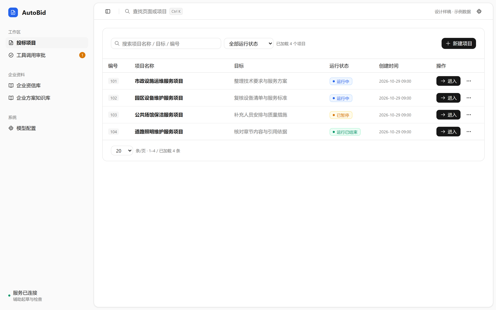
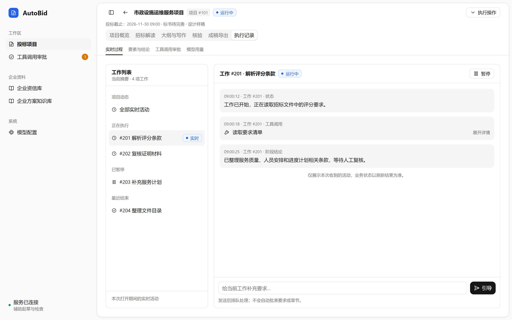
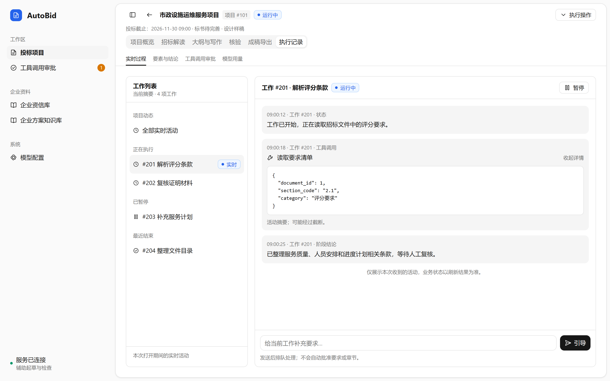

# AutoBid Engine 前端重构实施方案

> 实施对象：Claude Code。
> 编制日期：2026-10-29。
> 文档状态：第一轮实施中（2026-10-29），已勾选项与未完成项见第 9 节及 [实施报告](docs/frontend-refactor/IMPLEMENTATION_REPORT.md)。勾选只表示前端工程改造完成，不代表任何业务能力达到 V / P。
> 本文路径均以本仓库根目录为基准；实施只依赖本仓库代码、接口、本方案与 `docs/frontend-refactor/design/` 中的设计材料。
> 视觉基线：投标业务设计样稿 v1。截图是实施目标，不能作为前端功能已经完成的证据。

## 1. 实施目标与执行原则

将现有前端整理为以投标项目为中心的工作台，让使用者能明确回答：正在处理哪个项目、下一步需要做什么、哪些问题阻止成稿、修改会影响哪些已批准结果。

核心交付是统一工作台布局、重组业务导航、改善章节写作与证据查看、打通核验问题到修正位置的跳转。保留现有 React 19、TypeScript、Vite、Tailwind CSS v4 与 Go 服务端静态托管方式。

Claude 开始实施时必须：

1. 阅读 `AGENTS.md`、`ROADMAP.md`、`CLAUDE.md`，以实际源码核对当前能力。文档中的历史描述与代码不一致时，先确认实现及测试，再修正界面表述。
2. 检查 `git status --short` 和已有差异。当前工作区可能包含尚未提交的业务开发，尤其是文件角色、投标分包、否决项及截止时间相关改动；不得覆盖、回退或遗漏这些能力。
3. 按本方案 U0～U6 顺序完成主交付。先阅读第 3 节及设计图册，再实现对应页面。组件内部实现和命名可自行决定；已冻结的布局、尺寸、状态样式与关键交互必须遵守，无需为常规步骤再次请求确认。
4. 不扩大业务范围，不把布局重构变成后台状态机、数据库或模型流程重写。遇到实际接口缺口，先采用本文约定的降级呈现，记录缺口。
5. 只在完成相应检查后勾选实施进度。前端重构验收不能替代 `ROADMAP.md` 的 D0～D5 外部验证，也不能将 E 级能力标为 V 或 P。
6. Shell 优先使用真实 Git Bash。Windows 上可通过 PowerShell 入口显式调用 `D:/Git/bin/bash.exe`，实际脚本使用 Bash 语法；复杂脚本使用单引号 here-string，避免变量和引号被启动 Shell 提前解释。

## 2. 当前基线与范围

### 2.1 已有实现

| 能力 | 主要代码 | 本轮处理 |
| --- | --- | --- |
| 应用框架、令牌设置、服务状态 | `web/src/App.tsx` | 拆分框架并统一视觉，保留鉴权行为 |
| History 路由 | `web/src/lib/router.ts` | 支持细分页面、查询参数、旧地址兼容与离开保护 |
| 项目列表、创建与运行控制 | `web/src/pages/TasksPage.tsx` | 改善列表和创建流程 |
| 项目工作台、SSE 刷新 | `web/src/pages/TaskWorkspace.tsx`、`web/src/hooks/useTaskEvents.ts` | 作为稳定的项目上下文，重组页面 |
| 文档导入、解析片段与表格 | `web/src/pages/task/DocumentsTab.tsx` | 保留上传能力，改善资料浏览 |
| 要求、大纲、写作与版本 | `web/src/pages/task/ProposalTab.tsx` | 按业务职责拆分，支持直接定位 |
| 投标范围与否决项 | `web/src/pages/task/VetoPanel.tsx` | 整合进招标解读，保留全部现有规则 |
| 响应矩阵、一致性核验 | `web/src/pages/task/ReviewPanels.tsx` | 独立路由、问题定位与状态解释 |
| 图表、模板与成稿导出 | `web/src/pages/task/ExportPanels.tsx` | 提升可发现性，完善阻断修复与任务状态 |
| 检索、证据与知识库 | `ResearchTab.tsx`、`RetrievalEvidence.tsx`、`KnowledgePage.tsx` | 保留请求协议，增加结构化选择和上下文查看 |
| 监控、工具审批、报告与模型配置 | 对应现有页面及 `components/Intercepts.tsx` | 全部保留入口与业务动作 |

上表中简写文件名分别位于现有 `web/src/pages/task/`、`web/src/components/` 或 `web/src/pages/`，实施前用文件检索确认位置。

### 2.2 必须解决的问题

- 任务页八个页签与写作内部六个视图叠加，准备、写作、核验、导出之间的关系不直观。
- 成稿导出已有页面与接口，但侧栏和 `RoadmapPage.tsx` 仍包含“规划中”“接口尚未实现”等过时说明。
- 写作内部视图和选中章节主要保存在组件状态，刷新、复制链接、浏览器后退不能完整恢复工作位置。
- 写作页面把正文、依赖、证据、历史、图表纵向堆叠，编辑和核对需要反复滚动。
- 部分交互暴露证据 ID、数据库字段名和开发阶段说明，增加普通使用者的操作负担。
- 任务运行期限 `deadline_at` 与投标截止时间 `manifest.bid_deadline` 含义不同，现有“截止”标签容易混淆。
- 当前按读取结果刷新页面的方式，需要补齐未保存编辑保护、过期请求隔离和跨视图刷新规则。

### 2.3 主交付与后续项

**主交付：** 本文 U0～U6 的全部任务，以已有 API 完成；默认不新增数据库表、不新增业务审批类型、不改变生成与导出规则。

**后续项：** 持久化会话回放、完整探索图、跨项目业务汇总、服务端分页、原始 PDF 文件预览、独立聊天系统、租户与 RBAC。详细边界见第 12 节；这些不阻塞本轮前端交付，也不能以空按钮或演示数据冒充实现。

“投标项目”是当前 `Task` 的界面名称，不新建一套与任务平行的项目实体。Task 的运行状态与标书业务进度分开显示。

## 3. 目标布局与视觉规范

### 3.0 设计材料与适用范围

视觉目标由**本节数值、设计截图和区域说明**共同定义，不能只根据“现代化、简洁、类似工作台”等描述自由设计。

| 材料 | 位置 | 用法 |
| --- | --- | --- |
| 设计图册与区域标注 | [设计图册](docs/frontend-refactor/design/README.md) | 查看全部 7 个状态、区域对应关系和业务适配边界 |
| 可查看的静态样稿 | [布局样稿](docs/frontend-refactor/design/reference-layout.html) | 用浏览器打开，查看 CSS 数值与固定示例内容；不请求 API，按钮不执行业务动作 |
| 捕获参数与区域尺寸 | [截图清单](docs/frontend-refactor/design/capture-manifest.json) | 记录浏览器、视口、DPR、图片哈希与主要区域的 CSS 坐标 |
| 截图生成脚本 | `docs/frontend-refactor/design/render-design.mjs` | 从样稿重新生成截图；使用方法见图册，不加入应用运行依赖 |

图 1：项目列表。重点对照左侧导航、内嵌白色主容器、48px 顶栏、搜索工具条、表格和深色主按钮。



图 2：执行工作台。重点对照项目标题、灰底白色选中块的一级导航、紧凑二级导航、左侧工作列表、右侧活动详情和底部引导输入区。



图 3：工具活动展开。展开详情仅改变右侧活动区内部内容，不移动左侧列表和底部输入区。



图册另含模型配置、侧栏折叠、三栏写作和移动端执行页。所有图中文字均为投标业务示例；品牌、项目名、目标、工具摘要、模型名称和正文都已按 AutoBid 场景编写。交给实施者的设计材料须保持这一内容范围。

适用顺序：业务行为以第 5～7 节和真实 API 为准，布局尺寸以第 3 节及截图清单为准，页面观感以配套截图为准。样稿没有展示的删除、审批、错误、冲突等状态仍须实现；不得因为图片未出现而移除已有能力。样稿的固定数据只能用于隔离的视觉测试，不能进入生产页面的默认数据。截图中的“设计样稿”“示例数据”标识不进入正式页面。

设计范围已经明确：保留侧栏、内嵌容器、紧凑顶栏、分段导航、列表与详情联动等构图；导航和内容使用投标业务，新增第二级项目导航与三栏写作。模型页使用已有环境变量名与模型池配置语义。未实现的业务能力不出现在目标图中。交付时按这些已确定的适配项比对，不要求恢复其他领域的文案或功能。

### 3.1 工作台框架

采用左侧全局导航、右侧主工作区的布局。全局导航只管理项目入口、企业资料和系统配置；项目内部的步骤放在项目工作区中。

- 桌面侧栏展开宽度 **272px**，收起宽度 **64px**；支持主动折叠并记忆偏好。侧栏内边距 16px，导航项高 32px、图标 16px、图文间距 8px、圆角 8px；选中项为浅灰底深色字。
- 主工作区使用 `#fafafa` 底上的白色容器：顶部、右侧、底部间距 **8px**，展开侧栏时左侧不另加间距；折叠时增加 8px 左间距。主容器圆角 **14px**、1px 边框、轻阴影。1440px 视口下，展开时容器左边界 x=272，折叠时 x=72。
- 列表与资料页全局顶栏高 **48px**，左右内边距 24px；左侧折叠按钮、分隔线、导航查找，右侧放现有设置入口。项目详情由自己的项目标题与导航替代全局顶栏，同页只有一套页头。
- 项目标题按“32px 首行 / 16px 元信息行 / 32px 一级导航 / 32px 二级导航”排列，行间距 8px、顶部 10px、水平 24px。首行放返回、名称、项目编号、运行状态和执行操作；第二行放投标截止和业务状态。存在二级导航的单行桌面样本总高 147px（含底边框）；长文案或窄屏按内容增高，不强行裁剪。
- 一级项目导航必须使用**浅灰整体底座 + 白色选中块 + 深色选中文字 + 轻阴影**：底座高 32px、内边距 3px、圆角 10px，选中块圆角 8px，文字 14px/20px。路由链接仍采用链接语义。二级导航高 32px、文字 12px、间距 16px，当前项使用 2px 深色底线。
- 页面内容在桌面使用 24px 内边距；执行区内部左右栏间距 16px，列表宽 288px、右侧 `minmax(0,1fr)`。主容器、标题、列表、详情的对齐关系以图 2 为准。
- 运行控制、模型详情、追加目标和提示执行器放入“执行操作”或执行记录区域；不要在写作标题区堆满运维按钮。
- 导航底部保留服务连接与令牌设置入口，产品定位使用“辅助起草与检查”。不以过时的 Phase 编号作为产品版本。
- 快捷跳转可以检索页面名称和当前已加载的项目，支持 Ctrl/Cmd+K；明确这是导航查找，不宣称能够搜索全部招标原文。

### 3.2 样式约束

| 项目 | 目标 |
| --- | --- |
| 色彩 | 画布 `#fafafa`，面板 `#ffffff`，正文/主操作 `#171717`，弱文本 `#737373`，浅灰底 `#f5f5f5`，边框 `#e5e5e5`；链接/运行蓝 `#2563eb`，成功绿 `#059669`，警告橙 `#d97706`，危险红 `#dc2626` |
| 字体 | 固定字体栈 `"Segoe UI", "Microsoft YaHei", sans-serif`；正文/表单 14px/20px，辅助文字 12px/16px，普通页标题 24px/32px，区块标题 16px/24px，项目标题 14px/20px。正文 400，操作与页签 500，标题 600；等宽内容用 `Consolas, monospace` |
| 内容密度 | 页面内边距 24px，卡片 16px，活动条目 12px，组件间距固定在 4/8/12/16/24px 梯度；模型配置左右列为 336px 与剩余宽度，间隔 24px |
| 表格 | 列表工具条最小高 88px、水平内边距 24px；表头 40px、普通行最小 48px、单元格水平内边距 16px；分页区最小高 60px。长内容摘要展示、详情另行展开，数字对齐 |
| 按钮/输入框 | 默认高 32px、圆角 10px、水平内边距 10px；紧凑按钮高 28px、圆角 8px；普通图标 16px。引导输入框/发送按钮高 36px，移动端可扩大点击热区而不压缩文字 |
| 圆角与边界 | 卡片/主容器 14px，执行面板与活动条目 10px，次级块 8px；边框 1px；主容器阴影 `0 1px 3px #00000014`，页签选中块 `0 1px 2px #00000015` |
| 层级 | 通过标题字号、留白和浅灰分组建立层次；侧栏和一级导航的选中项用中性色，蓝色留给链接和运行状态 |
| 状态 | Badge 为 12px/16px、内边距 2px 8px、圆角 7px、圆点 6px；蓝态底/边 `#eff6ff/#bfdbfe`，绿态 `#ecfdf5/#a7f3d0`，橙态 `#fffbeb/#fde68a`；失败、失效、待复核同时有图标或文字 |
| 主题 | 本轮必须完成浅色主题；先建立语义颜色变量。深色模式不属于必交项，未完成时不显示切换开关 |

在 `web/src/index.css` 定义背景、面板、正文、弱文本、边框、主操作、危险、成功、警告等语义变量。页面使用公共组件与变量，不继续散布互相冲突的颜色组合。

交互状态也属于视觉约束：普通按钮 hover 使用浅灰底，主按钮 hover 使用 `#404040`；焦点为 3px 半透明灰环且保留明确边界；disabled 使用 0.5 透明度并真正禁止提交，loading 保留原按钮宽度。列表选中和 hover 都不能只改变文字颜色。静态样稿中的图标用于说明位置；正式页面复用现有 `lucide-react` 的同义图标，尺寸与线条粗细保持一致。

### 3.3 响应式与可访问性

- 视口宽度 ≥1200px 默认展开侧栏，768～1199px 默认折叠，<768px 改为 288px 宽抽屉（上限为视口宽度减 32px）；用户主动设置的桌面偏好不被窗口变化反复覆盖。窄屏主容器取消外边距、边框与圆角，内容内边距 16px。
- 三栏写作按**扣除侧栏、边框和内边距后的实际内容区宽度**切换：1120px 及以上显示三栏；800～1119px 显示目录与正文，证据改抽屉；不足 800px 显示正文，目录和证据通过按钮打开。
- 三栏宽度为目录 240px、正文 `minmax(520px,1fr)`、依据面板 320px，两处栏间距各 16px。1440px 展开侧栏时内容宽 1110px，应显示两栏；折叠侧栏后内容宽 1310px，显示三栏，见图册第 6 图。拖动调宽不作为首轮验收要求。
- 执行工作台在内容宽度 ≥800px 时固定两栏；不足 800px 时改为活动详情单栏，顶部“工作列表”按钮打开选择抽屉，当前工作与草稿保留。列表、活动区独立滚动，底部引导区在详情面板内占独立一行，不能绝对定位覆盖活动。
- 一级导航宽度不够时仅导航行横向滚动，并确保当前项进入可视区域；二级导航采用同样规则。不能为了适应窄屏把六个一级入口缩成不可读的小字。
- 写作时标题与操作栏固定，各面板独立滚动；列表页采用主区域滚动。使用 `min-width: 0`、`min-height: 0` 避免内容撑破容器。
- 表格可以在自身容器横向滚动；整页不应因表格、长文件名或长编码而横向溢出。
- 模态框与抽屉具备可访问名称、初始焦点、焦点约束、关闭后的焦点恢复；有未保存修改时关闭也需保护。
- 所有图标按钮提供可访问名称；键盘可完成导航、保存、审批与关闭；焦点状态清晰。
- 页间导航使用链接与 `aria-current`；同页切换组件才采用 Tabs 语义。保留 Ctrl/Cmd 点击、新窗口打开与浏览器后退。
- 在 1440×900、1280×800、768×1024、390×844 四种视口检查布局，窄屏至少能查看内容、执行主要动作和确认结果。

## 4. 信息架构与路由

### 4.1 全局导航

| 分组 | 入口 | 行为 |
| --- | --- | --- |
| 工作区 | 投标项目 | `/tasks`，默认首页 |
| 工作区 | 工具调用审批 | `/intercepts`，保留跨任务待审批入口与数量 |
| 企业资料 | 企业资信库 | `/credentials` |
| 企业资料 | 企业方案知识库 | `/knowledge` |
| 系统 | 模型配置 | `/llm` |

写作和成稿导出属于具体项目，主要入口放在项目内部。保留旧的写作入口地址作为项目选择页，不增加重复的主导航。

### 4.2 项目导航与规范地址

下表是**前端页面地址**，不改变 `/api/...` 后端路由。`:taskId`、`:sectionId` 为正整数。

| 一级导航 | 页面 | 前端地址 |
| --- | --- | --- |
| 项目概览 | 进度、阻断与下一步 | `/tasks/:taskId/overview` |
| 招标解读 | 招标包文件 | `/tasks/:taskId/documents` |
| 招标解读 | 要求、投标范围与否决项 | `/tasks/:taskId/requirements` |
| 招标解读 | 证据检索 | `/tasks/:taskId/research` |
| 大纲与写作 | 大纲及审批 | `/tasks/:taskId/outline` |
| 大纲与写作 | 章节选择 | `/tasks/:taskId/writing` |
| 大纲与写作 | 具体章节 | `/tasks/:taskId/writing/:sectionId` |
| 核验 | 响应矩阵 | `/tasks/:taskId/matrix` |
| 核验 | 一致性核验 | `/tasks/:taskId/consistency` |
| 核验 | 推演审查报告 | `/tasks/:taskId/report` |
| 成稿导出 | 门禁、模板、导出任务 | `/tasks/:taskId/export` |
| 执行记录 | 实时执行过程 | `/tasks/:taskId/monitor` |
| 执行记录 | 招标要素与推演结论 | `/tasks/:taskId/elements` |
| 执行记录 | 工具调用审批 | `/tasks/:taskId/approvals` |
| 执行记录 | 模型用量与配置链 | `/tasks/:taskId/llm` |

同一分组存在多个页面时，用紧凑的二级导航；一级导航最多上述六项。导航分组不是额外的业务状态机。

查询参数统一约定：

- 列表的 `q`、`status`、`sort`、`page`、`pageSize` 表示当前列表条件；设置值白名单并限制有效范围。
- 要求页的 `requirement` 定位要求，`filter` 使用 `all/veto/scoring/needs_revision/evidence_gap`。
- 大纲页的 `version` 指定查看版本，`requirement` 定位尚未映射或需要调整映射的要求；缺省优先显示明确标注的当前批准版本，同时提供正在修订的版本入口。
- 写作页的 `rev` 指定只读历史版本，缺省为当前版本；`panel` 使用 `requirements/evidence/history/charts`；`evidence` 定位具体证据。
- 一致性页的 `finding`、`run` 定位结论及核验运行；矩阵页的 `requirement`、`section` 定位行。
- 执行页的 `work=all` 或正整数工作节点 ID 表示当前选择，缺省为 `all`；`kind` 允许 `all/round/text/tool/tool_error/state/error/intercept_request/intercept_decided`。选择工作使用 push，临时事件类型过滤使用 replace；不得用 worker 名称冒充工作 ID。
- 这些标识都必须经后端返回的任务归属与数据验证。定位失败时明确提示，不静默跳到另一项目、章节或版本。

### 4.3 旧地址兼容

| 原地址 | 兼容行为 |
| --- | --- |
| `/` | 使用 replace 跳到 `/tasks` |
| `/tasks/:taskId` | 保持旧默认语义，replace 到该项目的 `documents`；新列表“进入项目”按钮直接链接 `overview` |
| `/tasks/:taskId/proposal` | replace 到 `requirements`，保留原写作页首次打开的准备入口 |
| `/proposal` | 保留项目选择页，默认选择后进入 `outline` |
| `/proposal?intent=export` | 项目选择后进入该项目 `export` |
| `/roadmap/phase4` | replace 到 `/knowledge` |
| `/roadmap/phase5` | replace 到 `/proposal` |
| `/roadmap/phase6` | replace 到 `/proposal?intent=export`，不再显示未实现的导出说明 |
| 其他已有任务页地址 | 保持有效，归入新的导航分组 |
| 非法任务 ID、未知路径 | 显示明确的不存在页面；不以任意默认页掩盖路由错误 |

路由实现要求：

- 保留并扩展现有 History 路由，集中提供路径解析、URL 构造和导航函数；页面不自行拼装不同格式的地址。
- 路由订阅覆盖 `pathname + search + hash`；修复仅修改查询参数时页面不刷新的情况。
- 自动补全缺省章节、旧地址归一化使用 replace；用户切换章节或主要页面使用 push。
- 列表输入搜索使用 replace 或防抖更新，避免每输入一个字符就产生一条后退记录。
- 深层地址在 Vite 开发服务和 Go 静态托管中刷新都能打开。正常情况下复用 `server/static.go`，不新增与 API 冲突的后端页面路由。
- 浏览器后退/前进也经过第 7.2 节的未保存保护，不能只保护应用内部按钮。

## 5. 关键页面与业务流程

### 5.1 项目列表与创建

列表上方使用搜索、状态筛选、结果数量和“新建项目”，表格包含名称、运行状态、创建时间、进入项目和更多操作。

桌面构图必须对照图 1：搜索和筛选在同一工具条左侧，主按钮靠右，表格和分页在同一张卡片内；不额外插入大幅欢迎区或无接口支撑的汇总卡。搜索框宽 320px、状态筛选宽 144px；窄屏允许换行。侧栏折叠状态对照图册第 5 图。

- 保留启动、暂停、恢复、复活、删除等现有能力，按现有状态显示可用动作。运行完成不能显示为“标书完成”。
- 删除进入明确的确认对话框，展示项目名称与删除影响。
- 搜索、排序、分页先处理已经加载的任务集合。当前客户端请求上限是 500 条，后端尚无完整分页与总数协议；页面写“已加载 N 个项目”，不把该数量当全部项目总数。
- 不为每一行同时请求要求、大纲、导出门禁。列表首版不强制显示业务完成率或投标截止时间；这些信息在项目概览显示。
- 新建表单分“基本信息”和“高级运行配置”。保留名称与总目标必填、描述、分项目标、范围、超时、模型链等已有字段。
- 用业务名称显示“招标编号”“标段”等，技术字段名放在必要的帮助信息中。
- 默认先创建、后导入文档；保留原有可选立即启动能力及提醒。不要默认触发付费模型调用。
- 不把运行超时字段包装为投标截止时间。投标截止在文档解读后由投标范围面板确认。

### 5.2 项目概览

展示项目名称、投标分包、投标截止时间、运行状态、当前批准大纲版本、核心待办和导出门禁。

概览复用现有要求清单、大纲、覆盖统计和导出就绪度数据。优先提供：

1. 待复核要求与否决项数量。
2. 大纲审批状态与尚未映射的要求。
3. 当前大纲章节的写作、定稿和失效状态。
4. 响应矩阵、一致性核验与导出阻断入口。

“下一步”是基于后端状态的导航建议，不自动推进流程。用户可以回看任一步骤；是否允许审批、写作或导出仍由相应 API 决定。

接口尚未加载、请求失败、没有数据、确实完成是四种不同情况。失败时不能用零条待办或绿色完成态替代。

### 5.3 招标解读

文档页采用文件列表与解析内容详情布局：

- 保留文件与文本导入、拖放、格式及大小验证、解析结果和重试。
- 文件角色、发布时间、招标编号、分包与页数作为元信息；保留原有 `doc_role`、`published_at` 字段和上传协议。
- 展示解析片段、页码范围、表格和原文定位，明确标注“解析原文片段”。本轮不承诺原始 PDF 的逐页可视化。
- 不显示缺少实际任务进度接口支撑的解析百分比；上传与解析期间展示真实请求中的等待状态。
- 多文件队列如实施，沿用单文件接口逐件发送、展示每件结果；不得伪装为后端已有原子批量上传。

要求页集中展示投标范围、否决项、评分汇总和可复核清单：

- 投标截止统一显示北京时间及来源，缺失时显示“尚未确认”；保留人工修改与恢复原文的能力。
- `bid_lots: []` 表示全部分包；不能把空数组解释为一个也不投。
- `veto_status` 的待核对、通过、不通过分别显示；通过和不通过都必须填写依据，保持现有 API 验证。
- 显示价格评分项、未投分包和否决项的归属，不将它们错误计入技术标章节覆盖分母。统计优先使用服务端返回口径。
- 保留提取、人工新增/修改/删除、逐条复核、确认完整清单的能力。
- 提取后展示新增、变更、孤立旧项及待复核结果；不能因提取成功就自动确认清单。
- 原文位置、证据和映射章节可直接打开对应详情；切换筛选后仍能定位指定要求。
- 界面准确说明目前文件先后效力只部分实现；不宣称所有后发澄清已逐条覆盖旧要求。

### 5.4 大纲与审批

- 展示版本选择、树形章节、映射覆盖、依赖关系、审批状态和修订说明。
- 大纲编辑继续调用 `createOutline/updateOutline`，提交与批准分别执行已有操作。
- 当前批准版本与正在修订的草案分别展示，不能把“最新版本”自动标成“已批准版本”。
- 编辑已批准版本前说明将派生新版本并导致旧批准失效；提交后完全使用服务器返回的新版本和状态。
- 未映射要求、依赖错误或审批冲突保留在页面中，并提供对应修复入口。
- 章节排序、层级调整与依赖选择可优化交互，但最终仍提交原有 `SectionInput`；不通过前端自动消除依赖或绕过后端无环校验。

### 5.5 章节写作工作台

桌面目标结构：

```text
项目标题：名称 / 投标截止 / 当前大纲 / 业务状态
项目导航：概览｜招标解读｜大纲与写作｜核验｜成稿导出｜执行记录
┌────────────┬────────────────────────┬──────────────────┐
│ 章节目录   │ 章节标题 / 保存状态    │ 要求 / 证据      │
│ 搜索       │ 编辑 / 预览            │ 原文与核验结果   │
│ 层级与状态 │ 正文                   │ 历史 / 图表      │
│ 缺口提示   │                        │                  │
├────────────┼────────────────────────┼──────────────────┤
│            │ 保存 / AI 撰写 / 定稿  │ 相关操作         │
└────────────┴────────────────────────┴──────────────────┘
```

- 目录支持按章节标题/编码过滤，显示状态文字或可解释标记；选中章节进入规范 URL。
- 正文继续以 Markdown 字符串保存。首版保留可靠的文本编辑器，加安全的 Markdown 预览；本轮不更换正文存储格式，不引入 Word 式分页编辑。
- Markdown 预览禁用原始 HTML、脚本和危险 URL；文档内容只作为内容渲染。预览不等于最终 DOCX/PDF 版式。
- 编辑器显示未保存、保存中、已保存、冲突候选稿、当前版本已更新等状态。
- AI 撰写/重写、人工保存、批准当前修订、历史查看、采用候选稿/回滚保留全部现有流程。
- `SectionDetail.writable`、`blocked_reason`、`dependencies_ready`、`writing` 和后端返回共同决定操作是否可用，禁用原因必须可读。
- AI 发起成功只表示派发成功；正文写回后才显示已生成。保留失败、模型不可用、来源失效与候选稿结果。
- 图表保留生成、查看、重新绑定、渲染和删除入口，按修订展示过期状态；没有渲染产物时显示源码与原因，不伪造图片。
- 版本初版提供两版本内容并排查看及已有修改说明，逐行彩色差异可后续增强；不得把修改说明当自动计算的差异。

### 5.6 证据选择与上下文

- 将手填证据 ID 改为证据选择面板；开发排查仍可查看 ID，但不作为普通使用者的主要操作方式。
- 候选来源优先为当前要求绑定的检索运行、章节已有证据与该任务的检索运行列表。按需读取选中运行，不一次加载所有任务或整个知识库。
- 展示来源标题、解析片段、页码/定位可靠性、核验结论、支持关系、原因及失效状态。
- `SectionDetail.evidence[].usable` 和真实核验结果决定可用性；只有 `verified + supports` 不能被扩展解释为整项要求已完全满足。
- 未核验、证据不足、矛盾、失效和缺失分别呈现。允许沿用后端支持的缺口/待处理引用记录，但不得将其显示为已证实依据。
- 选择证据更新当前编辑草稿，人工保存时提交 `evidence_ids`；不暗中批准证据或将知识库搜索命中直接当成证据 ID。
- 要求绑定使用已有 `evidence_run_id/evidence_ids/evidence_gap`；如缺少足够上下文，保留缺口并引导用户发起检索。
- 检索重试沿用同一逻辑请求的 `request_key` 与原有恢复语义，不因刷新、打开抽屉而自动创建新研究请求；不启用多 Agent 路由。
- 现有数值指标核验入口继续保留，明确其适用范围和待人工复核的情形。
- 根据 `source_domain` 分流展示。企业资信、招标原文、知识库与推演结论保持各自的数据归属；不能强行套用同一种知识库快照。

### 5.7 核验与问题修复

- 响应矩阵单独展示“已映射”和“实质响应”两层统计，保留全量经复核要求基准及后端范围过滤。
- 未映射、未核验、未通过、已失效、负偏离具备可选筛选；表格行能跳到对应要求和章节。
- 一致性页面展示最新运行是否仍适用于当前正文、冲突两侧原文与修订号、处理方式及处理说明。
- 处理结论继续提交 `version`，遇到 409 显示已变更或已失效，并读取新数据；不自动改用最新版本重放原决策。
- 按 `fixed/accepted/false_positive` 显示真实处理含义。人工接受风险不能被描述为矛盾已经客观消除。
- 推演审查报告保留独立名称与下载，不将其等同于技术标成稿或响应矩阵核验报告。

### 5.8 成稿导出

页面依次包含导出门禁、依赖提示、模板与格式选择、历史导出任务。

- `exports/preflight` 的 `readiness` 是页面判断依据；实际创建导出仍由服务端在锁定快照时再次校验。
- 阻断事项按类别分组，展示原因和“去处理”。有具体标识时定位具体对象，缺失标识时跳到对应列表，不能构造无效链接。
- 模板上传/删除、默认模板下载、投标人名称、DOCX/PDF 选择全部保留。
- 任务状态区分排队、执行、成功、失败；展示锁定的大纲/章节修订、模板、目录刷新结果、警告和下载动作。
- 仅当前存在排队或运行任务时短间隔轮询；全部终态后停止高频刷新。
- 422 返回的新 `preflight` 覆盖页面之前的门禁结果，保留已选模板和格式，禁止绕过后端结果再次强行提交。
- 外部依赖异常按 `warnings/status` 如实展示：LibreOffice 缺失会影响 PDF 与目录刷新，图表渲染缺失影响图表产物。不要把所有警告提升为统一业务阻断，也不要隐藏影响。
- 导出成功只表示产物生成成功，不表示真实投标已达 V/P、已经电子签章或已经被交易平台接收。

阻断跳转表应集中维护：

| 后端 blocker kind | 目标页面 |
| --- | --- |
| `no_approved_outline` | `outline` |
| `requirements_not_confirmed` | `requirements` |
| `requirement_unmapped` | `outline`，附要求定位信息 |
| `veto_pending`、`veto_failed` | `requirements?filter=veto`，可附 `requirement` |
| `section_not_approved` | 对应 `writing/:sectionId`；无 ID 时进入章节列表 |
| `matrix_stale`、`matrix_failed`、`matrix_unverified` | `matrix`，可附要求/章节定位 |
| `consistency_not_run`、`consistency_stale`、`finding_open` | `consistency`，可附 `run/finding` |
| `evidence_invalid` | 优先相关章节的证据面板，其次相关要求，再次 `research` |
| 未知类型 | 保留服务器原文与刷新操作，不忽略、不标绿、不猜测目标对象 |

### 5.9 执行记录与企业资料

**执行工作台为必交布局，必须完成“选择工作 → 查看对应活动 → 展开工具详情 → 发送工作引导”的联动。** 桌面按图 2、展开态按图 3、窄屏按图册第 7 图实施；不能用所有节点卡片与混合事件流的原有堆叠布局代替。

左栏固定包含“全部实时活动”，其余按待执行、正在执行、已暂停、最近结束分组显示 `overview` 返回的工作摘要。点击行后更新 `work` 参数、选中背景、右侧标题与事件过滤；右侧同时保留“查看节点详情”。组名与数量只反映已加载摘要，不宣称是全部工作历史。空组可折叠，长名称截断并可查看全文。

| 数据/状态 | 展示与联动规则 |
| --- | --- |
| `overview.open_intents/running_intents/paused_intents/recent_terminal_intents` | 用节点 `id` 建立工作行；沿用 `summary/state/owner/blocked_reason`，同一节点在刷新或换组后保持选中，不因 worker 变更创建新会话 |
| `Activity.node_id` | 选中工作时仅显示节点 ID 明确相同的事件。缺少 ID 或指向其他节点的活动保留在“全部实时活动”，不按相似文字或相同 worker 强行归入当前工作 |
| `Activity.worker` | 显示执行来源；可作为辅助筛选，不作为持久化会话主键，不以它推断工作状态 |
| `Activity.kind/summary/at` | 生成带类型、时间与摘要的活动条目。按接收顺序从旧到新排列；不修改共享事件数组，不依赖字符串字典序排列 SSE 序号 |
| `Activity.detail` | 默认折叠、按条目独立展开，使用文本或可解析的 JSON 格式化显示；不可按 HTML 执行。无 detail 时不出现空的展开按钮 |
| 实时事件的边界 | 现有工具活动可能只含截断后的调用摘要或错误，且没有完整的成功返回及调用配对 ID；标题标为“活动摘要”，不能承诺完整输入/输出或自行合成工具调用对 |
| 未在摘要中的工作 ID | 用已有 `api.node` 验证任务归属及节点类型；有效 intent 可单独展示，404/非工作节点明确提示。不能静默选中另一项或启动全量历史读取 |

右栏为三行结构：顶部工作标题/状态/控制区、中部独立滚动的活动区、底部引导区。工作标题区最小高 48px；活动内边距 16px、条目间距 12px；底部内边距 12px、有顶部分隔线，输入框与发送按钮高 36px。该结构使用 `grid` 或 `flex` 分配剩余高度，不能依赖固定高度减法在二级导航或错误提示增加时覆盖正文。移动端输入法弹出后仍能看到输入内容和提交操作。

单工作操作必须遵守以下状态和接口：

| 当前选择 | 控制与底部输入 | 现有请求 |
| --- | --- | --- |
| 正在执行的工作 | 暂停、取消；输入按钮为“引导”，成功提示“已排队” | `api.controlWork(taskId,intentId,'pause'/'cancel')`、`api.steerWork(taskId,intentId,message)` |
| 已暂停的工作 | 取消；输入按钮为“发送并恢复”，成功后刷新工作状态 | `api.controlWork(...,'cancel')`、`api.messageWork(taskId,intentId,message)` |
| 待执行/终态/状态未知的工作 | 展示只读活动和原因，不提供会误发的运行中引导按钮 | 读取快照/节点；不伪造恢复或发送成功 |
| 全部实时活动 | 底部显示“选择一个工作后可发送引导”；项目级“补充提示”“追加目标”位于执行操作菜单 | 继续使用 `api.addHint`、`api.addGoal`，明确这是项目提示或目标，不伪装成聊天回复 |

输入按 `taskId + intentId` 在内存中隔离保存，切换工作不能把 A 的草稿发给 B。请求使用提交瞬间的工作 ID 和文本；按钮在途禁止重复提交，成功仅清除对应的已发送草稿，失败/409/401 保留文本并刷新可用状态。取消工作保留确认步骤；任务级启动、暂停、恢复、复活仍按原 API 提供。未保存内容的离开处理沿用第 7.2 节原则。

滚动和连接行为同样属于验收范围：

- 用户位于活动底部时新事件跟随；向上阅读时保持位置，显示“有新活动”按钮。切换工作保留各自的滚动位置与已展开条目；条目被缓存淘汰时允许重置并提示。
- 条目 key 在客户端稳定生成，不能使用会随着插入而改变的数组下标；服务重启后 SSE 序号可能重复，需要连接代次或本地唯一编号区分。不得据此假设具备历史补拉。
- 活动区标为“本次打开期间的实时活动”。显示连接中、已连接、重连中、断开、服务端丢弃以及客户端缓存上限提示；保留现有有界缓存（默认 300 条），新打开页面不会恢复此前活动。
- 重连后重读业务快照及工具审批；此前收到的活动可留在内存，断开期间可能缺失，不能显示“历史已恢复”。“清空显示”只清空客户端活动，不删除业务记录。
- `overview` 是有界推演摘要，不能展示为全部探索图，也不能据此判断全部要求已处理。

工具调用审批与大纲/章节业务审批使用不同名称、说明和动作，保留已有审批审计入口。企业资信、方案知识库、索引管理保留查询、编辑、删除、索引构建/激活等现有能力。

模型配置采用图册第 3 图的左侧配置列表、右侧编辑表单。选中卡片使用细深色边界与浅暖色底，保存操作在表单底部；未保存切换要保护。仍编辑现有 `LLMProfile` 的环境变量名、模型池、优先级与配置链等字段，图片中未展示的既有字段放入高级配置，不删除或改成不受支持的直接密钥输入。不增加未实现的账号、租户、权限管理、独立聊天或全局日志入口。

## 6. 业务状态与接口契约

### 6.1 状态呈现原则

| 对象 | 必须保持的语义 |
| --- | --- |
| Task | 表示推演运行生命周期，独立于标书完成度 |
| 要求清单 | `draft/confirmed/stale`，确认绑定 epoch；提取成功不是确认 |
| 否决项 | `pending/passed/failed`；待核对与不通过均参与真实导出阻断 |
| 大纲 | `draft/pending_approval/approved/superseded`；批准绑定具体版本 |
| 章节 | 当前正文、当前批准修订、依赖就绪、写作中、失效原因分别展示 |
| 证据 | 核验状态与支持关系分别展示，来源失效传播必须可见 |
| 核验 | 映射完成、实质响应通过、一致性无待处理问题是不同判据 |
| 导出 | 当前可导出、某次历史导出成功、真实提交完成是不同事件 |

前端可派生用于导航的 `unknown/empty/action_required/in_progress/complete/stale/error` 展示状态，必须保存原始业务状态与来源。没有数据或分母为零时不显示 100% 完成。失效不能沿用旧绿色状态；读取失败不能沿用未经标注的“最新结果”。

建议下一步的优先顺序为资料与清单复核、大纲审批、章节缺口与定稿、矩阵、一致性、导出；阻断事项单独显示。该排序只是 UI 建议，不为写作添加后端没有的强制门禁，也不自动批准前置步骤。

### 6.2 真实 API 对照

下表中的路径是当前后端契约。具体类型、字段与请求形态以 `web/src/api/client.ts`、`web/src/api/types.ts` 和对应服务端注册为准。

| 场景 | 接口 | 服务端位置 |
| --- | --- | --- |
| 任务列表与创建 | `GET/POST /api/tasks` | `server/http.go` |
| 任务详情与运行控制 | `GET /api/tasks/{id}`；运行控制为 `POST /api/tasks/{id}/{action}`，action 分别为 start、pause、resume、revive | `server/http.go` |
| 文档 | `GET/POST /api/tasks/{id}/documents` | `server/http.go`、`server/knowledge.go` |
| 要求清单 | `GET/POST /api/tasks/{id}/requirements`；提取和确认为该路径下 `POST extract`、`POST confirm`；单项为 `PUT/DELETE /api/tasks/{id}/requirements/{reqID}` | `server/proposal.go` |
| 投标范围、否决项 | `PUT /api/tasks/{id}/requirements/bid-scope`；`PUT /api/tasks/{id}/requirements/{reqID}/veto` | `server/proposal.go` |
| 大纲版本与审批 | `GET/POST /api/tasks/{id}/outlines`；`GET/PUT /api/tasks/{id}/outlines/{version}`；该版本路径下 `POST submit`、`POST approve` | `server/proposal.go` |
| 章节与修订 | `GET /api/tasks/{id}/sections/{sectionID}`；该章节路径下 `POST dispatch`、`POST revisions`、`POST revisions/{revNo}/approve`、`POST revisions/{revNo}/rollback` | `server/proposal.go` |
| 任务检索 | `POST /api/tasks/{id}/research`；`GET /api/tasks/{id}/retrieval-runs` | `server/retrieval.go` |
| 证据查看与核验 | `GET /api/retrieval/runs/{runID}/evidence`；`POST /api/retrieval/runs/{runID}/evidence/{evidenceID}/verify` | `server/retrieval.go` |
| 响应核验 | `POST /api/tasks/{id}/compliance/verify`；`GET /api/tasks/{id}/compliance/matrix`；`GET /api/tasks/{id}/compliance/coverage` | `server/compliance.go` |
| 一致性核验 | `GET/POST /api/tasks/{id}/consistency/runs`；`GET /api/tasks/{id}/consistency/findings`；`POST /api/tasks/{id}/consistency/findings/{findingID}/resolve` | `server/compliance.go` |
| 导出就绪与预检 | `GET /api/tasks/{id}/export-readiness`；`GET /api/tasks/{id}/exports/preflight` | `server/compliance.go`、`server/export.go` |
| 导出任务与下载 | `GET/POST /api/tasks/{id}/exports`；`GET /api/tasks/{id}/exports/{jobID}`；`GET /api/tasks/{id}/exports/{jobID}/download` | `server/export.go` |
| 模板 | `/api/export/templates` 及其已有文件、删除接口 | `server/export.go` |
| 图表 | `/api/tasks/{id}/charts` 及已有详情动作 | `server/charts.go` |
| 实时活动与工作控制 | `GET /api/tasks/{id}/events`；`POST /api/tasks/{id}/works/{intentID}/{action}`，action 分别为 control、steer、message | `server/http.go`、`server/steer.go` |
| 工具审批 | `GET /api/intercepts`；`POST /api/intercepts/{pendingID}/decide`；`GET /api/tasks/{id}/intercept-audit` | `server/intercept.go`、`server/http.go` |

表中的 `{action}` 是对已注册动作路径的归纳，并非可传任意动作的通用接口；“该路径下”表示在已列路径后追加相应子路径。未列全的企业资料、报告与模型接口继续沿用客户端现有封装。不要根据页面名字自行创建 `/api/projects`、统一审批接口或全局聊天接口。

### 6.3 错误处理

- 401：沿用令牌设置入口与现有鉴权事件，避免多个请求同时弹出多个对话框；未保存内容不能被重新挂载直接清空。
- 404：明确任务/章节/来源不存在或不可访问，保留返回入口。
- 409：按 `code/data` 展示版本冲突、候选稿、已失效结论、模板被引用等实际原因，保留编辑内容。
- 410：工具审批等待者已结束等情况显示为已失效，刷新列表，不保留可点击的“批准”假状态。
- 422：展示业务前置条件、证据或导出门禁明细，不统一解释为表单填写错误。
- 503：模型或服务暂不可用，允许用户保留人工编辑；不循环重发写作、研究或导出请求。
- 网络故障：保留最近一次成功读取结果并标明更新时间和错误；不得自动重试可能重复产生业务结果的 POST。

## 7. 数据刷新与编辑安全

### 7.1 项目上下文与请求生命周期

- `TaskWorkspace` 或新的 `TaskWorkspaceProvider` 在同一任务的页面切换时保持挂载，统一管理任务信息、SSE 和失效通知。
- 一次只订阅当前打开任务的活动流；任务改变、页面卸载和令牌变化时正确清理旧连接与定时器。
- 沿用单次事件批量刷新思路，避免每条工具事件触发全部接口重读。
- 对当前任务的 `section-writer/proposal` 事件触发相应资源失效；事件字段不足时做有界重读，不猜测章节 ID。
- 保留写作中章节、运行中导出任务的轮询作为补偿。重新连接或浏览器重新聚焦时重读当前可见的关键业务状态。
- `useAsync` 若继续使用，需验证卸载、依赖变化和禁用后的过期响应不会更新新任务/新章节。必要时增加取消或请求序号失效处理。
- 缓存/请求键至少包含任务、对象及版本；令牌改变清理受保护远程数据，不能把上一任务的数据短暂渲染到下一任务。
- 新增依赖仅用于已经明确需要的可访问交互、Markdown 或验证能力；同时更新 `package.json` 与锁文件并验证兼容，不整体替换现有前端技术栈。

### 7.2 未保存修改与并发

- 章节草稿同时记录正文、摘要、修改说明、证据集合及开始编辑时的 `base_rev_no`、`based_on_outline_version`。
- 草稿变脏后，后台刷新只更新远端状态和冲突提示，不覆盖本地文本，也不悄悄把编辑基线换成最新修订。
- 切换章节、项目、页面、历史版本以及浏览器后退/前进时，提供保存并离开、放弃修改、继续编辑。保存失败时留在原编辑位置。
- 浏览器刷新/关闭使用 `beforeunload` 提示；不假设浏览器会展示自定义文案，不默认将正文或证据原文长期写入 localStorage。
- 避免用组件 `key`、令牌 epoch 或条件渲染造成未确认的草稿卸载。令牌变化后保留本地草稿，重新核对同一任务访问与版本后才允许提交。
- 人工保存严格提交编辑基线；409 返回的候选稿应可打开、比较和恢复，不能自动重试为覆盖当前版本。
- 未保存内容存在时发起 AI 重写、批准或回滚，必须先明确处理草稿，不能让这些动作默默丢弃编辑。
- 接到在途 AI 返回时，使用服务器的 `applied/stale_outline/conflict_candidate` 等结果；客户端不自行决定替换主稿。
- 保存中允许继续编辑时，成功回执只能确认已发送的草稿快照；若期间内容又变更，仍应保留未保存标记。也可在短暂提交期间禁用编辑并明确显示状态。

### 7.3 资源失效矩阵

以下动作成功后重新读取相关资源；只为正在使用的页面立即加载，其余标记为待刷新。

| 动作 | 至少刷新或失效的资源 |
| --- | --- |
| 导入文档、提取/修改要求、变更投标范围 | 文档/要求、概览、大纲、相关章节、矩阵、一致性、导出就绪 |
| 核对否决项 | 要求、概览、导出就绪 |
| 确认清单、提交/批准/修改大纲 | 要求、大纲、概览、章节可写性、矩阵、一致性、导出就绪 |
| 人工保存、AI 写回、回滚、批准章节 | 章节与目录、概览、图表状态、矩阵、一致性、导出就绪 |
| 证据核验、来源失效或删除 | 证据、关联要求/章节可用性、概览、矩阵、一致性、导出就绪 |
| 响应核验、运行/处理一致性结论 | 对应核验数据、概览、导出就绪 |
| 模板或图表变化、创建导出 | 相关模板/图表、导出预检、导出任务 |
| 工具审批与运行控制 | 工具待审批、审计、运行状态、推演摘要 |

这张表定义前端需要重读的范围，不重写后端失效规则。后台发生的变化仍需通过事件、聚焦重读、手动刷新和操作时的服务端校验发现。

## 8. 代码组织与迁移方式

建议形成以下职责划分；可以结合既有命名调整，不要求为了目录形式搬动无关代码。

```text
web/src/
  App.tsx                         路由装配、全局 Provider 与鉴权入口
  index.css                       设计变量和基础样式
  components/
    layout/                       AppShell、Sidebar、GlobalHeader、TaskHeader
    ui/                           Button、Card、Dialog、Drawer、Tabs、Table 等
    ui.tsx                        迁移期间的兼容导出
  lib/
    router.ts                     解析、导航、旧地址归一化
    routes.ts                     类型化 URL 构造与导航定义
    format.ts                     现有业务标签和格式化
  features/task-workspace/
    TaskWorkspaceProvider.tsx     任务上下文、SSE、资源失效
    TaskProgress.tsx              状态与下一步建议
    blocker-links.ts              导出阻断到页面的映射
  features/proposal/
    requirements/                 清单、范围、否决项与原文定位
    outline/                      大纲版本、编辑、审批
    writing/                      目录、正文、草稿保护、修订查看
    evidence/                     选择面板与来源详情
    review/                       矩阵、一致性
    export/                       门禁、模板、导出任务、图表展示
  pages/                          项目列表、资料库、配置及路由入口
  api/                            保留 client.ts 与 types.ts 作为契约边界
```

迁移顺序：

1. 先抽离公共组件与框架，保留 `components/ui.tsx` 的旧导出签名，降低所有页面同时修改的风险。
2. 建立新路由和兼容映射，再将 `ProposalTab.tsx` 内的要求、大纲、写作拆成独立页面组件。
3. 尽量直接移动既有请求和业务处理，再改善交互；避免为每个新页面重写一套状态判断。
4. `ReviewPanels.tsx`、`ExportPanels.tsx` 可以先作为适配层复用，再按职责拆分；拆分过程中保留类型与错误处理。
5. 页面只调用统一 API 客户端；下载仍使用带鉴权的 blob 方法，不能把受保护的下载地址直接替换为裸链接。
6. 更新全部调用方和兼容入口后再移除旧组件。删除前检索引用；不要留下两套都可修改同一业务数据的独立实现。
7. 导入路径使用当前 TypeScript/Vite 能解析的形式；若引入别名，同时配置编译器与构建器，不只修改一边。

## 9. 分阶段执行计划

所有阶段初始状态均为待实施。每阶段完成后，记录实际改动、检查结果与仍存在的限制。

### U0：建立基线与回归清单

- [x] 阅读工程说明，检查已有工作区改动与前后端路由。
- [x] 阅读本方案第 3 节和 `docs/frontend-refactor/design/README.md`，打开 7 张目标截图及 HTML 样稿；记录 `capture-manifest.json` 中的哈希，冻结设计基线 v1。
- [ ] 将样稿中的投标示例转换为隔离的视觉测试 fixture，记录页面状态、视口、字体、语言和时区；先定好差异阈值与允许变化区域，再开始改页面。
- [x] 执行现有 `npm --prefix web run typecheck`、`npm --prefix web run build`，记录已有失败，避免与本轮回归混淆。
- [x] 整理需要保留的业务动作、旧 URL、401/409/422 行为与前端能力边界。
- [ ] 使用可用的测试任务记录当前列表、要求、写作、核验、导出页面；截图使用非敏感数据。
- **完成条件：** 目标图、当前界面、业务回归三种基线分别记录；视觉用例可复现，已有能力与接口依赖明确；没有清理或回退用户已有修改。

### U1：设计基础与应用框架

- [x] 建立语义颜色、尺寸、排版与基础组件。
- [ ] 实现 272px/64px 侧栏、8px 外边距、48px 顶栏和灰底白块一级导航，按图 1、图 2、图 5 的框架区域生成第一轮差异证据。
- [x] 抽取侧栏、顶栏、页面容器、项目标题，完成折叠和窄屏适配。
- [x] 统一加载、空态、错误、状态标记、对话框和焦点行为。
- [x] 清理过时的导出规划说明和产品页中的开发阶段标签。
- **主要文件：** `App.tsx`、`index.css`、`components/ui.tsx`、新增布局组件、`RoadmapPage.tsx`。
- **完成条件：** 原有页面仍可访问，构建通过，框架在四种视口可用；框架区域尺寸、颜色和状态样式符合第 10.3 节，不能仅以“页面可用”通过本阶段。

### U2：路由、项目列表与概览

- [x] 实现规范页面地址、查询参数、旧地址跳转和集中 URL 构造。
- [x] 完成项目列表搜索、筛选、排序、客户端分页与创建表单分组。
- [x] 实现六组项目导航、项目概览、业务状态与下一步建议。
- [ ] 项目列表、折叠列表、项目标题及两级导航完成目标图对照，保留紧凑密度。
- [x] 区分投标截止与运行超时；列表数量正确标注已加载范围。
- [x] 稳定项目 Provider，避免同一任务内切页重复订阅 SSE。
- **主要文件：** `lib/router.ts`、`TasksPage.tsx`、`TaskWorkspace.tsx`、`ProposalEntryPage.tsx` 及新增任务上下文。
- **完成条件：** 所有旧链接和深层刷新可用；统计没有使用不存在的接口或伪造值。

### U3：招标解读与大纲页面

- [x] 拆出要求与大纲页面，调整文档浏览布局。
- [x] 整合投标范围、否决项、评分分组、清单确认与来源定位。
- [x] 大纲版本、映射、依赖、提交与批准流程完整迁移。
- [x] 业务表单关闭/离开保护和相关状态刷新就位。
- **主要文件：** `DocumentsTab.tsx`、`VetoPanel.tsx`、`ProposalTab.tsx` 的要求/大纲部分。
- **完成条件：** 已有 D1 能力完整保留；价格项、不投分包、否决项与技术标覆盖口径一致。

### U4：写作与证据工作台

- [x] 完成三栏/两栏/窄屏布局、章节深链和 Markdown 预览。
- [x] 完成草稿保护、编辑基线、并发保存、候选稿、历史与回滚。
- [x] 完成证据选择、来源查看、核验状态与缺口呈现。
- [ ] 保留 AI 派发、定稿和图表功能，完善异步完成刷新。
- **主要文件：** 原 `WritingPanel/SectionEditor`、`RetrievalEvidence.tsx`、写作/证据新组件与 hooks。
- **完成条件：** 刷新与后退定位正确，未保存内容不被后台刷新覆盖，409 和失效场景不丢稿。

### U5：核验与导出闭环

- [x] 响应矩阵、一致性与导出使用独立地址。
- [x] 实现要求/章节/结论定位和统一的阻断跳转映射。
- [x] 保留模板、格式、版本快照、目录刷新、警告与鉴权下载。
- [x] 完成跨页修复后相关核验与门禁刷新，保留真实的“需要重新核验”状态。
- **主要文件：** `ReviewPanels.tsx`、`ExportPanels.tsx`、`blocker-links.ts`。
- **完成条件：** 用户能从导出阻断进入问题位置，修复和重新核验后得到新的真实门禁结果。

### U6：其余页面、回归与交付

- [ ] 统一执行记录、工具审批、审查报告、企业资料与模型配置页面。
- [x] 按第 5.9 节完成工作选择、事件关联、详情展开、独立滚动、引导输入与状态控制；不能只给旧监控页换颜色。
- [ ] 完成全部 7 个目标状态的“目标 / 实现 / 差异”对照及尺寸记录，逐项解释允许的业务差异；不覆盖目标图消除失败。
- [ ] 完成第 10 节的自动化、真实接口联调和视觉检查，修复回归。
- [x] 清理无引用旧实现，核对未新增失效入口、重复请求与无意义轮询。
- [x] 更新工程说明中的前端入口；仅在实际工程验收完成后记录本轮 E 级交付，不勾选未完成的业务深化阶段。
- [x] 提供实施报告、检查结果、必要截图和明确的未覆盖项。
- **完成条件：** 主交付全部满足，所有遗留限制准确记录；第 12 节后续项不计入本轮完成率。

## 10. 验证与验收

### 10.1 检查命令

当前已经存在的前端检查：

```bash
npm --prefix web run typecheck
npm --prefix web run build
git diff --check
```

- 为路由解析/兼容、阻断映射、状态派生、并发草稿处理添加针对性的自动化验证；不要为纯颜色和间距写重复实现的测试。
- 当前 `web/package.json` 没有现成测试脚本。如新增 `test:unit`、`test:e2e`，必须先落实测试依赖、配置和脚本再执行；报告写实际执行命令，不写不存在的脚本已经通过。
- 浏览器测试应覆盖关键用户行为而非只检查组件能渲染。Mock 可以验证异常显示和交互，不可替代真实 API 联调。
- 若修改 Go 后端，执行 `go vet ./...`、`go test -race ./...`；涉及存储层时设置 `AUTOBID_TEST_DATABASE_URL` 并在真实 PostgreSQL 跑通，不能以跳过数据库测试作为通过。
- 没有修改后端时不为纯样式迁移强行新增表、API 或数据库测试，但仍需通过真实服务验证前端契约。
- 对已有差异造成的检查失败单独记录，不能擅自清理无关改动，也不能将失败写成通过。

### 10.2 必测行为

| 编号 | 场景 | 预期结果 |
| --- | --- | --- |
| T01 | 新旧地址、深层刷新、仅查询参数变化、后退/前进 | 页面与定位正确，无循环跳转、空白或重复历史 |
| T02 | 不存在的任务、章节、修订或来源 | 显示明确状态，不回退成另一个有效对象 |
| T03 | 创建项目后导入文件/文本 | 字段与上传协议一致，解析结果可查看，失败可重试 |
| T04 | 修改分包、投标截止与否决项结论 | 统计和门禁更新；空分包语义、时区与依据要求正确 |
| T05 | 提取和复核要求、确认清单、修改已批准大纲 | epoch/版本变化可见；旧批准失效和重新审批提示正确 |
| T06 | 未批准大纲、前置章节未就绪、证据失效时派发 | 原有门禁仍生效，禁用原因或 422 可理解 |
| T07 | 编辑未保存时切章节/路由/历史、后退、刷新 | 有离开保护；继续编辑不会丢失正文与证据选择 |
| T08 | 两个浏览器同时编辑；编辑期间 AI 写回 | 保留原基线；409 候选稿可查看，不静默覆盖主稿 |
| T09 | 保存过程中再次输入、保存失败、令牌失效后恢复 | 未发送的新修改仍标为未保存；失败与鉴权恢复不丢草稿 |
| T10 | 查看/选择待核验、矛盾、失效或缺失证据 | 状态准确，不显示为已证实或整项满足 |
| T11 | 章节产生新修订、来源失效、大纲被取代 | 矩阵、一致性、图表和导出门禁按真实状态更新 |
| T12 | 一致性结论处理发生版本冲突 | 显示服务器当前结果，不自动重放旧决策 |
| T13 | 每种导出阻断及未知 kind | 相关对象可定位；无 ID 时可进入正确列表；未知类型不被忽略 |
| T14 | 预检后状态变化导致创建导出返回 422 | 使用新门禁，保留选择，无伪成功任务 |
| T15 | 导出排队/执行/成功/失败，依赖缺失 | 状态与警告真实，终态停止高频轮询，下载保留鉴权 |
| T16 | SSE 断线重连、事件丢弃、切换任务 | 重新获取业务快照，无重复订阅或历史已恢复的误导 |
| T17 | 要求无数据、零分母、接口失败、过期缓存 | 不显示虚假 100% 或绿色已完成；提供加载、空态或错误 |
| T18 | 长项目名、长条款、多章节、四种视口、键盘操作 | 核心内容不被遮挡，焦点可见，表格不撑破整页 |
| T19 | 企业资信、知识库、索引、模型链、报告与工具审批 | 现有操作全部仍可用，没有因拆分遗漏入口 |
| T20 | 选择工作 A/B、浏览器后退、刷新含 work 参数的地址、选中未知节点 | 左侧选中、右侧标题和事件一致；归属验证正确；无 node_id 的事件仍可在全部活动找到 |
| T21 | 展开工具详情、连续新事件、向上阅读、超过缓存上限、SSE 序号重置 | 展开项不串位，阅读不跳动，底部输入不被挤走；可见缓存/连接边界，不伪造历史或工具输出 |
| T22 | 给运行中/暂停工作发送、在途切换工作、接口失败、全局活动选择 | 调用正确 API 和工作 ID；不重复发送、不跨工作清草稿；失败保留输入；全部活动不冒充聊天 |
| T23 | 相同 fixture 下对照 7 张目标图，并检查 hover/focus/disabled/loading | 几何、颜色、密度、当前项、展开态符合第 3 节和 10.3 节；截图正常不代替行为测试 |

真实接口联调至少走通一条“文档导入 → 要求复核 → 大纲审批 → 章节人工保存/定稿 → 核验 → 导出”的工程链路，并验证典型阻断。AI 实际调用、LibreOffice 或图表渲染不可用时如实记录验证范围，不以替身或静态页面冒充实测。联调可使用隔离的测试任务，不能修改用户正在使用的投标数据来制造验收结果。

### 10.3 视觉验收与交付证据

**验收依据是实施前冻结的设计图，不能用重构后首次截图自行生成目标再宣称通过。** 设计样稿只证明目标已明确，不能代替实际 React 页面的运行、请求或交互证据。

1. **固定环境。** 桌面目标为 1440×900 CSS px，移动目标为 390×844 CSS px，DPR=2、浏览器缩放 100%、浅色、`zh-CN`、`Asia/Shanghai`、减少动态效果。同一轮目标与实现使用相同浏览器版本和 Windows 字体环境，参数见截图清单。截图等待字体及 fixture 加载完成，不含光标、临时时钟与动画中间帧。1280×800、768×1024 另做响应式检查。
2. **固定数据。** 视觉测试沿用样稿中的 4 条项目、工作 #201 的 3 条活动、2 个模型配置及 4 个章节，冻结编号、时间、选中项、滚动位置和展开状态；只在测试环境使用。真实 API 的业务联调另外记录，不把 fixture 结果充当业务验收。样稿文案或列数的调整必须在实现前记入差异清单，不能失败后临时删除内容。
3. **逐状态比对。** 下表每项交付 `expected.png`（目标图副本）、`actual.png`（真实实现截图）、`diff.png`（像素差异或边缘叠加图）以及测量结果。差异图由图像比较工具计算，不能手工涂抹；实际图必须来自当前应用，不能用静态样稿截图替代。

| 用例 | 目标文件（均在 `docs/frontend-refactor/design/`） | 必对照的区域/状态 |
| --- | --- | --- |
| V01 | `01-project-list.png` | 展开侧栏、48px 顶栏、工具条、列表密度与分页 |
| V02 | `02-execution-workspace.png` | 项目页替代顶栏、两级导航、288px 工作列表、选中工作、右侧输入区 |
| V03 | `03-model-settings.png` | 左侧配置列表、选中卡片、右侧表单、字段间距与底部操作 |
| V04 | `04-execution-expanded.png` | 工具摘要展开后详情框、滚动区域和不移动的输入区 |
| V05 | `05-sidebar-collapsed.png` | 64px 折叠侧栏、图标对齐、主容器 x=72 与列表重排 |
| V06 | `06-writing-workspace.png` | 折叠侧栏后的 240px 目录、正文、320px 依据面板与 16px 栏间距 |
| V07 | `07-execution-mobile.png` | 无桌面侧栏、可见当前导航、工作选择入口、活动与输入区不相互覆盖 |

4. **明确门槛。** 侧栏、顶栏、容器边界、列宽、间距、按钮高和圆角相对第 3 节及截图清单的偏差不超过 **2 CSS px**；字体字号/行高/字重和设计颜色按 token 精确核对。相同环境、相同 fixture 下，分别对侧栏、页头、工具条、列表/工作区计算差异，单区域超出色差容差（每 RGB 通道 8/255）的像素占比不超过 **2%**，记录所用算法及抗锯齿处理。不能只算整页平均值，让大片空白掩盖核心区域偏差。超过门槛须解释并修正；无相同字体环境时仅能报告几何检查结果，不能写像素对照已通过。
5. **允许变化有边界。** 可遮罩固定位置的“设计样稿/示例数据”标识、真实连接状态与动态时间，以及更换为现有同义图标后图标内部的笔画差异；遮罩清单、坐标和理由必须记录，遮罩面积不超过各区域的 5%。不得遮罩侧栏宽度、导航选中背景、整张表格/表单、工作列表、整个活动区或输入区。按 5.9 节补充的取消/刷新/筛选等已有业务动作允许在对应操作区增加紧凑按钮，但不能改变主布局，单独记录所在区域并验证操作可用。
6. **检查图片之外的状态。** 实测侧栏折叠、导航横滚、工作切换、工具详情展开、长内容滚动、输入框焦点、发送中与发送失败；检查 hover/focus/disabled/loading。补充项目概览、要求/否决项、大纲、冲突提示、证据抽屉、矩阵、一致性、导出阻断与企业资料的实际截图。未提供整页目标图的页面按公共组件规范与业务流程验收，不能宣称其已通过整页像素对照。

实施证据保存到 `docs/frontend-refactor/verification/`，按 V 编号存放对照图；实施报告为 `docs/frontend-refactor/IMPLEMENTATION_REPORT.md`，至少记录环境、目标哈希、fixture、实际命令、各区域尺寸/差异、允许变化及理由、真实 API 联调、未验证项。截图仅使用投标业务示例，日志不包含令牌、密钥、数据库连接串及敏感标书内容。不得修改 `design/` 下目标文件来迁就实际实现；必要的设计变更需同时更新版本、规格及变更原因，作为独立可审查差异。

## 11. 变更控制与完成定义

- 按 U 阶段组织可审查的变更；允许在本地连续实施，不要求为了每一步停下来确认。
- 只变更与本次重构有关的代码。用户已有改动应保留，提交或暂存时按文件/差异确认，不将整个脏工作区一并提交。
- 功能移除前须有等价入口并完成调用检索；保留旧 URL 是交付要求，不是可选清理。
- 纯前端重构不改变四类数据域、不修改审批与导出门禁、不改变检索策略和生产多 Agent 开关。
- 如果为修复实际契约问题必须调整后端，应说明原因、接口兼容和新增验证；不得把第 12 节能力顺便纳入本轮。
- 发生需要回退的回归时，只回退本轮对应变更，不使用破坏已有工作区的重置操作。

本轮完成必须同时满足：U0～U6 主任务完成；既有业务动作与旧链接可用；前端构建通过；关键数据安全与状态场景验证通过；执行工作台联动可用；V01～V07 对照与其余页面视觉检查达标；真实接口联调有记录；所有未验证项已准确披露。缺少目标对照证据时只能记录已做部分改造，不能确认设计复刻完成。

## 12. 后续能力清单（不属于本轮主交付）

| 能力 | 现有边界 | 后续需要 |
| --- | --- | --- |
| 完整会话与历史回放 | SSE 事件不持久化；当前仅有实时订阅与业务快照 | 事件持久化、稳定序号、历史分页/详情、断点补拉与权限/保留策略 |
| 完整探索图 | `overview` 为有界摘要，单节点可取详情 | 明确图范围、分页/子图接口、节点边数据与性能预算 |
| 跨项目业务仪表盘 | Task 列表不包含投标范围、写作阶段及全局业务汇总 | 服务端聚合口径和接口，避免全列表逐任务请求 |
| 服务端任务分页 | 现有列表只有有限条数参数 | 筛选、排序、游标/分页和总量或 has_more 契约 |
| 原始 PDF/证明材料预览 | 已有解析片段与来源定位，不等于受控原件访问 | 原件存储、权限、下载/预览 API、页码映射及 D2 证据能力 |
| 独立聊天与附件会话 | 现有控制主要为目标、提示及单工作引导 | 明确会话实体、历史、消息协议、文件权限和调用预算 |
| 故事板、承诺台账、色队评审、RBAC | 对应业务深化与权限阶段未全部实施 | 按 `ROADMAP.md` 独立完成状态机、数据和验收 |

这些能力可以影响未来组件扩展点，但不得增加假数据、不可用的操作入口或另建一套临时业务状态来提前呈现。

## 13. 给 Claude 的实施入口

开始执行时按以下顺序处理：

1. 先打开设计图册、7 张截图及 HTML 样稿，再完成 U0；说明实际发现的基线差异，并保留现有工作区。
2. 先落实框架、URL 与项目上下文，再逐页迁移，避免同时重写整个 `web/`。
3. 以写作不丢稿、版本不误覆盖、证据状态不误判、导出门禁不绕过作为核心回归标准。
4. 持续推进到 U6，完成构建、联调、V01～V07 视觉对照和交付报告；遇到环境限制记录具体未验证内容，不虚构完成状态。静态样稿不接 API，不能作为正式前端或验收截图交付。
5. 最终报告已完成范围、实际验证结果、剩余问题与文件位置；本轮目标是可使用的投标工作台，不是仅更新样式或提供页面演示。
