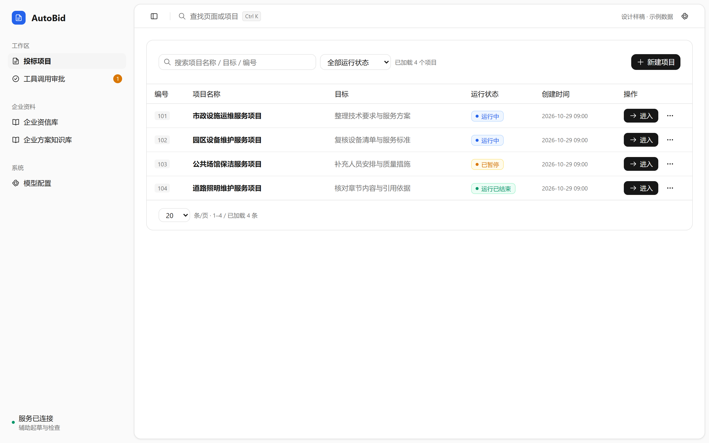
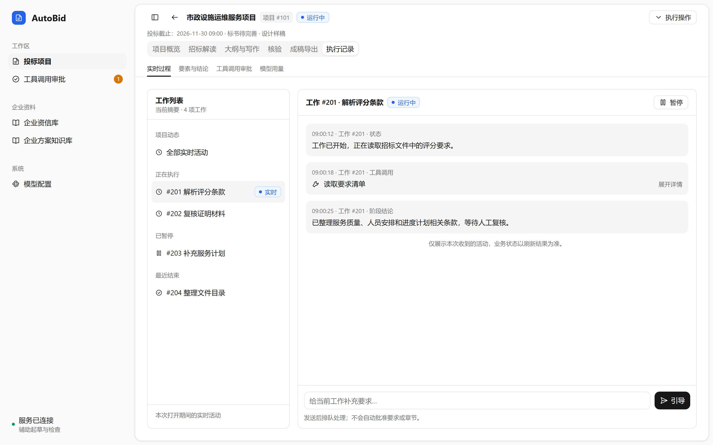
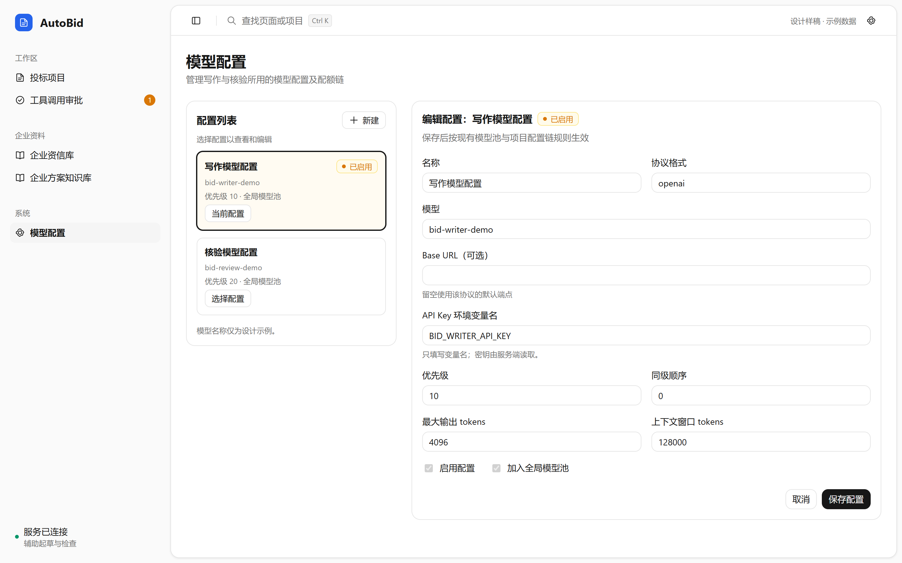
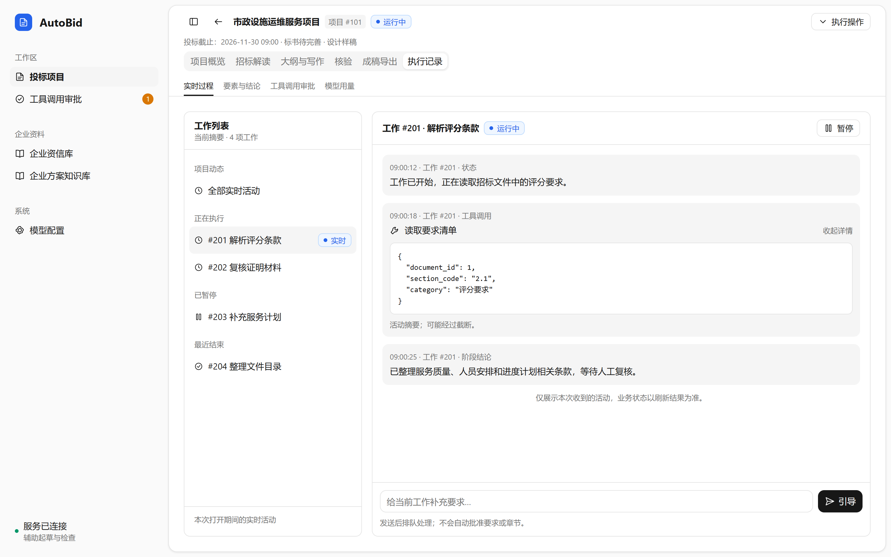
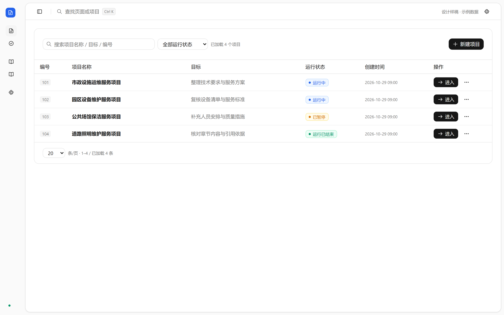
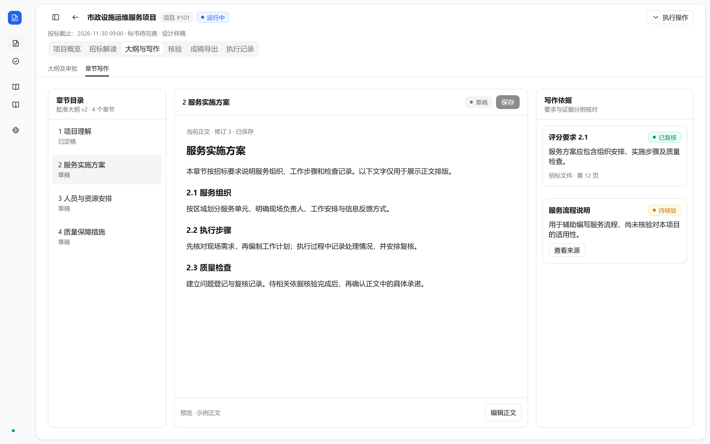
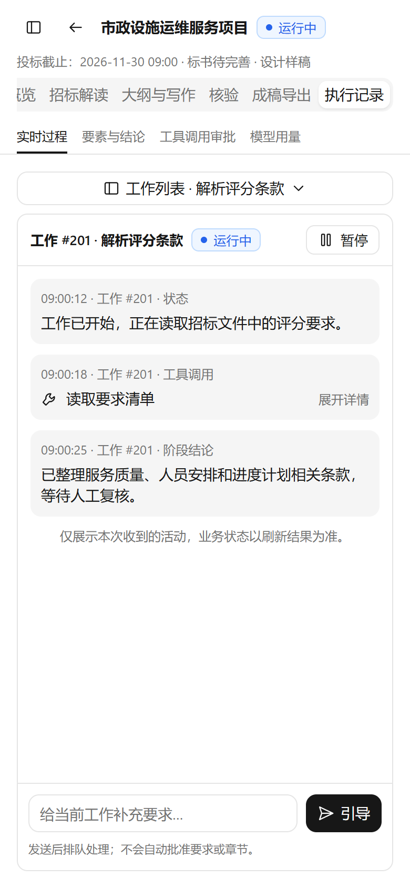

# AutoBid 前端设计图册 v1

本目录与根目录的 `FRONTEND_REFACTOR_PLAN.md` 一起交给 Claude 实施。以下是用固定投标业务内容制作的**目标样稿**，不是已完成的产品截图。页面只呈现布局与选中状态，不执行业务请求。实际权限、状态机和操作以实施方案及当前 API 为准。

截图全部采用 AutoBid 品牌和投标业务文案，项目、时间、节点、模型和正文均为示例。实施者直接使用本目录材料即可。不要把示例数据、静态 HTML 或“设计样稿”标识接入生产页面。

## 设计文件

| 文件 | 作用 |
| --- | --- |
| [reference-layout.html](reference-layout.html) | 可在浏览器打开的静态目标，包含 CSS、SVG 图标示意和固定内容；支持 `view=projects/execution/models/writing`、`sidebar=collapsed`、`detail=expanded` |
| [capture-manifest.json](capture-manifest.json) | 每张图片的视口、DPR、浏览器版本、哈希与 `data-region` 区域坐标，坐标单位是 CSS px |
| [render-design.mjs](render-design.mjs) | 本目录截图生成脚本，不访问项目服务，不属于应用运行依赖 |

字体固定为 `"Segoe UI", "Microsoft YaHei", sans-serif`，代码文字为 `Consolas, monospace`。桌面视口 1440×900、DPR=2，PNG 为 2880×1800；移动端视口 390×844、DPR=2，PNG 为 780×1688。浏览器缩放 100%，浅色、中文、时区 `Asia/Shanghai`。目标图和实际图必须在相同字体环境下比较。

区域标注采用下文的区域名及 HTML 的 `data-region`，不把标注覆盖在产品界面上。尺寸见截图清单；原图是完整视口，不能从缩放后的 Markdown 预览直接推算像素。

## 1. 项目列表 · V01



| 标注区域 | 必须保留的关系 |
| --- | --- |
| A `sidebar` | 272px 展开侧栏，导航分组、32px 行高、浅灰选中项、底部连接信息 |
| B `main-frame` | 白色内容容器，顶部/右侧/底部 8px 间距，14px 圆角与轻阴影 |
| C `global-header` | 48px 顶栏，折叠按钮、导航查找与设置入口 |
| D `project-table` | 搜索/筛选左对齐，新建按钮靠右；同一卡片包含表格及分页 |

项目列表中的运行状态不能当作标书完成度。“已加载 4 个项目”不是服务端总量。实际页面保留原有启动、暂停、恢复、复活、删除能力，可放在更多操作菜单。

## 2. 执行工作台 · V02



| 标注区域 | 必须保留的关系 |
| --- | --- |
| A `task-header` | 项目标题替代全局顶栏，名称与状态首行，截止与业务状态次行 |
| B `project-tabs` | 六个业务分组，灰色底座、白色选中块；二级导航采用紧凑底线样式 |
| C `work-list` | 固定 288px，按工作状态分组，当前工作浅灰选中；不伪装完整历史会话 |
| D `activity-pane` | 右侧标题与选中工作一致，活动按节点关联，控制区与列表联动 |
| E `activity-scroll` / `composer` | 活动独立滚动，输入区占面板底部独立一行；不能遮挡最后一条活动 |

图中选中工作 #201。实际实现的默认选择是“全部实时活动”，只有选中可引导的工作才显示相应发送操作；运行中为“引导”，暂停时为“发送并恢复”。图片中的事件仅表达摘要布局，不代表完整模型消息或完整工具返回。

## 3. 模型配置 · V03



左侧 `profile-list` 宽 336px，右侧 `profile-form` 占剩余宽度，间距 24px。当前项使用浅暖色底和深色细边界；表单字段间距 16px，保存位于底部。

模型名称只是示例，不是可用模型推荐。密钥字段填写 `api_key_env` 环境变量名，不能改为将真实密钥发送给前端。现有高级字段、模型池、健康状态和配额链仍须保留，可以在高级配置或同页区域中提供；不是所有字段都在这张图中展开。

## 4. 工具活动展开 · V04



与 V02 相比仅 `tool-event` 展开。详情白底框位于活动条目内部，允许多行并保留可读换行。左侧工作列表、右侧面板边界和 `composer` 的坐标保持不变。成功事件没有提供输出时不补造输出；详情可能截断，保持“活动摘要”的说明。

## 5. 侧栏折叠 · V05



侧栏宽 64px，主容器额外留 8px 左边距，因此主容器左边界为 x=72。分组文字与导航文字隐藏，图标居中，键盘焦点与可访问名称保留；正式页面应能通过 Tooltip 识别入口。展开/折叠不重置当前页、列表条件或草稿。

## 6. 三栏写作 · V06



此图使用折叠侧栏，实际内容宽 1310px，目录宽 240px、依据面板宽 320px、两处间距各 16px、正文占剩余宽度。正文与依据是并列上下文，不再纵向堆叠。

这是正文**预览态的构图**，正式页面还须实现编辑、保存中、未保存提示、冲突候选稿、历史与回滚等方案要求。图中“保存”因没有新修改而禁用，真实页面应按 dirty/busy 状态控制。1440px 展开侧栏时内容宽 1110px，按实施方案切换为两栏和证据抽屉。

## 7. 移动端执行页 · V07



取消桌面侧栏及主容器外边距，以“工作列表”入口打开选择抽屉；当前工作仍显示在详情标题。一级、二级导航只在自身行内横滚，选中项必须可见。活动区域滚动时输入区留在面板底部；键盘弹出、切换工作和发送失败需要额外进行真实交互验证。

## 重现与交付约束

使用可用的 Node.js 和 Playwright 执行以下命令即可重现静态样稿；本次已经保存全部 PNG，实施者无需为阅读图册安装工具。

```bash
node docs/frontend-refactor/design/render-design.mjs
```

脚本默认从运行环境加载 `playwright`；也支持通过 `PLAYWRIGHT_MODULE` 指定已有 `playwright` 或 `playwright-core` 模块，通过 `BROWSER_EXECUTABLE` 指定浏览器。没有相同字体或浏览器环境时不要覆盖现有 PNG。重新渲染会更新截图及清单，只有明确修订设计时才执行；验证应用时将实际截图写入方案指定的 `verification/`。

冻结目标以本目录的 PNG、HTML 和截图清单为整体。主布局、颜色和密度不得以实现方便为由修改。图标可复用项目现有同义图标；设计样稿标识、动态状态等允许差异按根目录方案第 10.3 节逐项登记。不能用大块遮罩隐藏页面偏差，也不能把静态样稿的截图作为实际前端已经交付的证据。
