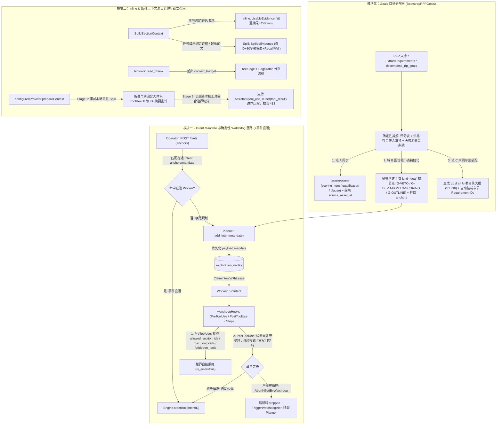

# AutoBid Engine 吸收 DeepSeek Super-agent 核心机制改造蓝图

## 目标概述

本计划结合 [ARTEX架构技术标系统解析.md](file:///d:/Pycharm%20Project/Bid_plan/autobid-engine/docs/ARTEX架构技术标系统解析.md) 与当前代码库真实基线（遵循 [CLAUDE.md](file:///d:/Pycharm%20Project/Bid_plan/autobid-engine/CLAUDE.md) 与 [ROADMAP.md](file:///d:/Pycharm%20Project/Bid_plan/autobid-engine/ROADMAP.md) 工程约束），完成以下三项工作：
1. **现状瓶颈定位**：精准指出当前源码在长文本标书生成、上下文组装、Worker 监控及事件路由上的具体函数级短板；
2. **取舍判断**：评估四大机制与衍生特性的改造性价比，明确“立即落地”与“暂缓/裁剪”边界；
3. **代码级改造蓝图**：针对最值得立即落地的核心机制，给出涉及的具体文件名、数据结构（Struct/Schema）及核心实现逻辑。

---

## 一、现状瓶颈定位（源码级短板剖析）

通过对 `agent/`、`bidtools/`、`server/`、`db/`、`ingest/`、`guard/`、`internal/harness/` 的全量扫描，当前系统在面对几十万字级长标书与多轮自主探索时存在以下 **8 处具体源码瓶颈**：

### 1. 上下文组装与溢出管理瓶颈（缺 Inline & Spill 与链式召回）

* **瓶颈 1A：章节写作上下文无差别内联全任务证据** — [`BuildSectionContext`](file:///d:/Pycharm%20Project/Bid_plan/autobid-engine/bidtools/proposal.go#L164-L307) & [`RenderSectionPrompt`](file:///d:/Pycharm%20Project/Bid_plan/autobid-engine/bidtools/proposal.go#L321-L342)
  * 在 [bidtools/proposal.go](file:///d:/Pycharm%20Project/Bid_plan/autobid-engine/bidtools/proposal.go#L238-L240) 中，`BuildSectionContext` 执行了：
    ```go
    if taskEvIDs, err := pg.TaskUsableEvidenceIDs(ctx, tenant, taskID); err == nil {
        evIDs = append(evIDs, taskEvIDs...)
    }
    ```
    这导致无论当前撰写的是哪一个小节，系统都会把**整个任务下所有已核验的知识库/资信证据快照**（每条 600 字摘录 + Citation JSON）连同全任务所有承诺台账（`sc.Commitments`）一次性塞进 `SectionContext`，并在 [`RenderSectionPrompt`](file:///d:/Pycharm%20Project/Bid_plan/autobid-engine/bidtools/proposal.go#L321-L342) 中通过 `json.MarshalIndent` 全量内联进 Prompt。当任务积累上百条证据时，80% 无关证据直接挤占当前章节的注意力与上下文窗口。
  * 同时，`maxContextExcerpt = 600` 与 `maxContextBody = 6000`（[bidtools/proposal.go](file:///d:/Pycharm%20Project/Bid_plan/autobid-engine/bidtools/proposal.go#L26-L27)）对超长原文和上一版章节正文直接做硬截断（`truncate`），被截断的后半部分既无溢出（Spill）提示，也无分段读取游标。
* **瓶颈 1B：招标原文读取 `read_chunk` 无预算上限，大表直灌会话历史** — [`readChunkTool`](file:///d:/Pycharm%20Project/Bid_plan/autobid-engine/bidtools/documents.go#L282-L347)
  * 知识库工具 [`kb_read_chunk`](file:///d:/Pycharm%20Project/Bid_plan/autobid-engine/bidtools/knowledge.go#L223-L325) 已实现 `context_budget`、`text_offset` 与 `retrieval.PageTable` 分页；但常驻的招标文件读取工具 [`read_chunk`](file:///d:/Pycharm%20Project/Bid_plan/autobid-engine/bidtools/documents.go#L282-L347) 在 `before=3, after=3` 时会将最多 **7 个连续切片的完整正文 + 完整 `Tables` JSON** 原样塞进 `tool_result` 并持久化进 `transcripts.messages`（[`Session.Resume`](file:///d:/Pycharm%20Project/Bid_plan/autobid-engine/internal/agentcore/session.go#L73-L96)）。遇到工程量清单或技术参数大表时，单次调用即可注入数万 Token。
* **瓶颈 1C：纯工具调用长链路下 `prepareContext` 因找不到文本 User 边界直接报 `413` 崩溃** — [`configuredProvider.prepareContext`](file:///d:/Pycharm%20Project/Bid_plan/autobid-engine/server/llm_runtime.go#L452-L495)
  * 在 [server/llm_runtime.go](file:///d:/Pycharm%20Project/Bid_plan/autobid-engine/server/llm_runtime.go#L462-L481) 中，当请求超过 `window * 3 / 4` 时，`prepareContext` 从后往前寻找包含 `BlockText` 的普通 `RoleUser` 消息作为压缩切分点 `boundary`。
  * 然而在 Worker 单次执行（`MaxTurns = 40`，[`Worker.execute`](file:///d:/Pycharm%20Project/Bid_plan/autobid-engine/agent/worker.go#L75-L145)）中，只有 `req.Messages[0]`（`renderWorkerInput`）是普通文本 User 消息，第 1~39 轮全部是 `Assistant(BlockToolUse) -> User(BlockToolResult)`！此时 `boundary` 循环扫不到任何 `i > 0` 的文本 User 消息，恒得 `boundary = -1`，直接触发第 480 行：
    ```go
    return req, &llm.APIError{StatusCode: 413, Message: "上下文超过模型窗口，当前完整交互无法安全压缩"}
    ```
    导致正在深度检索或写标的 Worker 直接因 413 失败！

### 2. Intent 边界约束与长标书生成瓶颈（缺 Mandate 硬件门禁）

* **瓶颈 2A：Intent 载荷仅有自由文本，缺乏代码级 Mandate 门禁** — [`addIntentTool`](file:///d:/Pycharm%20Project/Bid_plan/autobid-engine/agent/tools.go#L279-L316) & [`workerSystem`](file:///d:/Pycharm%20Project/Bid_plan/autobid-engine/agent/prompt.go#L59-L81)
  * 当前 `add_intent` 写入 `exploration_nodes.payload` 的结构只有 `{"summary": "...", "rationale": "..."}`。
  * Worker 的执行边界完全依赖 [`workerBase`](file:///d:/Pycharm%20Project/Bid_plan/autobid-engine/agent/prompt.go#L30) 的一句 Prompt（`"你只负责执行 system 末尾给出的当前意图，不要扩展到其他方向"`）。
  * 当 Worker 通过 `Skill("proposal-writing")` 解锁 [`section_write_draft`](file:///d:/Pycharm%20Project/Bid_plan/autobid-engine/bidtools/proposal.go#L470-L514) 或 [`requirement_bind_evidence`](file:///d:/Pycharm%20Project/Bid_plan/autobid-engine/bidtools/proposal.go#L516-L599) 后，**没有任何代码门禁校验该 Worker 是否有权修改目标 `section_id` 或 `requirement_id`**，也没有字数上下限、最大工具调用次数或必写回约束。

### 3. Worker 监控与事件直通瓶颈（缺 Watchdog 跑偏熔断与锚点直通）

* **瓶颈 3A：在途监控只能识别“空想回合”，对工具死循环、报错风暴与零产出跑偏完全失明** — [`steerHooks`](file:///d:/Pycharm%20Project/Bid_plan/autobid-engine/server/steer.go#L16-L63) & [`Guard`](file:///d:/Pycharm%20Project/Bid_plan/autobid-engine/guard/guard.go#L34-L127)
  * [`steerHooks.Stop`](file:///d:/Pycharm%20Project/Bid_plan/autobid-engine/server/steer.go#L40-L51) 仅检查 `isThinkingOnlyTurn`（既无文本也无工具调用）；[`Guard.PostToolUse`](file:///d:/Pycharm%20Project/Bid_plan/autobid-engine/guard/guard.go#L99-L122) 只累加内存计数器 `g.attrib[name+":"+status]++`，`Guard.Stop()` 恒返回不干预。
  * 如果 Worker 陷入**相同参数重复调用检索工具**、**连续多次工具调用报错**、或 **连续 20 轮只读不写（`WriteCounts == 0`）**，系统没有任何自动纠偏（Auto-Steer）或熔断（Circuit Break）机制；而 Planner 默认心跳间隔高达 `MinPlanHeartbeat = 600s`（[`server/engine.go`](file:///d:/Pycharm%20Project/Bid_plan/autobid-engine/server/engine.go#L59)），根本来不及通过 `kill_work` 止损。
* **瓶颈 3B：人工补充（Hint）总是绕行全局 Planner，未与 `SteerWork` 打通事件直通** — [`Manager.AddHint`](file:///d:/Pycharm%20Project/Bid_plan/autobid-engine/server/manager.go#L250-L258)
  * 底层虽然具备单 Worker 纠偏通道 [`Engine.SteerWork`](file:///d:/Pycharm%20Project/Bid_plan/autobid-engine/server/engine.go#L629-L640)，但当操作员调用 `POST /api/tasks/{id}/hints`（带 `anchors` 资产 ID）补充信息时，[`AddHint`](file:///d:/Pycharm%20Project/Bid_plan/autobid-engine/server/manager.go#L250-L258) 仅写入 `hint` 节点并无条件触发 `TriggerHintAdded` 唤醒全局 Planner，即使当前正有一个 running Worker 锚定在同一批 `anchors` 上，也无法直接穿透投递给该 Worker。

### 4. RFP 解析与图谱 Goal 根节点断层（缺 `Goals` 目标分解器桥接）

* **瓶颈 4A：已有的确定性 RFP 解析器（域 C）与 ARTEX 推演图谱（域 B）/ 静态资产（域 A）完全脱节** — [`PersistTender`](file:///d:/Pycharm%20Project/Bid_plan/autobid-engine/ingest/store.go#L177-L223)、[`ExtractRequirements`](file:///d:/Pycharm%20Project/Bid_plan/autobid-engine/db/requirements.go#L1196-L1440) & [`CreateTask`](file:///d:/Pycharm%20Project/Bid_plan/autobid-engine/db/tasks.go#L41-L88)
  * 当前代码库在 **域 C（标书与清单域）** 其实已经写好了非常扎实的确定性 RFP 解析引擎：[`extractCandidatesTx`](file:///d:/Pycharm%20Project/Bid_plan/autobid-engine/db/requirements.go#L1047-L1193) 能从 `document_chunks` 中结构化拆解出**评分标准表与分档规则**（[`scoringCandidates`](file:///d:/Pycharm%20Project/Bid_plan/autobid-engine/db/scoring.go)）、**资格/符合性审查表与法定废标项**（[`reviewCandidates`](file:///d:/Pycharm%20Project/Bid_plan/autobid-engine/db/veto.go)）、**`★` 实质性条款与技术偏离要求**（`MC-*` / `RQ-*`），而 [`DefaultOutlineSections`](file:///d:/Pycharm%20Project/Bid_plan/autobid-engine/db/proposal.go#L120-L154) 则能生成 S1~S6 标准技术标目录大纲。
  * **但核心断层在于**：
    1. 上传招标文件时，[`PersistTender`](file:///d:/Pycharm%20Project/Bid_plan/autobid-engine/ingest/store.go#L177-L223) 只向域 A 写入了 1 个 `tender` 根资产（和可选 `lot` 资产），既未提取条款资产，也未初始化任何图谱 `Goal` 节点；
    2. 调用 [`ExtractRequirements`](file:///d:/Pycharm%20Project/Bid_plan/autobid-engine/db/requirements.go#L1196-L1440) 时，它只单向写入 `requirement_items` 表（且从分块提取出的条目 `source_asset_id` 均为 `NULL`），**既不会反向将抽取的评分项/资格项/实质性条款同步回填至 `assets` 表（域 A），也不会在 `exploration_nodes`（域 B）中生成对应的 `kind='goal'` 图谱根节点，更不会自动挂载草案级目录大纲**；
    3. 结果导致 Planner 被 `TriggerDocumentAdded` 唤醒时，面对的是一张几乎空白的图谱（仅有手工输入的宽泛 Goal 和 1 个 `tender` 资产），不得不派发多个 LLM Worker 从零调用 `document_outline -> read_chunk -> insert_assets -> add_goal`，白白浪费数万 Token 与数分钟的 LLM 轮次去重复发现确定性规则在 50ms 内就能解析出的结构！

---

## 二、取舍判断（落地优先级评估）

结合本项目的 Go + PostgreSQL 架构基线与 [ROADMAP.md](file:///d:/Pycharm%20Project/Bid_plan/autobid-engine/ROADMAP.md) 第五节（“不新增无关功能面，深化确定性与防废标控制”），对文档中提到的机制做出如下取舍：

| DeepSeek Super-agent 机制 | 评估结论 | 取舍理由与工程性价比分析 |
| :--- | :--- | :--- |
| **1. `Inline & Spill 上下文溢出管理`（含 Chain of Recall）** | **立即落地（P0）** | **极高性价比**。直接修复 Worker 40 回合工具链下的 `413` 窗口溢出崩溃（`server/llm_runtime.go`）、消除 `BuildSectionContext` 全任务证据洪水，并为 `read_chunk` 补齐分页预算，零 Schema 破坏即可大幅降低 Token 消耗与长文失忆。 |
| **2. `Intent 的 Mandate 边界约束` + `独立 Watchdog 跑偏熔断`** | **立即落地（P0，合并为确定性 Watchdog + 异常唤醒 Planner）** | **极高性价比**。在 `Intent` Payload 中固化结构化 `Mandate`，通过 `HookRunner`（`PreToolUse` / `PostToolUse` / `Stop`）在代码层强制拦截越界写回、重复工具调用死循环、连续报错风暴与长回合零产出跑偏；初次异常自动注入 `SteerWork` 纠偏，二次不收敛直接熔断并唤醒 Planner。**注意：裁剪掉“独立常驻轮询的 LLM Watchdog Session”**，改用零 Token 确定性探针 + 触发式唤醒 Planner，避免双倍算力消耗。 |
| **3. `Goals（目标分解器）`：解析 RFP 拆解评分标准、技术偏离要求与大纲并初始化图谱根节点** | **立即落地（P0，采用“确定性解析底座 + 跨四域图谱根节点装配器”）** | **极高性价比，打通现有代码最大断层**。复用并升级现有的 `ExtractRequirements` + `DefaultOutlineSections`，构建幂等的 **`BootstrapRFPGoals`（目标分解器）**：在 RFP 入库/提取时，一次性完成 **① 抽取评分标准/否决项/★技术偏离要求（域 C） → ② 同步回填 `scoring_item`/`qualification`/`clause` 静态资产并关联 `source_asset_id`（域 A） → ③ 在 `exploration_nodes` 中幂等初始化四大 `kind='goal'` 图谱根节点并挂载 `anchors`（域 B） → ④ 自动初始化 S1~S6 标书目录大纲草案并按类别分配要求（域 C，保留人工确认门禁）**，同时向 Planner 暴露 `decompose_rfp_goals` 工具。 |
| **4. `事件直通机制（Passthrough）`** | **轻量落地（P1，随本轮一并打通）** | **高性价比、改动极小**。复用现有的 `Engine.SteerWork` 与 `exploration_anchors`：当 `AddHint` 携带 `anchors`（或指定章节/意图）且匹配到在途 running Worker 时，直接穿透投递至该 Worker 的 `steerBox`，绕过全局 Planner 重算。 |
| **5. 异步 `start()/stop()` 工具级 ReAct Loop** | **建议暂缓 / 不做** | **性价比极低，结构破坏大**。本项目在耗时层（Intent 队列、章节异步撰写 `/dispatch`、文件处理 `/file-jobs`、导出 `/exports`）**已经全面采用 `202 Accepted` + PostgreSQL 租约 + SSE 事件流**；而 Worker 内部工具均为短时 DB/检索调用，强改 `harness` 工具同步契约会破坏 `tool_use/tool_result` 消息配对与 Transcript 存储。 |
| **6. 飞书群聊潜伏与投机执行（Speculative Execution）** | **坚决不做** | **违背 `ROADMAP.md` 边界**。标书系统要求严格的确定性状态机（清单确认 → 大纲获批 → 依赖就绪 → 台账锁定），后台静默投机改写不仅浪费大量 Token，还会制造大量 `conflict_candidate` 候选稿噪音。 |

---

## 三、代码级改造蓝图（Proposed Changes）

以下针对立即落地的三大核心模块（含轻量事件直通）给出完整的数据结构与代码改造方案：



---

### 模块一：Intent Mandate 边界约束、独立 Watchdog 跑偏熔断与事件直通

#### [MODIFY] [constants.go](file:///d:/Pycharm%20Project/Bid_plan/autobid-engine/db/constants.go) & [graph_tx.go](file:///d:/Pycharm%20Project/Bid_plan/autobid-engine/db/graph_tx.go)
* **数据结构改动**：
  * 在 `db` 包定义 `IntentMandate` 结构体，作为 `exploration_nodes.payload`（JSONB）中的标准化子对象（向后兼容所有既有节点，无需破坏表结构；同时提供 `NodeMandate(n *Node) *IntentMandate` 解析辅助函数）：
    ```go
    // IntentMandate 定义 Planner 赋予单个 Intent 的硬性执行边界（Mandate）。
    type IntentMandate struct {
        AllowedSectionIDs     []int64  `json:"allowed_section_ids,omitempty"`
        AllowedRequirementIDs []int64  `json:"allowed_requirement_ids,omitempty"`
        TargetWordsMin        int      `json:"target_words_min,omitempty"`
        TargetWordsMax        int      `json:"target_words_max,omitempty"`
        MaxToolCalls          int      `json:"max_tool_calls,omitempty"`
        ForbiddenTools        []string `json:"forbidden_tools,omitempty"`
        RequireWriteback      bool     `json:"require_writeback,omitempty"`
    }
    ```

---

#### [MODIFY] [abort.go](file:///d:/Pycharm%20Project/Bid_plan/autobid-engine/agent/abort.go)、[prompt.go](file:///d:/Pycharm%20Project/Bid_plan/autobid-engine/agent/prompt.go) & [tools.go](file:///d:/Pycharm%20Project/Bid_plan/autobid-engine/agent/tools.go)
* **`agent/abort.go`**：
  * 新增 Watchdog 熔断专用取消原因：
    ```go
    AbortKilledByWatchdog = &AbortCause{Code: "killed_by_watchdog"}
    ```
* **`agent/prompt.go`**：
  * 新增触发事件类型 `TriggerWatchdogAlert = "watchdog_alert"`；
  * 在 `workerSystem` 中解析 `db.NodeMandate(intent)`，若非空则渲染 `## 执行边界（Mandate 硬约束）` 段落（明确告知允许操作的 `section_id` / `requirement_id`、字数区间、最大工具调用次数及必写回要求）；
  * 在 `renderPlannerInput` 中渲染 `TriggerWatchdogAlert`：`- 意图 #%d 因偏离或死循环被 Watchdog 熔断：%s`。
* **`agent/tools.go`**：
  * 在 `addIntentTool` 的 JSON Schema 中新增可选对象属性 `"mandate"`（包含 `allowed_section_ids`、`allowed_requirement_ids`、`target_words_min`、`target_words_max`、`max_tool_calls`、`forbidden_tools`、`require_writeback`），并在 `AddIntentTx` 时存入 `payload["mandate"]`。

---

#### [NEW] [watchdog.go](file:///d:/Pycharm%20Project/Bid_plan/autobid-engine/server/watchdog.go)
* **核心实现逻辑**：
  * 定义 `WatchdogConfig`（嵌入 `server.Config`，提供合理默认值）：
    * `RepeatCallSteerThreshold`（默认 3：相同工具+相同归一化入参连续/累计调用达 3 次自动注入 Steer 警告）
    * `RepeatCallKillThreshold`（默认 5：达 5 次直接以 `AbortKilledByWatchdog` 熔断）
    * `ConsecutiveErrSteerThreshold`（默认 4：连续工具报错达 4 次自动注入 Steer 警告）
    * `ConsecutiveErrKillThreshold`（默认 7：连续工具报错达 7 次直接熔断）
    * `NoWritebackSteerTurns`（默认 15：累计 15 次工具调用仍无任何图写回或标书域写回时注入收敛警告）
    * `NoWritebackKillTurns`（默认 25：累计 25 次工具调用仍零写回且非纯研究任务时直接熔断）
  * 实现 `watchdogHooks`（包装在 `steerHooks` 外层或合并入 `steerHooks`）：
    1. **`PreToolUse(ctx, name, input)` — Mandate 硬件门禁**：
       * 解包延迟工具（`tool.UnwrapDeferred(name, input)`）；
       * 校验 `Mandate.ForbiddenTools` 与 `Mandate.MaxToolCalls`（超限则阻断非 `agent.WorkerWritebackTools` 的一切只读探索工具，强制进入写回）；
       * 当调用 `section_write_draft` 或 `chart_generate` 时：若 `Mandate.AllowedSectionIDs` 非空，校验入参 `section_id` 是否在白名单内；若配置了 `TargetWordsMin/Max`，校验 `content_md` 的字符/字数是否在允许区间内；不满足则直接返回 `block=true` 及具体原因；
       * 当调用 `requirement_bind_evidence` 时：若 `Mandate.AllowedRequirementIDs` 非空，校验 `requirement_id` 是否在白名单内。
    2. **`PostToolUse(ctx, name, input, result, isErr)` — 轨迹监控与自动纠偏/熔断**：
       * 计算 `(unwrappedName, sha256(canonicalInput))` 签名计数；
       * 识别是否属于有效写回工具（`insert_assets`、`link_assets`、`record_fact`、`report_finding`、`requirement_bind_evidence`、`section_write_draft`、`chart_generate`、`compliance_verify`、`fulltext_consistency_check`）且 `!isErr`，若是则标记 `hasWriteback = true`；
       * 达到 `SteerThreshold` 时调用 `enqueueSteer` 自动向该 Worker 注入纠偏指令并广播 `Kind: "watchdog"` 的 `db.Activity`；
       * 达到 `KillThreshold` 时调用 `workCancel(&agent.AbortCause{Code: agent.AbortKilledByWatchdog.Code, Message: reason})` 立即熔断该 Worker。
    3. **`Stop(ctx, messages)` — 完结门禁**：
       * 若 `Mandate.RequireWriteback == true` 且 `!hasWriteback` 且尚未触发过写回督促，返回 `blockingErrors` 阻止 Worker 空手退出，要求其先调用写回工具。

---

#### [MODIFY] [engine.go](file:///d:/Pycharm%20Project/Bid_plan/autobid-engine/server/engine.go) & [manager.go](file:///d:/Pycharm%20Project/Bid_plan/autobid-engine/server/manager.go)
* **`server/engine.go`**：
  * 在 `workExecution` 结构体中记录当前 running Intent 的 `anchors []int64` 与 `mandate *db.IntentMandate`；
  * 在 `runIntent` 的终态 `switch` 分支（第 790 行附近）识别 `errors.Is(workCause, agent.AbortKilledByWatchdog)`：
    * 将 Intent 状态迁为 `db.StateIntentStopped`；
    * 向任务追加 `agent.TriggerEvent{Kind: agent.TriggerWatchdogAlert, IntentID: iid, Detail: workCause.Error()}` 立即唤醒 Planner 重规划或调整策略；
  * 新增 `RouteHintToRunningWork(t *Task, hintID int64, text string, anchors []int64) (routedIntentIDs []int64)`：
    * 遍历本任务下正在运行的 `workExecution`，若 `anchors` 与某在途 Intent 的 `anchors` 有交集，直接调用 `e.SteerWork(intentID, fmt.Sprintf("【人工实时补充 Hint #%d】%s", hintID, text))` 并发送 `Activity{Kind: "passthrough"}`。
* **`server/manager.go`**：
  * 在 `AddHint`（或 `server/http.go` 的 `addHint` 处理器）中：当 `len(anchors) > 0` 且 `Engine.RouteHintToRunningWork` 成功命中在途 Worker 时，直接通过 `SteerWork` 直通投递并将该 Hint 标记为已直通（`ConsumeHint`），无需唤醒全局 Planner 重算；若未命中任何在途 Worker，则保持原有逻辑触发 `TriggerHintAdded` 唤醒 Planner。

---

### 模块二：Inline & Spill 上下文溢出管理与链式召回（Chain of Recall）

#### [MODIFY] [proposal.go](file:///d:/Pycharm%20Project/Bid_plan/autobid-engine/bidtools/proposal.go)
* **数据结构与逻辑改动**：
  * 在 `SectionContext` 中引入 **Inline & Spill 分层**：
    ```go
    // SpilledEvidenceBrief 是未直接绑定到本章节、但同属本任务的可用证据微摘要（Spill 索引）。
    // 模型若需引用，须先按 ID 调用 kb_read_evidence 核实详情。
    type SpilledEvidenceBrief struct {
        ID      int64  `json:"id"`
        Domain  string `json:"source_domain"`
        Snippet string `json:"snippet"`
    }

    // SpilledTextMeta 标记被截断的超大文本及重读指引。
    type SpilledTextMeta struct {
        OriginalChars int    `json:"original_chars"`
        IncludedChars int    `json:"included_chars"`
        RecallHint    string `json:"recall_hint"`
    }
    ```
  * 在 `SectionContext` 中新增 `SpilledEvidence []SpilledEvidenceBrief` 与 `CurrentRevisionSpill *SpilledTextMeta`；
  * 修改 [`BuildSectionContext`](file:///d:/Pycharm%20Project/Bid_plan/autobid-engine/bidtools/proposal.go#L164-L307)：
    1. **Inline 层**：仅收集本章节 `det.Requirements`（含 `LinkedDemands`）显式绑定的 `EvidenceIDs` 以及 `det.Current.EvidenceIDs`，完整加载 `maxContextExcerpt`（600 字）摘录与 `Citation` 放入 `sc.UsableEvidence`；
    2. **Spill 层**：对于 `pg.TaskUsableEvidenceIDs` 中不属于本章节直接绑定的其他任务级证据，不再混入 `sc.UsableEvidence`，而是截取 80 字微摘要放入 `sc.SpilledEvidence`（上限 30 条），并在 `ParseSectionDraft` 中同样允许识别 `SpilledEvidence` 的 ID；
    3. 当 `det.Current.ContentMD` 长度超过 `maxContextBody`（6000 字符）时，填充 `CurrentRevisionSpill` 明确告知模型正文已发生 Spill 截断及总长度。

---

#### [MODIFY] [documents.go](file:///d:/Pycharm%20Project/Bid_plan/autobid-engine/bidtools/documents.go)
* **核心实现逻辑**：
  * 为 [`readChunkTool`](file:///d:/Pycharm%20Project/Bid_plan/autobid-engine/bidtools/documents.go#L282-L347) 补齐与 `kb_read_chunk` 一致的 **Inline & Spill 分页预算控制**：
    * Schema 新增可选参数 `text_offset`、`table_index`、`row_offset`、`context_budget`（默认 `16000`，上限 `32000`）；
    * 正文通过 `retrieval.TextPage` 按预算切片并返回 `next_text_offset` 与 `text_complete`；
    * 当切片内 `target.Tables` 超过 `budget/4` 或显式指定 `row_offset > 0` 时，调用 `retrieval.PageTable` 分页返回 `table_page`（保留表头与原始坐标），彻底杜绝单次 `read_chunk` 将几万字节大表直灌进 Worker 上下文。

---

#### [MODIFY] [llm_runtime.go](file:///d:/Pycharm%20Project/Bid_plan/autobid-engine/server/llm_runtime.go)
* **核心实现逻辑（修复 `prepareContext` 的 `413` 崩溃并引入两级 Spill 压缩）**：
  * 重构 [`configuredProvider.prepareContext`](file:///d:/Pycharm%20Project/Bid_plan/autobid-engine/server/llm_runtime.go#L452-L495)：
    1. **Stage 1：确定性历史 `ToolResult` Spill（零 LLM 调用开销）**：
       * 当 `estimateRequestTokens(req) >= window * 3 / 4` 时，保留最近 `keepRecentToolTurns = 2` 个回合的原始消息不动，扫描更早回合的 `RoleUser` 消息中的 `BlockToolResult`；
       * 对单条长度超过 `spillToolResultThreshold = 1500` 字节的 `BlockToolResult`，提取其中的关键标识字段（正则或 JSON 提取 `chunk_id`、`doc_id`、`evidence_id`、`run_id`、`section_id`、`node_id`、`fact_id`、`finding_id`）及前 300 字符摘要，替换为 `[Spilled tool_result: keys={...}, preview="...", hint="re-call the read tool with the ID if exact verbatim text is still needed"]`；
       * 若 Stage 1 完成后 `estimateRequestTokens(req) < window * 3 / 4`，直接返回！无需耗费额外 LLM 请求。
    2. **Stage 2：支持工具回合边界（`Turn-Boundary`）的 LLM 摘要压缩（根治 `boundary <= 0` 的 413 错误）**：
       * 若 Stage 1 后仍超限，寻找切分点 `boundary`：优先找最后一条普通文本 `RoleUser` 消息；**若不存在（即 `boundary <= 0`，如 40 回合纯工具调用的 Worker），则回退到保留最近 K 个完整 `Assistant(tool_use) -> User(tool_result)` 回合对的边界索引**（确保切分点处 `req.Messages[boundary]` 之后的消息序列角色合法，且不拆断 `tool_use` 与 `tool_result` 配对）；
       * 将 `req.Messages[:boundary]` 交由 `p.base.Complete` 生成保留精确 ID 链（Chain of Recall）的延续摘要，并与保留的近期回合拼接。

---

## 三、代码级改造蓝图 — 模块三：Goals（目标分解器 / RFP 图谱根节点与目录大纲初始化器）

#### [NEW] [rfp_goals.go](file:///d:/Pycharm%20Project/Bid_plan/autobid-engine/db/rfp_goals.go) (配合 [requirements.go](file:///d:/Pycharm%20Project/Bid_plan/autobid-engine/db/requirements.go) & [proposal.go](file:///d:/Pycharm%20Project/Bid_plan/autobid-engine/db/proposal.go))
* **数据结构与核心逻辑改动（`BootstrapRFPGoals` 跨四域幂等分解器）**：
  * 定义 `RFPGoalDecomposition` 与 `(*DB).BootstrapRFPGoals(ctx, tenant, taskID, actor)` 方法：
    ```go
    type RFPGoalNodeSummary struct {
        GoalCode string  `json:"goal_code"` // G-VETO | G-DEVIATION | G-SCORING | G-OUTLINE
        NodeID   int64   `json:"node_id"`
        Summary  string  `json:"summary"`
        Anchors  []int64 `json:"anchors"`
        Created  bool    `json:"created"`
    }

    type RFPGoalDecomposition struct {
        ExtractResult    *ExtractResult       `json:"extract_result"`
        SyncedAssets     int                  `json:"synced_assets"`
        Goals            []RFPGoalNodeSummary `json:"goals"`
        OutlineID        *int64               `json:"outline_id,omitempty"`
        OutlineVersion   int                  `json:"outline_version,omitempty"`
        OutlineCreated   bool                 `json:"outline_created"`
    }
    ```
  * **`BootstrapRFPGoals` 四步确定性流水线**：
    1. **Step 1（域 C：拆解要求清单）**：调用 `ExtractRequirements` 解析评分表（`scoring_item` + 分档规则 `scoring_tiers`）、资格/符合性审查表与法定废标项（`veto_item`）、`★` 实质性条款与技术偏离要求（`mandatory_clause` / `non_scoring_required`）以及格式附件要求（`format_attachment`）；
    2. **Step 2（域 A：回填静态图资产 `assets`）**：遍历 `requirement_items` 中 `source_asset_id IS NULL` 的有效条目，按类别映射为 `scoring_item` / `qualification` / `clause` 静态实体，通过 `AssetStore.UpsertAsset` 幂等写入 `assets` 表（自动加入 `task_scopes`），并将生成的 `asset.id` 回填至 `requirement_items.source_asset_id`；
    3. **Step 3（域 B：幂等初始化图谱 `Goal` 根节点并挂载 `anchors`）**：在 `exploration_nodes` 中按 `payload->>'goal_code'` 幂等查找或创建 4 个标准图谱根 Goal（从任务 `origin` Fact 节点连出 `spawns` 边），并将 Step 2 对应的 `asset_id` 集合写入 `exploration_anchors`：
       * `G-VETO`：**「资格与符合性否决项 100% 闭环核验」**（锚定全部 `veto_item` / `qualification` 资产）；
       * `G-DEVIATION`：**「★实质性条款与技术偏离表逐条响应核验」**（锚定全部 `mandatory_clause` / `non_scoring_required` 资产）；
       * `G-SCORING`：**「评分标准拆解、分档夺分策略与证据绑定」**（锚定全部 `scoring_item` 资产，附带总分与高分项摘要）；
       * `G-OUTLINE`：**「技术标整体目录大纲与章节协同编制」**（锚定根 `tender`/`lot` 资产与商务/格式基线）；
    4. **Step 4（域 C：自动装配 v1 标书目录大纲草案）**：若当前任务尚无任何 `proposal_outlines` 版本，基于 `DefaultOutlineSections()` 自动创建 `v1` 草案大纲（`status = 'draft'`），并按 `category`、`score_group` 及章节标题关键词将提取出的 `requirement_items.id` 自动分配挂载到 `S1~S6` 对应章节的 `RequirementIDs` 中（严格遵守 `AGENTS.md` 门禁：仅生成 `draft` 草案供人工审阅，绝不自动越权执行 `ConfirmRequirements` 或 `ApproveOutline`）。

---

#### [MODIFY] [tools.go](file:///d:/Pycharm%20Project/Bid_plan/autobid-engine/agent/tools.go)、[knowledge.go](file:///d:/Pycharm%20Project/Bid_plan/autobid-engine/server/knowledge.go) & [proposal.go](file:///d:/Pycharm%20Project/Bid_plan/autobid-engine/server/proposal.go)
* **`agent/tools.go`**：
  * 为 Planner 新增工具 `decompose_rfp_goals`：允许 Planner 在收到新文档或修订通知时一键调用 `BootstrapRFPGoals`，一步完成“RFP 条款拆解 → 静态资产入图 → 图谱 Goal 根节点挂载 → 大纲草案生成”，无需再派发多个 Worker 手工搬运条款。
* **`server/knowledge.go` & `server/proposal.go`**：
  * 在招标文档入库完成（`uploadDocument` / `commitTenderImport`）及手动触发 `POST /api/tasks/{id}/requirements/extract` 时，联动执行 `BootstrapRFPGoals`，使任务一开始就具备完整的 ARTEX 图谱根节点树与大纲草案。

---

## 四、待确认问题（User Review Required）

> [!IMPORTANT]
> 请审阅以下三项设计决策，确认后我将直接开始编写代码并运行验证：
> 1. **改造范围确认**：本蓝图将 **「模块一：Intent Mandate + 确定性 Watchdog 熔断（含 Hint 锚点事件直通）」**、**「模块二：Inline & Spill 上下文溢出管理（SectionContext 分层 + read_chunk 分页 + prepareContext 两级压缩）」** 与 **「模块三：Goals 目标分解器（`BootstrapRFPGoals` 跨四域解析 + 图谱 Goal 根节点初始化 + 大纲草案装配）」** 作为本次代码落地的完整范围，同时暂缓异步 `start()/stop()` 工具改造与飞书投机执行。您是否同意这一范围？
> 2. **Goals 目标分解器触发时机**：除了向 Planner 提供 `decompose_rfp_goals` 工具及在 `POST /api/tasks/{id}/requirements/extract` 时触发外，您是否希望在**上传招标文件（`POST /api/tasks/{id}/documents`）入库成功时也默认自动执行一次 `BootstrapRFPGoals`**（自动生成初始要求草案、资产、4 类图谱 Goal 根节点与 v1 大纲草案）？
> 3. **Watchdog 默认阈值**：Watchdog 默认设为「相同参数工具重复调用 **3 次自动 Steer 纠偏、5 次熔断**；连续工具报错 **4 次自动 Steer、7 次熔断**；累计 **15 次工具调用零写回自动 Steer、25 次熔断**」。这套默认阈值是否符合您的预期？

---

## 五、验证计划（Verification Plan）

### 自动化测试
1. **静态检查与单元测试**：
   ```powershell
   go vet ./...
   go test -race ./agent/... ./bidtools/... ./server/... ./db/...
   ```
2. **新增专项单元测试**：
   * `server/watchdog_test.go`：
     * 验证 `IntentMandate` 在 `PreToolUse` 下对越界 `section_id` / `requirement_id` 和禁用工具的硬拦截；
     * 验证 Worker 重复相同参数调用工具达 3 次时自动收到 Steer 纠偏、达 5 次时被 `AbortKilledByWatchdog` 熔断并落为 `stopped` + 产生 `TriggerWatchdogAlert`；
     * 验证带 `anchors` 的 `AddHint` 能直接穿透投递给锚定相同 `asset_id` 的在途 running Worker（Passthrough），不触发多余的 Planner 轮次。
   * `bidtools/proposal_test.go` & `server/llm_runtime_test.go`：
     * 验证 `BuildSectionContext` 仅将章节绑定证据放入 `UsableEvidence`（Inline），其余任务级证据进入 `SpilledEvidence`（Spill）；
     * 验证 `read_chunk` 在超长切片与大表下按 `context_budget` 分页返回 `next_text_offset` 与 `table_page`；
     * 验证 `prepareContext` 在纯 `Assistant(tool_use) -> User(tool_result)` 长会话（无第二条普通文本 User 消息）下，先执行 Stage 1 确定性 `ToolResult` Spill，并在仍超限时按工具回合边界完成 Stage 2 压缩，不再报错 `413`。
   * `db/rfp_goals_test.go`：
     * 验证 `BootstrapRFPGoals` 在上传含评分表、资格审查表与 `★` 实质性条款的招标文件后，幂等完成：`requirement_items` 提取、`assets` 静态实体回填（`source_asset_id` 非空）、4 类 `kind='goal'` 图谱根节点与 `exploration_anchors` 初始化、以及 `v1 draft` 目录大纲生成（且重复调用不产生重复 Goal 节点）。
3. **真实 PostgreSQL 集成测试与前端构建校验**：
   * 在配置 `AUTOBID_TEST_DATABASE_URL` 的情况下运行全量集成测试，并执行 `npm --prefix web run build` 确保零破坏。
